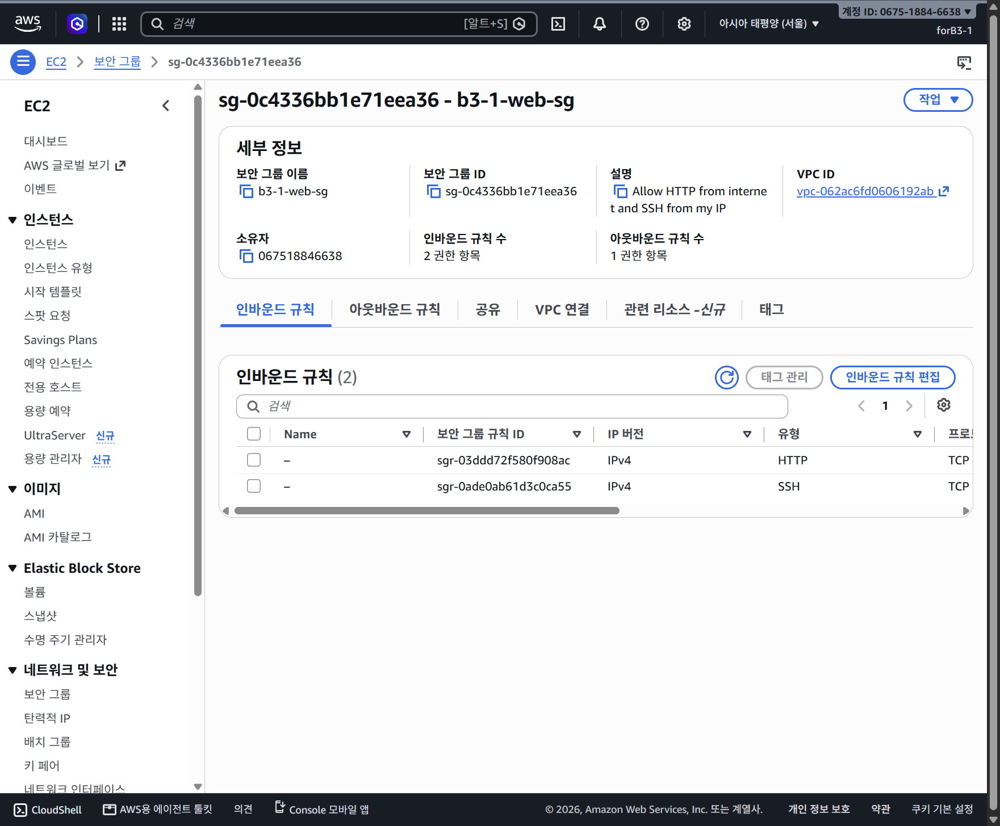

# B3-1 — AWS EC2 웹 배포

AWS EC2와 Nginx 기본 페이지로 네트워크·보안·외부 웹 접속을 검증한 실습입니다. B1-1 콘텐츠를 배포했다고 확인한 것은 아닙니다. 검증 후 실습 서버와 전용 네트워크를 정리했으며 현재 운영 중인 서비스가 아닙니다.

[과제 요구·평가 질문 요약](docs/0051-requirements-and-review-reference.md) · [제출 상태 점검](docs/0041-instruction-strict-audit.md) · [분할 커밋 계획](docs/0050-submission-and-commit-plan.md)

> **2026-10-19 항목별 확인 결과:** 사용자 직접 실행으로 원본 EC2 `i-05d34639a30bbfb6a`의 **종료됨(Terminated)**을 확인했고, 서울 EBS 전체 목록에도 볼륨이 없었다. 아래 웹 접속 URL·화면은 과거 동작 증빙이며 현재 운영 중이라는 뜻이 아니다. 실습 SG·Subnet·IGW·VPC와 그 기본 라우팅 테이블·ACL·기본 SG의 정리도 확인했다. 서울 NAT Gateway 없음과 Billing·Cost Explorer의 당월 예상 비용 US$0.00 표시까지 확인·캡처했다. 다만 EC2 사용료 미표시 원인, 추가 과금 자원 및 확정 청구액 검증은 남아 있다. DNS A 레코드는 사용자 선택으로 유지했다. [EC2 종료 증빙](docs/captures/0237-cleanup-ec2-terminated.png) · [EBS 정리 증빙](docs/captures/0238-cleanup-ebs-no-volumes-seoul.png) · [최신 정리 체크리스트](docs/cleanup-checklist.md).

## 도구 연동 가이드

- [Aside ↔ Herdr 에이전트 상호작용](docs/0020-herdr-aside-interaction-guide.md): 연결 확인, 전용 에이전트 생성, Gemini 3.8 Flash 세션 설정, 메시지 송수신, 오류 복구 절차.

## Terraform IaC 학습용 작성본

- [Terraform 코드와 사용법](infra/terraform/README.md) · [첫 구성 설명](docs/0039-terraform-iac-첫구성.md) · [로컬 검증 기록](docs/0040-terraform-local-validation.md)
- 기존 수동 실습과 같은 목적의 새 스택용 코드다. **AWS에는 아직 적용하지 않았으며 기존 자원을 변경하거나 가져오지 않았다.** 아래 실제 서버 검증 결과와 IaC 코드의 로컬 검증을 구분한다.

## HTTPS 보너스

- [HTTPS 개념과 현재 진행 정리](docs/0044-https-concepts-and-progress.md): DNS·무료 인증서 운영·Certbot/DNF·Nginx 설정·갱신의 차이를 정리했다.

- [전체 계획과 단계별 진행표](docs/0043-https-bonus-step-by-step.md): 보유 루트 도메인 `kodyssey.kr` 자체와 Let's Encrypt로 HTTPS를 검증한 당시 기록. 기존 DNS 용도와 값을 확인한 뒤 사용자가 직접 변경했다. **사용자가 루트 A 레코드를 `13.125.99.141`에 DNS only로 저장했다. 사용자 PC에서 DNS A 응답이 해당 IP인 것을 확인했다(TTL 300). `http://kodyssey.kr/`에서 Nginx 환영 페이지 표시도 확인했다. [도메인 HTTP 증빙](docs/captures/0206-kodyssey-domain-http.png). Let's Encrypt 인증서 발급은 완료했다(만료일 2027-01-17). [발급 증빙](docs/captures/0214-letsencrypt-certificate-issued.png). Nginx TLS 설정 검사·reload와 `https://kodyssey.kr/`의 환영 페이지 표시를 확인했다. [HTTPS 페이지 증빙](docs/captures/0216-kodyssey-https-browser.png). EC2 SSH에서 `curl -i https://kodyssey.kr/`로 HTTPS GET `HTTP/1.1 200 OK`와 HTML 본문도 확인했다(`-k` 없음). [HTTPS GET 증빙](docs/captures/0218-https-get-200.png). PC PowerShell의 curl 결과와 혼동하지 않는다. `sudo certbot renew --dry-run`의 모의 갱신 성공도 확인했다. [갱신 시험 증빙](docs/captures/0220-certbot-renew-dry-run-success.png). 자동 갱신 timer 활성화와 Nginx reload hook 추가는 명세의 필수가 아니므로 사용자 선택으로 생략했다. 마지막 확인에서 timer는 disabled/inactive였고 자동 갱신은 보장하지 않는다. 아키텍처 PNG는 필수 HTTP 검증 단계의 구성을 나타내며 HTTPS 443 추가는 이 보너스 기록으로 구분한다. 이후 서버와 실습 네트워크 정리도 완료했고 결과는 정리 체크리스트에 연결했다.** [DNS 저장 증빙](docs/captures/0205-cloudflare-root-a-record.png).
- HTTPS 진행 당시에는 종료 확인창을 취소하고 정리를 보류했다. 이후 HTTPS·선택 백업을 마친 뒤 EC2와 실습 네트워크를 정리했다. 앞선 취소 기록은 과거 경위이며 현재 정리 상태는 문서 상단과 체크리스트를 따른다.

## 로컬 AMI 백업과 복원 참고 (과제 외 추가 실습)

- [백업 위치·필수 파일·나중에 복원하는 순서](docs/0048-local-ami-backup-restore-guide.md)
- [실제 백업·검증·임시 자원 삭제 기록과 캡처](docs/0047-ami-local-backup-worklog.md)
- 2026-10-19 로컬 암호화 백업의 다운로드·복호화 SHA-256 일치까지 검증했다. 이번 백업용 AMI·스냅샷·S3는 삭제했고 로컬 파일·복구키는 보존했다. **AWS 재업로드·새 EC2 부팅 시험은 아직 하지 않았다. 원본 과제 자원 정리와는 별개다.**

## 아키텍처 다이어그램

- [제출용 PNG](docs/architecture.png): 3060×2098, AWS 공식 아이콘 4개를 포함한 실제 네트워크와 HTTP·SSH·아웃바운드 경로. EBS·로컬 ttyd 표기를 생략하고 Security Group 규칙 설명을 오른쪽에 분리했다.
- [수정 가능한 Excalidraw 원본](docs/architecture.excalidraw)
- [그림 구성과 검증 설명](docs/0035-architecture-diagram-설명.md)

## 실습 학습 정리

- [24개 주제 학습 노트와 근거](docs/0036-learning-notes.md): 로그인·MFA·IAM·VPC·라우팅·Security Group·SSH·Nginx·비용·작업 도구를 실습 확인/개념/미완료로 구분했다.
- [아키텍처 옆 학습 보드 PNG](docs/architecture-learning.png)
- [전체 보드 편집 원본](docs/architecture-learning.excalidraw): 기존 Excalidraw 탭에는 이 전체 보드를 반영했다. 제출용 아키텍처 파일은 위와 같이 별도로 유지한다.

## 웹 서버 검증 현황

- SSH: 로컬 ttyd에서 Windows OpenSSH로 EC2의 `ec2-user` 접속 확인.
- Nginx: `sudo systemctl enable --now nginx` 실행 및 자동 시작 등록 확인.
- 내부 HTTP: 사용자가 EC2에서 `curl -i http://localhost`를 실행해 일반 GET의 `HTTP/1.1 200 OK`와 Nginx HTML 본문 확인. [GET 증빙](docs/captures/0202-nginx-localhost-get-200.png).
- **외부 접속 검증 선택: (A) 브라우저 접속.** `http://13.125.99.141/`에서 **Welcome to nginx!** 페이지 표시 확인.
- 아웃바운드: EC2 SSH 세션에서 `curl -I --max-time 15 https://example.com` 실행 후 `HTTP/2 200` 확인.
- 검증 당시 최종 보안 그룹(삭제 전): HTTPS 보너스를 위해 사용자가 TCP 443 `0.0.0.0/0`을 추가·저장해 인바운드 3개를 확인했다. 기존 HTTP TCP 80 `0.0.0.0/0`과 SSH TCP 22 개인 IP `/32`는 유지했다. [HTTPS 규칙 저장 증빙](docs/captures/0209-https-rule-saved.png). 인증서 발급과 Nginx TLS 적용·브라우저 HTTPS 표시는 후속 완료했다. Instance Connect 서비스 CIDR 규칙은 없다.
- 아래는 서버 삭제 전의 검증 증빙이다. 종료 후 자원 목록과 당시 발생한 사용료의 청구는 별개이며, 최신 상태는 [정리 체크리스트](docs/cleanup-checklist.md)에 기록했다.

퍼블릭 IP는 인스턴스 중지·시작 또는 리소스 정리 시 변경되거나 더 이상 접속되지 않을 수 있다. 위 주소는 검증 당시 주소다.

진행·증빙: [EC2 배포 기록](docs/0025-ec2-deployment-walkthrough.md), [SSH 트러블슈팅](docs/0028-browser-ssh-troubleshooting.md), [로컬 ttyd 사용·종료](docs/0031-local-ttyd-쉬운설명.md).

## Peer review 답변 초안

- [Aside 버전](docs/0032-peer-review-aside.md): 실제 검증 결과와 미완료 항목을 중심으로 한 문답.
- [Bridge 버전](docs/0033-peer-review-bridge.md): 현재 사실·일반 원리·향후 계획을 나눈 문답.

두 문서는 학습자가 자신의 말로 다듬을 준비 자료이며 실제 평가 PASS를 의미하지 않는다. 원본 질문 `peer-review.md`는 기존 Git 제외 규칙에 따라 로컬에 보존한다. 저장소에서는 [평가 질문 요약](docs/0051-requirements-and-review-reference.md)을 참조한다. 아키텍처 PNG·정리 체크리스트와 주요 자원 정리 증빙은 갖췄지만, 학습자의 자기 설명과 실제 평가 PASS는 별도 확인 대상이다.

## 제출 판정과 남은 한계

- 필수 제출물 네 가지: 아키텍처, README의 외부 접속 증빙, 트러블슈팅 보고서, 실제 정리 체크리스트. 파일과 근거가 있다는 사실을 평가 통과로 바꾸어 적지 않는다.
- HTTPS는 검증 완료한 선택 보너스이며 Docker는 수행하지 않은 선택 보너스다. Terraform은 로컬 검증만 했고 AMI는 AWS 부팅 복원 시험 전이다.
- 프리 티어 범위 준수는 현재 예상 비용 0.00만으로 입증되지 않았다. EC2 사용료 미표시 원인과 확정 청구액은 후속 확인 대상이다.
- 계정 복구 중 root 로그인 이력이 기록돼 있어 ‘root를 전혀 사용하지 않았다’고 주장하지 않는다. 실제 실습 신원 `forB3-1`, 복구·백업·비용 조회의 기존 `AccountFullAccessRole`, root는 구분한다. 과제 사용자에 AdministratorAccess를 새로 붙인 기록은 없다.
- 실습 자원 정리와 별개로 DNS A 레코드는 사용자 선택으로 유지 중이다. 예전 IP를 현재 정상 서비스 주소로 신뢰하지 않는다. IAM 사용자·정책·키 페어는 별도 삭제 승인 없이 보존했다.
- 원문 명세·평가표·개인키·실제 입력값·상태 파일·암호화 백업과 복구키는 제출용 Git 파일에 포함하지 않는다. `study`의 학습 자료 전체와 향후 `main` 제출본 선별은 구분한다.
