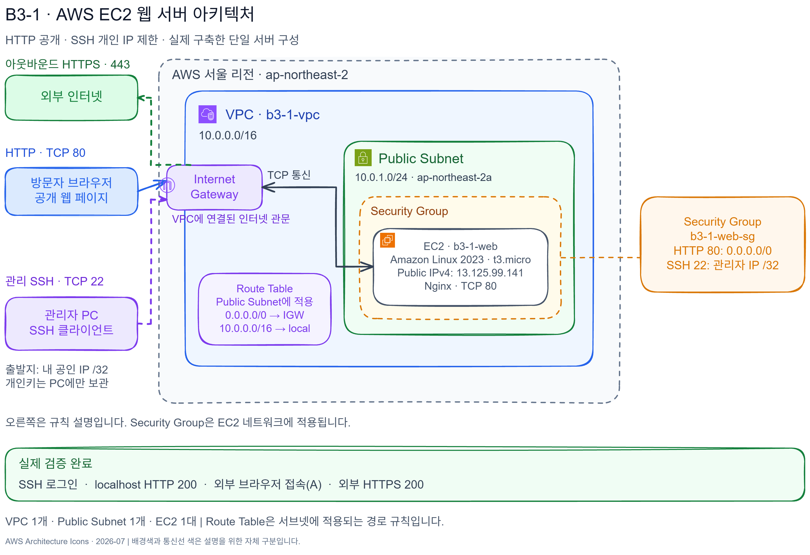
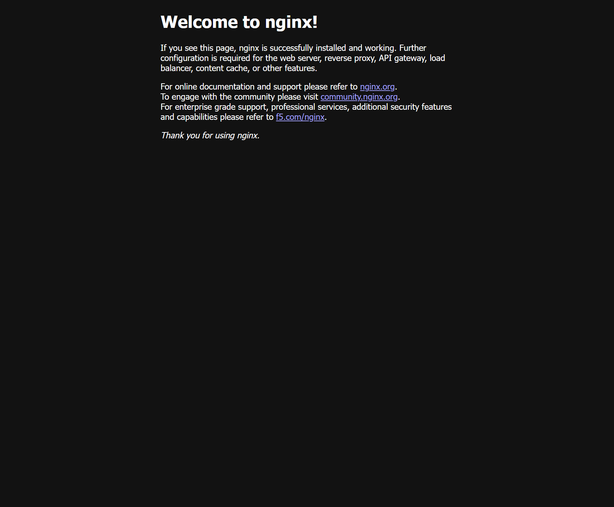

# B3-1 AWS EC2 웹 서버 배포

서울 리전에서 VPC·Public Subnet·Internet Gateway·EC2·Security Group을 구성하고, Nginx 웹 페이지의 외부 접속을 검증한 개인 실습입니다.

> 아래 IP·도메인과 화면은 실습 검증 당시의 기록입니다. 네트워크 구성과 서버 응답은 실제 AWS에서 확인했습니다.

## 구성

- 리전: 서울 `ap-northeast-2`
- VPC: `10.0.0.0/16`
- Public Subnet: `10.0.1.0/24`, `ap-northeast-2a`
- 기본 경로: `0.0.0.0/0 → Internet Gateway`
- 서버: Amazon Linux 2023, `t3.micro`, gp3 EBS 8 GiB, Nginx
- 인바운드: HTTP 80 공개, SSH 22 개인 IP `/32` 제한. HTTPS 보너스에서 443 추가
- 실습 사용자: `forB3-1`, EC2/VPC 구성 중심의 고객 관리형 IAM 정책 사용

## 아키텍처

[편집 원본](docs/architecture.excalidraw) · [요구사항별 검증과 구성 설명](docs/verification.md)

그림은 필수 HTTP·SSH 검증 단계의 구성입니다. HTTPS 443 추가는 보너스 검증에서 구분합니다.

## 외부 접속 검증: A 선택

- 방법: 외부 브라우저에서 `http://13.125.99.141/` 접속
- 결과: **Welcome to nginx!** 정상 표시
- localhost: EC2에서 `curl -i http://localhost`로 **HTTP 200 및 HTML 본문** 확인
- 아웃바운드: EC2에서 `curl -I --max-time 15 https://example.com`으로 **HTTP/2 200** 확인

검증 당시 인스턴스는 `i-05d34639a30bbfb6a`입니다. `/health` 방식 B를 함께 구현했다고 주장하지 않습니다.
