# 0013. IAM 사용자 생성 메뉴 진입 기록

관찰일: 2026-10-17 (한국 시간)

## 목적과 현재 결과

**최신 결과(2026-10-17 03:31 KST): `B3Ec2SeoulLabPolicy` 정책 생성 및 `forB3-1` 사용자 생성·직접 연결을 완료했다. 연결된 권한 정책은 1개로 확인했다. 콘솔 로그인과 서울 리전 실제 사용은 아직 검증하지 않았다. 아래 초기 관찰 기록의 보류 상태는 당시 상태이며, 최종 진행은 16절을 참고한다.**

B3-1 과제는 루트 대신 IAM 사용자 또는 Role로 콘솔에 접근하고, 실습 권한을 EC2/VPC/Security Group 구성에 필요한 범위로 제한하도록 요구한다. AdministratorAccess는 부여하지 않는다.

**현재 결과: 사용자 생성 1단계까지 진입했으나, 사용자 생성은 보류했다.** 현재 AWS 프로젝트 방식 콘솔에서는 IAM 사용자가 프로그래밍 방식 접근용이라고 안내되며, 열린 생성 화면에 콘솔 로그인 활성화·암호 설정 항목이 없다. 사용자 이름도 입력하지 않았다. 단순히 IAM 사용자를 생성한다고 과제용 콘솔 로그인이 가능하다고 판단하지 않는다.

## 1. 콘솔 홈에서 IAM 클릭

- 출발 화면: 콘솔 홈 | Sunrise Sprint
- 누른 위치: **최근에 방문한 서비스 → IAM** 링크
- 결과: IAM의 역할 목록 화면으로 이동했다.
- 참고: URL의 리전은 시드니(ap-southeast-2)였다. 과제 리소스는 서울(ap-northeast-2)에 생성해야 하며, 이번 작업에서 리전은 변경하지 않았다.

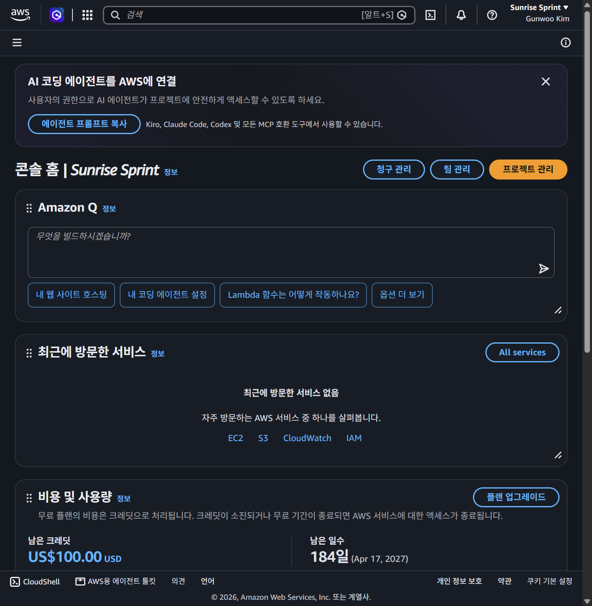

## 2. IAM 왼쪽 메뉴에서 IAM 사용자 클릭

- 화면: Identity and Access Management(IAM), 역할 목록
- 누른 위치: **왼쪽 측면 탐색 → IAM 사용자**
- 결과: IAM 사용자 목록으로 이동했다.
- 역할은 신뢰할 수 있는 주체가 맡아 사용하는 권한 묶음이고, IAM 사용자는 장기 자격 증명을 가질 수 있는 별도 자격 증명이다. 과제는 사용자와 Role 중 하나를 허용하므로 사용자 생성만이 유일한 경로는 아니다.

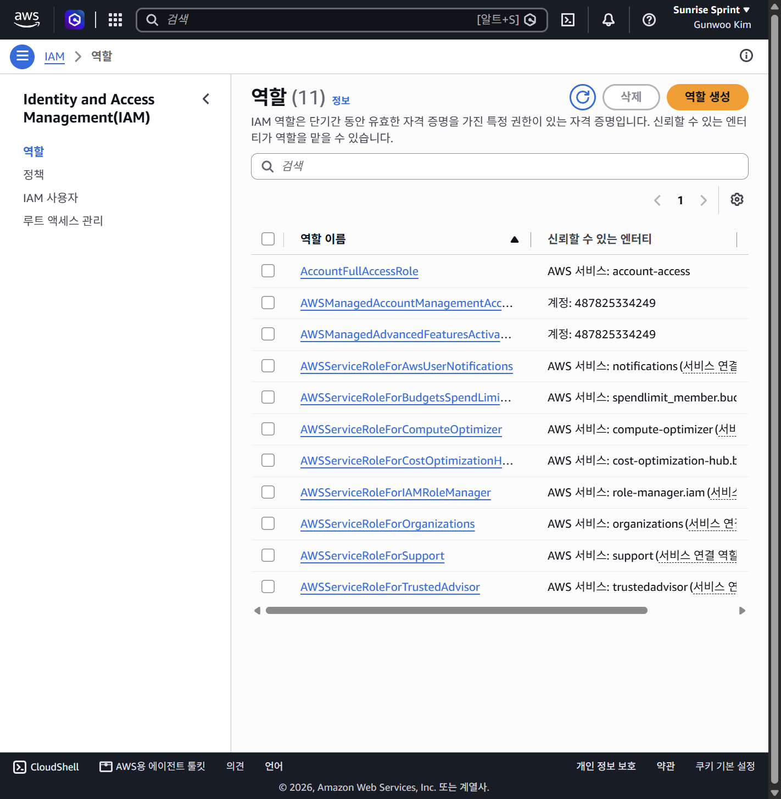

## 3. IAM 사용자 목록에서 사용자 생성 클릭

- 화면: **IAM 사용자 (0)**, 표시할 리소스 없음
- 안내: “IAM 사용자는 프로그래밍 방식 액세스에만 사용해야 함”
- 사람 사용자 접근은 **팀 페이지**에서 권한을 부여할 수 있다는 안내가 표시됐다.
- 누른 버튼: **사용자 생성**
- 결과: 사용자 생성 마법사의 1단계로 이동했다.

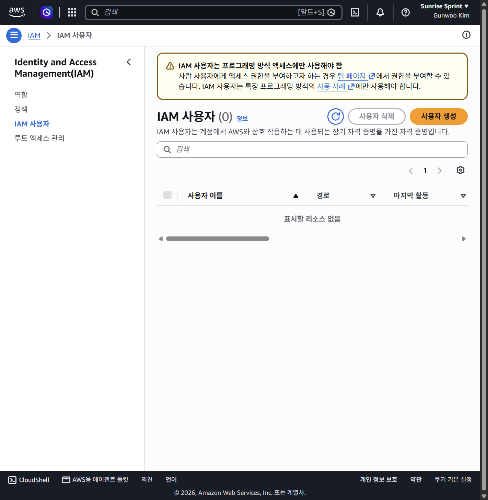

## 4. 사용자 세부 정보 지정 화면 확인

- 현재 단계: **1단계: 사용자 세부 정보 지정**
- 이후 단계: 2단계 권한 설정 → 3단계 검토 및 생성
- 표시된 입력란: 사용자 이름
- 안내: 생성 후 액세스 키 또는 서비스별 보안 인증 정보로 프로그래밍 방식 액세스를 생성할 수 있음
- 이 화면에서는 콘솔 로그인 활성화·암호 설정 항목이 보이지 않았다.
- **사용자 이름 입력, 다음 버튼 클릭, 최종 사용자 생성은 실행하지 않았다.**

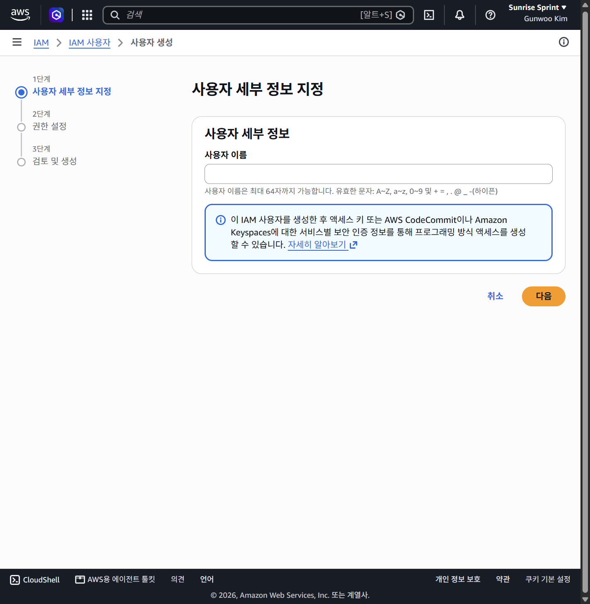

## 다음 확인 사항

1. 현재 프로젝트 로그인에서 사용 중인 Role과 권한을 확인한다. 기존 Role이 있다고 해서 과제의 최소권한 조건을 만족한다고 단정하지 않는다.
2. 팀 기반 접근 또는 고급 기능 활성화가 IAM 콘솔 로그인에 어떤 영향을 주는지 확인한다. 유료 전환이나 계정 설정 변경은 안내와 영향을 확인하고 별도 동의 후 진행한다.
3. 과제용 접근 방식을 결정한 뒤 EC2/VPC 중심 최소권한을 설정한다. 액세스 키·암호는 캡처하거나 Git에 기록하지 않는다.

이번 작업에서는 사용자·정책·액세스 키 생성, 권한 부여, 유료 플랜 전환 및 EC2 등 과금 리소스 생성을 하지 않았다.

## 추가 확인: 고급 기능 활성화는 단순 화면 전환이 아님

프로젝트 설정 화면의 “설명서를 검토” 링크로 연결된 [AWS 공식 고급 기능 활성화 안내](https://docs.aws.amazon.com/console/accounts/activate-advanced-features)를 확인했다.

- 활성화 전에 계정 업그레이드가 필요하다고 안내한다.
- 활성화는 되돌릴 수 없다.
- 기존 지출 한도가 제거되며 새 지출 한도를 만들 수 없다고 안내한다.
- 여러 리전 접근 및 관리 기능이 확장된다. 따라서 현재 시드니 콘솔의 주소만 서울로 바꾸면 사용할 수 있다고 가정하지 않는다.

고급 기능 활성화 버튼이나 계정 업그레이드는 실행하지 않았다. 사용자 생성 문제를 해결하려고 무료 플랜의 비용 보호 장치를 임의로 바꾸지 않는다. 다음 단계에서는 현재 플랜에서 가능한 역할 기반 접근·리전 범위를 먼저 확인한다.

## 5. 사용자 이름 입력: forB3-1

사용자가 이름을 **forB3-1**로 지정했다.

- 조작 위치: 사용자 생성 → 1단계 사용자 세부 정보 지정 → **사용자 이름** 입력란
- 입력값: `forB3-1` (대소문자와 하이픈을 그대로 유지)
- 입력 후 화면에 같은 값이 표시되는 것을 확인했다.
- **다음 버튼은 누르지 않았고, 사용자는 아직 생성되지 않았다.** 앞선 콘솔 접근 방식 확인 사항도 해결된 것은 아니다.

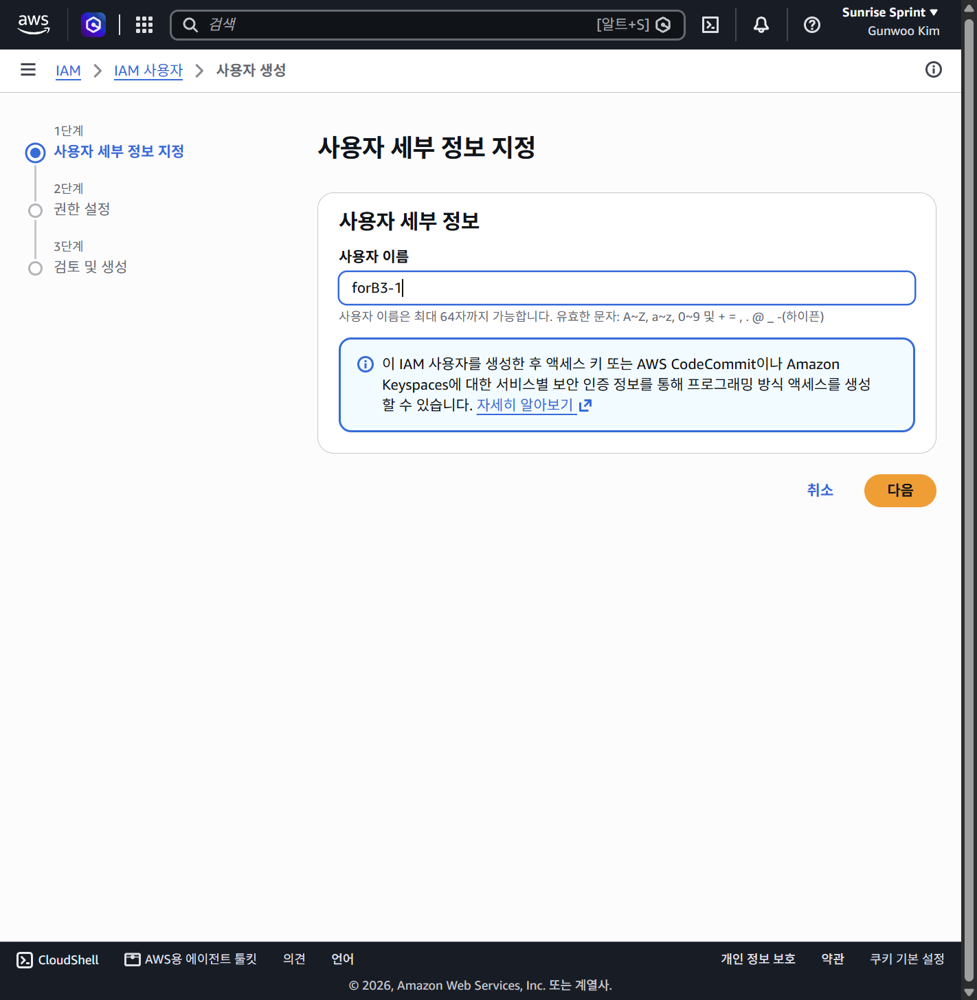

## 6. 권한 설정으로 이동: 사용자가 다음 클릭

사용자가 1단계에서 **다음** 버튼을 직접 눌렀다고 알려 주었고, 실제 화면에서 **2단계: 권한 설정** 진입을 확인했다.

- 현재 기본 선택: **권한 복사**
- 복사할 기존 사용자: **0명**, 표시할 리소스 없음
- 다른 선택지: **직접 정책 연결**
- 권한 경계 설정: 선택 사항이며 펼치거나 설정하지 않았다.
- 이 단계에서는 어떤 정책도 선택하거나 연결하지 않았다.

권한 복사는 다른 사용자의 기존 권한을 가져오는 방식이다. 현재 복사 대상이 없으므로 다음에는 **직접 정책 연결**을 눌러 정책 목록을 확인한다. 정책은 허용할 AWS 작업과 리소스를 적은 규칙이다. 과제에서는 AdministratorAccess를 금지하므로 선택하지 않는다. EC2/VPC 관련 정책도 이름만 보고 최소권한이라고 단정하지 않고 허용 범위를 검토한 뒤 결정한다.

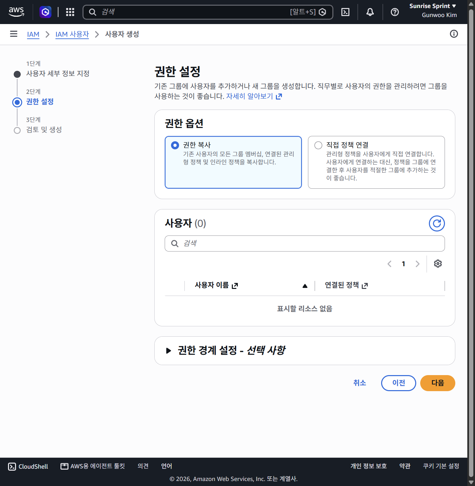

### 질문: 권한 복사와 직접 정책 연결은 어떻게 다른가?

둘은 권한의 강도가 아니라 **권한을 가져오는 방법**이 다르다.

- **권한 복사**: 기존 사용자를 본보기로 삼는다. 화면 안내에 따르면 그 사용자의 그룹 멤버십, 연결된 관리형 정책, 인라인 정책을 새 사용자에게 복사한다. 예를 들어 같은 업무를 하는 동료와 같은 권한 구성을 빠르게 만들 때 쓰지만, 불필요한 권한까지 가져올 수 있으므로 원본 확인이 필요하다. 원본 사용자의 이후 변경을 계속 따라가는 동기화 기능은 아니다. 다만 같은 그룹에 속하게 되면 이후 그 그룹의 정책 변경은 두 사용자 모두에게 영향을 줄 수 있다.
- **직접 정책 연결**: 기존 사용자를 참고하지 않고, 관리형 정책 목록에서 필요한 정책을 골라 새 사용자에게 직접 연결한다. 예를 들어 EC2 조회 정책을 연결하면 그 정책이 허용하는 조회 작업을 할 수 있다. 관리형 정책의 내용이 나중에 바뀌면 연결된 사용자에게 적용되는 권한도 바뀔 수 있다.

현재 화면에서는 기존 사용자가 0명이므로 복사할 대상이 없다. 따라서 직접 정책 연결 쪽에서 사용할 정책을 검토하는 것이 다음 단계다. **직접 연결한다고 자동으로 최소권한이 되는 것은 아니다.** AdministratorAccess처럼 넓은 정책을 연결하면 그만큼 넓은 권한이 생긴다. 과제에서는 관리자 권한을 금지하며 EC2/VPC/Security Group 구성에 필요한 범위만 허용해야 한다.

참고로 여러 사람을 관리할 때는 사용자마다 정책을 직접 붙이기보다 직무별 그룹에 정책을 붙이고 사용자를 그룹에 넣는 방식이 관리하기 좋다는 안내도 화면에 표시된다. 현재 생성 마법사에는 권한 복사와 직접 정책 연결 두 선택지만 표시되었다.

## 7. 직접 정책 연결 선택: 권한 정책 1586개 표시

사용자가 **직접 정책 연결**을 클릭했고, 화면에서 해당 선택 및 **권한 정책 (1586)**을 확인했다. 이는 연결 가능한 정책 목록의 개수이며, 1586개가 사용자에게 부여됐다는 뜻이 아니다. 관찰 시점 체크된 정책은 없었다.

- 표시된 검색란: 항목 검색
- 표시된 링크: **정책 생성** (새 탭에서 열림)
- 목록에 AdministratorAccess가 있지만 과제에서 금지하므로 선택하지 않는다.
- 다음 안내: 목록 위 **정책 생성**을 눌러 과제용 사용자 지정 정책을 준비한다. EC2/VPC/Security Group 실습에 필요한 작업을 좁혀 허용하기 위해서다. 정책 생성 링크는 아직 누르지 않았다.
- 어떤 정책도 선택하지 않았으며 다음 단계 이동·사용자 생성도 하지 않았다.

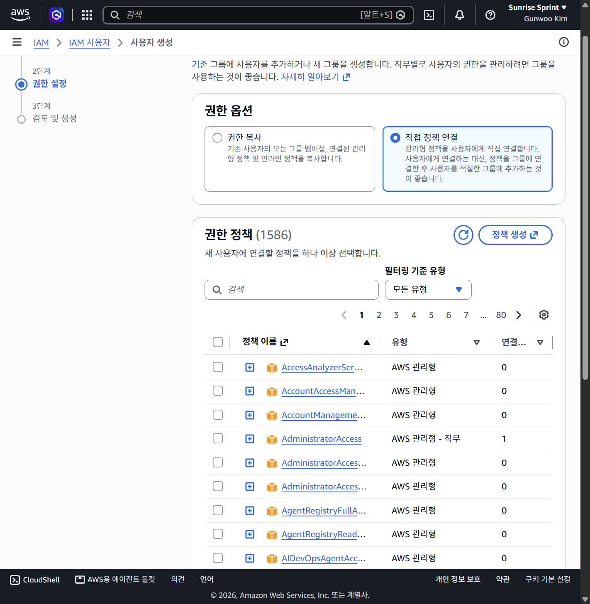

## 8. 정책 생성: EC2의 CreateVpc 작업 선택

사용자가 정책 생성 화면에서 JSON 편집기 오른쪽의 작업 선택 UI를 사용해 EC2 → `CreateVpc`를 직접 체크했다. JSON 전체를 붙여넣지 않고 작업을 하나씩 선택하며 학습하기로 했다.

- 체크된 작업: `ec2:CreateVpc`
- 현재 문 식별자(Sid): `Statement1`
- 현재 `Resource`는 빈 배열이며, 리소스 범위와 서울 리전 조건은 아직 설정하지 않았다. 완성된 정책이 아니다.
- 정책 생성·연결 및 실제 VPC 생성은 하지 않았다.
- 문 식별자 추천: `B3NetworkSetup` (네트워크 구성 작업들을 모을 문). Sid는 문을 구분하는 이름이며 권한을 부여하는 설정이나 정책 전체 이름이 아니다. 현재 화면에는 Sid 전용 입력란이 보이지 않아, 바꾸려면 왼쪽 JSON의 `"Sid": "Statement1"`에서 값만 수정할 수 있다. 이름 변경은 아직 수행하지 않았다.

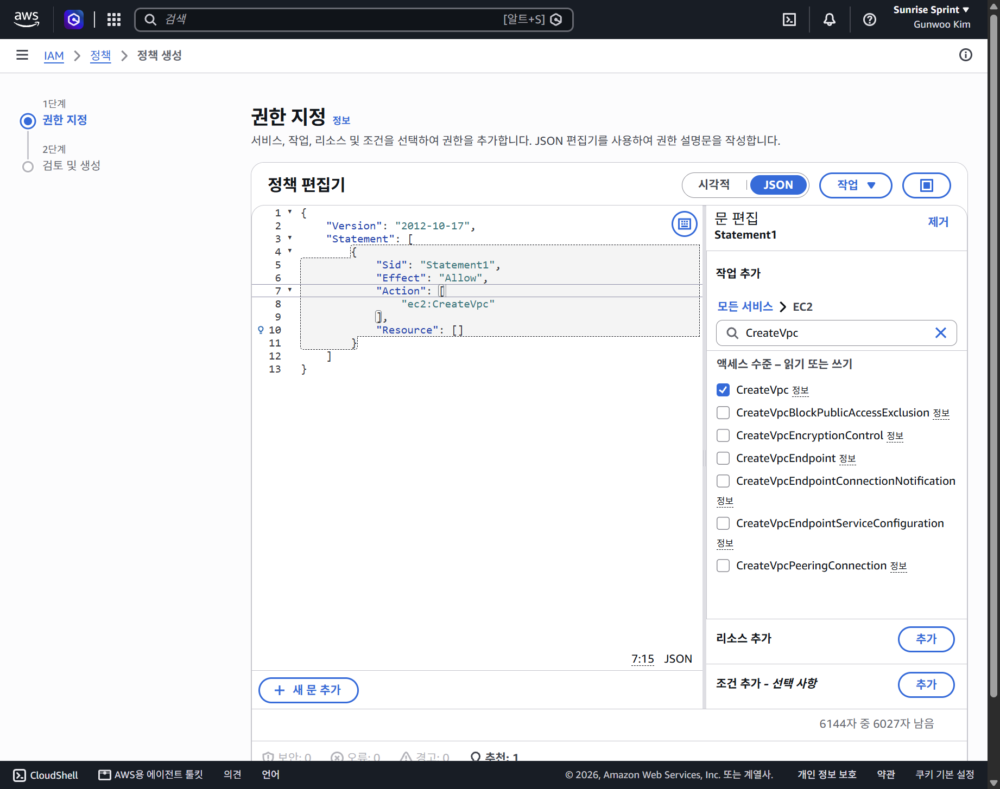

## 9. 문 이름 변경 및 네트워크 생성 작업 3개 선택

사용자가 Sid를 `B3NetworkSetup`으로 변경하고 오른쪽 EC2 작업 선택 UI에서 작업을 추가했다. 현재 화면의 JSON과 체크 상태를 확인하고 캡처했다.

- Effect: `Allow`
- Action: `ec2:CreateVpc`, `ec2:CreateSubnet`, `ec2:CreateInternetGateway`
- Resource: 빈 배열. 리소스 범위와 서울 리전 조건은 아직 미설정이며 정책은 미완성이다.
- `CreateInternetGateway`는 인터넷 게이트웨이를 만드는 권한이고, VPC에 연결하는 권한인 `AttachInternetGateway`는 별도로 필요하다. 다음 안내 작업은 이것을 검색해 체크하는 것이다. 아직 선택 여부는 확인하지 않았다.
- 정책 생성·권한 연결·실제 네트워크 리소스 생성은 하지 않았다.

앞으로도 사용자가 수행한 주요 단계는 화면을 확인한 뒤 캡처하고 이 문서에 기록한다. 지나간 단계의 단독 캡처를 소급해서 만들지는 않으며, 이번 캡처는 위 세 작업이 함께 선택된 현재 상태의 증빙이다.

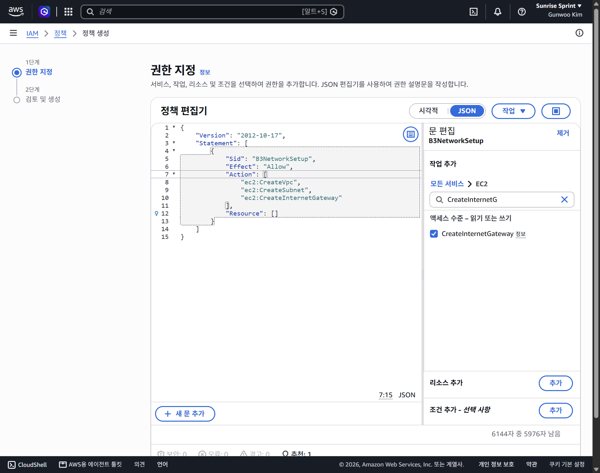

## 10. AttachInternetGateway 작업 선택

사용자가 EC2 작업 목록에서 `AttachInternetGateway`를 체크했고, 현재 화면에서 체크 상태와 `B3NetworkSetup` 문 식별자를 확인하여 캡처했다.

- 추가 권한: `ec2:AttachInternetGateway` — 인터넷 게이트웨이를 VPC에 연결하는 작업을 허용한다.
- 앞서 선택한 생성 작업들과 함께 정책을 편집 중이다. 이 체크 자체가 실제 게이트웨이를 연결하는 것은 아니다.
- 리소스 범위와 서울 리전 조건은 아직 미설정이며, 정책 생성·연결은 하지 않았다.
- 다음 학습 작업: `CreateRouteTable` 선택. 라우팅 테이블은 트래픽의 목적지에 따라 어디로 보낼지 정하는 규칙을 담는다. 생성 후 서브넷 연결 및 인터넷 게이트웨이 방향 경로 추가 권한도 별도로 준비한다.

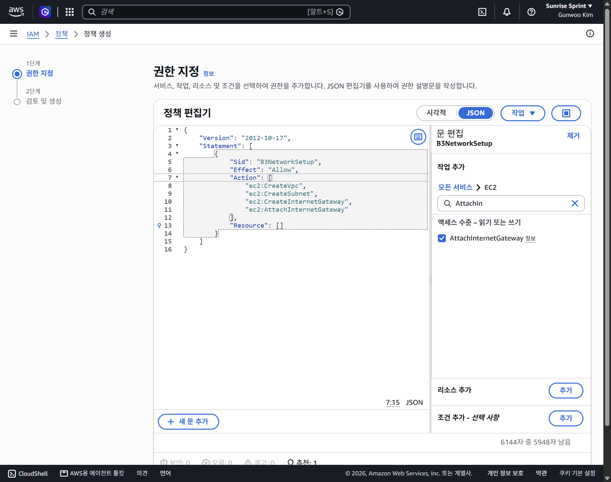

## 11. CreateRouteTable 작업 선택

사용자가 `CreateRouteTable`을 체크했고, 현재 EC2 작업 목록의 체크 상태를 확인하여 캡처를 첨부했다.

- 추가 권한: `ec2:CreateRouteTable` — 라우팅 테이블을 생성하는 작업을 허용한다.
- 문 식별자: `B3NetworkSetup`
- 라우팅 테이블은 목적지에 따라 트래픽을 어디로 보낼지 정하는 규칙을 담는다. 생성 권한만으로 서브넷 연결이나 경로 추가까지 허용되지는 않는다.
- 리소스 범위·서울 리전 조건은 아직 미설정이며, 정책 생성·권한 연결·실제 라우팅 테이블 생성은 하지 않았다.
- 다음 안내 작업: `AssociateRouteTable` 선택. 서브넷이 사용할 라우팅 테이블을 연결하는 권한이다. 아직 체크 여부는 확인하지 않았다.

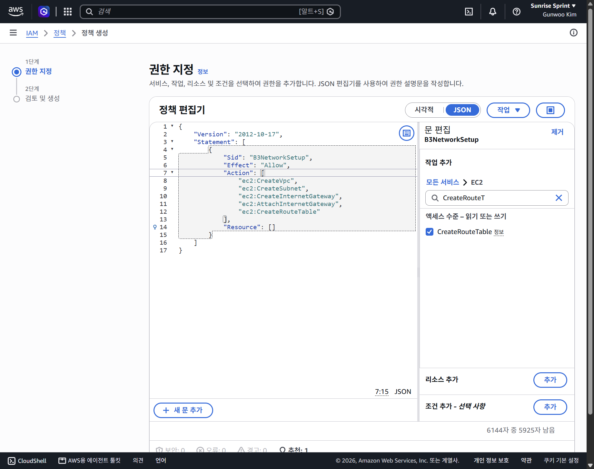

## 12. AssociateRouteTable 작업 선택

현재 화면에서 사용자가 `AssociateRouteTable`을 체크한 것을 확인하고 캡처를 첨부했다. 비슷한 검색 결과인 `DisassociateRouteTable`은 선택되지 않았다.

- 추가 권한: `ec2:AssociateRouteTable` — 서브넷과 라우팅 테이블을 연결하는 작업을 허용한다.
- 문 식별자: `B3NetworkSetup`
- 리소스 범위·서울 리전 조건은 아직 미설정이며, 정책 생성·연결이나 실제 서브넷 연결을 실행한 것은 아니다.
- 다음 안내 작업: `CreateRoute` 선택. 라우팅 테이블에 경로를 추가하는 권한이며, 과제의 `0.0.0.0/0 → Internet Gateway` 경로 설정에 필요하다. `CreateRouteTable`과는 별개다. 아직 선택 여부는 확인하지 않았다.

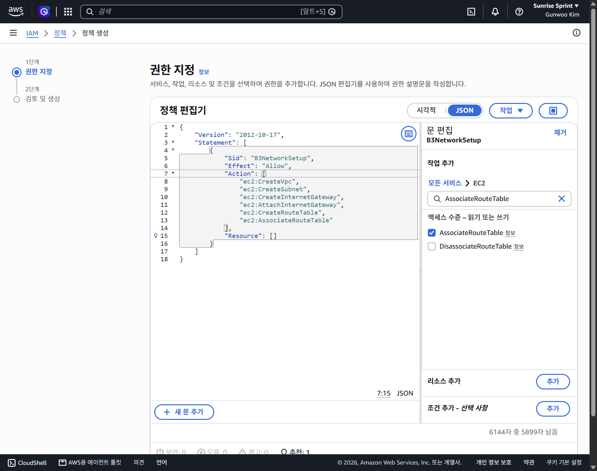

## 13. CreateRoute 작업 선택

현재 EC2 작업 목록에서 `CreateRoute`와 앞서 선택한 `CreateRouteTable`의 체크 상태를 확인하고 캡처를 첨부했다. 검색 결과의 Route Server 관련 세 작업은 체크되지 않았다.

- 추가 권한: `ec2:CreateRoute` — 라우팅 테이블에 경로를 추가하는 작업을 허용한다. 과제의 `0.0.0.0/0 → Internet Gateway` 경로 설정에 사용한다.
- 문 식별자: `B3NetworkSetup`
- 정책 편집 중이며 리소스 범위·서울 리전 조건은 아직 미설정이다. 정책 생성·권한 연결·실제 경로 생성은 하지 않았다.
- 다음 안내 작업: `CreateSecurityGroup` 선택. 보안 그룹을 생성하는 권한으로, HTTP/SSH 인바운드 규칙을 추가하는 권한과는 별개다. 아직 선택 여부는 확인하지 않았다.

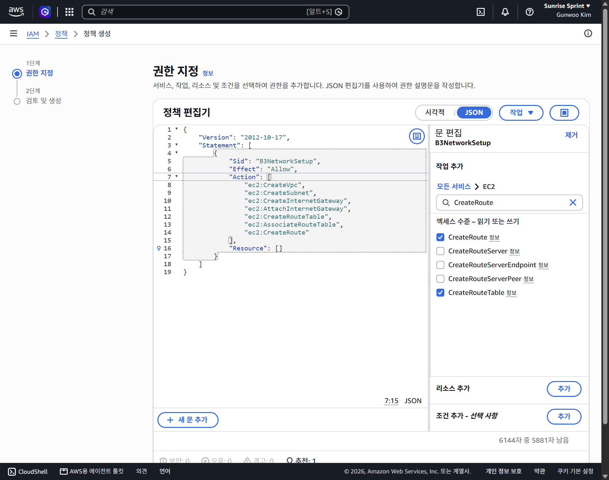

## 14. CreateSecurityGroup 작업 선택

현재 EC2 작업 목록에서 `CreateSecurityGroup` 체크를 확인하고 캡처를 첨부했다.

- 추가 권한: `ec2:CreateSecurityGroup` — 보안 그룹을 생성하는 작업을 허용한다. 인바운드 규칙 추가 권한은 별도로 필요하다.
- 문 식별자: `B3NetworkSetup`
- 리소스 범위·서울 리전 조건은 아직 미설정이며 정책은 미완성이다. 정책 생성·권한 연결·실제 보안 그룹 생성은 하지 않았다.
- 다음 안내 작업: `AuthorizeSecurityGroupIngress` 선택. 보안 그룹에 인바운드 허용 규칙을 추가하는 작업이다. 실제 리소스 구성 시 HTTP(80)는 전체 인터넷, SSH(22)는 개인 IP로 제한한다. 이 IAM 작업 선택만으로 포트나 IP 제한이 적용되는 것은 아니다. 아직 선택 여부는 확인하지 않았다.

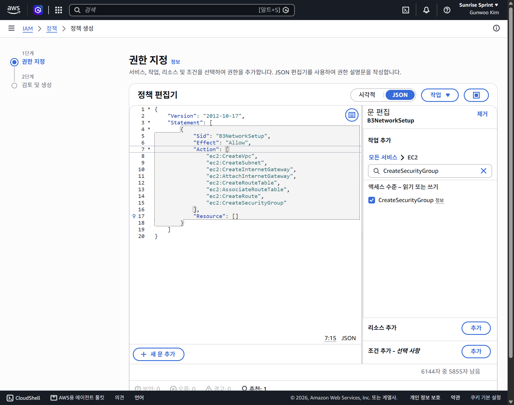

## 15. 개별 작업 선택 안내에서 JSON 설계 문서로 전환

사용자가 전체 JSON 작성과 권한별 근거의 체계적인 문서화를 요청했다. 편집기에 대신 입력하거나 AWS 정책을 생성하지 않고, 다음 로컬 파일을 작성했다.

- [0014. IAM 정책 설계와 권한별 근거](0014-iam-policy-design.md)
- [정책 JSON](policies/b3-1-ec2-seoul-policy.json)

7개 문·36개 작업을 조회, 네트워크 설정, 네트워크 정리, SSH 키, 인스턴스 실행, 컴퓨트 정리, 태그로 구분했다. JSON 구문과 AWS 공식 작업 이름·주요 리소스 지원 유형을 점검했지만, AWS 정책 검증 및 실제 동작 검증은 아직 하지 않았다. 절대 최소 권한이라고 표현하지 않으며, 콘솔 조회/태그 등 선택한 방식에 필요한 권한과 같은 계정·서울 리전 기존 리소스에도 영향을 줄 수 있는 한계를 설계 문서에 명시했다.

이전 단계의 개별 캡처는 당시 UI 상태의 증빙이다. 새 JSON이 현재 AWS 편집기에 입력된 상태라는 뜻은 아니다. 별도 사용자/Role의 콘솔 접근 방식 및 서울 리전 사용 가능 여부도 여전히 별도 확인 대상이다.

## 16. JSON 입력·정책 생성·사용자 생성 및 연결 완료

2026-10-17, 사용자의 JSON 복사·붙여넣기 및 권한 지정 마무리 요청에 따라 실행했다.

1. 주석 없는 [JSON](policies/b3-1-ec2-seoul-policy.json) 전체를 AWS 편집기에 입력했다.
2. AWS 정책 린터의 보안 0, 오류 0, 경고 0, 추천 0을 확인했다. 이는 실제 리소스 조작 성공이나 절대 최소권한의 증명은 아니다.
3. 정책 이름 `B3Ec2SeoulLabPolicy`, 설명 `B3-1 EC2 VPC lab setup read and cleanup in Seoul only`로 생성했고 AWS 성공 알림을 확인했다.
4. 기존 사용자 생성 탭은 닫혀 있었고 목록은 0명이었다. 사용자 생성 절차를 다시 열어 앞서 정한 `forB3-1`을 입력했다.
5. 직접 정책 연결에서 `B3Ec2SeoulLabPolicy` 한 개만 선택했다. 검토 화면에 콘솔 암호 유형 `None`으로 표시됐다.
6. 사용자 생성 성공 알림을 확인하고 상세 권한 탭에서 권한 정책 (1), `B3Ec2SeoulLabPolicy`, 고객 관리형·직접 연결을 확인했다. AdministratorAccess는 연결하지 않았다.

사용자 ARN: `arn:aws:iam::067518846638:user/forB3-1`

액세스 키 생성이나 콘솔 암호 설정은 실행하지 않았다. EC2/VPC 등 실습 인프라도 생성하지 않았다. 사용자 목록은 여전히 IAM 사용자가 프로그래밍 방식 접근용이라는 경고를 표시했다. 성공 알림의 일반적인 암호 다운로드 안내만으로 콘솔 로그인이 활성화됐다고 판단하지 않는다. **별도 사용자/Role 콘솔 접근 조건과 서울 리전 사용 가능 여부는 아직 미해결이며, 권한의 실제 실행 검증도 남아 있다.**

### 단계별 증빙

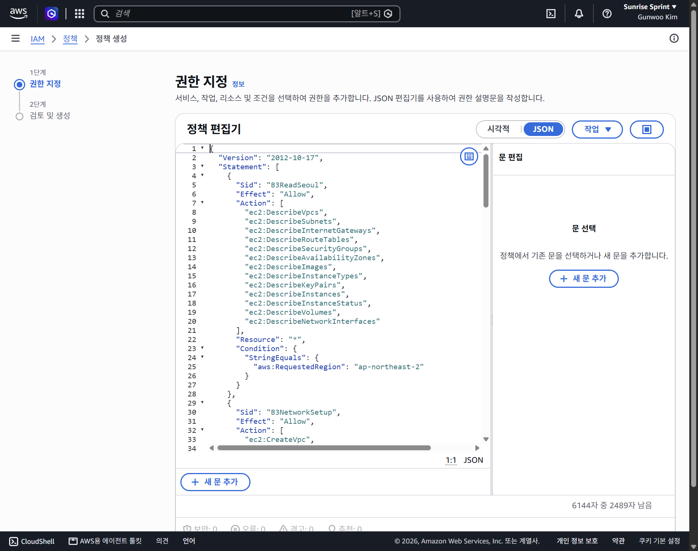

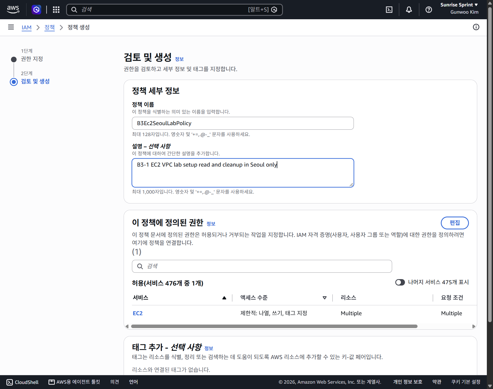

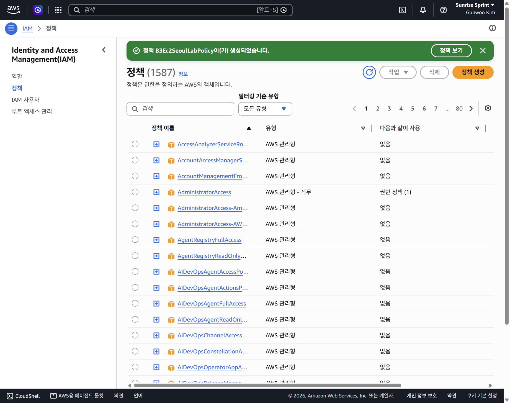

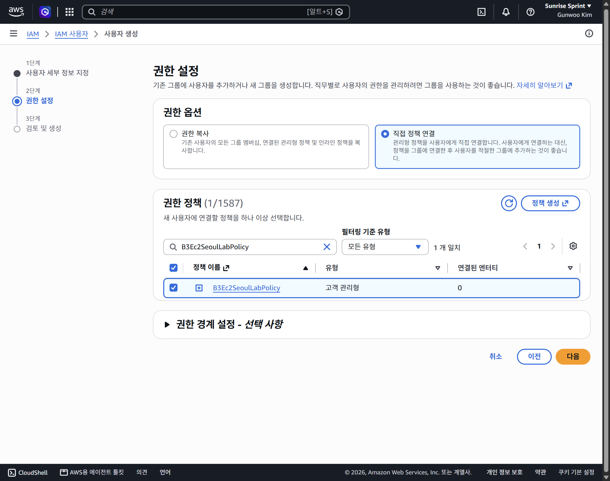

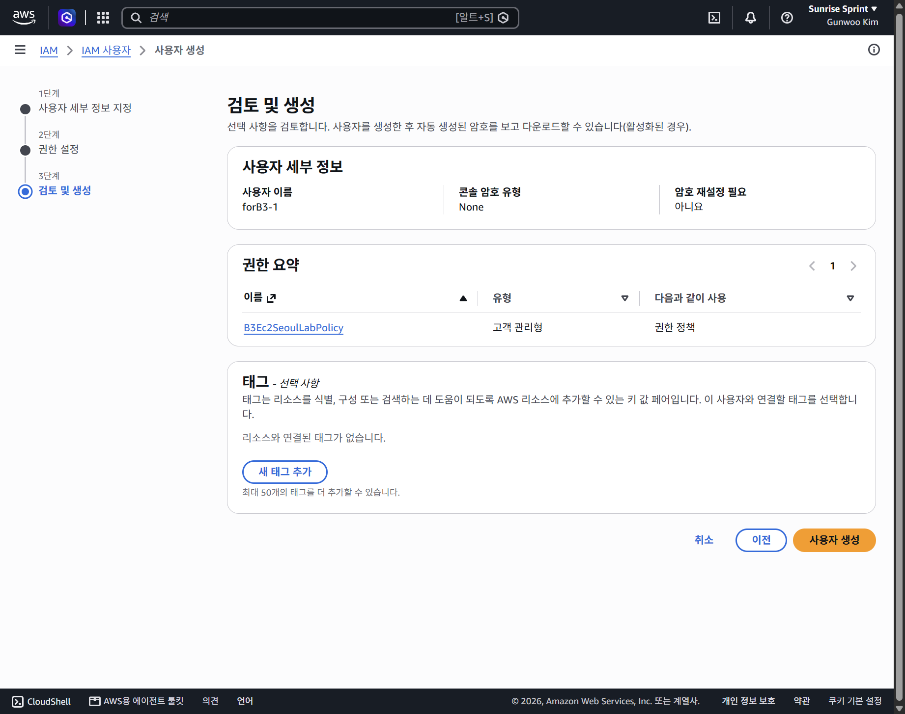

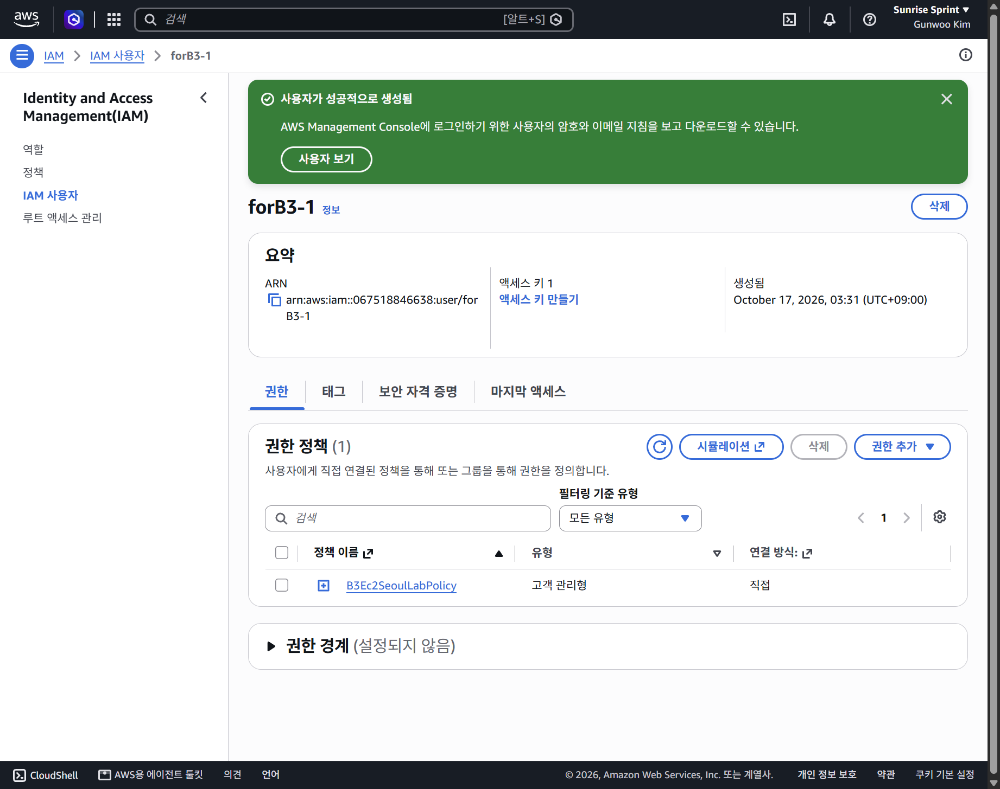

## 17. 보안 자격 증명 탭: 콘솔 암호 설정 항목 없음

사용자가 직접 `보안 자격 증명` 탭을 눌렀다. 현재 탭 전체를 확인했으며 액세스 키 (0), API 키 (0), CodeCommit SSH/HTTPS 및 Keyspaces 자격 증명만 표시됐다. 콘솔 로그인 활성화·암호 설정 항목은 보이지 않았다. 위 생성 성공 알림의 일반적인 콘솔 암호 안내와 실제 설정 가능 여부를 구분한다.

액세스 키 생성은 실행하지 않았다. 키를 만들면 콘솔 로그인 문제가 해결되는 것은 아니다. 다음은 왼쪽 `역할`에서 기존 역할 및 현재 로그인 주체와의 관계를 확인하는 단계이며, 아직 역할 선택·정책 변경은 하지 않았다.

사용자 요청에 따라 앞으로 AWS 페이지 버튼 클릭과 생성·저장 등은 사용자가 직접 수행하고, 나는 안내·읽기 확인·캡처·문서화를 담당한다. 별도 요청 없이 대신 진행하지 않는다.

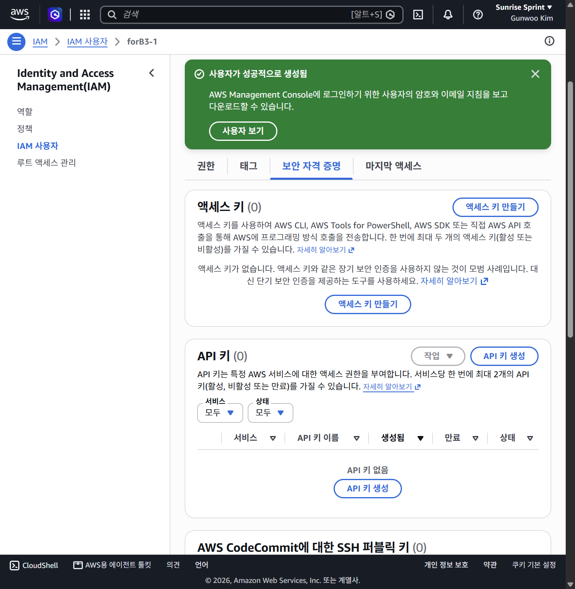

## 18. 역할 목록 확인: 11개

사용자가 왼쪽 `역할`을 눌렀고 현재 목록 11개를 확인해 캡처했다. `AccountFullAccessRole`의 신뢰할 수 있는 엔터티는 AWS 서비스 `account-access`이고 마지막 활동은 관찰 시 6분 전이었다. 그 외 계정 관리·고급 기능 활성화 역할 및 여러 서비스 연결 역할이 표시됐다.

목록 이름이나 최근 활동만으로 현재 로그인 주체 또는 과제 적합성을 확정하지 않는다. 다음에는 사용자가 `AccountFullAccessRole` 이름 링크를 열어 실제 권한과 신뢰 관계를 읽는다. 기존 접근 역할의 정책을 제거하거나 교체하지 않는다. 잠금 위험이 있으므로 실습용 최소권한 역할과 기존 관리자 접근 역할을 구분해야 한다. 아직 역할 상세 확인·변경은 하지 않았다.

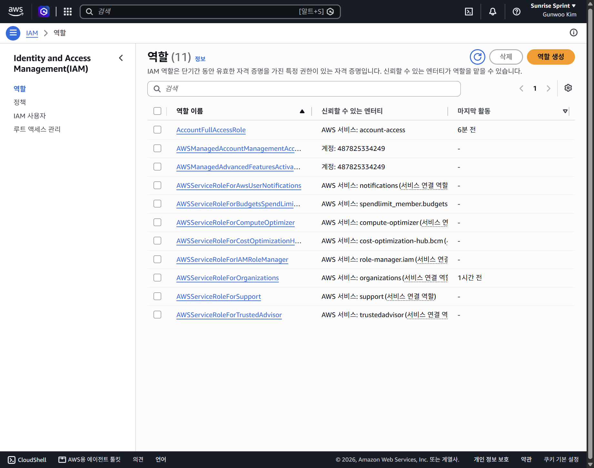

## 19. AccountFullAccessRole: AdministratorAccess 연결 확인

사용자가 `AccountFullAccessRole` 상세를 열었다. ARN은 `arn:aws:iam::067518846638:role/managed/AccountFullAccessRole`이며, 권한 정책 (1)에 AWS 관리형 `AdministratorAccess`가 연결되어 있고 권한 경계는 설정되지 않았다.

이 역할을 그대로 실습 주체로 사용하는 것은 `instruction.md`의 관리자 권한 금지 조건에 맞지 않는다. 다만 상세 화면 열람만으로 현재 로그인 중인 주체가 이 역할이라고 확정하지 않는다. 기존 관리 접근을 잃을 수 있으므로 정책 삭제·교체는 하지 않았다. 실습 정책을 추가로 연결해도 기존 AdministratorAccess 허용이 줄어들지는 않는다.

다음은 사용자가 `신뢰 관계` 탭을 눌러 누가 이 역할을 맡을 수 있는지 읽는 단계다. 아직 신뢰 정책은 확인하지 않았으며 편집도 하지 않았다.

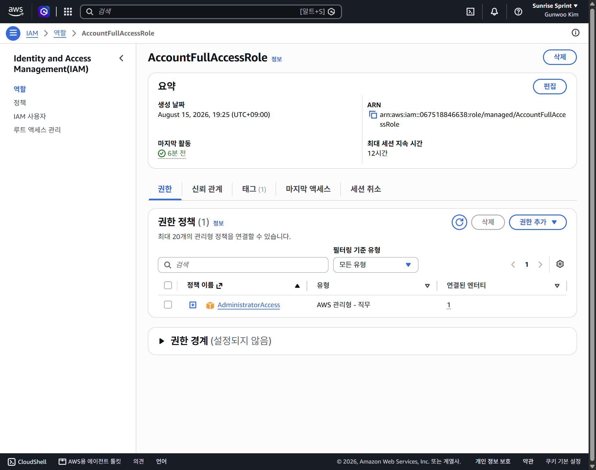

## 20. AccountFullAccessRole의 신뢰 관계 확인

사용자가 `신뢰 관계` 탭을 눌렀다. 신뢰 정책은 서비스 주체 `account-access.amazonaws.com`에 `sts:AssumeRole`, `sts:SetContext`를 허용한다. 이 정책에는 `forB3-1` 사용자나 특정 사람이 Principal로 지정되어 있지 않다.

이는 AWS 계정 접근 서비스가 역할을 수임하도록 하는 신뢰 설정이며, 이를 임의의 새 실습 역할에 복사한다고 사람의 역할 전환·콘솔 접근이 가능하다고 단정할 수 없다. 기존 역할이나 신뢰 정책은 수정하지 않았다. 다음에는 사용자가 우측 상단 `Sunrise Sprint / Gunwoo Kim` 계정 메뉴를 열어 제공되는 접근·역할 전환 경로를 확인한다. 현재 로그인 주체의 정확한 ARN과 실습용 역할 전환 지원 여부는 아직 미확인이다.

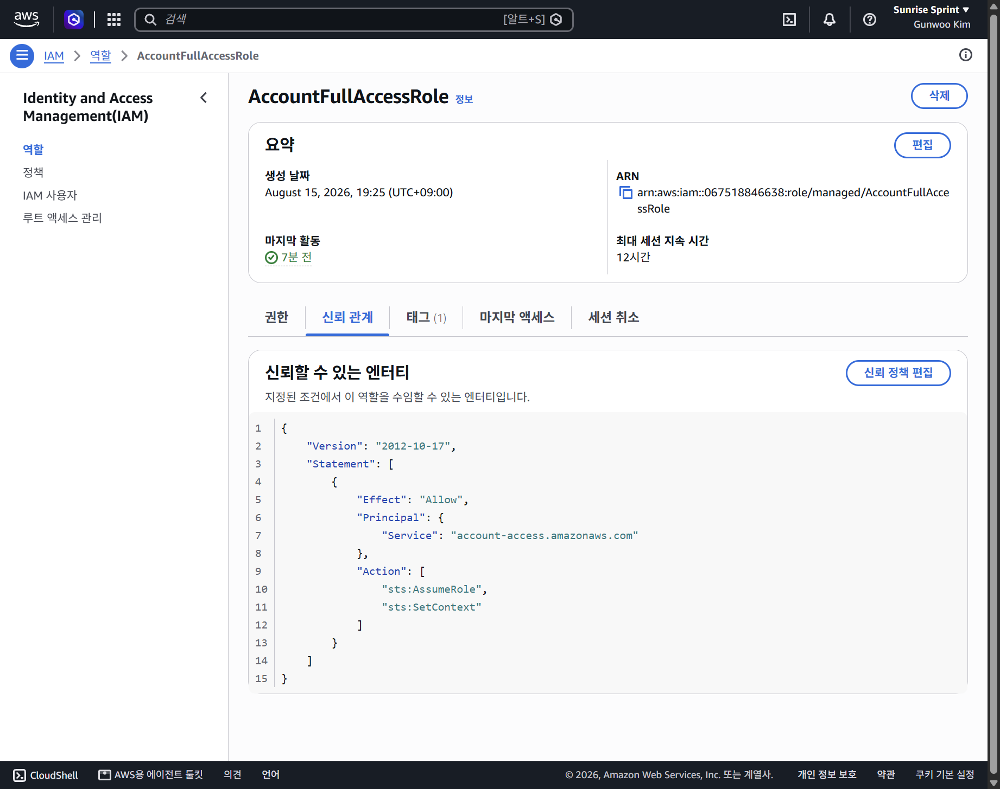

## 21. 계정 메뉴: 역할 전환 항목 없이 팀·프로젝트 표시

사용자가 우측 상단 계정 메뉴를 열었다. 현재 메뉴에는 프로젝트 전환, 프로젝트, 팀, 청구, 프로필 및 로그아웃이 표시되며 `역할 전환` 항목은 보이지 않는다. 무료 플랜 상태로 남은 크레딧 US$100, 남은 일수 183일이 표시됐다. 이 값은 관찰 시점 표시이며 모든 사용 비용의 무료 보장을 뜻하지 않는다.

다음 안내는 `팀` 링크를 눌러 사람 사용자 접근과 권한 선택 항목을 읽는 것이다. 팀원 초대·권한 변경·플랜 업그레이드는 실행하지 않는다. 현재 메뉴에서 역할 전환이 보이지 않는다는 사실만으로 모든 역할 기반 접근 가능성을 부정하지는 않는다.

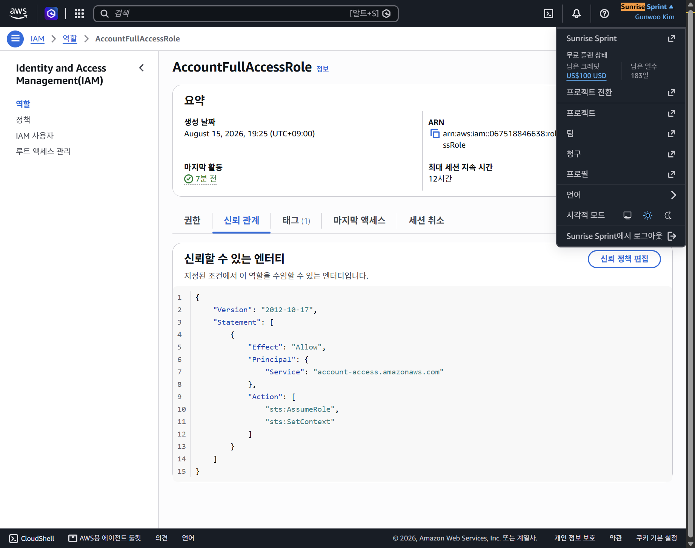

## 22. 팀 페이지: 소유자 1명, 세부 IAM 권한 선택은 미표시

사용자가 `팀`을 눌러 새 탭 `https://settings.aws.com/team`을 열었다. 멤버 탭에는 소유자 Gunwoo Kim 1명만 표시됐다. 안내는 팀 멤버가 프로젝트에 접근할 수 있고, 관리·재무 작업 권한은 없으며, 소유자만 멤버를 추가/제거할 수 있다고 설명한다.

목록 화면에는 사용자 지정 IAM 정책·역할을 선택하는 항목은 보이지 않는다. 이 안내만으로 EC2/VPC에만 한정한 실습 권한이 제공된다고 판단하지 않는다. 다음에는 사용자가 `새 팀 멤버 초대` 버튼으로 입력 화면만 열어 권한 범위 선택 가능 여부를 확인한다. 실제 초대 발송·이메일 입력·멤버 추가는 하지 않는다. 이 경로에서 해결된다고 보장하지 않는다.

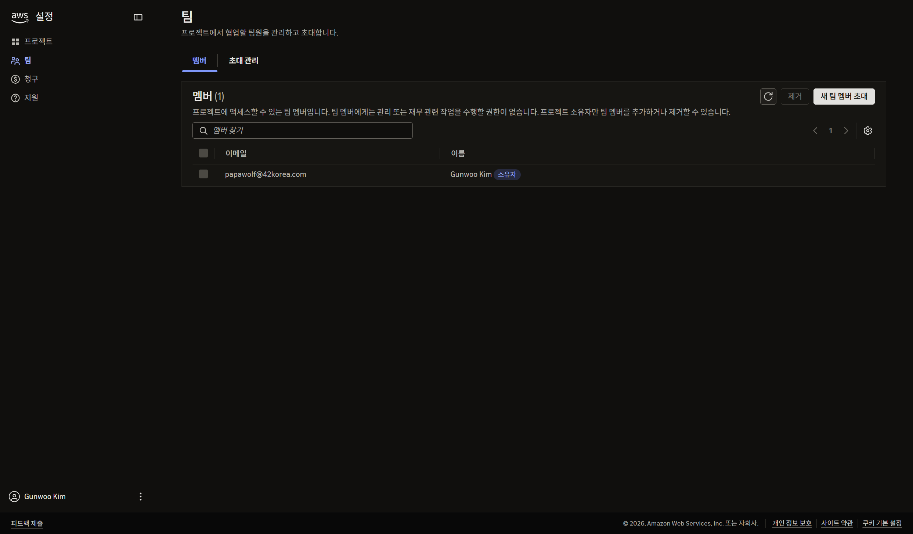

## 23. 팀 초대: 모든 개발자 접근 권한 안내, 최소권한 대체 경로 아님

사용자가 팀 초대 모달을 열었다. 실제 안내는 초대받은 팀원에게 “서비스 및 애플리케이션의 액세스 제어를 포함한 모든 개발자 액세스 권한”이 부여되고 “제한 없이 개발”할 수 있다고 설명한다. 입력 항목은 이메일과 프로젝트 선택이며, 현재 모달에는 EC2/VPC 한정 정책 또는 IAM Role을 고르는 항목이 없다.

따라서 이 화면의 팀 초대는 과제용 EC2/VPC 최소권한 콘솔 접근의 해결책으로 사용할 수 있다고 판단하지 않는다. 이메일 입력이나 초대 발송은 하지 않았다. 다음 사용자 조작은 `취소`로 모달을 닫는 것이다. 임의 권한 축소나 고급 기능 활성화·유료 전환도 하지 않는다.

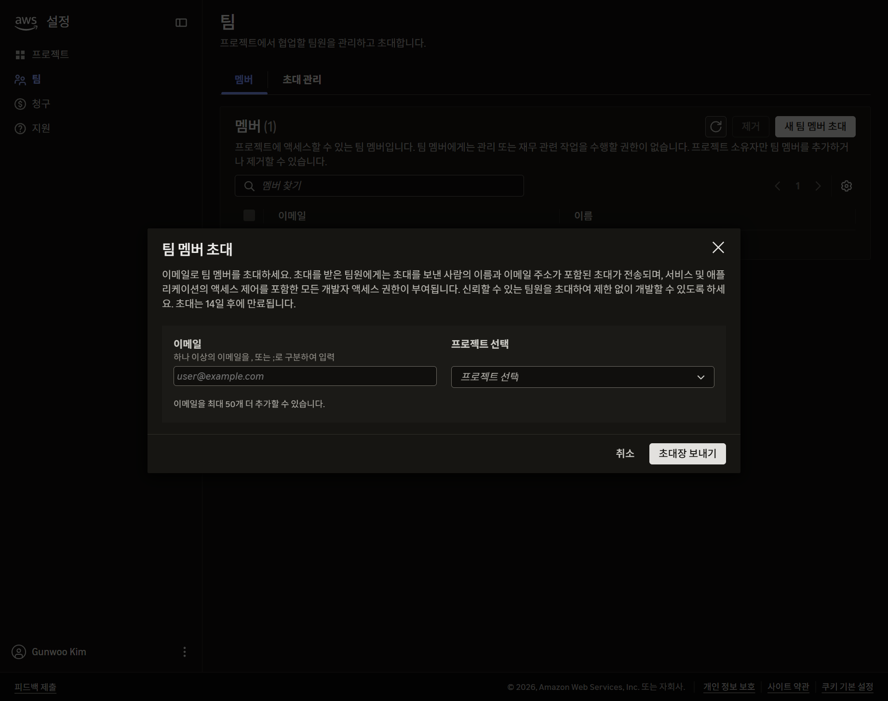

## 24. 공식 문서 조사로 접근·리전 제한 확인

사용자가 IAM 생성 방법을 조사해 달라고 요청해 AWS 공식 문서를 확인했다. [0015. IAM 콘솔 접근 조사](0015-iam-console-access-research.md)에 인용 문구, 일반 IAM 생성 흐름, 기존 계정 사용/현재 환경 고급 기능 활성화 후 Role 접근/담당자 조건 조정의 선택지를 정리했다.

핵심은 신규 프로젝트 기본 환경에서 콘솔 접근 IAM 사용자 생성이 지원되지 않고, 세부 사용자·Role 접근과 특정 리전 선택도 제한된다는 점이다. 한국 연락처 기반 프로젝트 리전은 시드니로 안내된다. 현재 IAM 사용자 생성·정책 연결 완료가 과제용 콘솔 로그인 및 서울 배치 충족을 의미하지 않는다.

유료 업그레이드만으로 advanced 기능이 제공되는 것은 아니며, 고급 기능 활성화는 비가역적이고 지출 한도 제거 등 비용 보호 변화가 있다. 전환·초대·액세스 키 생성·관리 역할 변경은 하지 않았다. 다음은 사용할 계정/환경의 결정이며, 사용자의 직접 조작·확인 원칙을 유지한다.

## 25. Q·ChatGPT 리서치 통합 및 크레딧 FAQ 직접 확인

사용자가 첨부한 ChatGPT 독립 리서치 전체를 읽고 [0016. 통합 문서](0016-aws-access-research-consolidated.md)에 관찰 사실, Q의 정정 과정, 외부 분석, 공식 확인 및 다음 검증 순서를 구분해 정리했다. [첨부 원문 복사본](references/2026-10-17-chatgpt-research-original.txt)도 보존했다.

공식 프리 티어 FAQ의 고급 기능 Q2를 직접 펼쳐 “이미 적립한 프리 티어 크레딧은 만료될 때까지 향후 AWS 청구서에 자동으로 적용됩니다”를 확인했다. 따라서 고급 기능 활성화 후 크레딧 유지의 직접 근거를 찾지 못했다는 앞선 설명을 정정한다. 같은 FAQ의 고급 기능 Q2/일반 Q6는 6개월, Paid 업그레이드 Q8은 12개월을 안내하므로 계정의 실제 크레딧 만료일 확인은 남는다.

이번 작업은 조사·기록뿐이며 계정 전환·결제·권한·실습 리소스 변경은 하지 않았다. 다음 사용자 단계는 프로젝트의 개요/추가 정보에 표시되는 실제 Region 확인이다. 읽기 전용 CLI 검증은 이미 인증이 있는 경우에만 수행하고 이를 위해 새 장기 액세스 키를 먼저 만들지 않는다.
