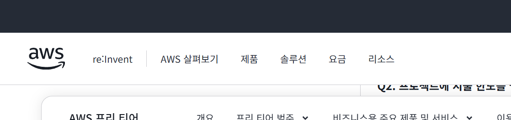

# 0016. AWS 프로젝트 환경: Q·ChatGPT 리서치 통합과 다음 확인 순서

정리일: 2026-10-17 (한국 시간)

## 1. 문서 목적과 자료 출처

이 문서는 다음을 구분해 정리한다.

1. **직접 관찰:** 사용자가 AWS 화면을 조작하고 내가 읽어 확인한 상태.
2. **Amazon Q 답변:** 사용자와 Q의 대화에서 읽은 설명. 공식 지원의 보증이나 계정 전체 검증 결과가 아니다.
3. **사용자 제공 ChatGPT 리서치:** 첨부한 독립 리서치 답변. 계정에 직접 접속하지 않은 외부 분석이다.
4. **공식 문서 재확인:** 이번 세션에서 AWS 공식 문서를 직접 읽어 확인한 내용.

사용자 제공 파일은 손대지 않은 복사본으로 보존했다.

- [ChatGPT 리서치 원문 전체](references/2026-10-17-chatgpt-research-original.txt)
- [앞선 공식 문서 조사](0015-iam-console-access-research.md)
- [실제 화면과 생성 과정](0013-iam-user-creation-walkthrough.md)
- [실습 권한 설계](0014-iam-policy-design.md)
- [과제 명세](../instruction.md)

**현재 새 계정 생성, 유료 전환, 고급 기능 활성화, 액세스 키 생성, 기존 관리자 역할 변경은 실행하지 않았다.** 전환을 결정한 문서가 아니라 사실·정정·남은 검증을 기록한 문서다.

## 2. 현재까지 실제로 한 일

- `forB3-1` IAM 사용자 생성.
- `B3Ec2SeoulLabPolicy` 생성 및 해당 사용자에게 직접 연결. 사용자 상세의 권한 정책 1개를 확인했다.
- 정책 편집기의 보안·오류·경고·추천 0 표시 확인. 이것은 실제 작업 성공이나 절대 최소권한의 증명은 아니다.
- 사용자 자격 증명 탭에 콘솔 암호 설정이 없고 액세스 키가 0개인 것을 확인했다.
- 기존 `AccountFullAccessRole`에 AdministratorAccess 연결을 확인했다. 신뢰 주체는 account-access.amazonaws.com이고 sts:AssumeRole/SetContext를 허용한다.
- 계정 메뉴는 프로젝트·팀 중심이며 Switch Role 항목은 보이지 않았다.
- 팀 초대는 광범위한 개발자 권한을 부여한다고 안내했다. 실제 초대는 보내지 않았다.

아직 직접 확인하지 않은 것:

- 프로젝트 추가 정보에 표시되는 정확한 배정 리전.
- 현재 로그인 주체의 STS ARN.
- 현재 주체의 서울 EC2 읽기 요청 결과 및 실제 SCP 거부 메시지.
- 실제 계정 크레딧의 종류별 만료일과 적용 제외 조건.
- 별도 최소권한 주체로의 콘솔 로그인 및 실습 리소스 작업.

## 3. 두 리서치의 공통 결론

### 3.1 계정이 가짜이거나 잘못 가입된 것은 아님

AWS의 신규 가입 경험은 Builder ID·프로젝트·팀을 중심으로 관리되며, 프로젝트 안에는 실제 AWS 계정이 있다. Free/Paid는 요금제이고 New/Advanced는 가입·관리 기능의 구분이다. 이를 “일반 계정 대 비정상 계정”, “신형 대 구형”으로 표현하지 않는다.

### 3.2 리전 문제

공식 프로젝트 리전 문서는 한국 연락처를 시드니 배정 대상으로 설명한다. 그러나 모든 한국 AWS 계정이 시드니에 고정된다는 뜻은 아니다. 또한 URL의 region 값은 프로젝트 배정 리전·실제 요청 허용 범위를 직접 입증하지 않는다.

공개된 신규 프로젝트 관리 정책의 RegionFloor는 배정 리전 밖의 요청을 제한한다. 실제 계정에 적용된 정책과 예외를 확인해야 하며, 서울이 기본 활성화 리전이라는 사실이나 관리자 정책이 이 Deny를 무효화하는 것은 아니다. CLI/Terraform도 상위 정책 제한을 자동으로 없애지 않는다.

### 3.3 IAM 콘솔 문제

공식 IAM 사용자 생성 문서는 신규 경험에서 콘솔 접근 IAM 사용자를 만들 수 없다고 명시한다. 사용자와 권한 정책 생성 성공은 로그인 암호 발급 성공과 다르다.

팀 초대는 EC2/VPC 한정 최소권한 주체의 대체안으로 확인되지 않았다. 기존 관리자 역할도 실습 정책을 추가한다고 권한이 축소되는 것은 아니다.

### 3.4 기존 계정을 유지하는 경로

공식 문서가 설명하는 경로는 Paid 업그레이드 → 고급 기능 활성화 → 실제 조직 정책의 서울 허용 여부 확인/필요 최소 수정 → 실습 Role과 사람 접근 배정 → 별도 로그인 검증이다.

Paid 전환만으로 완료되는 것이 아니며, 고급 기능 활성화만으로 실습 Role 배정·서울 허용까지 자동 완료된다고 가정하지 않는다. 기존 관리 역할이나 조직 보호 정책 전체를 삭제하지 않는다. 새 계정 생성은 필수가 아니다.

## 4. Q 답변의 변화와 주의점

- **04:00:** 일반 IAM 생성 절차와 콘솔 접근 체크박스를 안내했다. 실제 화면과 달랐다.
- **04:01:** 신규 환경의 암호 미지원을 인정하면서 AssumeRole/Federation과 Switch Role을 지원 경로로 제안했다.
- **04:10:** 재질문 후 Federation 방식의 신규 환경 공식 지원 명시를 찾지 못했다고 정정했다. 서울 EC2는 고급 기능 활성화 없이 지원되지 않는다고 설명했다.
- **04:17:** Paid 전환 선행, 활성화의 비가역성, spend limit 제거를 설명했다. 고급 기능 활성화 후 기존 크레딧 승계의 직접 근거는 못 찾았다고 했다.
- **04:24 및 04:36:** Paid 전환 후 크레딧 유지와 활성화 자체 무료를 설명했지만, 고급 기능 활성화 후 크레딧 유지 근거는 여전히 미확인으로 남겼다.

Q가 IAM GetUser 또는 비용 관리 조회를 표시했다고 해서 프로젝트 리전·전체 SCP·크레딧 약관을 모두 직접 검증했다고 판단하지 않는다. 특히 Q가 말한 us-east-1 콘솔 컨텍스트는 배정 리전 증거가 아니다.

**Federation은 일반 AWS에서 지원되는 기능이지만, 이 신규 프로젝트에서 공식 지원되거나 과제 조건을 해결한다고 확인된 경로는 아니다.** 이를 시험하려고 장기 액세스 키를 먼저 발급하지 않는다. 서울 리전 문제도 별도로 남는다.

## 5. 이번 정리 중 직접 찾은 정정: 고급 기능 활성화 후 크레딧 유지

### 5.1 이제는 공식 FAQ에 직접 근거가 있다

출처: [AWS 프리 티어 FAQ 한국어](https://aws.amazon.com/ko/free/free-tier-faqs/) → **고급 기능 → Q2. 고급 기능을 활성화하면 프리 티어 크레딧은 어떻게 되나요?**

2026-10-17 브라우저에서 문항을 펼쳐 직접 확인한 답변:

> 이미 적립한 프리 티어 크레딧은 만료될 때까지 향후 AWS 청구서에 자동으로 적용됩니다. 프리 티어 크레딧은 계정을 생성한 지 6개월 후에 만료됩니다.

따라서 Q와 내가 앞서 “고급 기능 활성화 후 기존 크레딧 유지에 대한 직접 명시를 찾지 못했다”고 남긴 상태를 정정한다. **공식 일반 정책 수준에서 적립 크레딧의 만료 전 자동 적용 근거가 확인됐다.** 이것이 모든 비용에 적용된다는 뜻은 아니며, 특정 계정의 개별 크레딧 상태를 조회한 결과도 아니다.



### 5.2 만료기간 6개월/12개월 차이는 남아 있음

같은 FAQ를 직접 펼쳐 읽었을 때:

- 일반 → Q6: 계정 생성일부터 **6개월**, 설정 포털에서 실제 만료일 확인 안내.
- Free 플랜 → Q8(Paid 업그레이드): 잔여 크레딧 자동 적용, 계정 생성일부터 **12개월**이라고 안내.
- 고급 기능 → Q2: 잔여 크레딧 자동 적용, 계정 생성일부터 **6개월**이라고 안내.

일반 Q6는 2026년 10월 신규 가입 경험 적용 전 가입자는 Billing and Cost Management의 크레딧 페이지를 확인하라고도 설명한다. 가입 경험·시점·크레딧 유형에 따른 조건 차이인지 문서 정합성 문제인지 여기서 확정하지 않는다.

**본인 크레딧은 무조건 12개월 유지된다고 안내하지 않는다.** AWS Settings의 청구/크레딧 상세에서 항목별 만료일을 사용자가 직접 확인하는 것을 다음 검증으로 둔다. Free Plan 잔여 일수와 개별 크레딧 만료일도 구분한다.

## 6. 비용에서 구분해야 할 것

- 고급 기능 활성화 행위 자체에는 추가 활성화 요금이 없다는 공식 AWS 발표가 있다.
- Paid 플랜은 월정액 구매와 같은 의미가 아니라 사용료 결제 책임이 생기는 요금제 전환이다. 사용 서비스·별도 지원 플랜 등의 요금은 구분한다.
- 적용 가능한 크레딧이 남아 있으면 해당 사용료에 반영되지만, 크레딧 적용 제외 항목·만료·잔액 초과분은 직접 부담할 수 있다.
- 고급 기능 활성화 시 기존 프로젝트 spend limit은 제거되고 재설정할 수 없다.
- 현재 Free Plan과 Paid Plan의 프로젝트 spend limit을 혼동하지 않는다.
- AWS Budgets 알림은 동일한 강제 비용 상한이 아니다.
- EC2, EBS, 퍼블릭 IPv4, 인터넷 송신 등이 실제 비용 검토 대상이다. 자동 할당 IP라고 무료가 되는 것은 아니다.
- Paid 업그레이드와 고급 기능 활성화는 모두 비가역적이라고 공식 문서가 안내한다.

## 7. 사용자 제공 ChatGPT 리서치를 어떻게 활용할 것인가

유용한 보완:

- 계정·Builder ID·프로젝트·요금제·관리 경험을 분리해 설명했다.
- URL 추측 대신 프로젝트 추가 정보와 읽기 전용 요청 검증을 우선했다.
- 기존 계정 유지가 가능하며 새 계정 생성이 필수가 아님을 분명히 했다.
- RegionFloor 검토와 역할 생성 후 실제 접근 배정까지 필요함을 강조했다.
- 크레딧 유지·만료기간 문제를 구분했다. 이번 FAQ 재확인으로 유지 근거는 보완됐다.

그대로 적용하지 않을 부분:

- 첨부 리서치가 실제 계정에 접속한 것은 아니다. “서울 생성이 실제 거부됨”의 증빙으로 사용하지 않는다.
- 포함된 IAM 예시는 Describe*와 변경 Resource *를 사용한 출발점이다. 현재의 작업 열거·관련 유형 ARN 제한 정책을 그 예시로 교체하지 않는다.
- 예시에는 현재 정책과 달리 Start/Stop, 속성 변경, 규칙 제거 등이 있고 잔여 EBS 정리 권한은 별도 보완이 필요하다. 예시 자체도 최종 최소권한이라고 주장하지 않는다.
- 새 Role을 생성하기만 해서는 현재 세션의 관리자 권한이 줄어들지 않는다. 실제 실습 Role 세션으로 로그인됐는지 검증해야 한다.
- Advanced 활성화가 기존 프로젝트의 IAM 사용자 암호 로그인을 자동으로 가능하게 한다고 확정하지 않는다. 공식적으로 설명되는 Account access manager 기반 Role 접근을 기준으로 세부 절차를 확인한다.

## 8. 다음 진행 순서: 전환 결정 전에 할 일

### 1단계. 프로젝트 추가 정보 확인

사용자가 AWS Settings → 프로젝트 → Sunrise Sprint → 개요/추가 정보에서 Region과 계정 ID를 확인한다. 프로젝트 URL이 아니라 해당 표시 값을 증빙으로 남긴다.

### 2단계. 현재 주체 및 읽기 요청 검증

이미 사용할 수 있는 CLI 인증이 있을 때만 다음을 실행한다. 이를 위해 새 액세스 키부터 만들지는 않는다.

```powershell
aws sts get-caller-identity
aws ec2 describe-vpcs --region ap-northeast-2
```

- IAM 권한의 Allow 부재, SCP의 명시적 Deny, 인증 오류를 구분한다.
- 빈 목록이어도 읽기 성공일 뿐 생성 허용의 증거는 아니다.
- 정책 효과를 확인하려는 요청이므로 어떤 주체·프로필로 실행했는지 함께 기록한다.
- 현재 만든 실습 정책은 서울만 Allow하므로, 이 정책과 상위 SCP가 서로 다른 리전을 허용한다면 실제 실습이 막힐 수 있다. 정책을 시드니로 바꿔 과제 조건을 임의 변경하지 않는다.

### 3단계. 실제 크레딧 만료일과 비용 조건 확인

AWS Settings의 청구/크레딧 상세에서 잔액, 종류별 만료일, 적용 범위를 확인한다. 계정의 결제 정보나 개인 인증 정보는 캡처하지 않는다.

### 4단계. 사용자 결정

현재 계정을 유지한 전환, 조건에 맞는 기존 계정 사용, 담당자에게 대체 조건 승인 요청 등을 비교한다. 기존 계정 유지의 공식 경로가 있으므로 무조건 재가입부터 권하지 않는다. 전환은 비용·비가역성에 동의하고 사용자가 버튼을 눌러야 한다.

### 5단계. 전환을 선택한 경우에만 후속 설정

Paid → 고급 기능 활성화 → 실제 SCP의 서울 허용 검토 → 별도 실습 Role/신뢰 관계/사람 접근 배정 → 실제 Role 로그인 → 서울 리소스 생성·검증 → 정리 순서다. 변경 전후 정책과 역할 접근을 기록하고 관리자 접근은 보존한다.

## 9. 참고 공식 문서

- [가입 방식 비교](https://docs.aws.amazon.com/accounts/latest/reference/sign-up-for-aws.html)
- [프로젝트 리전](https://docs.aws.amazon.com/accounts/latest/reference/project-regions.html)
- [IAM 사용자 생성](https://docs.aws.amazon.com/IAM/latest/UserGuide/id_users_create.html)
- [유료 업그레이드](https://docs.aws.amazon.com/accounts/latest/reference/upgrade-account.html)
- [고급 기능 활성화](https://docs.aws.amazon.com/accounts/latest/reference/activate-advanced-features.html)
- [프로젝트 조직 관리 정책](https://docs.aws.amazon.com/accounts/latest/reference/scps-and-rcps-for-projects.html)
- [Account access manager](https://docs.aws.amazon.com/IAM/latest/UserGuide/account-access-manager.html)
- [Role 신뢰 관계 준비](https://docs.aws.amazon.com/IAM/latest/UserGuide/aam-prepare-roles.html)
- [사용자/그룹 접근 배정](https://docs.aws.amazon.com/IAM/latest/UserGuide/aam-assign-remove-access.html)
- [프리 티어 FAQ: 크레딧 유지·만료](https://aws.amazon.com/ko/free/free-tier-faqs/)
- [AWS 신규 경험 발표: 활성화 자체 추가 비용 없음](https://aws.amazon.com/blogs/aws/aws-reimagines-the-getting-started-experience)

## 10. 이번 작업의 완료 범위

첨부 리서치 전체 읽기, 원문 복사 보존, Q 답변과 비교, 공식 FAQ의 크레딧 유지 직접 재확인, 캡처 및 문서화를 완료했다. 계정 전환이나 결제·권한·리소스 변경은 하지 않았다. 공식 공개 FAQ를 읽기 위한 연구 탭만 열었다.
