# 0017. AWS 플랜 전환 단계별 기록

관찰일: 2026-10-17 (한국 시간)

관련 조사: [Q·ChatGPT 리서치 통합](0016-aws-access-research-consolidated.md)

## 진행 원칙

사용자가 직접 버튼을 누르고 내용을 눈으로 확인한다. 나는 화면 읽기·안내·캡처·문서화를 담당하며, 별도 요청 없이 대신 업그레이드·결제·활성화를 실행하지 않는다.

Paid 업그레이드와 고급 기능 활성화는 별도 절차다. 둘 다 비가역적이며, 고급 기능 활성화 시 기존 프로젝트 지출 한도가 제거된다. 활성화 자체의 별도 요금과 실제 서비스 사용료를 구분한다.

## 1. 청구 페이지: 전환 전 무료 플랜 확인

사용자가 계정 메뉴의 청구로 이동했고, `https://settings.aws.com/billing`에서 다음을 확인했다.

- 현재 플랜: 무료
- 미수 금액: $0.00
- 남은 크레딧: $100.00
- 무료 플랜 남은 일수: 183일, 화면 표시 만료일 Apr 17, 2027
- 프로젝트: Sunrise Sprint 1개
- 화면 안내: 무료 플랜을 사용하는 중에는 요금이 부과되지 않음

이 날짜는 무료 플랜 표시이며, 개별 크레딧의 만료일을 직접 확인한 것은 아니다. 캡처 후 다음 사용자 동작으로 `현재 플랜 무료` 옆의 `업그레이드` 버튼을 눌러 안내 화면을 열도록 안내한다. 아직 업그레이드 버튼을 누르거나 플랜 전환을 실행한 상태는 아니다.

## 2. 트러블슈팅 보고서에 전환 전 상태 첨부

사용자가 현재 화면도 캡처하고 트러블슈팅으로 기록해 달라고 요청했다. 무료 플랜 청구 화면을 새로 캡처해 `captures/0036-troubleshooting-free-plan.png`로 저장했다.

과제 지정 경로의 [트러블슈팅 보고서](troubleshooting.md)에 TS-001을 작성했다. 증상 → 가설 → 검증 → 조치 → 결과 → 재발방지 구조를 사용하고, 해결 결과 미완료와 계정/권한 변경 전 상태를 명시했다. 현재 페이지에는 여전히 `현재 플랜 무료`와 업그레이드 버튼이 표시되며, 이 기록 작업에서는 버튼 클릭이나 전환을 수행하지 않았다.

## 3. 사용자가 업그레이드 안내 화면 열기

사용자가 청구의 `업그레이드`를 눌렀고, `https://settings.aws.com/billing/upgrade` 안내 화면 진입을 확인해 캡처했다.

- 제목: 무료 플랜 그 이상의 가치를 만드세요
- 안내: 업그레이드 비용과 약정 없음, 크레딧 유지, 180개 이상 서비스 접근
- 사용량 기반 지불 및 직접 제어하는 월별 지출 한도를 안내한다.
- 이후 지출 한도 설정과 결제 방법 추가 단계를 안내한다.
- 현재 버튼: `시작하기`, `종료`

**이 화면을 연 것만으로 Paid 전환 완료는 아니다.** 결제 정보 입력·최종 업그레이드 확인은 아직 하지 않았다. 이 화면의 월별 지출 한도는 프로젝트형 Paid Plan 설명이며, 이후 고급 기능 활성화 시 유지되는 보호 장치라고 해석하면 안 된다.

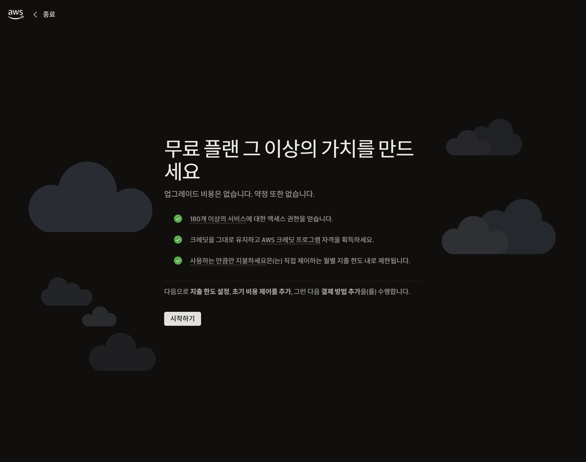

## 4. 시작하기 클릭: 1/3단계 월간 지출 한도

사용자가 `시작하기`를 눌렀고 `Sunrise Sprint에 대한 월간 지출 한도 설정` 화면을 확인해 캡처했다.

- 현재 단계: 1/3
- 기본 선택: `$20.00 USD 한도(권장)`
- 사용자 지정 한도: $20.00 이상, 최대 $10,000.00
- 안내: 한도에 도달하면 프로젝트가 일시 중지되며 재개하려면 한도를 늘림
- 버튼: 건너뛰기, 뒤로, 지출 한도 설정

기본 라디오 선택은 아직 한도 저장 완료를 뜻하지 않는다. `지출 한도 설정`을 누르거나 결제 정보를 입력한 것은 아니며, Paid 전환도 미완료다. 이 Paid Plan 단계의 한도는 고급 기능 활성화 시 제거되므로 이후까지 유지되는 강제 상한으로 생각하면 안 된다.

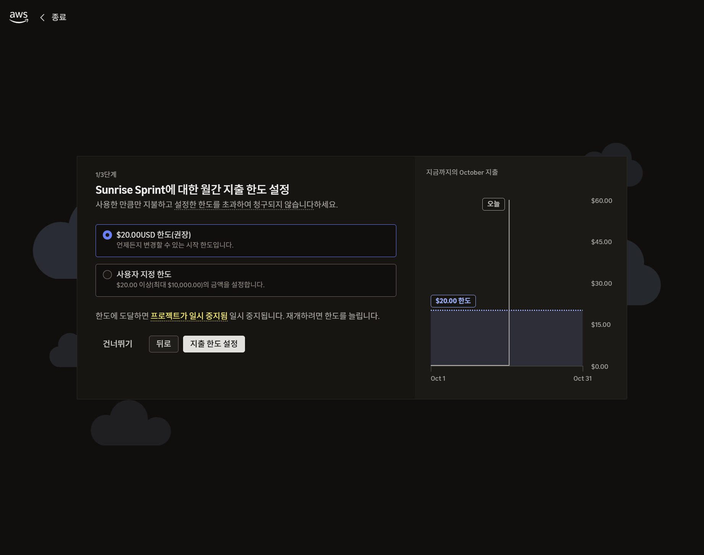

## 5. 2/3단계: 초기 비용 제어

사용자가 전 단계에서 다음 화면으로 이동했고, `초기 비용 관리를 사용하여 지출 한도 사용자 지정` 화면을 확인·캡처했다. 전 단계의 한도 설정 성공 알림은 별도로 확인하지 않았으며 최종 업그레이드는 아직 완료되지 않았다.

처음에는 모두 미선택이었다. 이후 사용자가 세 항목을 모두 체크했고 현재 화면에서 전부 선택된 것을 확인했다. 사용자 요청에 따라 아래 캡처를 세 항목 모두 체크된 최신 화면으로 교체했다. 아직 저장 버튼은 누르지 않은 상태다.

- 새 리소스 시작 중단: 한도 도달 약 7일 전에 새 리소스 실행 중단, 기존 리소스는 계속 유지.
- 유휴 상태 리소스 일시 중지: 한도 도달 약 5일 전에 유휴 리소스 일시 중지.
- 상위 비용 발생 항목 일시 중단: 한도 도달 약 4일 전에 비용이 큰 실행 리소스 일시 중지. 앱이 오프라인이 될 수 있다는 안내.

지출 한도의 50%·75%·90% 또는 향후 10일 내 초과 예상 시 알림을 안내한다. 버튼은 `건너뛰기`, `뒤로`, `초기 비용 제어 저장`이다. 이 제어들이 고급 기능 활성화 이후에도 유지된다고 검증한 것은 아니다.

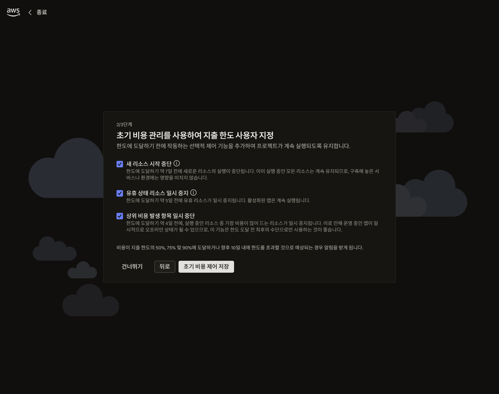

## 6. 3/3단계: 결제 방법 추가（개인정보 가림 캡처）

사용자가 비용 제어 저장 후 결제 방법 추가 화면으로 이동했다. 국가 선택, 카드 입력란, Billing address, 청구 연락 이메일 및 `계정 업그레이드` 버튼이 표시된다. 마지막 버튼은 AWS 종량제 요금 동의 및 플랜 전환에 해당한다.

사용자 요청으로 Billing address와 카드번호·유효기간·보안코드·카드 명의·이메일 입력란을 모두 가렸다. 이후 검은 박스를 부드러운 가장자리의 연한 회색 둥근 마스킹으로 바꿔 현재 입력 상태의 캡처로 교체했다. 본문은 불투명하게 덮어 민감한 글자가 이미지에 남지 않도록 했다. 실제 주소나 결제·연락처 값은 문서에 기록하지 않았다. 캡처 때만 임시 시각적 덮개를 사용하고 제거했으며, 원래 입력값·선택값·결제 설정은 변경하지 않았다. 마스킹되지 않은 결제 화면 이미지는 저장하지 않았다.

아직 `계정 업그레이드` 버튼 클릭이나 Paid 전환 완료는 확인하지 않았다. 사용자가 직접 내용을 확인하고 진행한다.

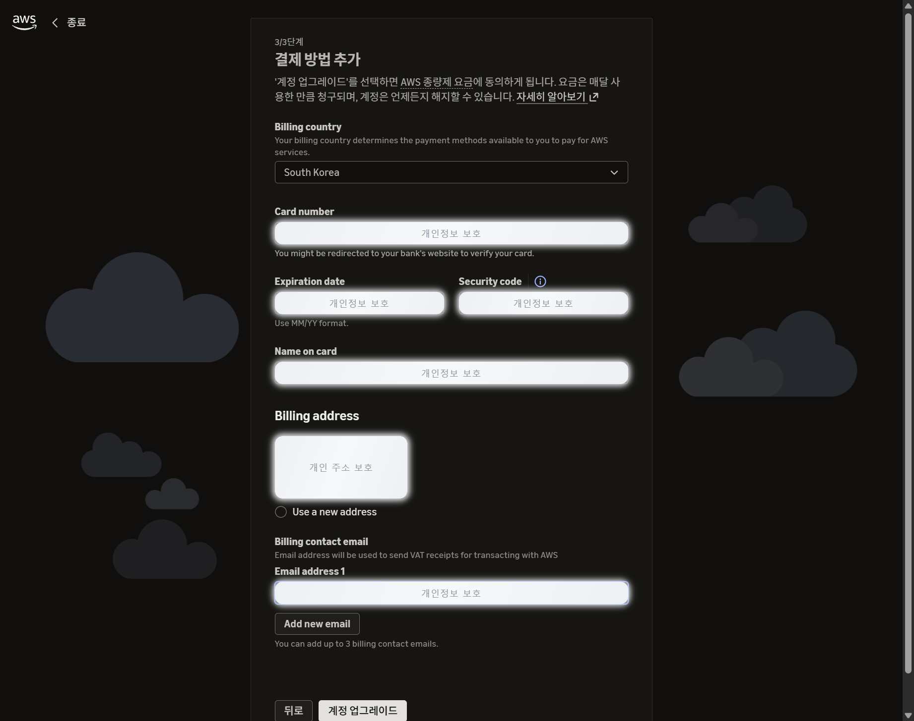

## 7. 카드 등록 성공 및 전환 처리 화면

사용자의 캡처 요청 시 `Your credit or debit card has been added successfully.` 성공 알림과 업그레이드 처리 애니메이션을 확인하고 캡처했다. 화면에는 카드번호·주소·이메일 등의 개인정보가 표시되지 않아 추가 가림 없이 저장했다. 캡처는 카드 등록 성공 및 처리 중 상태의 증빙이며, 이것만으로 Paid 전환이나 고급 기능 활성화 완료를 확정하지 않는다. 이 작업에서 내가 누른 버튼은 없다.

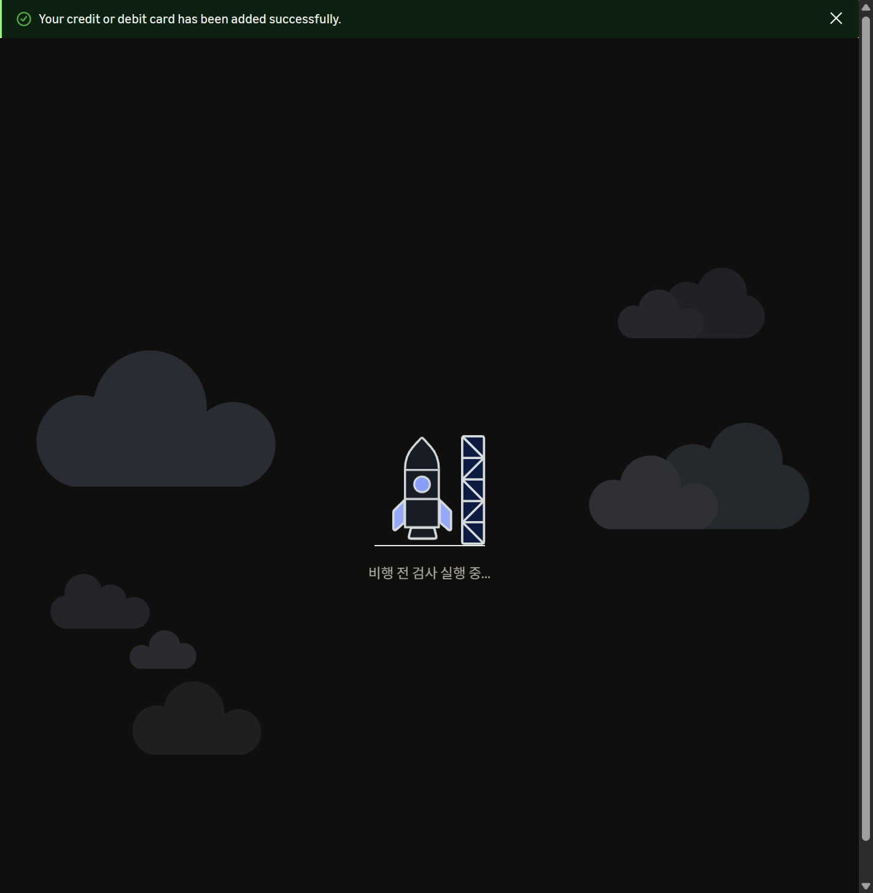

## 8. 사용자 보고: 업그레이드 완료, 청구 화면 복귀 확인

사용자가 업그레이드 완료를 알렸고, 업그레이드 마법사가 끝나 `https://settings.aws.com/billing` 청구 화면으로 복귀한 것을 확인했다. 기존 무료 플랜·업그레이드 버튼 대신 결제수단 관리와 현재 요금·프로젝트 지출 현황이 표시된다.

- 미수 금액: $0.00
- 당월 합계: $0.00
- 사용 가능한 크레딧: $100.00 USD
- Sunrise Sprint 지출 한도: $20.00, 상태 한도 이내
- 카드 등록 성공 알림 표시

카드 식별 정보가 있는 줄은 사용자가 요청한 부드러운 회색 마스킹으로 가린 뒤 완료 증빙을 저장했다. 사용자의 완료 보고와 전환 후 화면을 함께 근거로 Paid 업그레이드 단계 완료를 기록한다. **고급 기능 활성화는 아직 별도 미완료이며, 서울 허용·최소권한 콘솔 접근 문제 해결 완료를 뜻하지 않는다.**

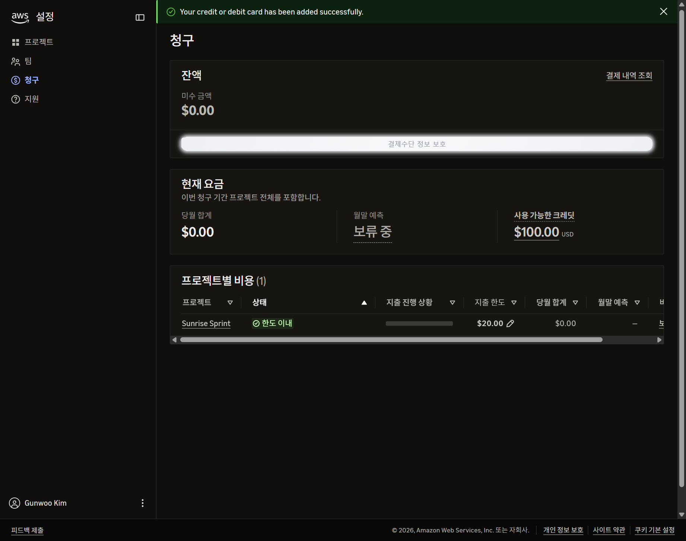

## 9. 프로젝트 목록에서 고급 기능 활성화 진입 위치 확인

사용자가 왼쪽 `프로젝트`를 눌렀다. 목록에는 Sunrise Sprint가 Active로 표시되고, 개요에 사용 가능한 크레딧 $100.00·현재 요금 $0.00가 보인다. 하단 `고급 기능 활성화` 영역에 `활성화 계속` 버튼과 설명서 링크가 표시된다.

현재 페이지의 설명은 자세한 내용과 활성화 절차를 확인하려면 `활성화 계속`을 선택하라고 안내한다. 다음 사용자 조작은 이 버튼으로 안내 화면을 여는 것이다. 아직 활성화 실행·최종 동의·조직 정책 변경은 하지 않았다.

사용자 요청으로 누를 버튼에 청록색 포커스 테두리와 다음 단계 안내를 추가한 강조본을 제작했다. 이는 조작 안내용 주석이며 AWS의 실제 알림이 아니다. 캡처 후 임시 강조 요소를 제거했고 버튼을 대신 누르지는 않았다. [원본 캡처](captures/0043-aws-advanced-features-entry.png)는 보존했다.

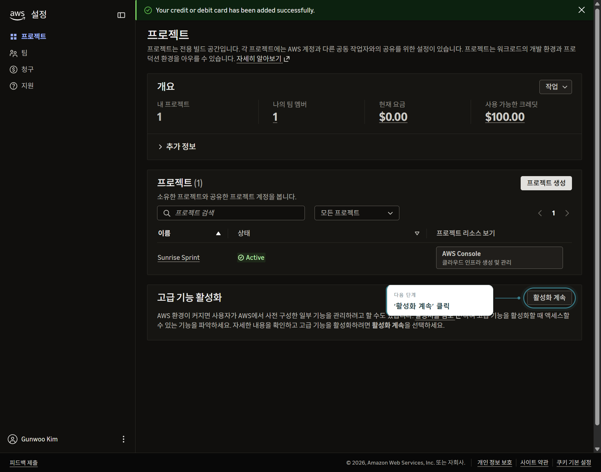

## 10. 고급 기능 평가·팀 이름·관리 계정 이메일 화면

사용자가 `활성화 계속`으로 들어간 다음 화면을 확인했다. 화면은 다중 리전, 팀원 사용자 지정 권한, 지출 한도 제거 및 프로젝트의 조직 멤버 계정 관리 등 변경 사항을 안내한다. 팀 이름은 기본 추천값이며 아직 수정하지 않았다.

관리 계정 이메일 단계에서 기존 이메일은 이미 다른 AWS 계정과 연결되어 있어 다른 이메일 주소가 필요하다는 안내가 표시된다. 이 이메일은 관리 계정 접근과 루트 자격 증명이 필요한 작업에 사용된다고 안내한다. 새 이메일 입력·인증 코드 발송·최종 활성화는 아직 하지 않았다.

사용자의 새 캡처 기준: 이후 조작 안내용 캡처에는 다음 입력/클릭 위치에 얇은 청록색 테두리와 설명 카드를 표시하고, 개인정보는 부드러운 불투명 마스킹으로 가린다. AWS의 실제 UI가 아닌 안내용 주석임을 구분하며, 원래 입력값이나 실제 설정은 변경하지 않는다.

현재 캡처는 관리 계정 이메일 입력란을 강조하고 기존 이메일 안내 영역을 가렸다. 팀 이름 추천값은 학습 흐름 확인을 위해 남겼다.

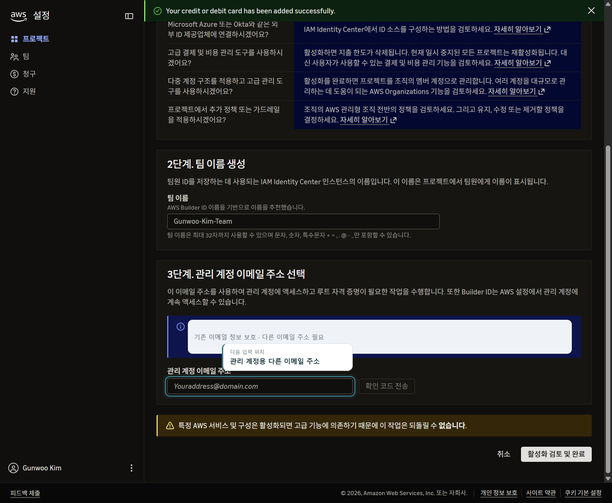

## 11. 관리 계정 이메일 입력 및 코드 전송 상태

사용자가 다른 관리 계정 이메일을 입력하고 확인 코드를 전송한 화면을 확인했다. 팀 이름은 추천값이 유지되며, `ID 확인` 영역과 코드 전송 안내, 코드 입력란, `활성화 검토 및 완료` 버튼이 표시된다. 코드 확인은 해당 버튼을 선택할 때 진행된다고 안내한다.

사용자가 이메일 주소는 캡처에 표시해도 된다고 명시했다. 이번 캡처는 이메일을 그대로 표시하고 **인증 코드 입력란만 불투명 가림 처리**했다. 코드를 읽거나 문서에 기록하지 않았으며 버튼은 대신 누르지 않았다. 다음 검토 버튼에 기존과 같은 청록색 테두리·설명 주석을 붙였다. 코드 검증 성공 및 고급 기능 활성화 완료는 아직 확인하지 않았다.

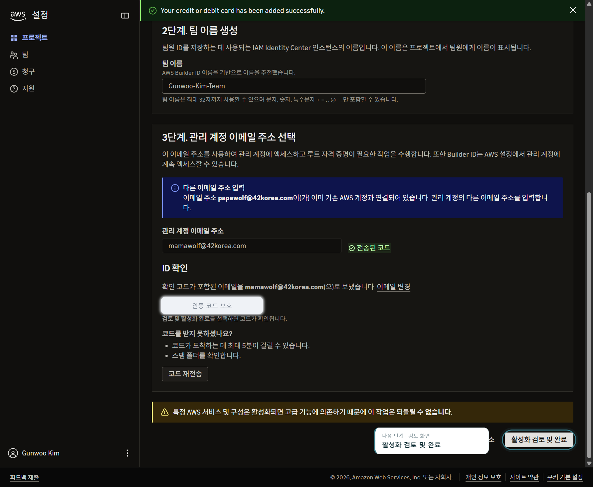

## 12. 활성화 확인 모달: 최종 실행 전

사용자가 검토 단계로 진행했고 `활성화 확인` 모달이 열렸다. 팀 이름과 관리 계정 이메일, 관리 계정 소유권 및 비가역성 경고가 표시된다. `활성화 확인` 문구를 입력해야 고급 기능 활성화를 진행할 수 있고, 관찰 시 입력란은 비어 있으며 `활성화` 버튼은 비활성 상태다.

이메일은 사용자가 표시를 허용한 범위로 남기고, 다음 확인 문구 입력 위치를 청록색 테두리로 강조해 캡처했다. 최종 활성화는 실행하지 않았으며 이 모달 진입이 활성화 성공을 뜻하지 않는다. 실제 주소나 카드 정보는 이 화면에 없다. 보안 인증 코드는 문서나 캡처에 노출하지 않는다.

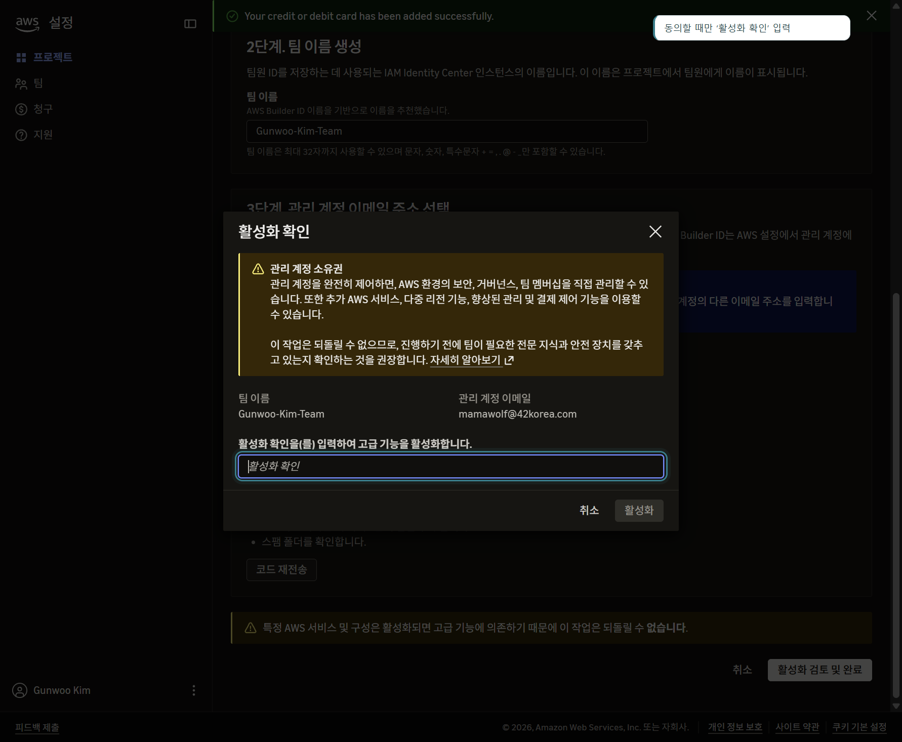

## 13. 사용자 최종 확인 후 활성화 진행 중

사용자가 최종 확인을 진행한 뒤 `활성화 진행 중` 모달이 표시된 것을 확인해 캡처했다. 화면은 최대 5분이 소요되며 AWS 환경을 수정하는 동안 이 페이지를 열어 두고, 완료 시 AWS 설정 페이지로 돌아간다고 안내한다.

현재 상태 제목을 청록색 테두리로 강조했다. 이메일은 허용 범위로 표시하고 배경의 인증 코드 입력란은 캡처 동안 숨겨 코드가 이미지에 남지 않도록 했다. 활성화 버튼은 내가 누르지 않았다. **활성화 요청은 진행 중이며 완료 성공은 아직 확인하지 않았다.** 페이지를 유지하고 결과 화면을 확인해야 한다.

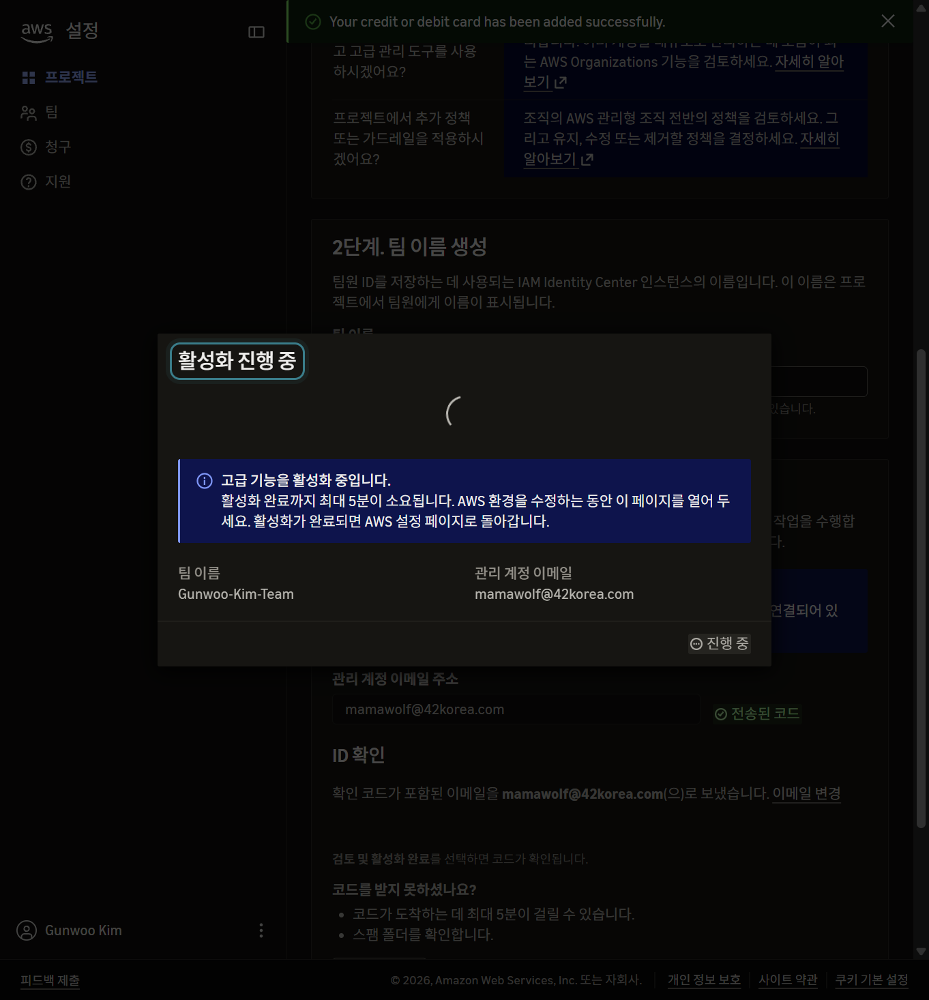

## 14. 활성화 지연 오류 표시

다음 캡처 요청 시 진행 모달이 사라지고 오류 안내가 표시됐다.

> 활성화 작업이 예상보다 오래 걸리고 있습니다. 페이지를 새로 고침하여 진행 상황을 확인하거나 다시 시도해 주세요.

오류 영역을 강조하고 인증 코드 입력란은 숨겨 캡처했다. 현재 성공·완전 실패·백엔드 처리 중 여부를 확정할 수 없다. 다음에는 사용자가 안내에 따라 페이지를 한 번 새로 고침해 상태를 확인하는 것이 우선이다. 중복 활성화 제출은 상태 확인 전 실행하지 않는다. 이 캡처 작업에서는 새로 고침이나 재시도 버튼을 대신 누르지 않았다.

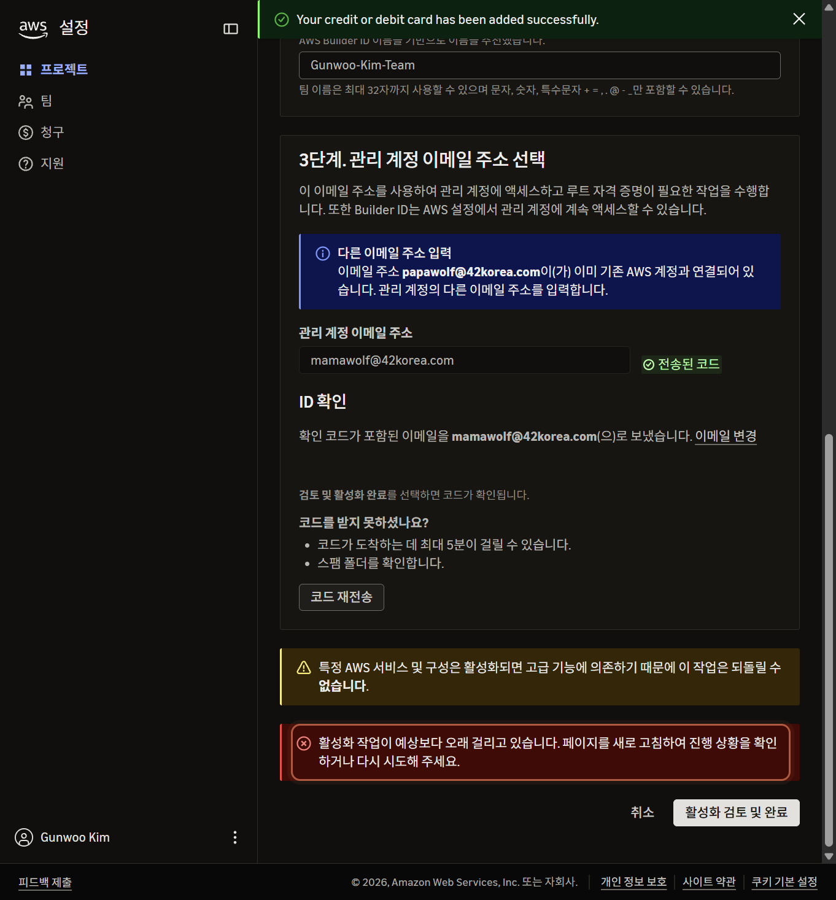

## 15. 후속 화면: Access denied

다음 캡처 요청 시 활성화 화면의 오류가 지연 안내에서 `Access denied`로 바뀐 것을 확인했다. 오류를 강조하고 인증 코드는 숨긴 채 새 증빙을 저장했다. 이메일 표시는 사용자 허용에 따른다.

이 문구만으로 어떤 API·주체·정책에 의해 거부됐는지 또는 백엔드 활성화가 전혀 적용되지 않았는지는 알 수 없다. 새로 고침이나 재시도가 실제로 수행됐는지도 이번 관찰만으로 단정하지 않는다. 내가 대신 재시도하거나 권한을 변경하지 않았다. 활성화 성공 여부는 여전히 확인이 필요하다.

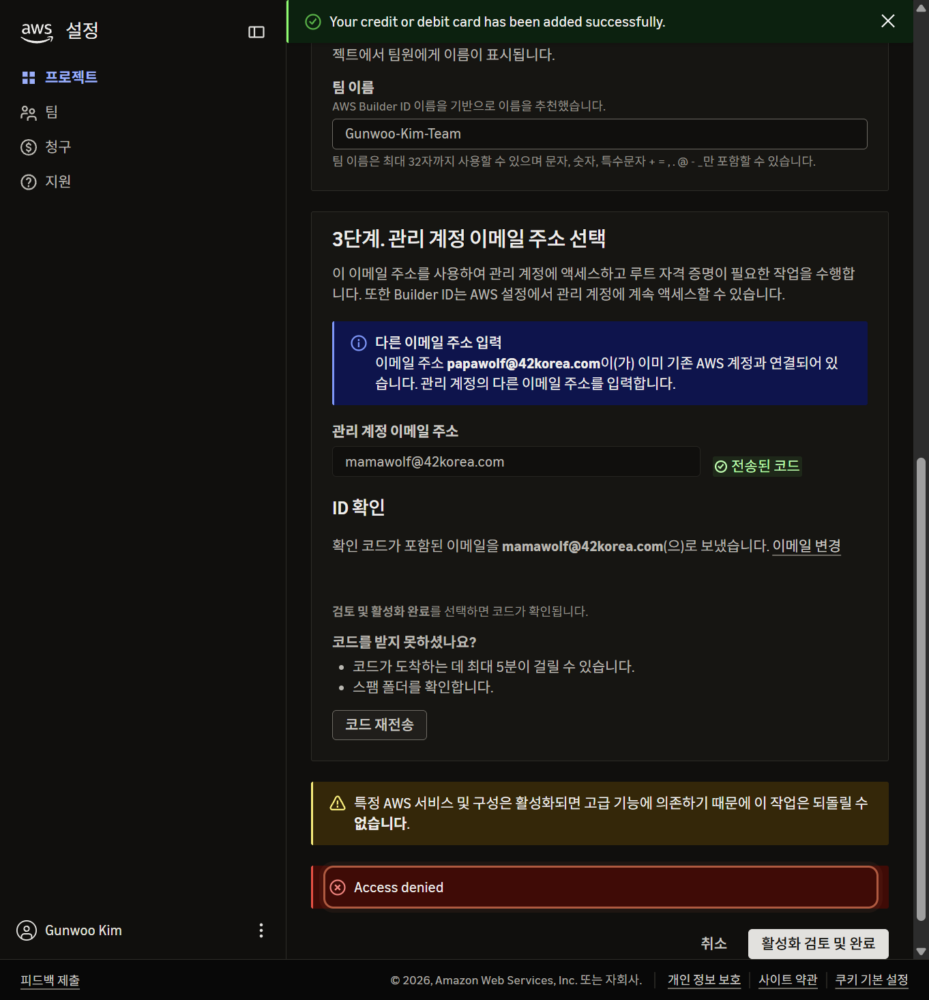

## 16. 고급 기능 활성화 완료 확인

사용자가 완료 상태를 발견한 뒤 캡처를 요청했다. 현재 프로젝트 목록에서 AWS의 `고급 기능 활성화 완료` 성공 알림을 직접 확인했다. 알림은 관리 계정 접근 권한과 조직 관리 권한이 부여됐다고 안내한다.

- 프로젝트 목록: Sunrise Sprint와 Gunwoo-Kim-Team Identity Delegated Admin, 둘 다 Active
- 관리 계정: Gunwoo-Kim-Team Management Account 1개
- 후속 진입: `이 조직 관리하기` 버튼

성공 알림과 후속 관리 버튼을 강조해 캡처했다. **고급 기능 활성화 단계는 완료**로 갱신한다. 앞선 지연·Access denied 메시지는 당시 화면의 실제 오류 기록으로 보존하되, 최종 활성화 실패를 뜻하는 것으로 해석하지 않는다. 처리 완료 시점·오류의 직접 원인은 아직 로그로 확인하지 않았다.

서울 리전의 실제 허용 여부와 별도 최소권한 실습 Role 접근은 다음 검증으로 남는다. 이 캡처 작업에서 조직 관리 버튼이나 정책은 조작하지 않았다.

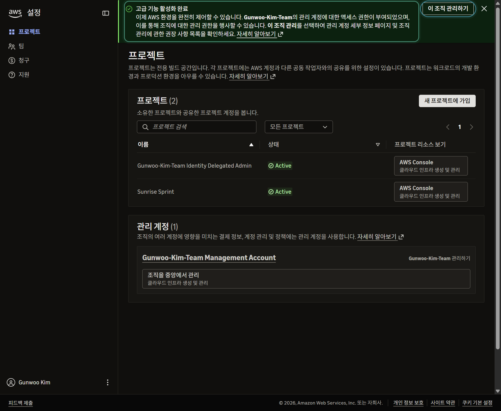

## 17. 알림을 닫은 뒤 관리 계정 재진입 및 리전 확인 경로

성공 알림을 닫아도 프로젝트 목록 아래 `관리 계정 (1)`의 `Gunwoo-Kim-Team Management Account` 이름으로 관리 계정 세부 화면에 다시 진입할 수 있다. 사용자가 진입한 현재 화면을 확인하고, `리전 관리` 카드의 `리전 정책 관리` 링크를 강조해 캡처했다.

다음은 해당 링크를 사용자가 눌러 현재 리전 정책을 읽는 단계다. 이 캡처에서는 링크 클릭·정책 변경을 대신 실행하지 않았으며 서울 허용 여부는 아직 확인되지 않았다.

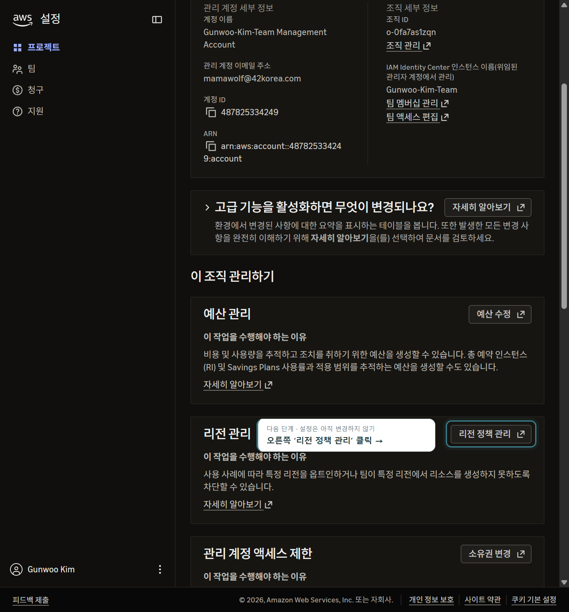

## 18. 조직 계정 구조 확인 및 매 단계 캡처 원칙

리전 제한 SCP의 대상 탭에서 Root(`r-3tke`) 연결을 확인했다. AWS 계정 목록에서 같은 Root 아래 실습 계정 Sunrise Sprint(`067518846638`), Identity Delegated Admin, Management Account가 표시됨을 확인했다. 따라서 실습 멤버 계정은 해당 Root SCP를 상속받는 구조다. 앞서 읽은 RegionFloor 문은 서울(`ap-northeast-2`)을 차단 예외 목록에 포함하지 않으며 EC2 작업도 그 문장의 서비스 예외에 포함되지 않는다. 실제 서울 작업 성공은 아직 검증하지 않았다.

사용자가 클릭 단계마다 반드시 캡처하라고 요청했다. 이후 사용자가 클릭 완료를 알리면 현재 상태를 읽고 **매 단계 캡처·문서 저장·다음 클릭 위치 강조**를 기본으로 진행한다. 조작은 계속 사용자가 직접 한다. 이메일 표시 허용은 유지하고 인증 코드·결제 정보는 노출하지 않는다.

현재 계정 목록의 `Sunrise Sprint` 이름을 강조해 캡처했다. 다음은 계정 이름을 눌러 상세 화면에서 적용 정책을 확인하는 단계이며 체크박스·작업 메뉴나 정책은 변경하지 않는다.

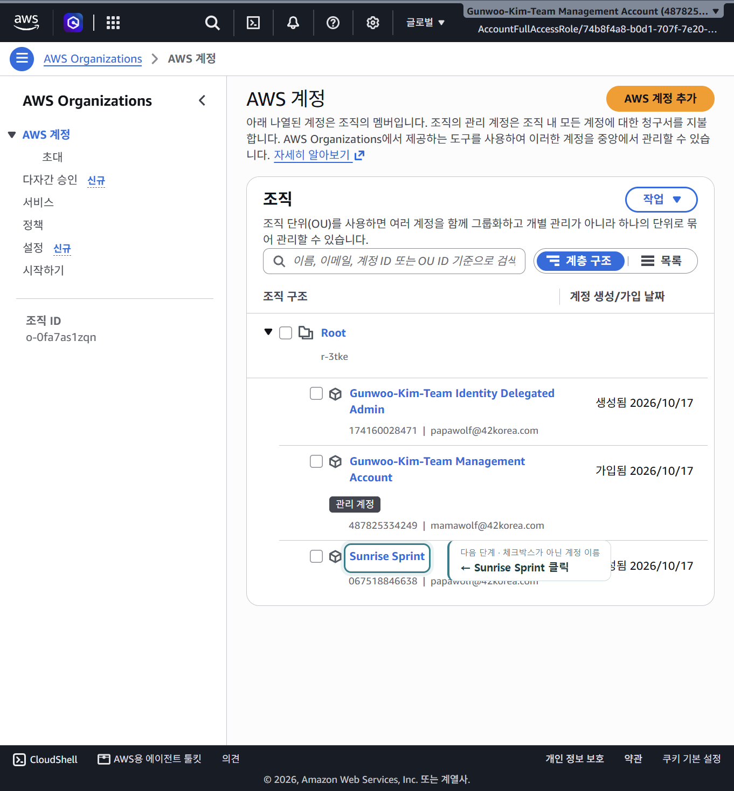

## 후속 진행 문서

서울 EC2 조회의 변경 전 거부·정책 수정·변경 후 성공 증빙은 [트러블슈팅 TS-001](troubleshooting.md)에 기록했다. 이후 IAM 사용자의 콘솔 액세스 활성화와 MFA 준비 캡처는 [0018. IAM 콘솔 로그인과 MFA](0018-iam-console-login-and-mfa.md)에 이어서 기록한다. MFA 등록과 최소권한 로그인은 아직 완료 전이다.
