# 실습용 IAM 콘솔 로그인과 MFA 준비

[이전: AWS 활성화 진행](0017-aws-plan-upgrade-walkthrough.md) · [트러블슈팅](troubleshooting.md)

## 목표와 현재 상태

실습 계정 Sunrise Sprint(067518846638)의 기존 관리자 역할을 유지하면서, 과제용 IAM 사용자 forB3-1로 콘솔에 로그인할 준비를 한다. 모든 AWS 변경은 사용자가 직접 수행했다.

- 확인: forB3-1에 B3Ec2SeoulLabPolicy가 직접 연결돼 있다.
- 확인: 사용자 콘솔 액세스 활성화 성공 알림과 활성화 상태를 확인했다.
- 확인: 가상 MFA 디바이스 forB3-1-iPhone 등록 완료, 콘솔 액세스가 MFA로 활성화됨.
- 확인: 계정 별칭 papawolf-b3-1과 forB3-1의 암호·MFA로 실제 콘솔 로그인 성공.
- 미완료: 최소권한으로 서울 EC2/VPC 실습 동작 검증.

## 1. 기존 사용자 권한 확인

IAM → IAM 사용자 → forB3-1 → 권한에서 고객 관리형 B3Ec2SeoulLabPolicy 한 개가 직접 연결된 것을 확인했다. 현재 관리자 세션과 과제용 사용자는 별개의 주체이며, 사용자를 열었다고 그 사용자로 로그인한 것은 아니다.

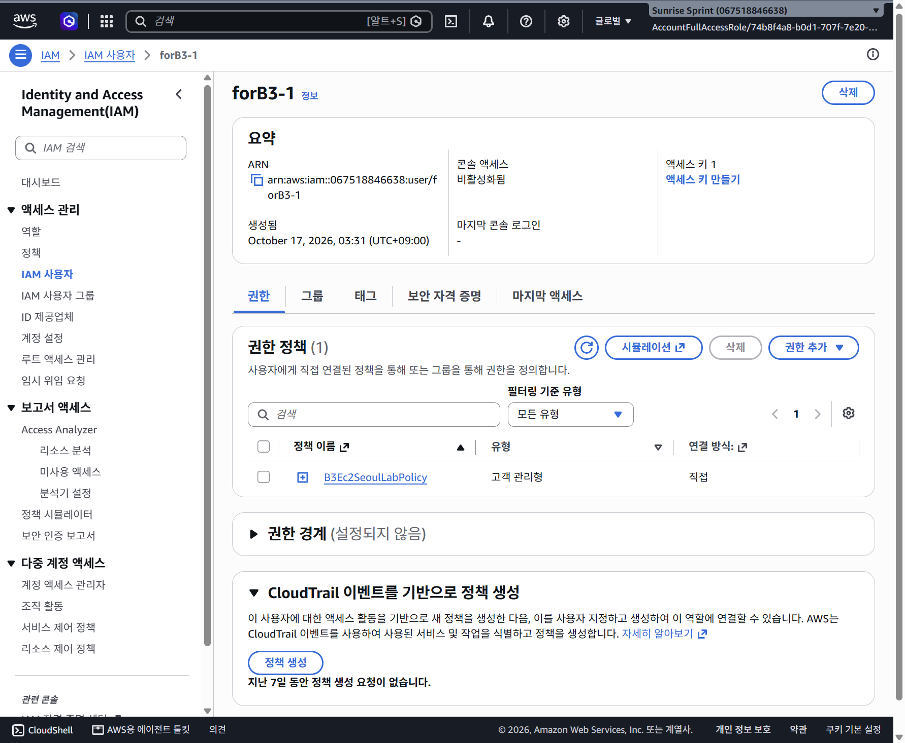

## 2. 콘솔 액세스 활성화 전

보안 자격 증명 탭에서 콘솔 암호가 활성화되지 않은 상태를 확인했다. 액세스 키 목록은 0개였으며 콘솔 로그인을 위해 액세스 키를 만들지는 않았다.

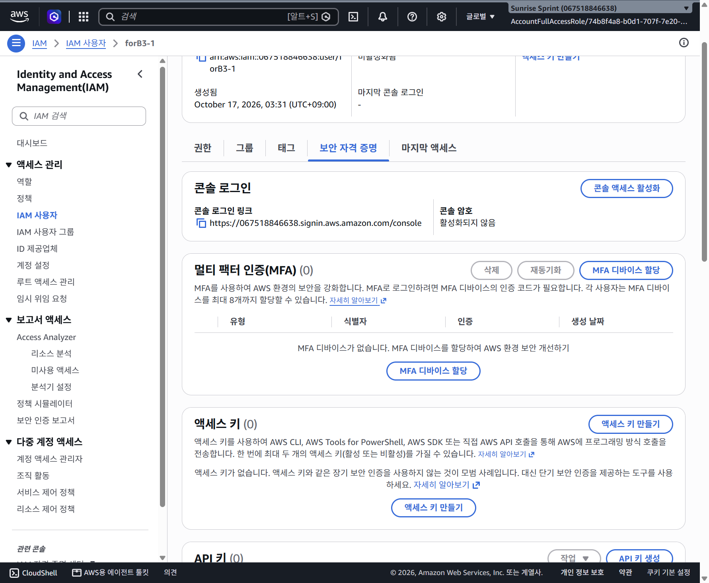

## 3. 사용자 직접 활성화 후

사용자가 암호 설정과 콘솔 액세스 활성화를 완료했다. AWS 성공 알림과 MFA 없이 활성화된 상태를 확인했다. 암호는 읽거나 문서에 저장하지 않았고, 자격 증명 CSV를 수집하지 않았다. 아래는 암호 창이 닫힌 후의 화면이다.

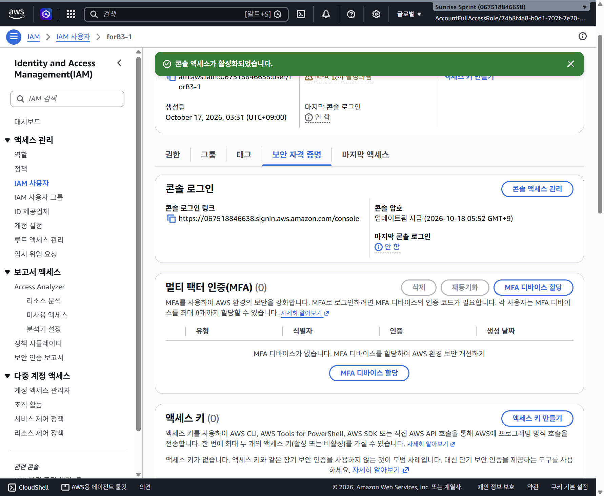

콘솔 액세스 활성화는 로그인 수단을 만드는 작업이며, 연결된 IAM 정책보다 넓은 권한을 추가하는 작업은 아니다. 활성화 시점에는 아직 forB3-1 로그인 검증을 하지 않았다.

## 4. MFA 인증 앱 방식 선택

사용자는 휴대폰 인증 앱 방식을 선택했다. 디바이스 이름은 forB3-1-iPhone이며, 관찰 시 Next 이전의 방식 선택 단계다. MFA 등록 성공은 아직 확인하지 않았다.

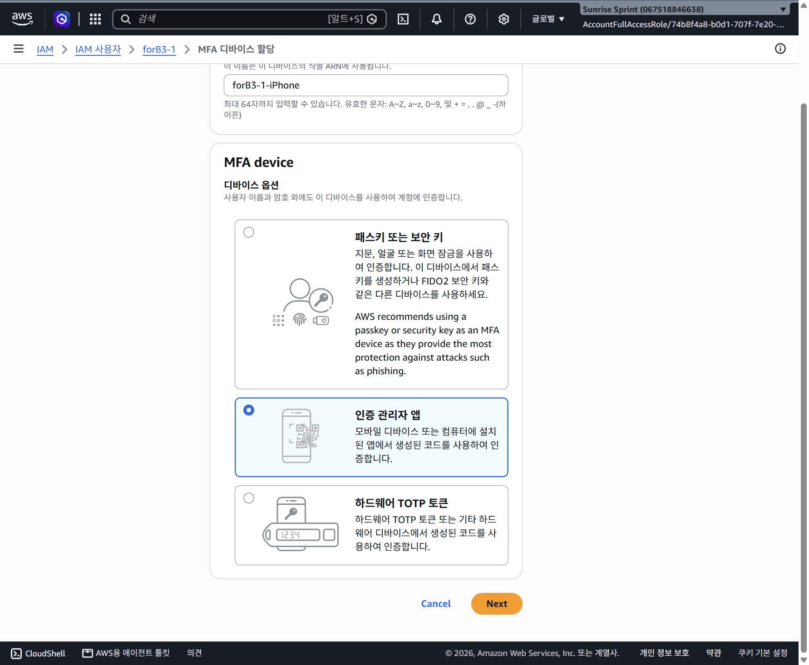

## 보안 및 기록 원칙

- 암호, MFA QR, 시드/비밀키, 일회용 인증 코드는 MD·Git·캡처에 넣지 않는다.
- MFA 등록 중 민감정보가 표시되는 화면은 증빙에서 제외하거나 안전한 범위만 캡처한다.
- MFA와 실제 최소권한 로그인이 성공한 시점에 완료 상태를 갱신한다.
- 단계별 증빙은 채팅 임시 이미지로만 두지 않고 docs/captures와 MD 상대 링크로 보존한다.
- 마일스톤 검증 완료 시 관련 문서와 증빙을 커밋·푸시한다. 이 문서 작성만으로 푸시 완료를 뜻하지 않는다.

## 5. 인증 앱 연결 단계 진입

사용자가 Next를 눌러 디바이스 설정 화면에 진입했다. QR 코드 표시·보안 키 보기 버튼과 연속된 두 MFA 코드 입력란, MFA 추가 버튼을 확인했다. QR 미표시·코드 미입력 상태만 캡처했다. 이후 QR/비밀키 및 코드 입력 과정은 캡처하지 않는다. 등록 성공은 아직 확인 전이다.

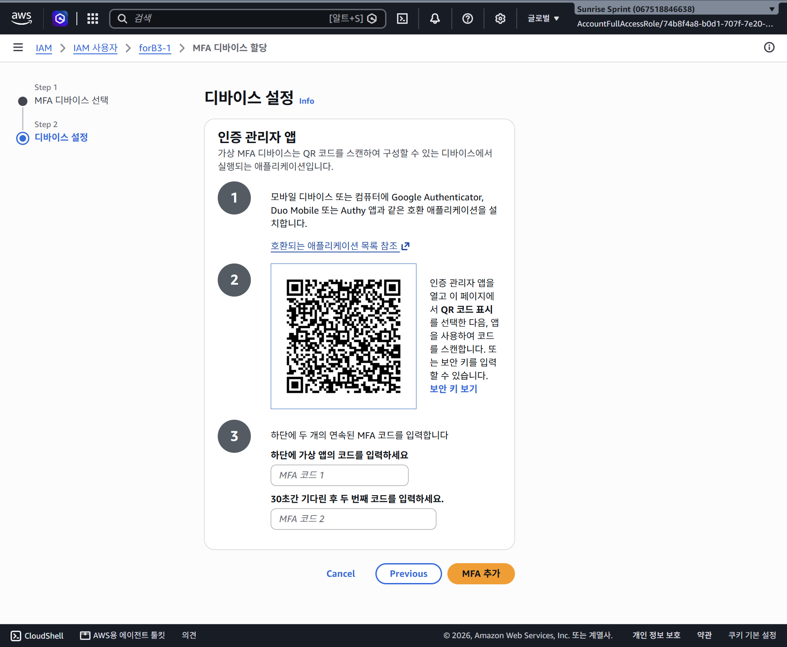

## 6. 등록 도중 보호 캡처

사용자 요청으로 디바이스 설정 화면을 다시 캡처했다. QR가 표시된 단계이므로 QR·비밀키·인증 코드 입력 영역 전체를 불투명 가림 처리한 뒤 저장했다. 등록 성공은 아직 확인되지 않았다.

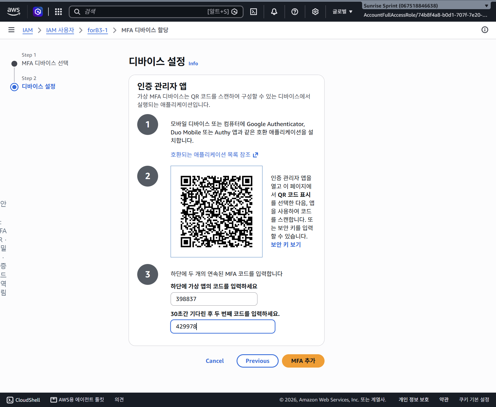

## 7. MFA 등록 완료 확인

사용자 조작 후 `MFA 디바이스 할당됨` 알림, `콘솔 액세스 MFA로 활성화됨`, `멀티 팩터 인증(MFA) (1)` 및 가상 디바이스 forB3-1-iPhone을 확인했다. QR·비밀키·일회용 코드가 없는 완료 화면을 캡처했다. 현재 세션은 여전히 기존 관리자 역할이며, 사용자 로그인 검증은 남아 있다.

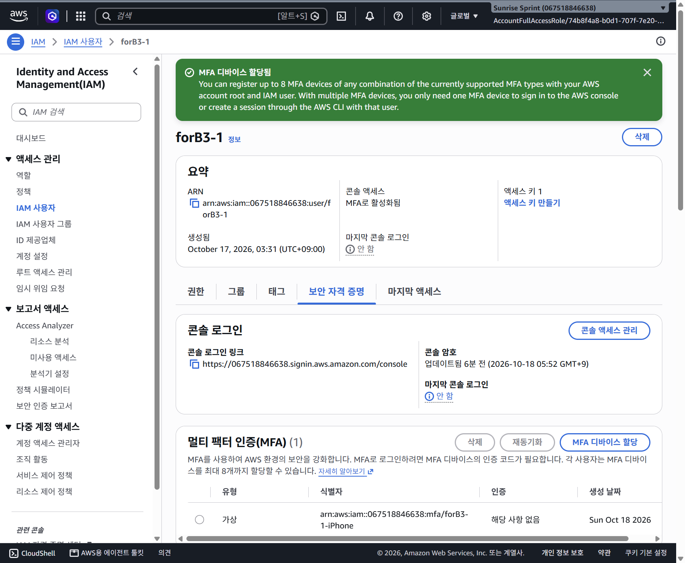

## 8. IAM 사용자 로그인 검증 경로

계정 메뉴에서 기존 Sunrise Sprint 관리자 세션과 별도 관리 계정 세션을 확인했다. 로그아웃하지 않고 `세션 추가`로 IAM 사용자 로그인 경로를 확인하기로 했다. 아직 forB3-1로 로그인한 상태는 아니다.

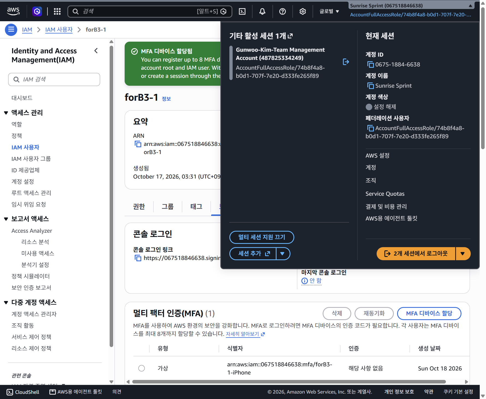

## 9. 로그인 방식 선택

세션 추가 후 AWS 로그인 화면이 열렸다. 이메일/Builder ID가 아니라 기존 forB3-1로 로그인하기 위해 `IAM user`를 선택하는 단계다. 로그인 완료는 아직 확인하지 않았다.

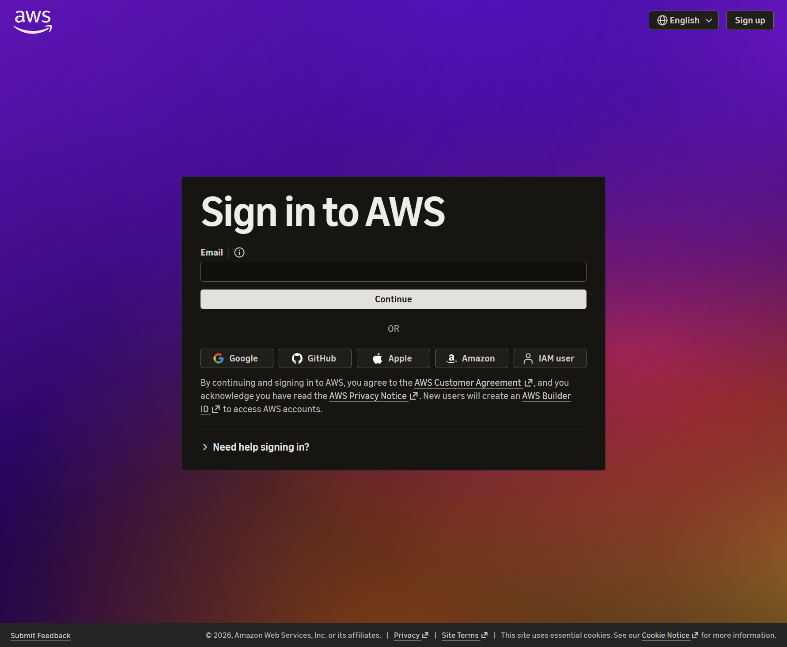

## 10. IAM 사용자 로그인 입력 화면

IAM user 선택 후 계정 ID/별칭, IAM 사용자 이름, 암호를 입력하는 화면을 확인했다. 실습 계정 ID는 067518846638, 사용자 이름은 forB3-1이다. 암호·MFA 코드는 사용자가 직접 입력하고 공유하지 않는다. 입력 전 화면을 캡처했다. 실제 로그인 성공은 아직 확인 전이다.

## 11. 계정 별칭 생성 준비

계정 ID를 매번 입력하는 대신 별칭을 사용하고 싶다는 사용자 요청으로, 기존 관리자 세션의 IAM 대시보드에서 실습 계정 067518846638의 별칭 생성 창을 열었다. 입력란은 비어 있고 아직 별칭은 생성되지 않았다. 후보로 papawolf-b3-1을 제안했다. 전역 중복 여부는 생성 응답으로 확인해야 한다. 별칭은 계정 전체의 로그인 식별자이며 IAM 사용자 이름이나 권한을 변경하지 않는다.

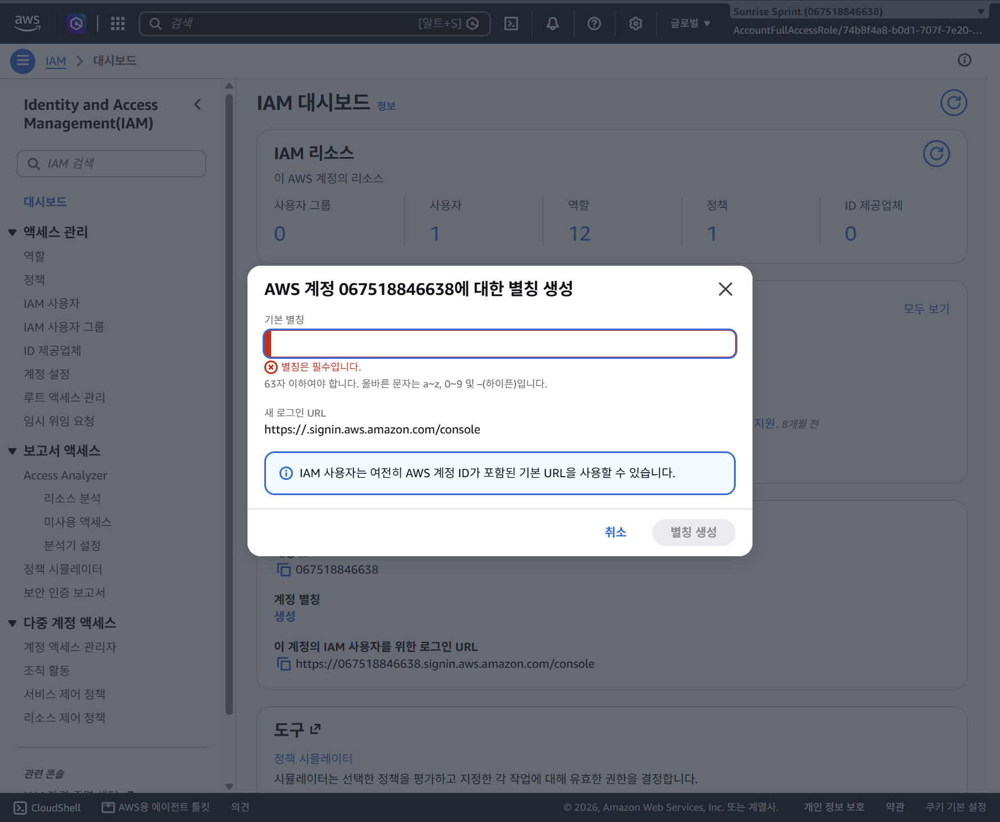

## 12. 별칭을 사용한 로그인 준비 화면

사용자가 별칭 생성을 완료했다고 알린 뒤, 현재 화면은 IAM 로그인 페이지다. 계정 칸에 papawolf-b3-1, 사용자 칸에 forB3-1이 입력돼 있고 암호 표시는 꺼져 있다. 이 캡처는 별칭 생성 성공 알림이 아니라 **별칭을 사용한 로그인 준비 화면**이다. 별칭 매핑과 로그인 성공은 아직 이 화면만으로 검증되지 않았다. 비밀번호는 기록하지 않는다.

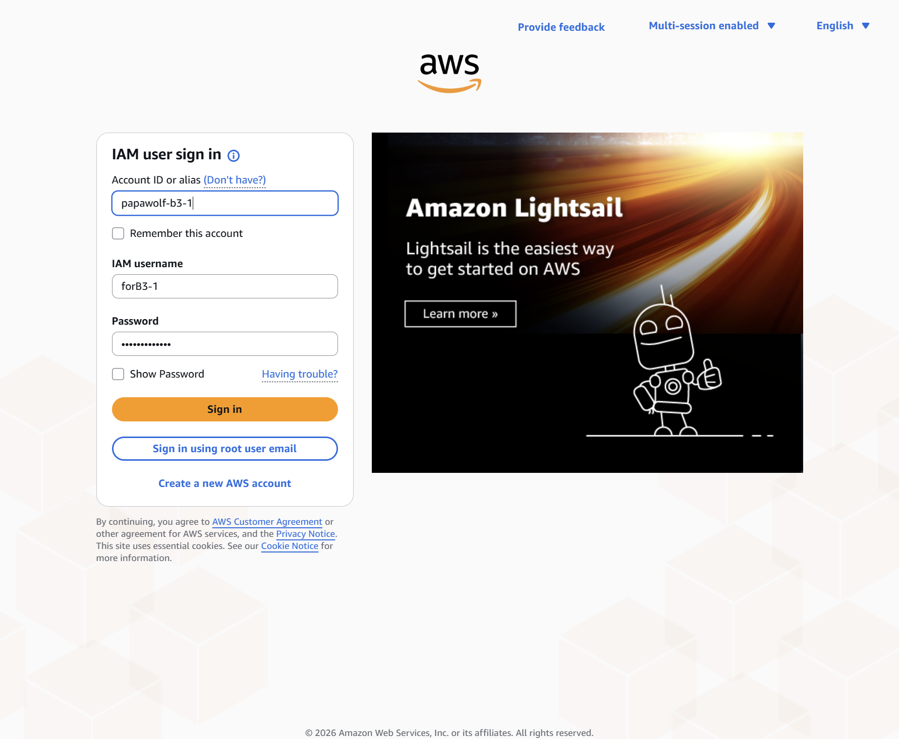

## 13. 로그인 MFA 추가 인증 화면

별칭과 사용자 암호로 로그인 진행 후 `Additional verification required`가 표시됐다. 휴대폰 MFA 코드를 입력하는 단계이며, 아직 콘솔 로그인 완료는 아니다. 인증 코드 입력란을 캡처 동안 숨겨 코드가 남지 않도록 했다.

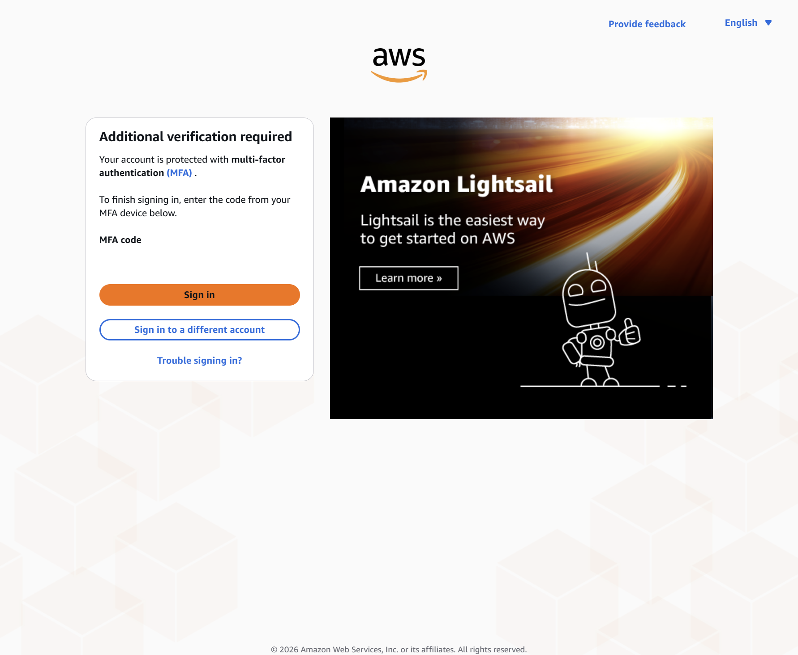

## 14. 마일스톤: 과제용 사용자 MFA 로그인 성공

MFA 제출 후 콘솔 홈으로 진입했고 오른쪽 위 `forB3-1 @ papawolf-b3-1`, 계정 ID 067518846638을 확인했다. 이제 실제 세션 주체는 기존 관리자 역할이 아닌 IAM 사용자 forB3-1이다. 별칭·암호·휴대폰 MFA 로그인 경로가 실제로 동작했다.

현재 기본 리전은 시드니(ap-southeast-2)다. 다음 단계는 서울로 전환하고 EC2/VPC 조회 및 과제 작업을 검증하는 것이다. 홈의 Health·비용 위젯에 권한 부족이 표시되지만 이를 이유로 관리자 권한을 추가하지 않는다. 작업별 실제 권한 검증은 남아 있다.

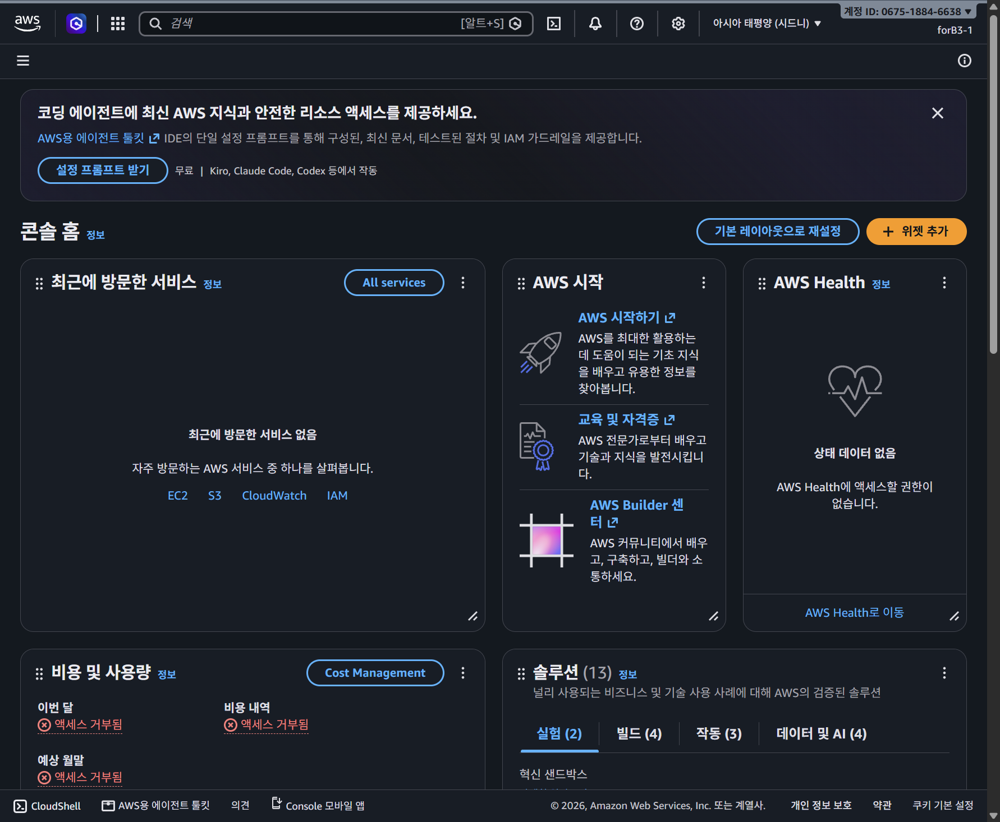
