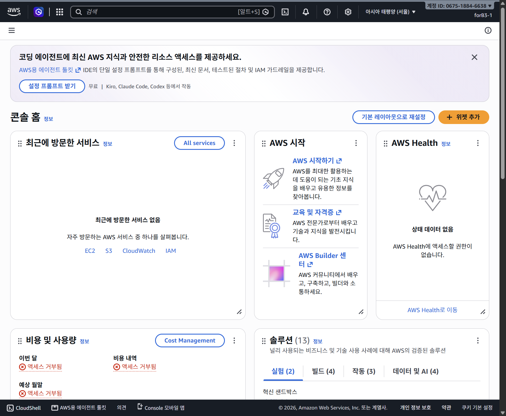
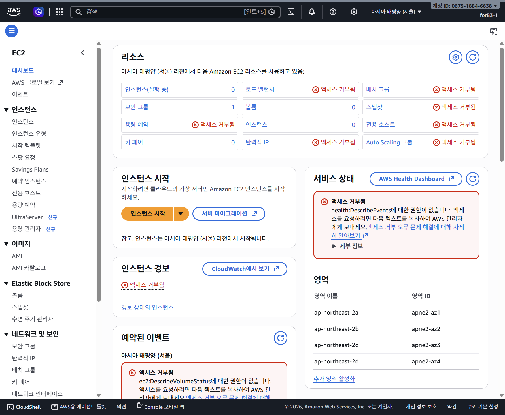
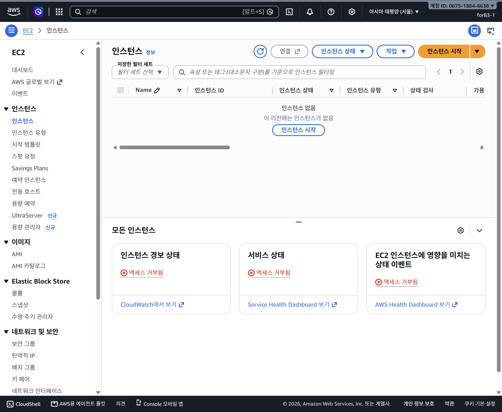
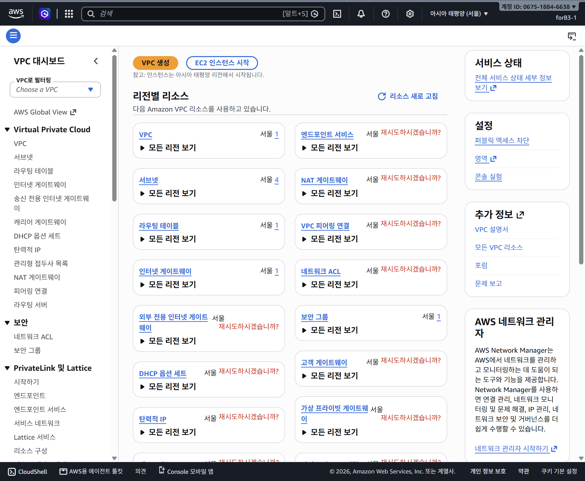
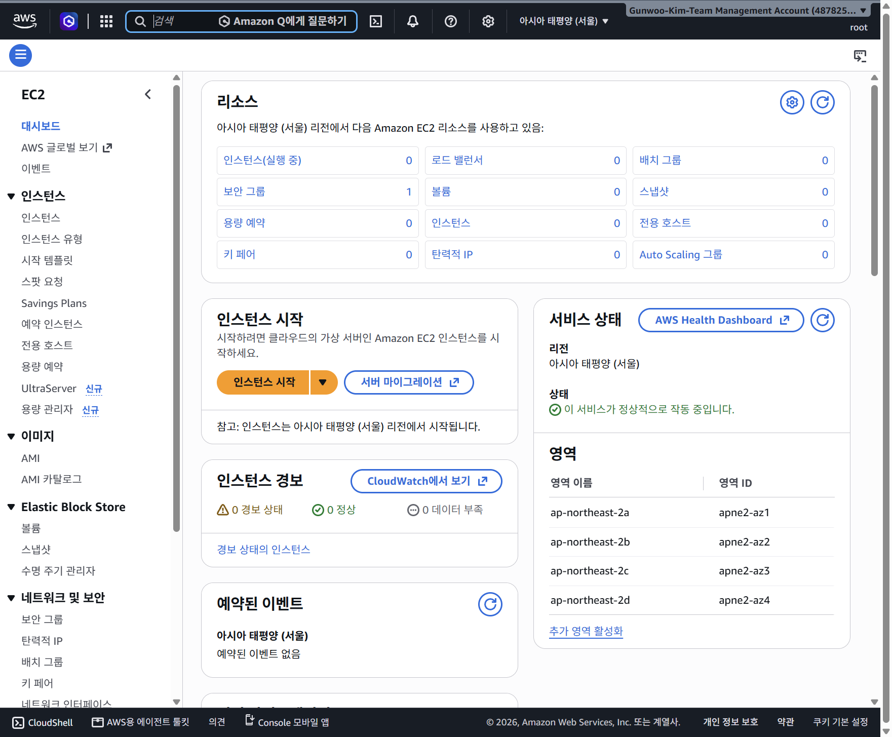

# 실습용 IAM 콘솔 로그인과 MFA 준비

> **후속 상태 안내:** 아래는 로그인·구축 과정을 관찰 시점별로 남긴 기록이다. 이후 EC2·실습 네트워크는 정리했고 현재 상태는 [정리 체크리스트](cleanup-checklist.md)에 있다. 과거 생성·실행 화면을 현재 운영 상태로 읽지 않는다.

[이전: AWS 활성화 진행](0017-aws-plan-upgrade-walkthrough.md) · [트러블슈팅](troubleshooting.md)

## 목표와 현재 상태

실습 계정 Sunrise Sprint(067518846638)의 기존 관리자 역할을 유지하면서, 과제용 IAM 사용자 forB3-1로 콘솔에 로그인할 준비를 한다. 모든 AWS 변경은 사용자가 직접 수행했다.

- 확인: forB3-1에 B3Ec2SeoulLabPolicy가 직접 연결돼 있다.
- 확인: 사용자 콘솔 액세스 활성화 성공 알림과 활성화 상태를 확인했다.
- 확인: 가상 MFA 디바이스 forB3-1-iPhone 등록 완료, 콘솔 액세스가 MFA로 활성화됨.
- 확인: 계정 별칭 papawolf-b3-1과 forB3-1의 암호·MFA로 실제 콘솔 로그인 성공.
- 미완료: 최소권한으로 서울 EC2/VPC 실습 동작 검증.

## 1. 기존 사용자 권한 확인

IAM → IAM 사용자 → forB3-1 → 권한에서 고객 관리형 B3Ec2SeoulLabPolicy 한 개가 직접 연결된 것을 확인했다. 현재 관리자 세션과 과제용 사용자는 별개의 주체이며, 사용자를 열었다고 그 사용자로 로그인한 것은 아니다.

## 2. 콘솔 액세스 활성화 전

보안 자격 증명 탭에서 콘솔 암호가 활성화되지 않은 상태를 확인했다. 액세스 키 목록은 0개였으며 콘솔 로그인을 위해 액세스 키를 만들지는 않았다.

## 3. 사용자 직접 활성화 후

사용자가 암호 설정과 콘솔 액세스 활성화를 완료했다. AWS 성공 알림과 MFA 없이 활성화된 상태를 확인했다. 암호는 읽거나 문서에 저장하지 않았고, 자격 증명 CSV를 수집하지 않았다. 아래는 암호 창이 닫힌 후의 화면이다.

콘솔 액세스 활성화는 로그인 수단을 만드는 작업이며, 연결된 IAM 정책보다 넓은 권한을 추가하는 작업은 아니다. 활성화 시점에는 아직 forB3-1 로그인 검증을 하지 않았다.

## 4. MFA 인증 앱 방식 선택

사용자는 휴대폰 인증 앱 방식을 선택했다. 디바이스 이름은 forB3-1-iPhone이며, 관찰 시 Next 이전의 방식 선택 단계다. MFA 등록 성공은 아직 확인하지 않았다.

## 보안 및 기록 원칙

- 암호, MFA QR, 시드/비밀키, 일회용 인증 코드는 MD·Git·캡처에 넣지 않는다.
- MFA 등록 중 민감정보가 표시되는 화면은 증빙에서 제외하거나 안전한 범위만 캡처한다.
- MFA와 실제 최소권한 로그인이 성공한 시점에 완료 상태를 갱신한다.
- 단계별 증빙은 채팅 임시 이미지로만 두지 않고 docs/captures와 MD 상대 링크로 보존한다.
- 마일스톤 검증 완료 시 관련 문서와 증빙을 커밋·푸시한다. 이 문서 작성만으로 푸시 완료를 뜻하지 않는다.

## 5. 인증 앱 연결 단계 진입

사용자가 Next를 눌러 디바이스 설정 화면에 진입했다. QR 코드 표시·보안 키 보기 버튼과 연속된 두 MFA 코드 입력란, MFA 추가 버튼을 확인했다. QR 미표시·코드 미입력 상태만 캡처했다. 이후 QR/비밀키 및 코드 입력 과정은 캡처하지 않는다. 등록 성공은 아직 확인 전이다.

## 6. 등록 도중 보호 캡처

사용자 요청으로 디바이스 설정 화면을 다시 캡처했다. QR가 표시된 단계이므로 QR·비밀키·인증 코드 입력 영역 전체를 불투명 가림 처리한 뒤 저장했다. 등록 성공은 아직 확인되지 않았다.

## 7. MFA 등록 완료 확인

사용자 조작 후 `MFA 디바이스 할당됨` 알림, `콘솔 액세스 MFA로 활성화됨`, `멀티 팩터 인증(MFA) (1)` 및 가상 디바이스 forB3-1-iPhone을 확인했다. QR·비밀키·일회용 코드가 없는 완료 화면을 캡처했다. 현재 세션은 여전히 기존 관리자 역할이며, 사용자 로그인 검증은 남아 있다.

## 8. IAM 사용자 로그인 검증 경로

계정 메뉴에서 기존 Sunrise Sprint 관리자 세션과 별도 관리 계정 세션을 확인했다. 로그아웃하지 않고 `세션 추가`로 IAM 사용자 로그인 경로를 확인하기로 했다. 아직 forB3-1로 로그인한 상태는 아니다.

## 9. 로그인 방식 선택

세션 추가 후 AWS 로그인 화면이 열렸다. 이메일/Builder ID가 아니라 기존 forB3-1로 로그인하기 위해 `IAM user`를 선택하는 단계다. 로그인 완료는 아직 확인하지 않았다.

## 10. IAM 사용자 로그인 입력 화면

IAM user 선택 후 계정 ID/별칭, IAM 사용자 이름, 암호를 입력하는 화면을 확인했다. 실습 계정 ID는 067518846638, 사용자 이름은 forB3-1이다. 암호·MFA 코드는 사용자가 직접 입력하고 공유하지 않는다. 입력 전 화면을 캡처했다. 실제 로그인 성공은 아직 확인 전이다.

## 11. 계정 별칭 생성 준비

계정 ID를 매번 입력하는 대신 별칭을 사용하고 싶다는 사용자 요청으로, 기존 관리자 세션의 IAM 대시보드에서 실습 계정 067518846638의 별칭 생성 창을 열었다. 입력란은 비어 있고 아직 별칭은 생성되지 않았다. 후보로 papawolf-b3-1을 제안했다. 전역 중복 여부는 생성 응답으로 확인해야 한다. 별칭은 계정 전체의 로그인 식별자이며 IAM 사용자 이름이나 권한을 변경하지 않는다.

## 12. 별칭을 사용한 로그인 준비 화면

사용자가 별칭 생성을 완료했다고 알린 뒤, 현재 화면은 IAM 로그인 페이지다. 계정 칸에 papawolf-b3-1, 사용자 칸에 forB3-1이 입력돼 있고 암호 표시는 꺼져 있다. 이 캡처는 별칭 생성 성공 알림이 아니라 **별칭을 사용한 로그인 준비 화면**이다. 별칭 매핑과 로그인 성공은 아직 이 화면만으로 검증되지 않았다. 비밀번호는 기록하지 않는다.

## 13. 로그인 MFA 추가 인증 화면

별칭과 사용자 암호로 로그인 진행 후 `Additional verification required`가 표시됐다. 휴대폰 MFA 코드를 입력하는 단계이며, 아직 콘솔 로그인 완료는 아니다. 인증 코드 입력란을 캡처 동안 숨겨 코드가 남지 않도록 했다.

## 14. 마일스톤: 과제용 사용자 MFA 로그인 성공

MFA 제출 후 콘솔 홈으로 진입했고 오른쪽 위 `forB3-1 @ papawolf-b3-1`, 계정 ID 067518846638을 확인했다. 이제 실제 세션 주체는 기존 관리자 역할이 아닌 IAM 사용자 forB3-1이다. 별칭·암호·휴대폰 MFA 로그인 경로가 실제로 동작했다.

현재 기본 리전은 시드니(ap-southeast-2)다. 다음 단계는 서울로 전환하고 EC2/VPC 조회 및 과제 작업을 검증하는 것이다. 홈의 Health·비용 위젯에 권한 부족이 표시되지만 이를 이유로 관리자 권한을 추가하지 않는다. 작업별 실제 권한 검증은 남아 있다.

## 15. 과제용 사용자 세션을 서울로 전환

사용자가 리전을 변경했고, 계정 067518846638의 forB3-1 @ papawolf-b3-1 세션에서 서울(ap-northeast-2) 콘솔 홈을 확인했다. 다음 검증은 이 사용자로 EC2 목록을 조회하는 것이다. 리전 전환만으로 실제 EC2/VPC API 권한이 검증되는 것은 아니다.

## 16. 최소권한 사용자로 서울 EC2 대시보드 진입

forB3-1 세션과 서울 리전을 유지하며 EC2 대시보드를 열었다. 인스턴스 0, 보안 그룹 1, 볼륨 0, 키 페어 0 및 가용 영역 목록이 표시된다. 일부 대시보드 조회(DescribeVolumeStatus, DescribeAccountAttributes, Health, 비용 등)는 권한 거부가 표시됐다. 이를 이유로 광범위한 권한을 추가하지 않고 과제 작업에 필요한 동작을 개별 검증한다. 다음은 인스턴스 목록 직접 조회다. 리소스 생성은 아직 하지 않았다.

## 17. 과제용 사용자 서울 인스턴스 목록 조회 성공

forB3-1 @ papawolf-b3-1, 서울(ap-northeast-2)에서 필터 없는 인스턴스 목록을 직접 열었다. 목록 본문에 `인스턴스 없음 이 리전에는 인스턴스가 없음`이 표시되고 목록 조회 오류는 없다. 따라서 관리자 역할이 아닌 과제용 IAM 사용자의 서울 인스턴스 목록 조회 성공을 확인했다. 하단 CloudWatch/Health 등 부가 영역의 액세스 거부와 목록 조회 결과는 구분한다. EC2 생성 및 VPC 구성 권한 전체를 검증한 것은 아니다.

다음은 VPC 서비스에서 네트워크 현황을 확인하고 전용 실습 네트워크를 설계·구성하는 단계다. 인스턴스는 아직 생성하지 않았다.

## 18. VPC 현황 확인 시작

과제용 사용자·서울 리전에서 VPC 대시보드를 열었다. 현재 표시된 개수는 VPC 1개, 서브넷 4개, 라우팅 테이블 1개, 인터넷 게이트웨이 1개, 보안 그룹 1개다. 기존 자원이 기본 VPC인지 여부는 아직 상세에서 확인하지 않았다. 과제에서 직접 생성할 전용 네트워크와 기존 자원을 혼동하지 않도록 VPC 목록부터 확인한다. 리소스 생성·변경은 하지 않았다.

## 19. 재로그인 인증 실패 및 비밀번호 복구 검토

사용자가 비밀번호를 잊었을 수 있다고 알렸다. 로그인 화면에서 계정 별칭 papawolf-b3-1과 사용자 forB3-1이 맞게 입력되었으나 Authentication failed가 표시되는 것을 확인했다. 이 오류만으로 비밀번호 오류를 확정하지 않는다. Aside Vault는 설정되어 있지 않아 저장 로그인 조회·자동 입력을 사용할 수 없었다. 브라우저 저장 비밀번호가 있으면 이를 우선 사용하고, 없다면 유효한 관리자 세션에서 해당 IAM 사용자의 콘솔 비밀번호 재설정을 검토한다. 관리자 세션의 현재 유효성 및 재설정 수행 여부는 아직 확인하지 않았다. 비밀번호를 읽거나 채팅·문서에 기록하지 않았으며 로그인 화면 캡처는 저장하지 않았다. MFA는 변경하지 않는다.

## 20. 루트 로그인 후 다른 AWS 계정임을 확인

사용자가 남은 기간 61일 표시를 질문하여 현재 IAM 대시보드를 확인했다. 현재 계정은 papawolf(769533384379), root이며 무료 플랜 상태에 61일과 크레딧 US$100.00가 표시된다. 이 화면의 61일은 무료 플랜 남은 기간이지 비밀번호 유효기간이 아니다. 실습 계정 067518846638(papawolf-b3-1, 이전 관리자 역할 AccountFullAccessRole)와 계정 ID가 다르므로 별개의 AWS 계정이다. 이 계정에서 실습 자원을 새로 만들거나 forB3-1을 재생성·초기화하지 않는다. 올바른 실습 계정의 기존 관리자 접속 경로로 복귀해야 하며, 그 경로의 현재 로그인 복구는 아직 완료하지 않았다. 루트 이메일은 확인하거나 기록하지 않았다.

## 21. 다른 루트 계정 재확인 및 원래 프로젝트 경로 발견

현재 화면의 루트 계정은 603849567211로, 실습 계정 067518846638와 다르다. 이름 papawolf가 같아도 계정 ID로 구분한다. 사용자의 브라우저 방문 기록에서 원래 프로젝트 주소 https://settings.aws.com/projects/ssoins-7223f7b2e2c53070/067518846638 및 관리계정 프로젝트 주소 https://settings.aws.com/projects/management-account/487825334249 를 발견했다. 기록은 이전 접속 경로의 근거이지 현재 로그인 유효성이나 루트 이메일을 검증한 것은 아니다. 다른 이메일로 루트 로그인을 계속 추측하기보다 이 프로젝트 경로에서 원래 관리자 접근을 복구하도록 안내한다. 비밀번호 재설정은 아직 수행하지 않았다.

## 22. 방문 기록에서 Builder ID 접속 단서 확인

현재 원래 프로젝트 링크를 연 결과 AWS Builder ID ‘시작하기’ 로그인 화면이 표시된다. 이메일 입력 및 Google·Apple·GitHub·Amazon 로그인 선택지가 보이나 이 선택지 존재만으로 과거 사용한 제공자를 단정하지 않는다. 방문 기록에는 2026-10-17 02:25 AWS Sign up의 request_type=builderId, 02:27 BuilderId OAuth 경로, 03:59 settings에서 실습 계정 Sunrise Sprint 콘솔로 진입한 기록이 있다. 따라서 원래 프로젝트 접근을 복구하려면 루트 이메일만 추측하는 대신 당시 가입·사용한 Builder ID를 확인하는 경로가 근거 있다. 방문 기록 결과만으로 정확한 이메일이나 Google 등 제공자를 식별하지는 못했다. OAuth 코드·상태 값 및 로그인 진행용 일회성 파라미터는 문서에 기록하지 않는다. 로그인 또는 비밀번호 재설정은 아직 완료되지 않았다.

## 23. 카카오메일에서 가입 시각과 일치하는 Builder ID 메일 발견

사용자가 연 카카오메일에서 AWS 관련 메일을 검색했다. 실습 계정 ID 검색은 0건이었으나 Builder 검색으로 ‘AWS Builder ID 이메일 주소 확인’ 메일을 발견했다. 정확한 제목 검색은 1건이며 수신 시각이 2026-10-17 02:25로, 방문 기록의 Builder ID 가입 시각과 일치한다. 따라서 현재 카카오메일 주소는 원래 Builder ID 로그인 주소를 확인할 강한 단서다. 수신자 헤더와 프로젝트 로그인 성공은 아직 확인하지 않았으므로 실습 프로젝트 연결이나 루트 이메일을 확정하지 않는다. 인증 메일 본문·코드·링크는 열거나 기록하지 않았다. 공개 저장소에는 실제 개인 이메일 주소와 메일함 전체 캡처를 추가하지 않는다.

## 24. Builder ID 이름 입력 화면 발견·신규 가입 진행 중단

현재 profile.aws.amazon.com의 signup/enter-email 경로에 ‘이름 입력’ 화면과 후보 이메일이 표시된다. 기존 프로젝트 로그인 성공이 아니라 신규 가입 흐름으로 들어온 정황이므로 이름 입력·계속 진행을 안내하지 않는다. 앞서 찾은 이메일 확인 메일은 가입 인증 요청의 근거일 뿐, 가입 완료나 실습 프로젝트 소유권의 증거가 아니었다. 후보 이메일이 기존 실습 Builder ID라고 확정하지 않으며 로그인 방법 차이·이메일 변경·가입 미완료 등 원인은 아직 확인하지 않았다. 새 Builder ID 생성과 기존 실습 계정 복구를 혼동하지 않는다. 프로젝트 접근 및 IAM 암호 재설정은 여전히 미완료다.

## 25. 관리계정 루트 이메일 변경 완료 메일 확인

카카오메일의 AWS 검색 결과를 추가 확인하여 실습 조직 관리계정 487825334249의 루트 이메일 변경 알림을 발견했다. 2026-10-17 06:11 수신 메일 제목과 본문은 새 이메일 주소로 변경 완료되었다고 명시한다. 실제 주소는 사용자의 채팅에서만 안내하고 공개 저장소 문서·캡처에는 추가하지 않는다. 이로써 앞선 Builder ID 후보 주소만을 추측하는 대신 관리계정의 루트 접속 복구를 확인할 구체적 경로를 찾았다. 해당 메일은 관리계정에 대한 것이며 실습 멤버계정 067518846638의 루트 이메일을 직접 확인한 것은 아니다. 변경 알림 이후 추가 변경 여부나 현재 로그인 성공은 아직 검증하지 않았다. 다음은 메일에 명시된 새 주소로 관리계정 루트 로그인을 사용자가 진행하고 로그인 후 계정 ID 487825334249를 확인하는 단계다. 비밀번호·MFA·조직 및 IAM 정책은 변경하지 않았다.

## 26. 관리계정 후보 루트 로그인 인증 실패

사용자가 변경 완료 메일의 새 주소로 루트 로그인을 시도한 후 오류를 확인했다. 화면 문구는 ‘루트 사용자 자격 증명이 유효하지 않거나 현재 이 계정에 대해 루트로 로그인할 수 없습니다. 관리자에게 문의하여 추가 지원을 요청하세요.’이다. 이 문구는 비밀번호 오류와 루트 로그인 이용 불가를 구분해 확정하지 않으므로 원인을 단정하지 않는다. 현재 주소의 계정 ID는 로그인 성공 전이라 검증되지 않았다. Forgot password? 버튼을 눌러 복구 안내를 확인하도록 안내한다. 비밀번호 추측·계정 신규 생성·MFA 제거는 하지 않는다. 재설정 메일 발송이나 비밀번호 변경 완료는 아직 확인하지 않았다.

## 27. 관리계정 루트 로그인 성공 확인

현재 서울 EC2 대시보드의 계정 표시가 Gunwoo-Kim-Team Management Account(487825334249), root임을 확인했다. 앞서 이메일 변경 메일에서 찾은 관리계정의 로그인에 도달한 것은 확인되었으나 비밀번호 재설정 수행 과정 자체는 관찰하지 않았다. 관리계정의 EC2 리소스와 기본 VPC는 실습 멤버계정 067518846638의 자원과 별개이므로 실습 VPC·보안 그룹이 여기 안 보이는 것을 자원 유실로 판단하지 않는다. 실습 계정의 관리자 접근과 forB3-1 비밀번호 재설정은 아직 미완료다. 관리계정에서 새 실습 리소스를 만들지 않고 AWS Organizations를 열어 멤버계정과 기존 접근 경로를 확인하는 단계로 안내한다. 역할 전환 가능 여부와 신뢰 관계는 확인 전이며 루트가 다른 계정 IAM에 자동 접근한다고 가정하지 않는다.

## 28. Organizations에서 실습 멤버계정과 등록 이메일 확인

관리계정 487825334249의 Organizations 계정 목록에서 같은 조직에 Identity Delegated Admin(174160028471), Management Account(487825334249), Sunrise Sprint(067518846638)가 표시되는 것을 확인했다. Sunrise Sprint의 등록 이메일은 앞서 후보로 본 카카오 주소와 다른 도메인의 주소다. 실제 개인 이메일은 공개 저장소에 기록하지 않고 채팅으로만 안내한다. 조직 멤버 목록의 등록 이메일을 직접 확인한 것은 사실이나, 이 정보만으로 해당 계정에 루트 로그인 가능하거나 IAM 사용자의 비밀번호 재설정 권한이 자동 확보된 것은 아니다. 다음은 Sunrise Sprint 상세 링크를 열어 계정 상태와 제공되는 접근 경로를 확인하는 단계다. 계정 생성·정책 변경·조직 이동은 하지 않았다.

## 29. Sunrise Sprint 조직 상세 확인

Organizations 상세에서 Sunrise Sprint(#067518846638), 조직 관리계정 487825334249를 포함한 ARN, 등록 이메일, 상태 활성, 생성 날짜 2026-10-17을 직접 확인했다. 계정 제거·이동·해지 버튼은 사용하지 않는다. 계정 세부 정보의 작업 메뉴를 사용자에게 열도록 안내하여 제공되는 관리 항목을 확인한다. 메뉴 내용과 멤버계정 콘솔 접근 가능 여부는 아직 확인 전이다.

### Organizations 작업 메뉴 범위 확인

Sunrise Sprint 상세의 작업 메뉴에는 계정 이름 업데이트, 이메일 주소 업데이트, 이메일 업데이트 완료만 표시되어 계정 로그인·역할 전환 기능은 없다. 이름·이메일 변경은 복구 목적에 불필요하므로 선택하지 않는다. 관리계정의 IAM에서 루트 액세스 관리 상태와 제공되는 복구 기능을 읽기 전용으로 확인하는 경로로 전환한다. 중앙 루트 액세스 활성화나 새 자격 증명 생성 등을 승인 없이 수행하지 않는다.

## 30. 중앙 루트 액세스 화면의 조회 거부 확인

관리계정 root 세션의 IAM 루트 액세스 관리 화면에서 Sunrise Sprint(067518846638) 및 Identity Delegated Admin(174160028471)의 루트 사용자 자격 증명 열에 액세스 거부됨 버튼이 표시된다. 권한 있는 작업 수행 버튼은 계정 미선택 상태에서 비활성이다. 중앙 기능의 목록이 표시되는 사실과 특정 계정에 대한 조회·작업 권한은 구분한다. 이 화면만으로 거부의 API·정책 원인을 확정하지 않는다. Sunrise Sprint 행의 액세스 거부됨 버튼으로 상세 안내를 열도록 사용자에게 안내한다. IAM/SCP/MFA/루트 자격 증명 설정은 변경하지 않는다.

## 31. 사용자 요청으로 직접 복구 경로 확인

사용자가 Aside의 직접 접근을 요청했다. 중앙 루트 화면에서 Sunrise Sprint의 액세스 거부됨 상세를 열어 `RootSession may not be assumed by root accounts`를 확인했다. 따라서 앞선 거부는 적어도 현재 root 주체로 중앙 루트 세션을 사용할 수 없다는 구체적 제한이다. 새 IAM 관리자 생성이나 권한 확장을 수행하지 않았다.

관리계정 로그인은 유지하고 별도 기존 IAM 로그인 탭을 루트 이메일 로그인으로 전환해 조직 목록의 실습 등록 이메일을 입력했다. 이후 CAPTCHA가 표시되어 자동 판독·시도가 통과하지 못했다. 계정 비밀번호는 추측하거나 입력하지 않았다. 다음 단계는 사용자가 보안 문자 확인만 직접 완료하도록 요청하는 것이다. 실습 계정 접속·IAM 암호 재설정은 아직 완료되지 않았다.

## 32. 루트 로그인 결과 불일치 및 실제 중앙 로그인 사용자 확인

사용자 로그인 완료 후 현재 콘솔은 papawolf(769533384379), root로 확인되었다. 실습 계정 067518846638가 아니므로 해당 이메일로 루트 로그인을 하면 실습 계정으로 접근한다는 가정은 성립하지 않았다. 로그인 중 사용자 조작 전체를 관찰하지 않았으므로 실제 인증 이메일과 콘솔 세션 선택 사이의 원인은 확정하지 않는다.

유지된 관리계정 487825334249에서 계정 액세스 관리자와 IAM Identity Center를 읽기 전용으로 확인했다. 서울의 계정 액세스 관리자 화면은 Identity Center 미활성 안내를 표시했으나, Identity Center 자체는 기존 구성이 us-east-1에 있음을 안내했다. 안내 링크로 이동한 설정에는 인스턴스 ssoins-7223f7b2e2c53070, 조직 o-0fa7as1zqn, 소스 및 인증 방법 AWS Builder ID, 위임 관리자 Identity Delegated Admin이 표시된다. 실습 프로젝트 기록의 인스턴스와 일치한다. 리전별 초기 화면만 보고 인스턴스가 없다고 판단하거나 새로 활성화하지 않는다.

기존 사용자 1명의 ID는 74b8f4a8-b0d1-707f-7e20-d333fe265f89이며 앞서 실습 AccountFullAccessRole 세션명과 일치한다. 등록 사용자 이름·이메일은 조직 멤버 이메일과 같은 주소이고 상세에 이메일 확인되지 않음 경고가 표시된다. 이 발견은 과거 관리자 접근의 중앙 사용자 연결을 직접 뒷받침하지만 현재 인증 복구 완료는 아니다. 암호 재설정·이메일 확인 전송·사용자 수정·권한 할당은 수행하지 않았다.

설정에서 직접 확인한 기존 포털: https://ssoins-7223f7b2e2c53070.us-east-1.portal.amazonaws.com (IPv4), https://ssoins-7223f7b2e2c53070.portal.us-east-1.app.aws (이중 스택). 새 계정을 생성하지 않고 이 기존 포털의 로그인 경로를 확인한다.

## 33. 기존 관리자 접근 복구 성공·IAM 사용자 존재 확인

기존 IAM Identity Center 포털에 Builder ID로 로그인한 후 계정 탭은 새로 고침해도 0개였으나 애플리케이션 탭에 AWS account access 1개가 있었다. 이를 열어 실제 AWS 계정 접근 앱 https://aa-qgrz8p6ih.account-access.us-east-1.app.aws/ 에서 Sunrise Sprint(067518846638)를 확인했다. 해당 계정의 managed/AccountFullAccessRole 링크로 기존 관리자 세션을 열었다. 사용자가 보는 원래 탭을 그 실습 IAM 화면으로 전환하고 AccountFullAccessRole/74b8f4a8-b0d1-707f-7e20-d333fe265f89, 실습 계정 ID, forB3-1 사용자 ARN을 직접 확인했다. 사용자는 삭제되지 않았고 콘솔 액세스가 MFA로 활성화되어 있으며 기존 가상 MFA 1개도 유지된다.

따라서 접근 복구 경로는 기존 조직 포털 → 애플리케이션 → AWS account access → Sunrise Sprint → managed/AccountFullAccessRole 이다. 표준 포털의 계정 0개와 실습 자원의 부재를 동일시하지 않는다. root 로그인·중앙 루트 세션·새 관리자 생성은 이 복구에 필요하지 않았다. 기존 조직·SCP·IAM 정책·MFA는 변경하지 않았다.

이후 콘솔 액세스 관리에서 암호 재설정과 사용자 지정 암호 옵션을 선택해 새 암호 입력칸을 준비했다. 기본 선택인 콘솔 액세스 비활성화는 실행하지 않았다. 새 암호 입력과 최종 재설정은 사용자가 진행해야 하며 아직 변경 완료는 확인하지 않았다. 자동 생성된 암호를 조회하거나 암호를 채팅·문서에 기록하지 않는다.

## 34. forB3-1 콘솔 암호 재설정 성공

사용자 완료 보고 후 실습 계정 067518846638의 관리자 역할 화면에서 ‘콘솔 액세스가 업데이트되었습니다’ 성공 알림, 콘솔 암호 업데이트 시각 2026-10-19 03:45 GMT+9, ‘사용자의 새 암호를 활성화했습니다’ 안내를 확인했다. forB3-1의 콘솔 액세스는 MFA로 활성화되어 있고 기존 가상 MFA 1개가 유지된다. 새 암호는 가려진 상태이며 표시·복사·CSV 다운로드를 하지 않았고 문서·채팅·Git에 기록하지 않았다. 증빙은 암호 창이 아닌 성공 알림 영역만 캡처했다. 다음 단계는 사용자가 새 암호를 안전하게 보관하고 안내 창을 닫은 뒤 별도 IAM 사용자 로그인으로 새 암호와 MFA를 검증하는 것이다. 새 암호 재로그인 성공 및 실습 자원의 현재 상태는 아직 확인 전이다.

## 후속 검증: 새 IAM 암호 재로그인 완료

사용자가 새 암호와 MFA 로그인 절차 완료를 보고한 뒤 콘솔 홈을 직접 확인했다. 로그인 신원은 forB3-1 @ papawolf-b3-1, 계정 ID 067518846638, 리전 서울(ap-northeast-2)이다. 새 암호로 재로그인하는 최종 검증이 완료되었으므로 앞선 절의 재로그인 미검증 상태는 당시 기록으로만 해석한다. 암호와 MFA 코드는 읽거나 기록하지 않았다. 홈의 Health·비용 위젯 조회 권한 부족은 로그인 실패와 별개이며 이를 이유로 권한을 확장하지 않는다. 다음은 이 최소권한 사용자로 서울 EC2 생성 단계에 진입하는 것이다.

