# 서울 실습 네트워크 구성 진행

> **후속 상태 안내:** 아래는 로그인·구축 과정을 관찰 시점별로 남긴 기록이다. 이후 EC2·실습 네트워크는 정리했고 현재 상태는 [정리 체크리스트](cleanup-checklist.md)에 있다. 과거 생성·실행 화면을 현재 운영 상태로 읽지 않는다.

[이전: IAM 콘솔 로그인과 MFA](0018-iam-console-login-and-mfa.md) · [트러블슈팅](troubleshooting.md)

## 1. 기존 VPC 확인

실습 계정 067518846638, IAM 사용자 forB3-1, 서울(ap-northeast-2)에서 VPC 목록을 확인했다.

- 기존 VPC: vpc-0f2817bf8e55c5af4
- IPv4 CIDR: 172.31.0.0/16
- 상태: Available
- 기본 VPC: 예
- 기본 라우팅 테이블: rtb-044f497d7d18b2eb0

이것은 기존 기본 VPC이며 과제에서 새로 생성한 자원이 아니다. 삭제·수정하지 않는다. 전용 실습 VPC를 별도로 구성할 예정이다. 현재 새 리소스는 생성하지 않았다.

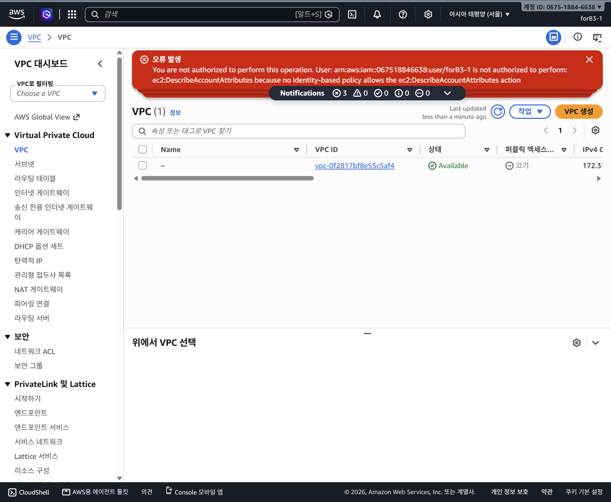

## 2. 동반 권한 오류

VPC 목록은 정상 표시되지만 알림에 ec2:DescribeAccountAttributes 작업을 허용하는 identity-based policy가 없다는 오류가 표시된다. 앞선 SCP 명시적 거부와 원인이 다르다. 이는 현재 사용자 정책에서 해당 조회를 허용하지 않는다는 증거이며 VPC 목록 전체의 조회 실패는 아니다. 다른 알림의 상세는 아직 확인하지 않았다. 필요한 과제 작업이 실제로 막히면 해당 API와 필요한 최소 범위를 검토하고 기존 관리자 역할은 변경하지 않는다.

## 다음 단계

VPC 생성 화면을 열어 구성 옵션을 확인한다. 생성 전 이름·CIDR·태그·비용 발생 가능 옵션을 확인하고 실제 생성은 사용자가 직접 수행한다. NAT Gateway·유료 엔드포인트 등 불필요한 자원을 자동 생성하지 않도록 주의한다.

## 3. 추가 오류 확인을 우선함

사용자가 다른 오류도 있다고 지적했다. 처음 알림 집계는 3건이었고, 후속 화면에서 네트워크 ACL 조회 ec2:DescribeNetworkAcls도 identity-based policy의 허용 부재로 거부된 것을 확인했다. 앞서 계정 속성 오류만 설명한 것은 전체 알림을 확인한 것이 아니었다. 생성 진행을 잠시 멈추고 View all notifications로 전체 오류를 확인하기로 했다. 아직 모든 오류의 API를 확인하지 않았고 권한 변경은 하지 않았다.

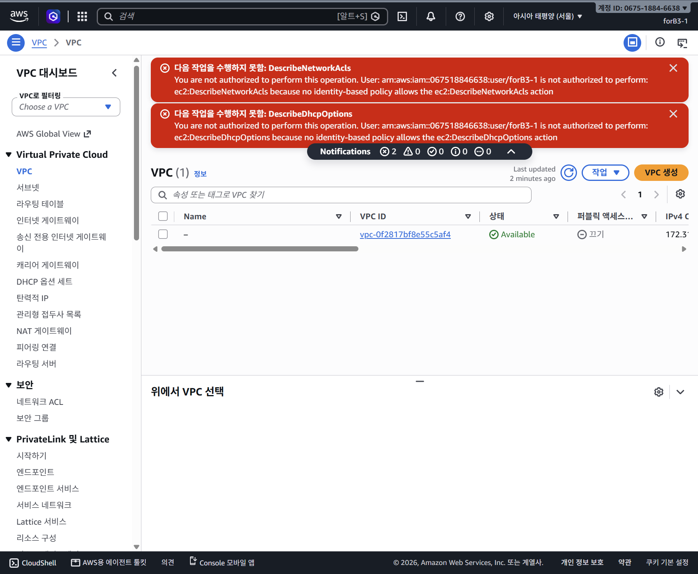

## 4. VPC 단독 생성 설정 화면

VPC 생성 화면에서 `VPC만`, IPv4 CIDR 수동 입력, IPv6 없음, 기본 테넌시가 선택된 것을 확인했다. 아직 이름과 CIDR은 입력되지 않았다. 권한 정책 파일의 CreateVpc 및 Name/Project 태그 허용 범위를 확인했다.

제안 구성: Name=b3-1-vpc, IPv4 CIDR=10.0.0.0/16, IPv6 없음, 기본 테넌시. VPC만 생성하고 서브넷·IGW·라우팅 테이블은 별도 단계로 구성해 각각 역할을 학습한다. 이 제안은 실제 생성 완료가 아니다. NAT Gateway나 유료 엔드포인트를 함께 생성하는 방식은 사용하지 않는다.

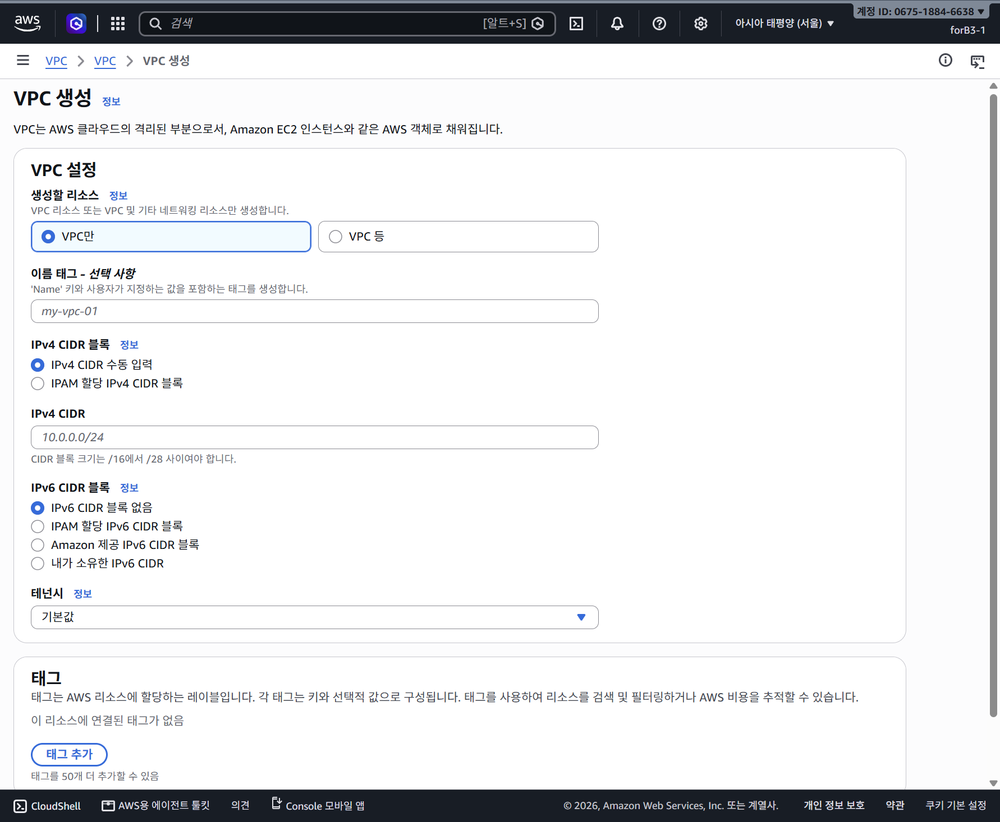

## 5. 생성 직전 입력값 확인

사용자가 입력한 값이 Name=b3-1-vpc, IPv4 CIDR=10.0.0.0/16, VPC만, IPv6 없음, 기본 테넌시임을 확인했다. 태그도 Name=b3-1-vpc 한 개다. 기존 기본 VPC의 172.31.0.0/16과 겹치지 않는다. 이 화면에서 아직 생성 완료는 아니며 사용자가 최종 VPC 생성 버튼을 누르는 단계다.

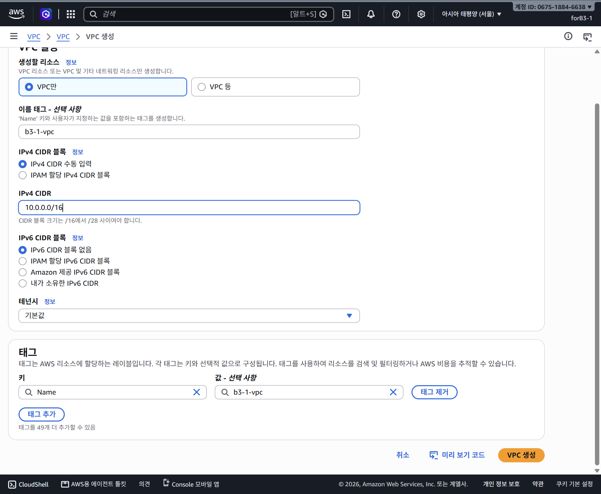

## 6. VPC 생성 성공과 상세 화면 조회 오류

사용자가 최종 생성 버튼을 눌렀고 AWS 성공 알림 `vpc-062ac6fd0606192ab / b3-1-vpc 생성됨`을 확인했다. 최소권한 사용자 forB3-1, 서울 리전에서 실제 VPC 생성이 수락됐다. 새 VPC ID는 vpc-062ac6fd0606192ab다.

동시에 상세 화면에서 ec2:DescribeNatGateways와 ec2:DescribeNetworkAcls의 identity-based policy 허용 부재가 표시됐다. 생성 실패가 아니라 생성 후 상세 리소스 로딩 실패로 구분한다. 재생성하지 않는다. 다음은 VPC 목록으로 돌아가 새 VPC를 확인하고, 콘솔 실습에 필요한 조회 권한 보완 범위를 검토하는 단계다. 기존 관리자 역할은 수정하지 않는다.

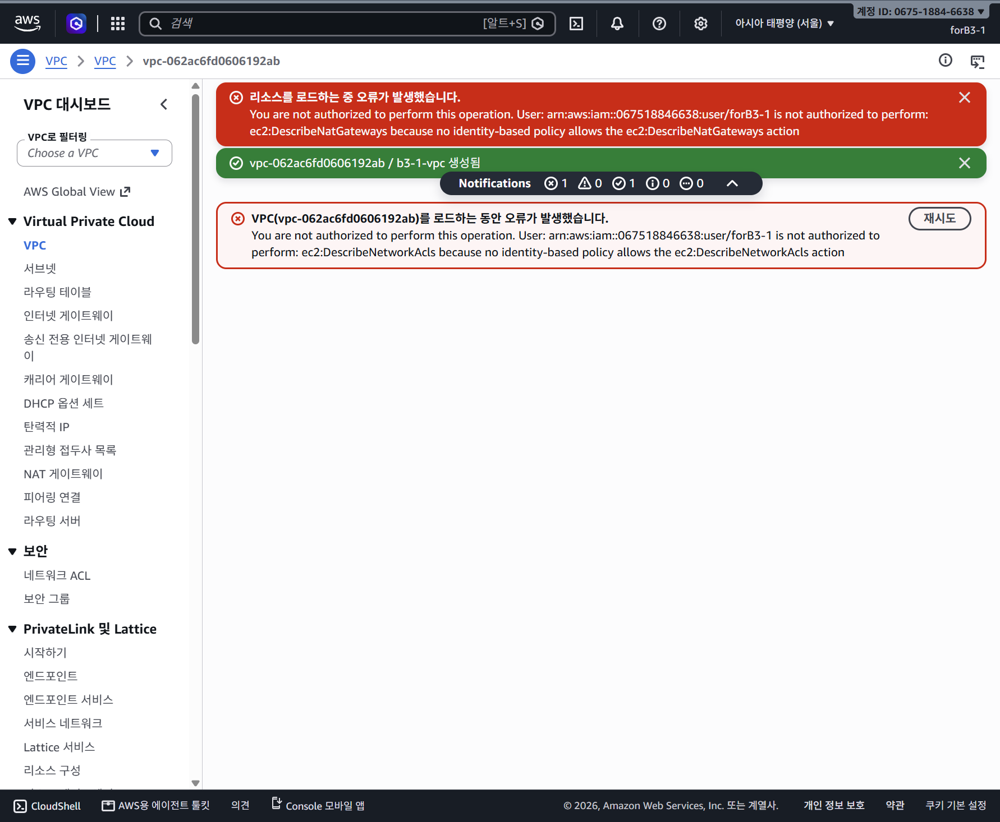

정리 대상에 추가: 사용자 생성 VPC vpc-062ac6fd0606192ab. 의존 리소스 정리 후 삭제하며, 기존 기본 VPC vpc-0f2817bf8e55c5af4는 삭제 대상이 아니다.

## 7. 두 조회 오류의 직접 원인 재확인

현재 화면을 다시 읽어 다음 두 오류와 생성 성공 알림이 동시에 표시됨을 확인했다.

- ec2:DescribeNatGateways: NAT Gateway 현황 조회. identity-based policy에 이 작업의 Allow가 없어서 거부됐다.
- ec2:DescribeNetworkAcls: 서브넷 경계 Network ACL 현황 조회. 같은 허용 부재로 거부됐고, VPC 상세 화면 전체의 로딩 오류에도 표시된다.

두 오류는 VPC 생성이 취소되거나 ACL 트래픽 처리 자체가 정지됐다는 의미가 아니다. 생성 성공과 상세 조회 성공은 다른 API·권한이다. NAT를 생성하지 않는 설계라도 콘솔은 리소스 현황을 조회할 수 있다. 예전 p-l9spe88l SCP의 explicit deny 오류와 이번 identity-based policy 허용 부재를 구분한다.

조치 후보는 실습 콘솔에 필요한 두 Describe 작업을 기존 B3ReadSeoul 조회 문장에 추가해 서울 리전 조건과 Resource=*를 유지하는 것이다. 조회 권한을 추가하는 것이 NAT/ACL 생성·수정 권한을 주는 것은 아니다. 실제 연결 정책 버전을 다시 확인하고 사용자 승인 후 직접 변경·재조회 검증해야 한다. 아직 이 조회 권한을 변경하지 않았다.

쉬운 설명은 aside-bridge에 별도 작성 요청했다. 검수 후 [질문 해설 문서](0021-vpc-read-errors-쉬운설명.md)와 연결한다. 원본과 해설의 파일 소유권을 나눠 동시에 같은 문서를 수정하지 않는다.

## 8. 과제 범위 정정 및 서브넷 목록 확인

명세에는 Network ACL 직접 설정이나 NAT Gateway 생성이 필수로 요구되지 않는다. 상세 화면 조회 편의를 위해 IAM 권한을 보완하자는 제안은 과제 필수 조건과 구분한다. 사용자는 추가 조회 권한을 부여하지 않고 필수 네트워크 구성을 계속하기로 했다. TS-003 조회 오류는 미해결 상태로 남겨 두며, 후속 필수 작업이 실제로 막힐 경우에만 필요한 범위를 재검토한다.

서브넷 목록에는 기존 기본 VPC(vpc-0f2817bf8e55c5af4) 소속 기본 서브넷 4개가 표시된다. 새 실습 VPC에 직접 생성한 서브넷은 이 목록에서 아직 확인되지 않았다. DescribeNetworkAcls 알림은 남아 있지만 서브넷 목록은 표시된다. 목록의 Last updated가 약 2시간 전이므로 개수와 항목은 현재 화면에 표시된 결과로 기록한다. 다음 단계는 서브넷 생성 화면을 열어 b3-1-vpc를 선택하는 것이다. 실제 생성은 아직 수행하지 않았다.

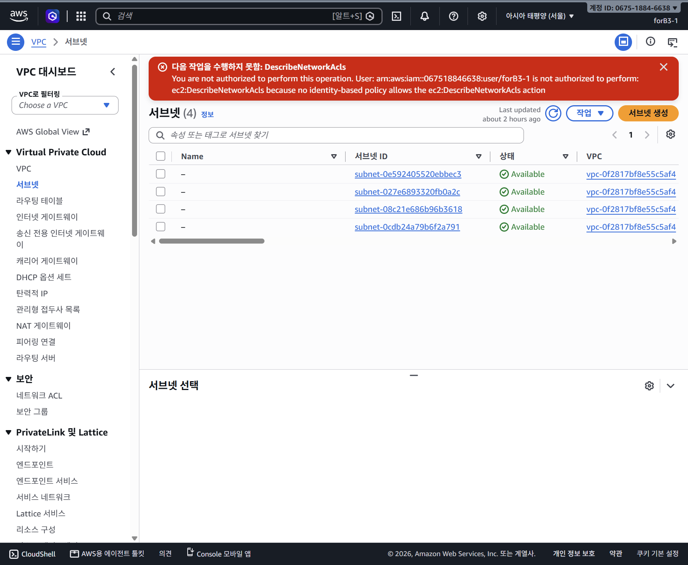

## 9. Network ACL 요금과 NAT 위치 구분

AWS 공식 VPC Network ACL 문서는 network ACL 사용에 추가 요금이 없다고 명시한다. AWS WAF의 Web ACL은 다른 기능이며 Web ACL·규칙·요청 기준으로 과금한다. 사용자가 들은 유료 ACL이 어느 제품이었는지는 확인하지 않았다. NAT Gateway는 별도의 시간·데이터 처리 요금이 있는 서비스다. VPC Network ACL과 이름이 비슷하다고 WAF Web ACL 또는 AWS Network Firewall의 요금을 혼동하지 않는다.

개념도는 공용 NAT Gateway의 일반적인 배치를 뜻해야 한다. NAT는 퍼블릭 서브넷 안의 주소 변환 서비스이고, ACL은 서브넷 경계의 필터, SG는 네트워크 인터페이스에 연결하는 보안 규칙이다. 이를 단순한 상하 방화벽 레이어로 표현하지 않는다. 이번 실습은 NAT를 사용하지 않는 public EC2 + IGW 설계다.

공식 근거:
- https://docs.aws.amazon.com/vpc/latest/userguide/vpc-network-acls.html
- https://aws.amazon.com/waf/pricing/
- https://aws.amazon.com/vpc/pricing/

## 10. 재개 시 현재 서브넷 화면

현재 사용자 forB3-1, 서울 리전의 서브넷 목록 화면을 재확인했다. DescribeNetworkAcls의 IAM Allow 부재 알림이 남아 있지만 기본 VPC의 기존 서브넷 4개는 표시된다. 목록은 약 7시간 전 갱신 표시이므로 새 서버 상태까지 검증한 것은 아니다. 이번 화면에는 NAT 조회 오류는 표시되지 않는다. 실습 VPC는 앞서 생성 성공했으며 서브넷은 아직 생성하지 않았다. 다음은 서브넷 생성 설정 화면을 열어 대상 VPC와 CIDR을 확인하는 단계다.

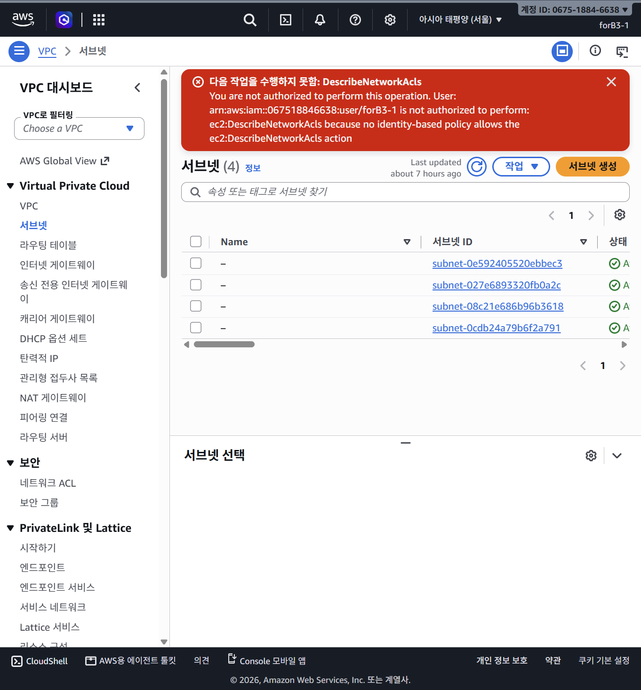

## 11. 서브넷 생성 화면 진입

과제용 사용자·서울 리전에서 서브넷 생성 화면을 열었다. VPC는 아직 선택되지 않았고 이름·CIDR·가용 영역 입력은 VPC 선택 이후에 진행한다. ec2:DescribeCarrierGateways의 IAM 허용 부재 알림이 추가로 표시된다. 캐리어 게이트웨이는 이번 기본 Public Subnet 실습에서 생성할 대상이 아니며, 아직 이 알림만으로 CreateSubnet이 실패했다고 판단할 수 없다. 조회 권한 변경 없이 VPC 선택 경로를 확인한다.

### 서브넷 설정 화면 재캡처

사용자 요청으로 현재 화면을 원본 그대로 재캡처했다. 이번 호출은 캡처만 수행했으며 입력값 검증이나 생성 완료 확인을 뜻하지 않는다.

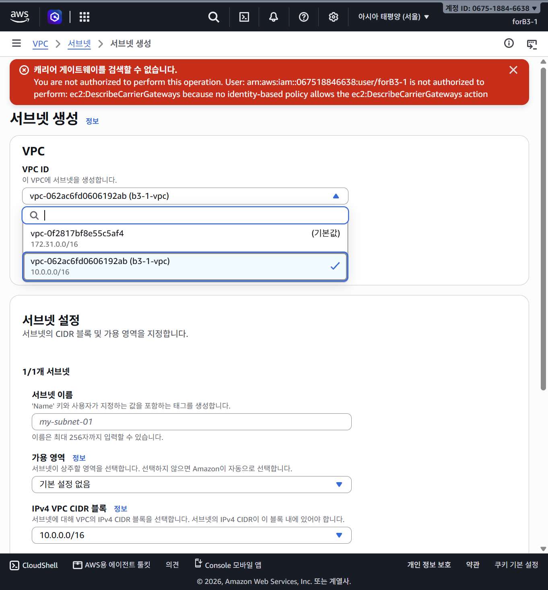

## 12. 실습 VPC 선택 및 서브넷 입력 준비

사용자가 b3-1-vpc(vpc-062ac6fd0606192ab)를 선택했고 연결된 CIDR 10.0.0.0/16을 확인했다. 이름과 서브넷 CIDR은 아직 비어 있으며 가용 영역은 기본 설정 없음이다. 제안 값은 Name=b3-1-public-subnet, IPv4 CIDR=10.0.1.0/24이다. 가용 영역은 선택 목록에서 실제 제공되는 서울 일반 AZ를 확인해 지정한다. Public이라는 이름은 목적을 나타낼 뿐이며 실제 퍼블릭 서브넷이 되려면 이후 IGW 경로를 연결해야 한다. 아직 서브넷 생성은 하지 않았다.

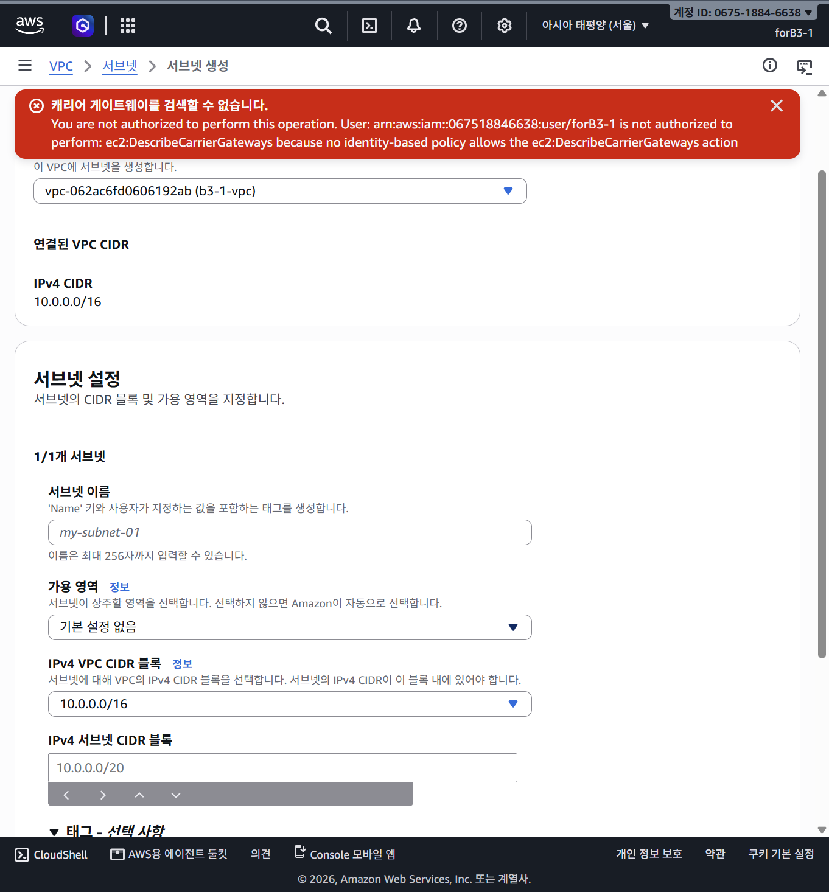

### 서브넷 입력 화면 추가 캡처

사용자 요청으로 현재 서브넷 생성 화면을 다시 캡처했다. 이 캡처 작업에서는 입력값 검증이나 최종 생성을 수행하지 않았다.

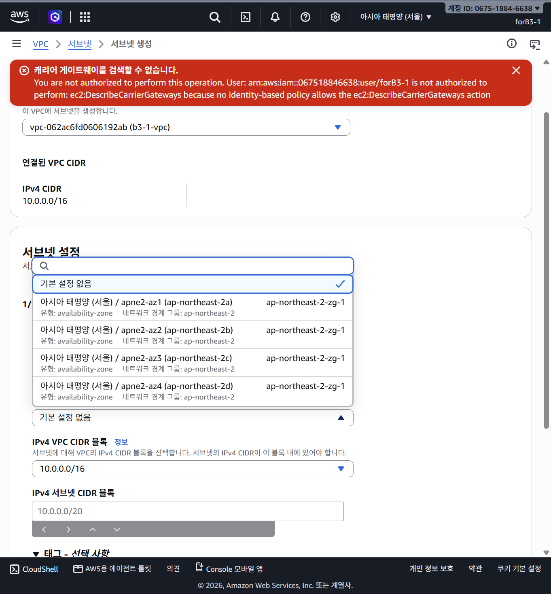

## 13. 서브넷 생성 전 입력값 확인

화면에서 VPC b3-1-vpc(vpc-062ac6fd0606192ab), 이름 b3-1-public-subnet, 가용 영역 ap-northeast-2a(apne2-az1), CIDR 10.0.1.0/24를 확인했다. CIDR은 VPC의 10.0.0.0/16 범위 안이다. 256개 주소 중 AWS 예약 5개를 제외하면 251개를 사용할 수 있다. DescribeCarrierGateways 조회 오류는 남아 있으며 생성 성공은 아직 확인하지 않았다. 사용자에게 최종 생성 버튼을 누르도록 안내한다.

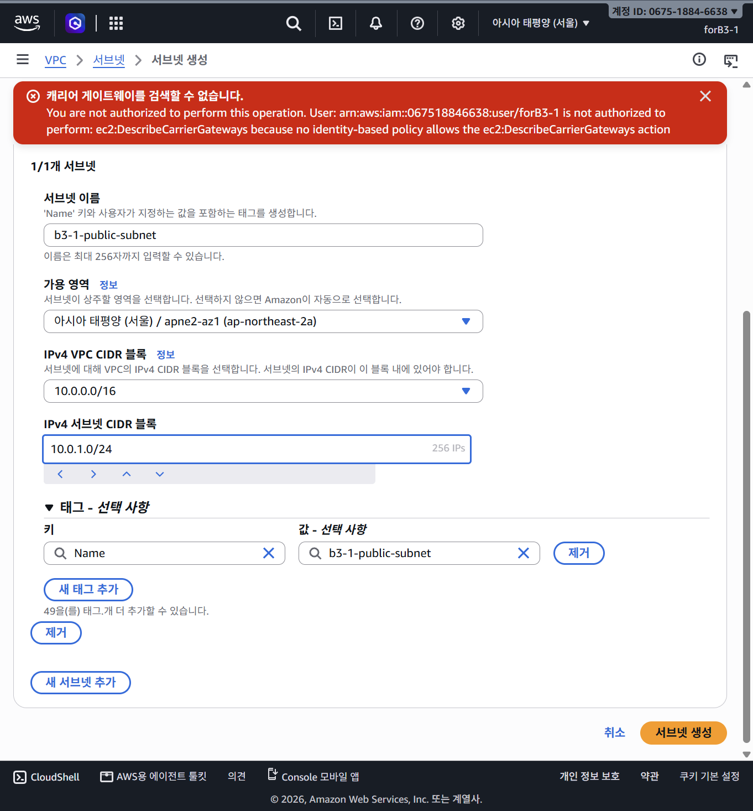

### 입력값 학습 해설

사용자 요청으로 aside-bridge가 [서브넷 설정값 쉬운 설명](0022-subnet-settings-쉬운설명.md)을 작성했다. VPC·AZ·서브넷 관계, 이름과 Name 태그, IPv4와 CIDR, 주소 예약, 퍼블릭 경로 조건을 캡처 및 ASCII 도식과 함께 설명한다. Aside가 검수하며 IPv4의 구분점 개수, DNS 예약 주소와 실제 VPC DNS 주소의 구분, 퍼블릭 서브넷 분류와 EC2 인터넷 연결 조건의 차이를 보완했다.

## 14. 서브넷 생성 결과 확인

사용자 요청으로 현재 화면을 원본 캡처했다. 서브넷 1개 생성 성공 알림과 b3-1-public-subnet(subnet-08efa9b32e083838b)의 Available 상태가 표시된다. 대상은 b3-1-vpc(vpc-062ac6fd0606192ab), CIDR 10.0.1.0/24, 가용 영역 ap-northeast-2a(apne2-az1), 사용 가능한 IPv4 251개이며 퍼블릭 IPv4 자동 할당은 아니요다. 목록은 해당 서브넷 ID로 필터링되어 있으므로 서울 전체 서브넷이 1개라는 뜻이 아니다. 화면의 마지막 갱신은 약 20분 전 표시로, 현재 조회를 새로 실행한 것은 아니다. DescribeNetworkAcls IAM 조회 권한 부족 알림과 생성 성공은 별개로 확인한다. 다음은 인터넷 게이트웨이 목록에서 실습용 IGW를 준비하고 해당 VPC에 연결하는 단계다.

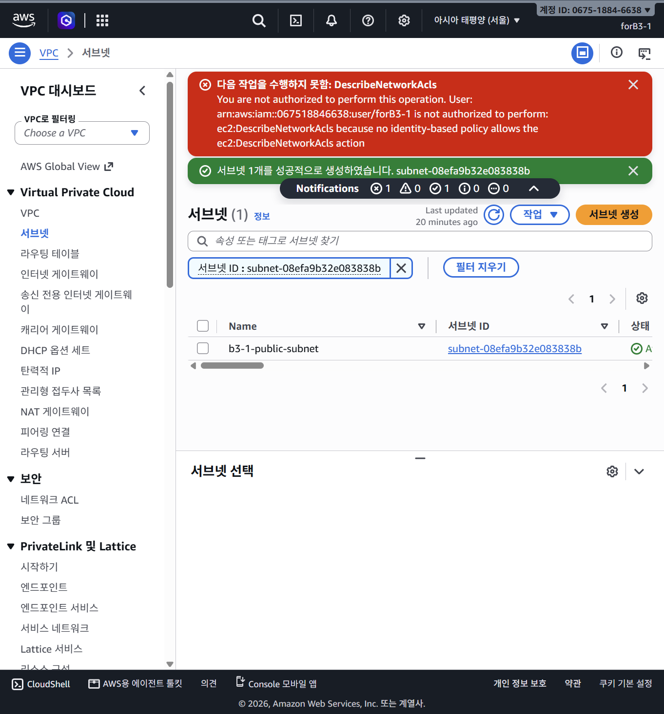

## 15. 인터넷 게이트웨이 기존 목록 확인

서울·forB3-1 세션에서 인터넷 게이트웨이 목록을 확인했다. 기존 igw-079296c76b0d42f03는 기본 VPC vpc-0f2817bf8e55c5af4에 Attached 상태이며 변경하지 않는다. 화면의 1개 목록은 검색 필터 없이 표시된다. DescribeNatGateways IAM 조회 허용 누락 알림도 있으나 인터넷 게이트웨이 자체 목록은 표시된다. 이 오류를 이유로 NAT를 생성하거나 권한을 추가하지 않는다. 다음은 인터넷 게이트웨이 생성 설정 화면을 여는 단계다. 실습용 IGW의 생성·연결은 아직 확인하지 않았다.

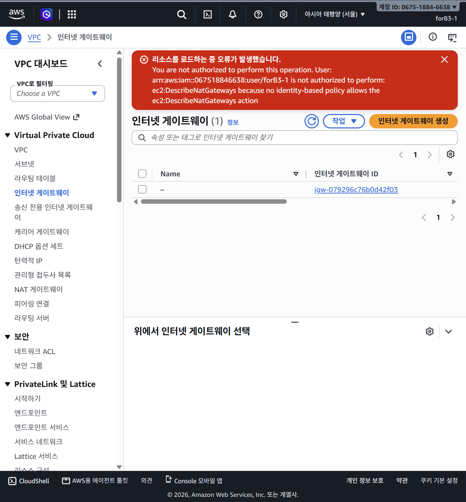

## 16. 인터넷 게이트웨이 생성 설정 화면

서울·forB3-1에서 IGW 생성 화면을 확인했다. 이름 태그 입력은 비어 있고 VPC 연결 항목은 이 화면에 없다. 이름으로 b3-1-igw를 제안한다. 생성 뒤 실습 VPC에 별도로 연결하고 라우팅을 구성해야 하며 생성 자체로 인터넷 연결이 완성되지는 않는다. DescribeNatGateways 조회 오류 알림이 계속 표시되며 IGW 생성 실패로 단정하지 않는다. 이 시점에는 생성 버튼을 누르지 않았다.

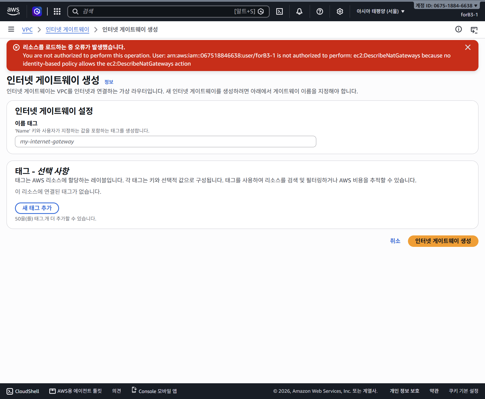

### IGW 생성 전 이름 검토

이름 태그 b3-1-igw 및 자동 생성된 Name=b3-1-igw를 확인했다. 사용자에게 인터넷 게이트웨이 생성 버튼을 누르도록 안내한다. 이 확인 시점에는 생성·VPC 연결은 완료되지 않았다.

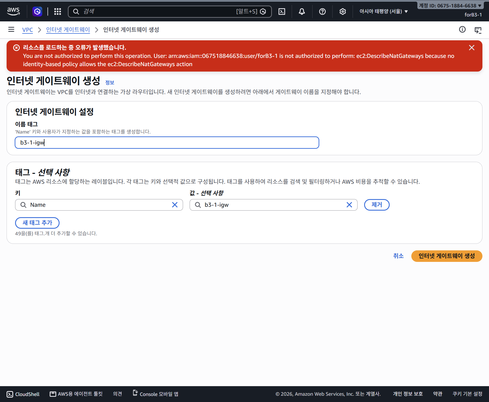

## 17. 실습용 IGW 생성 성공·미연결 확인

서울·forB3-1에서 b3-1-igw(igw-0453ef9ebcd131aad)의 생성 성공 알림과 상세 정보를 확인했다. 상태는 Detached이며 VPC ID는 비어 있다. Name 태그는 b3-1-igw다. DescribeNatGateways 조회 허용 부족 알림 두 개가 있으나 IGW 생성 성공과는 구분한다. 다음은 성공 알림의 VPC에 연결 버튼으로 연결 설정 화면을 여는 단계다. 연결할 대상은 실습 VPC b3-1-vpc(vpc-062ac6fd0606192ab)이며 기본 VPC는 변경하지 않는다.

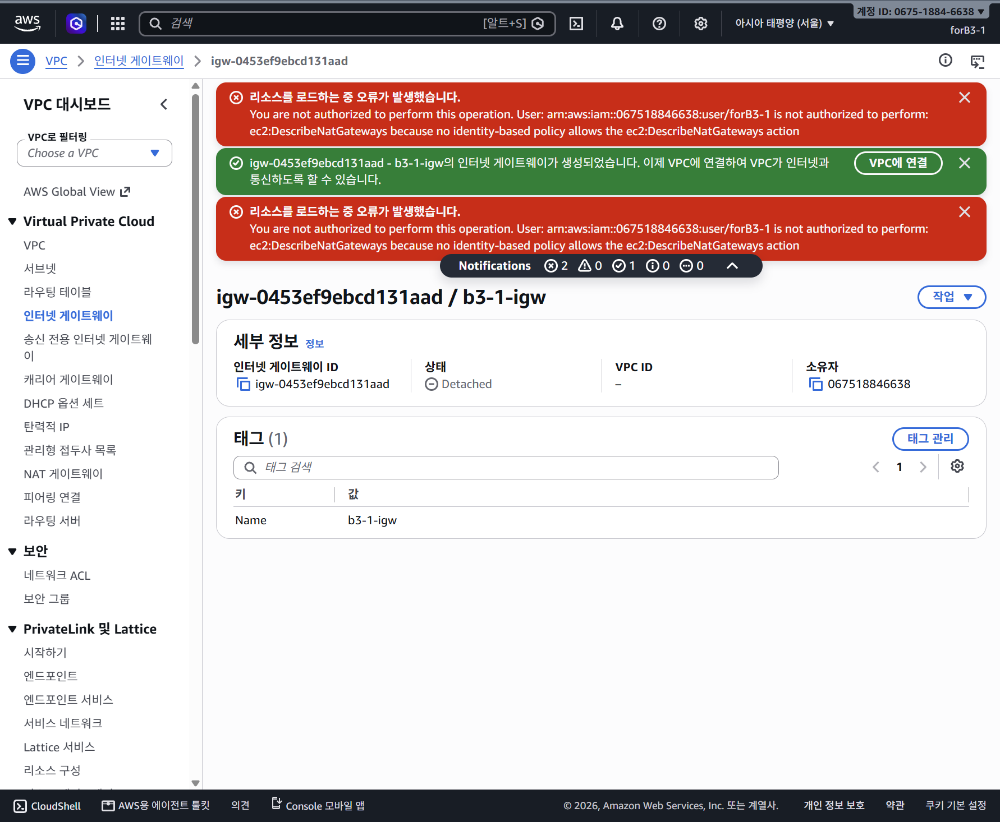

## 18. IGW의 VPC 연결 설정 화면

igw-0453ef9ebcd131aad의 VPC 연결 설정 화면을 확인했다. 사용 가능한 VPC는 아직 선택되지 않았다. 사용자에게 실습 VPC b3-1-vpc(vpc-062ac6fd0606192ab)를 선택하도록 안내한다. 이 시점에는 최종 인터넷 게이트웨이 연결 버튼을 누르지 않았으며 연결 완료를 확인하지 않았다.

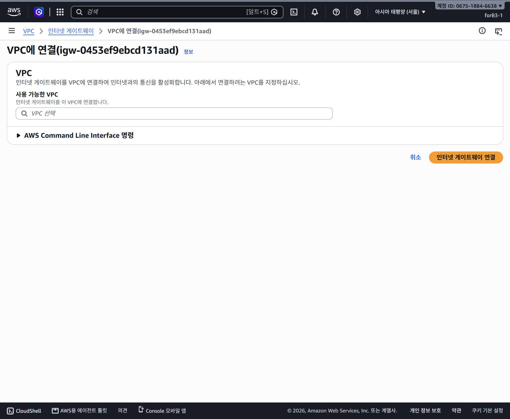

### 연결 대상 목록 확인

VPC 선택 목록에 vpc-062ac6fd0606192ab - b3-1-vpc가 표시되고 입력란에도 해당 VPC ID가 들어 있다. 드롭다운이 열린 상태이므로 실제 VPC 항목을 눌러 선택을 확정한 다음 인터넷 게이트웨이 연결 버튼을 누르도록 안내한다. 아직 연결 성공 상태는 확인하지 않았다.

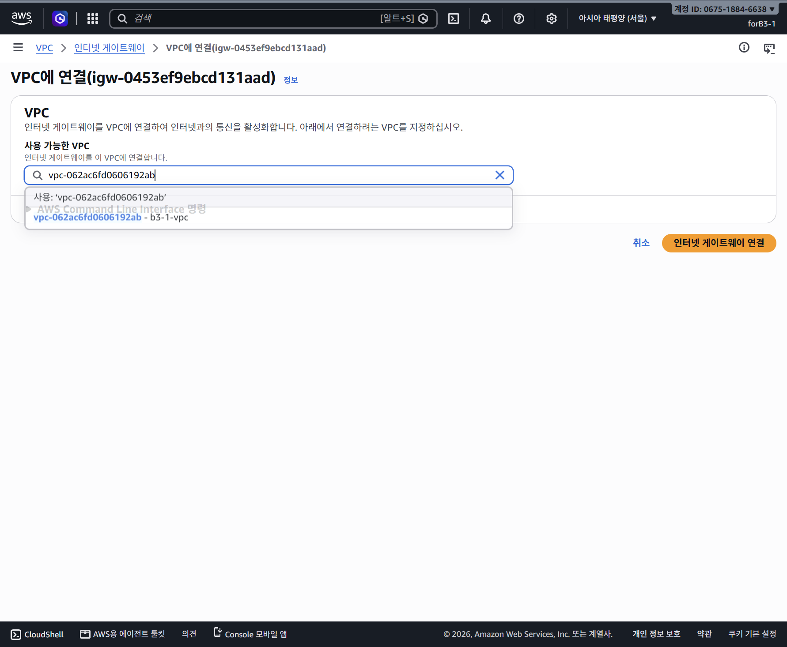

## 19. 실습 VPC에 IGW 연결 성공

성공 알림과 상세 정보에서 b3-1-igw(igw-0453ef9ebcd131aad)가 b3-1-vpc(vpc-062ac6fd0606192ab)에 연결되었고 상태가 Attached임을 확인했다. DescribeNatGateways IAM 조회 오류는 남아 있으나 IGW 연결 성공과 구분한다. IGW 연결만으로 서브넷의 인터넷 경로 구성이 완료되는 것은 아니다. 다음은 라우팅 테이블 목록을 열어 실습 VPC 소속과 서브넷 연결을 확인하고 인터넷행 기본 경로를 준비하는 단계다. 아직 기본 경로를 추가하거나 라우팅 테이블을 변경하지 않았다.

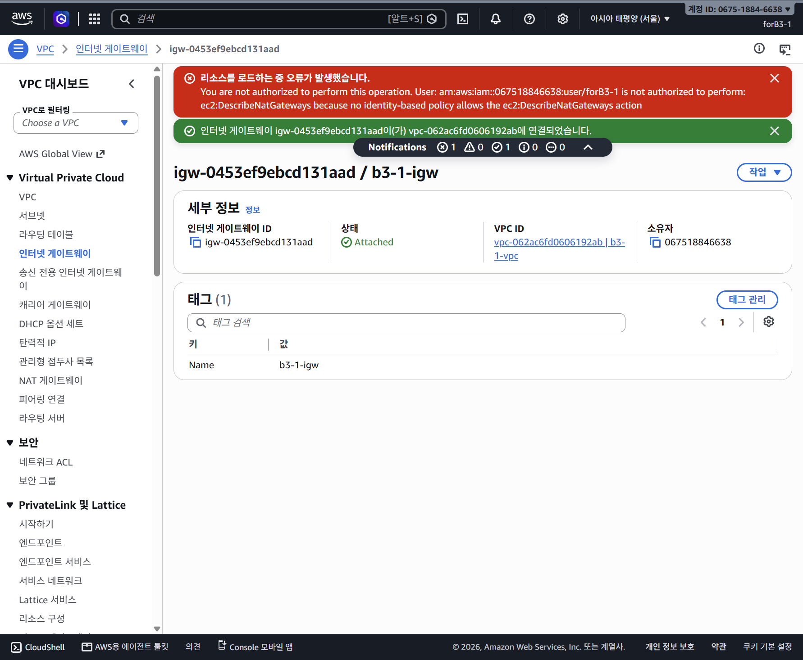

## 20. 라우팅 테이블 목록 진입·갱신 필요

현재 목록에는 기본 VPC vpc-0f2817bf8e55c5af4의 rtb-044f497d7d18b2eb0 1개만 표시되지만 마지막 갱신이 약 10시간 전으로 표시된다. 실습 VPC의 라우팅 테이블이 없다고 판단하지 않고 목록 새로 고침을 먼저 안내한다. 별도의 ec2:DescribeVpnGateways IAM 조회 허용 부족 알림도 표시되며 VPN을 생성할 필요를 뜻하지 않는다. 기존 기본 VPC의 라우팅 테이블은 변경하지 않는다.

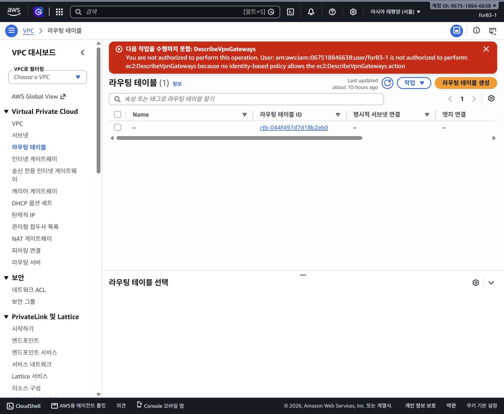

## 21. 목록 갱신 후 실습 VPC의 기본 라우팅 테이블 확인

사용자 새로 고침 이후 마지막 갱신이 1분 이내로 바뀌고 라우팅 테이블 2개가 표시된다. rtb-044f497d7d18b2eb0는 기존 기본 VPC 소속이며 유지한다. rtb-0f08329ebc84d7fb5는 실습 b3-1-vpc(vpc-062ac6fd0606192ab) 소속이며 기본=예, 명시적 서브넷 연결은 대시로 표시된다. 실제 경로와 서브넷의 암시적 연결은 아직 상세 확인 전이다. 실습 테이블 ID 링크를 열도록 안내한다. DescribeVpnGateways 조회 권한 부족 알림은 남아 있다.

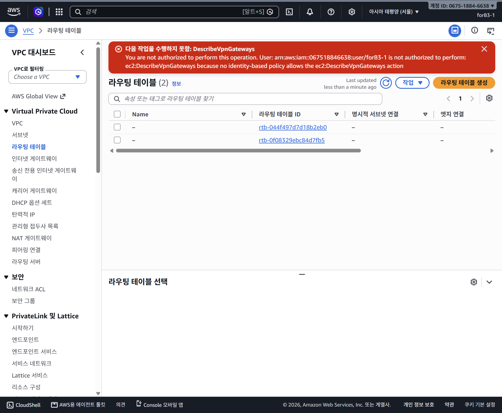

## 22. 실습 기본 라우팅 테이블의 내부 경로 확인

rtb-0f08329ebc84d7fb5 상세에서 VPC=b3-1-vpc(vpc-062ac6fd0606192ab), 기본=예를 확인했다. 라우팅 탭에는 10.0.0.0/16 → local 한 개만 있고 상태는 활성, 오리진은 라우팅 테이블 생성으로 표시된다. 인터넷행 0.0.0.0/0 → IGW 경로는 없다. 명시적 서브넷 연결은 대시로 표시되어 서브넷 연결 탭에서 적용 대상을 먼저 확인하도록 안내한다. 기존 기본 VPC와 이 실습 VPC의 기본 테이블은 서로 다른 자원이다. 앞선 약 10시간 전 표시는 목록의 갱신 시각이며 생성 시각이 아니다. 이 테이블의 소속과 기본 여부는 직접 확인했으나 정확한 생성 시각·이벤트는 조회하지 않았다.

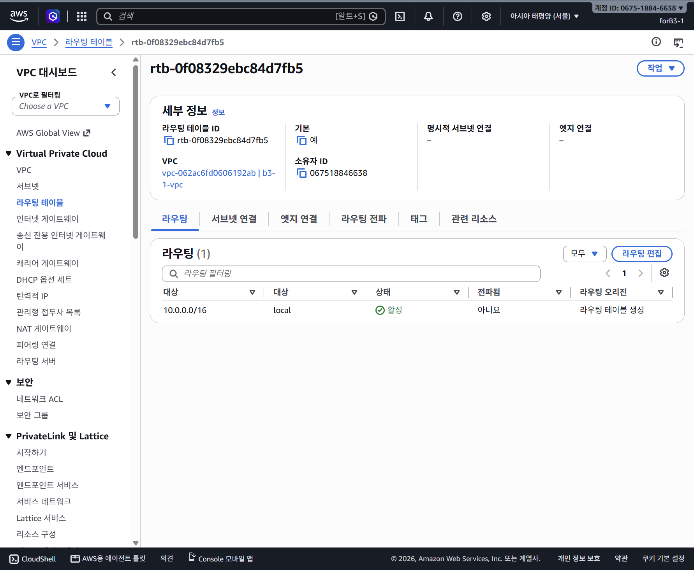

## 23. 실습 서브넷의 암시적 기본 테이블 연결 확인

서브넷 연결 탭에서 명시적 서브넷 연결 0개, 명시적 연결이 없는 서브넷 1개를 확인했다. 후자에 b3-1-public-subnet(subnet-08efa9b32e083838b), 10.0.1.0/24가 표시되며 콘솔은 기본 라우팅 테이블에 연결된 상태라고 설명한다. 따라서 이 서브넷은 현재 실습 VPC의 기본 테이블 rtb-0f08329ebc84d7fb5를 암시적으로 사용한다. 연결 없음이라는 명시적 목록만 보고 라우팅 테이블 미적용으로 판단하지 않는다. 별도의 연결 변경 없이 이 실습 기본 테이블에 인터넷 경로를 추가하는 흐름으로 진행한다. 기본 테이블 변경은 이 VPC에서 암시적으로 이를 사용하는 다른 서브넷에도 적용되므로 향후 프라이빗 서브넷을 추가할 때 별도 테이블 구분이 필요하다. 다음은 라우팅 탭으로 돌아가 편집 화면을 여는 단계다.

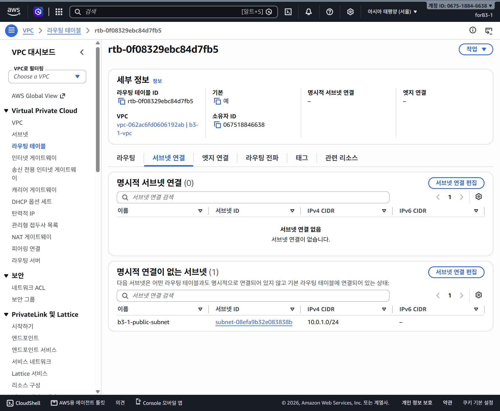

## 24. 라우팅 편집 초기 화면

실습 테이블 rtb-0f08329ebc84d7fb5의 라우팅 편집 화면을 확인했다. 기존 10.0.0.0/16 → local 한 개만 표시되고 라우팅 추가 버튼이 있다. 기존 local 경로를 유지한 채 새 경로 입력 행을 추가하도록 안내한다. 이 시점에는 경로 추가·저장을 수행하지 않았다.

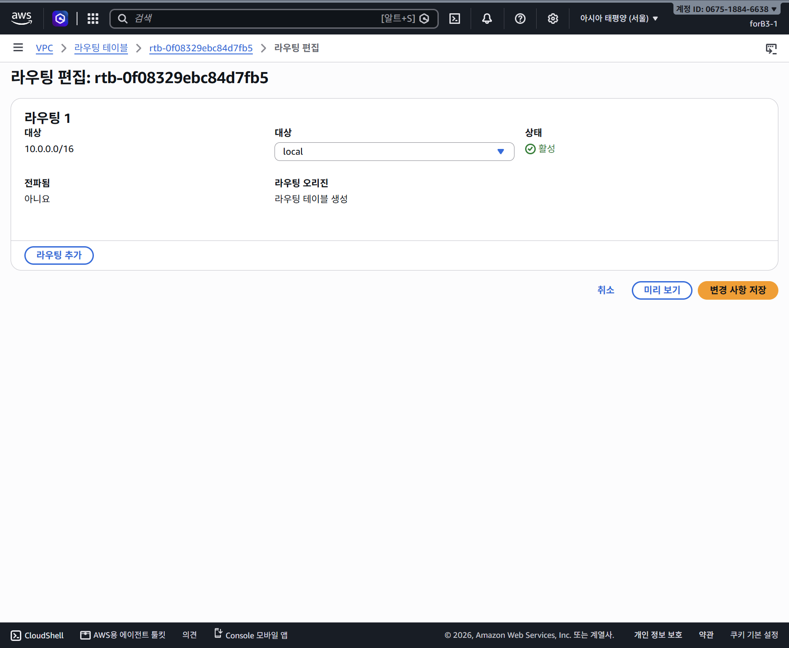

### 라우팅 추가 행 캡처

라우팅 2 행이 추가되었고 목적지 입력의 CIDR 후보 목록이 열린 상태를 캡처했다. 기존 local 경로는 유지된다. 사용자에게 목적지 0.0.0.0/0 후보를 선택하도록 안내하며 전송 대상 선택·저장은 아직 하지 않았다. 이 기본 경로는 모든 IPv4 목적지에 매칭하나 더 구체적인 local /16 경로가 우선하므로 VPC 내부 트래픽까지 IGW로 보내는 뜻은 아니다.

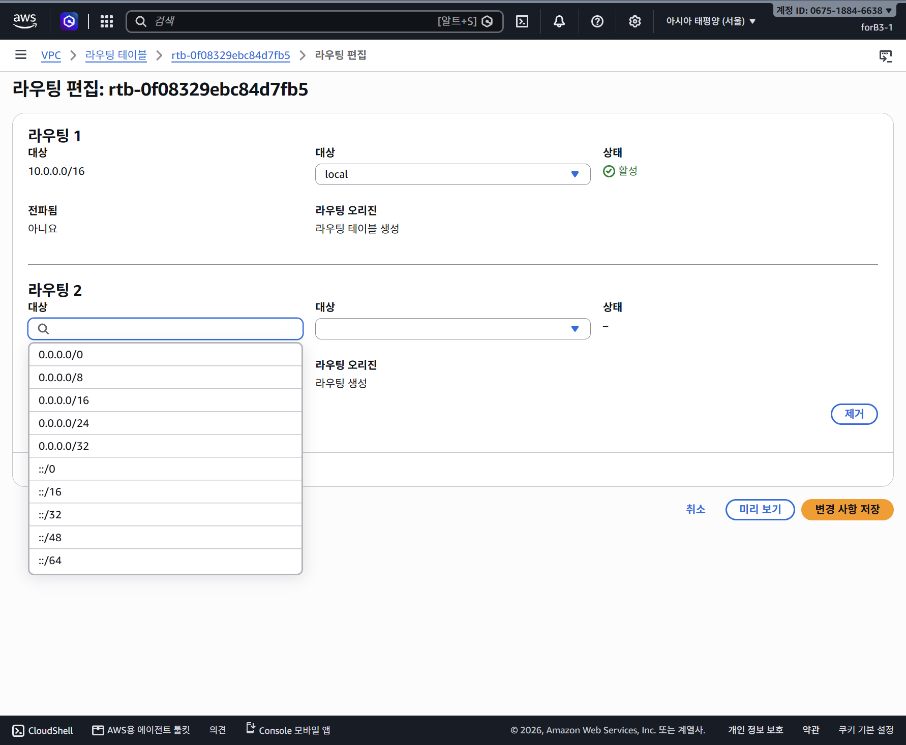

### 기본 경로 목적지 입력 확인

새 라우팅 2의 목적지에 0.0.0.0/0이 입력되었고 전송 대상은 아직 비어 있다. 기존 local 경로는 유지된다. 사용자에게 같은 행의 대상 버튼을 눌러 게이트웨이 유형 목록을 열도록 안내한다. 경로는 아직 저장하지 않았다.

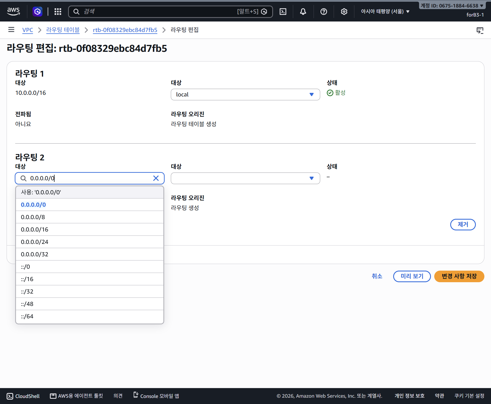

### 라우팅 전송 대상 유형 목록

라우팅 2의 대상 유형 목록에서 인터넷 게이트웨이 항목을 확인했다. NAT 게이트웨이·캐리어 게이트웨이·외부 전용 인터넷 게이트웨이와 구분하여 인터넷 게이트웨이를 선택하도록 안내한다. 목적지 0.0.0.0/0과 기존 local 경로는 유지되어 있으며 아직 저장하지 않았다.

### 인터넷 게이트웨이 유형 선택 확인

기본 경로의 전송 대상 유형이 인터넷 게이트웨이로 바뀌었고 아래 선택 입력란에는 igw-만 표시된다. 구체적인 IGW는 아직 지정되지 않았다. 사용자에게 이 입력란을 눌러 목록을 열도록 안내한다. 선택할 실습 IGW는 b3-1-igw(igw-0453ef9ebcd131aad)이며 경로 저장 전 해당 ID를 검토한다.

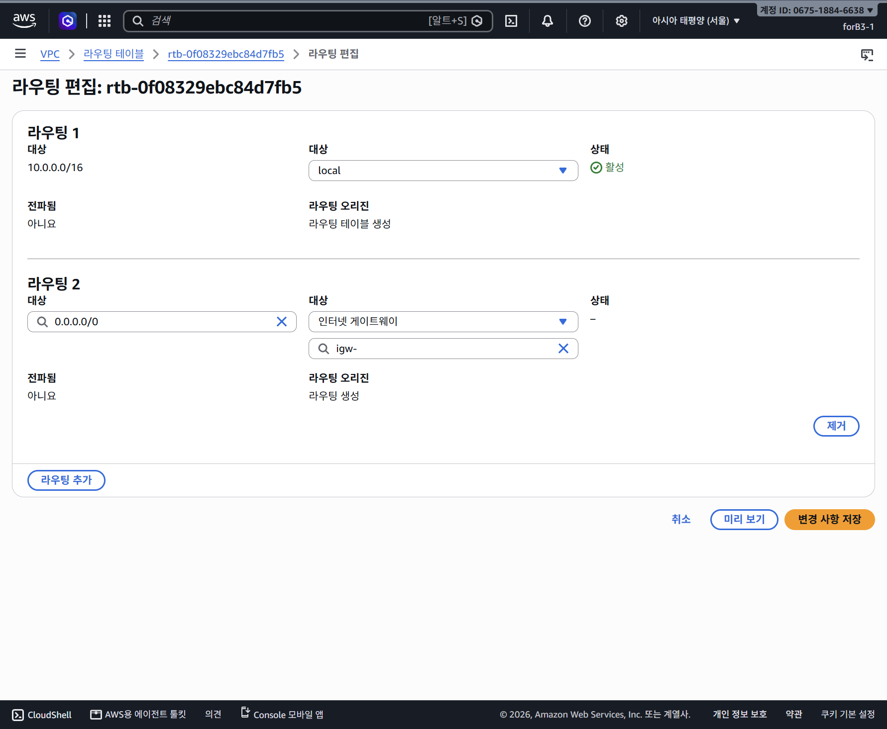

### 저장 전 실습 IGW 입력 및 대상 유형 학습 요청

라우팅 2에 0.0.0.0/0, 인터넷 게이트웨이 유형, igw-0453ef9ebcd131aad가 입력되고 선택 목록에 b3-1-igw 이름도 표시되는 것을 확인했다. 선택 목록은 열린 상태이며 최종 저장 성공은 아직 확인하지 않았다. 사용자 요청으로 aside-bridge에 메뉴에 보이는 라우팅 대상 14개를 용도별로 풀이하는 별도 문서 작성을 맡겼다.

### 대상 유형 해설 검수 완료

aside-bridge가 작성한 [라우팅 대상 14종 쉬운 설명](0023-route-targets-쉬운설명.md)을 Aside가 검수했다. 목적지와 전달 대상의 차이, /0 매칭 범위, local 경로의 고급 대상 교체, IPv6 및 ENI 설명을 보완했다. ODB network는 Oracle Database@AWS의 네트워크이며 VPC와의 사설 연결 및 경로 구성은 공식 문서 https://docs.aws.amazon.com/odb/latest/UserGuide/configuring.html 에서 별도로 확인했다. 새 경로의 저장 성공은 아직 확인하지 않았다.

## 25. 인터넷 기본 경로 저장 성공

사용자 저장 후 rtb-0f08329ebc84d7fb5 업데이트 성공 알림과 라우팅 2개를 확인했다. 새 경로 0.0.0.0/0 → igw-0453ef9ebcd131aad는 활성, 전파됨 아니요, 오리진 라우팅 생성이다. 기존 10.0.0.0/16 → local도 활성 상태로 유지되었다. 앞서 확인한 이 기본 테이블의 실습 서브넷 암시적 연결 및 IGW의 실습 VPC Attached 상태와 합쳐 IPv4 퍼블릭 서브넷 경로 구성을 완료했다. EC2 공인 IP·SG·웹 서비스 설정 및 실제 인터넷 통신은 아직 검증하지 않았다. 다음은 과제용 보안 그룹 설정이다.

## 26. 보안 그룹 목록 확인

서울·forB3-1에서 보안 그룹 2개가 표시된다. sg-0afca082092549bbc는 실습 VPC vpc-062ac6fd0606192ab의 default 그룹, sg-0feec7f4f7549acfb는 기존 기본 VPC vpc-0f2817bf8e55c5af4의 default 그룹이다. 각 그룹의 인바운드·아웃바운드 규칙 수는 각각 1개로 표시되며 구체적인 규칙은 아직 확인하지 않았다. 이름 default와 설명 default VPC security group만 보고 기본 VPC 소속이라고 판단하지 않고 VPC ID로 구분한다. 기존 default 그룹들을 수정하지 않고 실습 웹 서버용 그룹을 별도 생성하기 위해 보안 그룹 생성 설정 화면을 열도록 안내한다. 새 그룹의 생성·규칙 설정은 아직 수행되지 않았다.

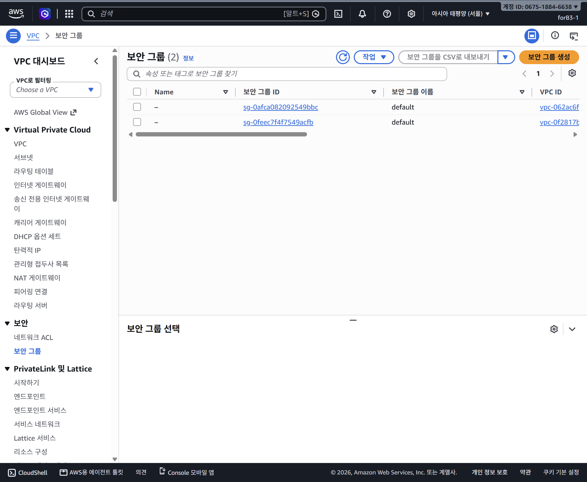

### 학습 질문: default 보안 그룹이 왜 두 개인가요?

VPC를 생성하면 AWS는 그 VPC에 속한 default 보안 그룹을 자동으로 만든다. 현재 서울에는 기존 기본 VPC와 새 실습 VPC가 있어서 각각의 default 그룹이 목록에 함께 표시된다. 같은 이름이지만 중복 생성된 동일 자원이 아니라 서로 다른 VPC 소속의 별개 보안 그룹이다.

- 기존 기본 VPC vpc-0f2817bf8e55c5af4 → default 그룹 sg-0feec7f4f7549acfb
- 실습 VPC b3-1-vpc(vpc-062ac6fd0606192ab) → default 그룹 sg-0afca082092549bbc

비유하면 아파트 단지 두 곳에 각각 ‘기본 출입 규칙’이 하나씩 있는 것이다. default는 기본 VPC만의 이름이 아니라 각 VPC의 기본 보안 그룹 이름이다. 따라서 이름만 보지 말고 VPC ID와 보안 그룹 ID를 함께 확인한다. 이번 웹 서버의 목적이 드러나는 별도 그룹을 만들고 기존 default 그룹은 수정하지 않는 계획이다.

## 27. 보안 그룹 생성 화면의 기본 VPC 선택 주의

보안 그룹 생성 화면에서 이름·설명은 비어 있고 인바운드 규칙은 없다. VPC는 기존 기본 VPC vpc-0f2817bf8e55c5af4가 선택되어 있다. 열린 VPC 목록에 실습 b3-1-vpc(vpc-062ac6fd0606192ab), 10.0.0.0/16이 표시되므로 이 항목으로 먼저 바꾸도록 안내한다. 아웃바운드는 모든 트래픽 → 0.0.0.0/0 초기 규칙과 경고가 표시된다. 아직 아웃바운드 최종 정책을 정하거나 보안 그룹을 생성하지 않았다.

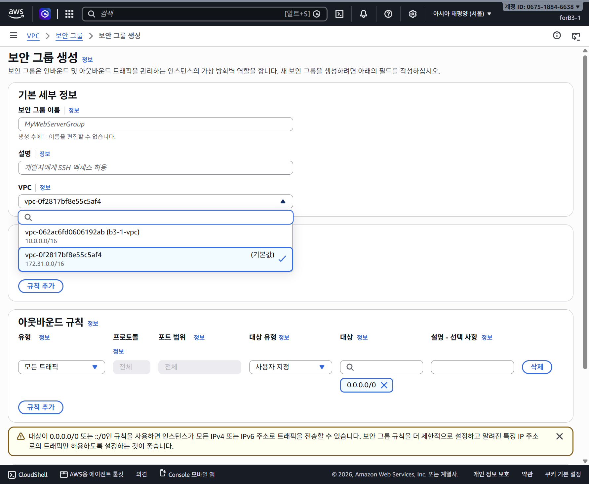

### 실습 VPC 선택 확인 및 그룹 이름 안내

보안 그룹 생성 화면의 VPC가 b3-1-vpc(vpc-062ac6fd0606192ab)로 바뀐 것을 확인했다. 이름과 설명은 아직 비어 있다. 제안 이름은 b3-1-web-sg, 설명은 Allow HTTP from internet and SSH from my IP 이다. 이름은 웹 서버용 보안 그룹을 식별하기 위한 것이며 설명 문구 자체가 규칙을 생성하지 않는다. 인바운드 규칙 추가와 최종 생성은 이후 별도로 진행한다.

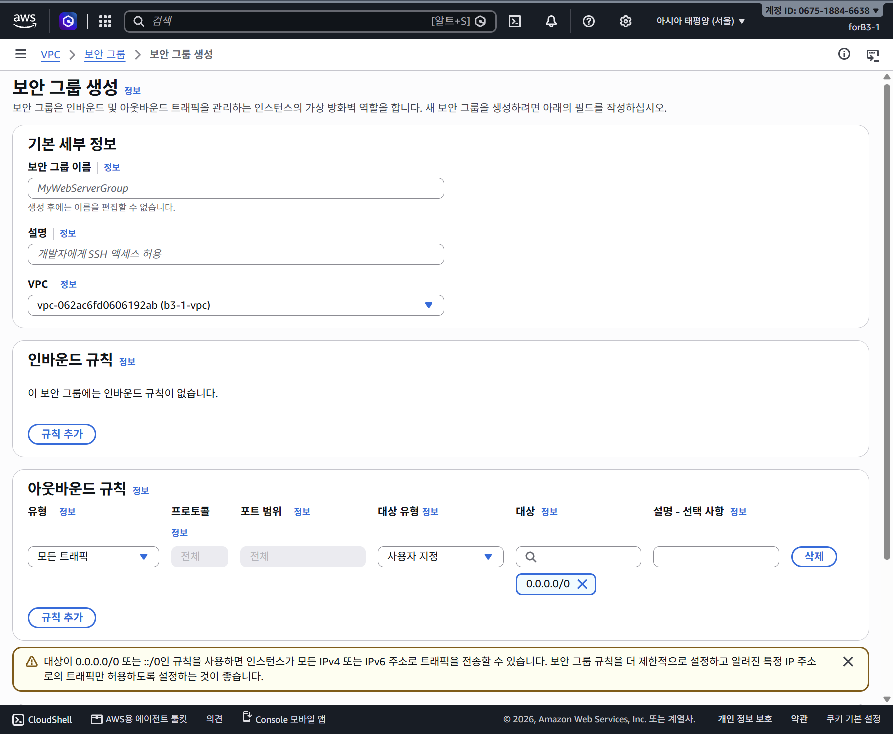

### 보안 그룹 이름 확인 및 설명 문자 수정 안내

이름 b3-1-web-sg와 실습 VPC 선택을 확인했다. 설명에는 ‘인터넷으로부터 HTTP 허용, 내 IP로 부터 SSH 허용’이라는 한글이 입력되어 있다. AWS 보안 그룹 설명의 허용 문자 범위에는 한글이 포함되지 않으므로 영문 설명 Allow HTTP from internet and SSH from my IP 로 변경하도록 안내한다. 아직 생성 시도나 문자 검증 오류를 확인한 것은 아니며 사전 입력값 검토다. 인바운드 규칙은 여전히 없다.

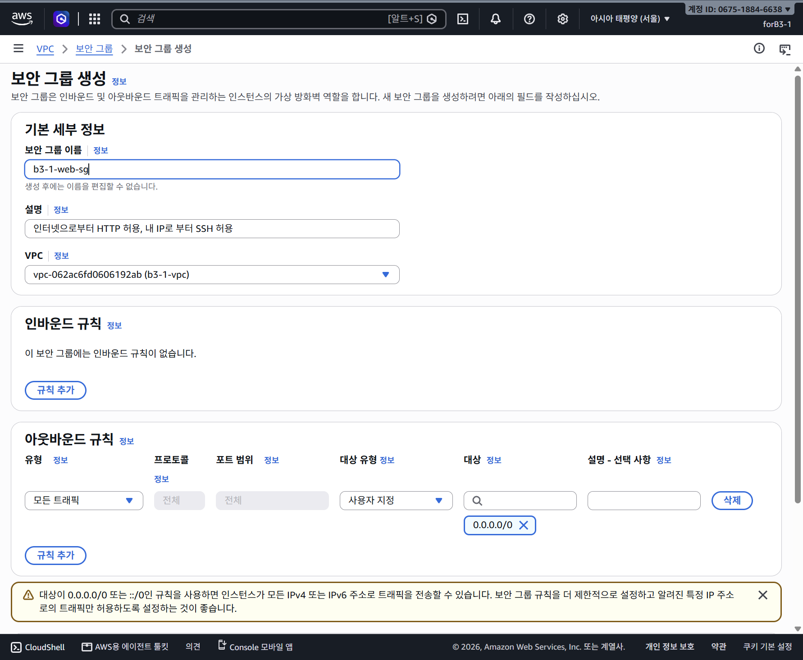

### 영문 설명 수정 확인·인바운드 규칙 입력 준비

보안 그룹 이름 b3-1-web-sg, 영문 설명 Allow HTTP from internet and SSH from my IP, 실습 VPC 선택을 확인했다. 인바운드 규칙은 아직 없다. 인바운드는 외부에서 서버로 들어오는 통신이며 첫 번째 규칙을 추가하도록 안내한다. 아웃바운드 규칙 추가 버튼과 구분한다. 아직 보안 그룹 생성은 하지 않았다.

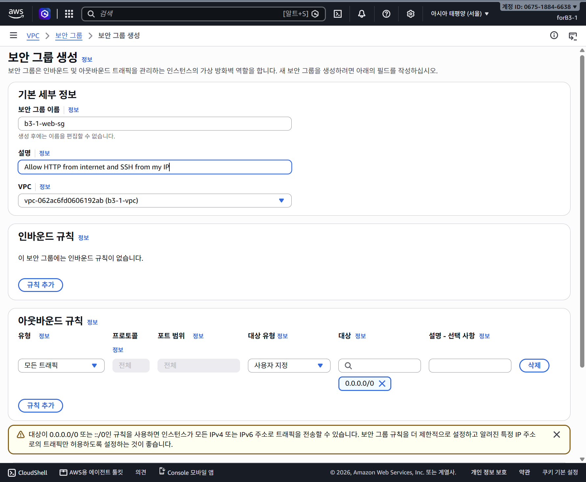

### 규칙 추가 위치 혼동 확인 및 복구 안내

현재 인바운드는 여전히 규칙이 없고 아웃바운드 규칙 2(사용자 지정 TCP, 포트 0, 대상 미지정)가 추가되어 유형 메뉴가 열려 있다. 의도한 HTTP 인바운드 행이 아니라 아웃바운드 행을 추가한 상태다. 메뉴 바깥을 눌러 닫고 새로 추가한 아웃바운드 규칙 2만 삭제하도록 안내한다. 기존 아웃바운드 규칙 1은 이 복구 단계에서 유지하며 최종 정책은 생성 전 검토한다. 아직 생성·저장은 하지 않았다.

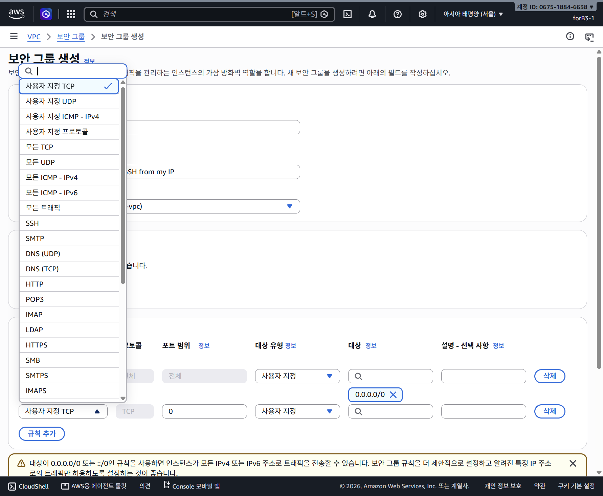

### 아웃바운드 복구 및 인바운드 첫 행 확인

잘못 추가된 아웃바운드 규칙 2가 제거되어 기존 모든 트래픽 규칙 1개만 남았음을 확인했다. 인바운드에는 첫 행이 추가되었고 유형 선택 목록이 열려 있다. 목록에서 HTTP 항목을 확인하고 선택하도록 안내한다. 아직 HTTP 선택·소스 지정·보안 그룹 생성은 확인 전이다.

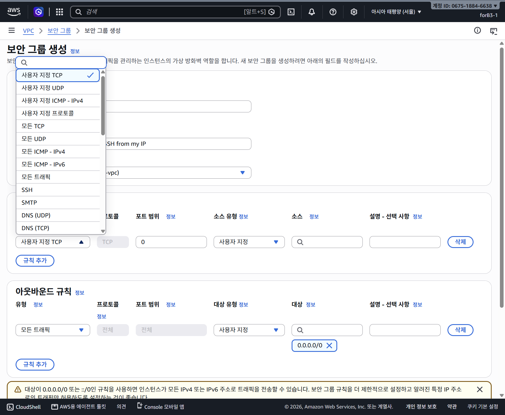

### HTTP 인바운드 유형 확인

인바운드 규칙 1의 유형 HTTP, 프로토콜 TCP, 포트 80을 확인했다. 소스 유형은 사용자 지정이며 소스 주소는 아직 비어 있다. 누구의 HTTP 요청을 받을지 지정하기 위해 이 행의 소스 유형 메뉴를 열도록 안내한다. 보안 그룹 생성은 아직 수행하지 않았다.

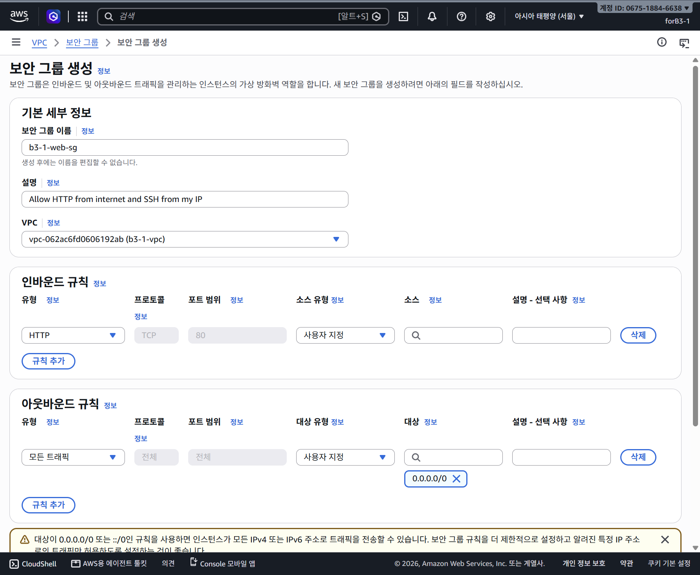

### HTTP 규칙의 소스 유형 목록 확인

HTTP 인바운드 행의 소스 유형 목록에 사용자 지정, Anywhere-IPv4, Anywhere-IPv6, 내 IP가 표시된다. 공개 웹 접속을 위해 Anywhere-IPv4(0.0.0.0/0)를 선택하도록 안내한다. 이는 TCP 80 규칙에만 적용하는 출발지 범위이며 모든 포트 허용이 아니다. SSH 규칙은 이후 별도로 본인 IP에 제한한다. 이 확인 시점에는 HTTP 소스 선택 및 보안 그룹 생성은 아직 완료하지 않았다.

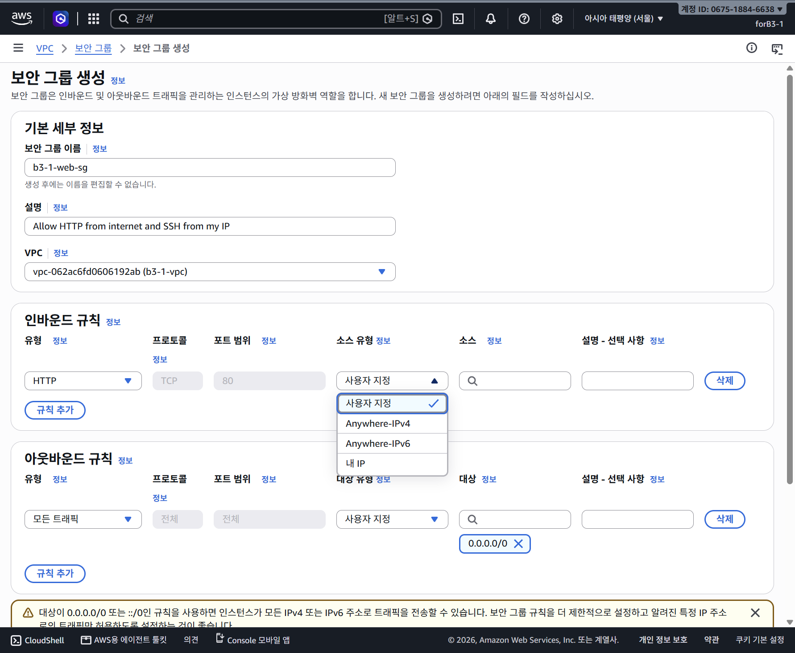

### HTTP 공개 소스 설정 확인·SSH 행 추가 준비

인바운드 규칙 1이 HTTP/TCP/80, Anywhere-IPv4, 소스 0.0.0.0/0으로 입력된 것을 확인했다. 모든 출발지 경고는 공개 웹 HTTP 규칙의 범위를 알리는 것이며 SSH를 공개한 상태는 아니다. 아직 SSH 규칙은 없다. 인바운드 구역의 규칙 추가로 두 번째 행을 만들도록 안내한다. 아직 보안 그룹 생성은 하지 않았다.

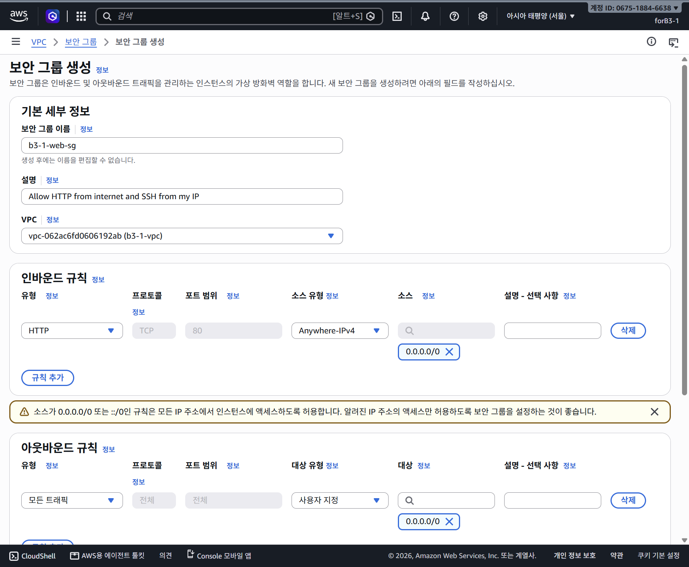

### 생성 전 인바운드 두 규칙 최종 확인

사용자가 두 번째 행까지 설정한 상태를 확인했다. 이름 b3-1-web-sg, 영문 설명, 실습 VPC가 유지되고 HTTP/TCP/80 소스 0.0.0.0/0 및 SSH/TCP/22 소스 내 IP(단일 IPv4 /32)가 입력되어 있다. /32는 현재 콘솔이 감지한 공인 IPv4 한 개만 매칭하며 같은 외부 IP를 공유하는 기기와 사용자를 구별하는 인증은 아니다. 네트워크·VPN·공인 IP가 바뀌면 SSH 소스를 재검토해야 한다. HTTP 공개 경고와 SSH 공개 여부는 구분한다. 아웃바운드는 서버의 패키지 설치·업데이트 등을 위해 초기 모든 트래픽 → 0.0.0.0/0 규칙을 유지하는 실습안이며, 이는 가장 엄격한 최소 출구 정책은 아니다. 외부가 먼저 시작하는 접속 전체를 허용하는 설정도 아니다. 운영 시 실제 필요한 목적지·프로토콜로 제한하는 별도 검토가 가능하다. 아직 생성 성공은 확인 전이며 사용자에게 생성 버튼을 누르도록 안내한다.

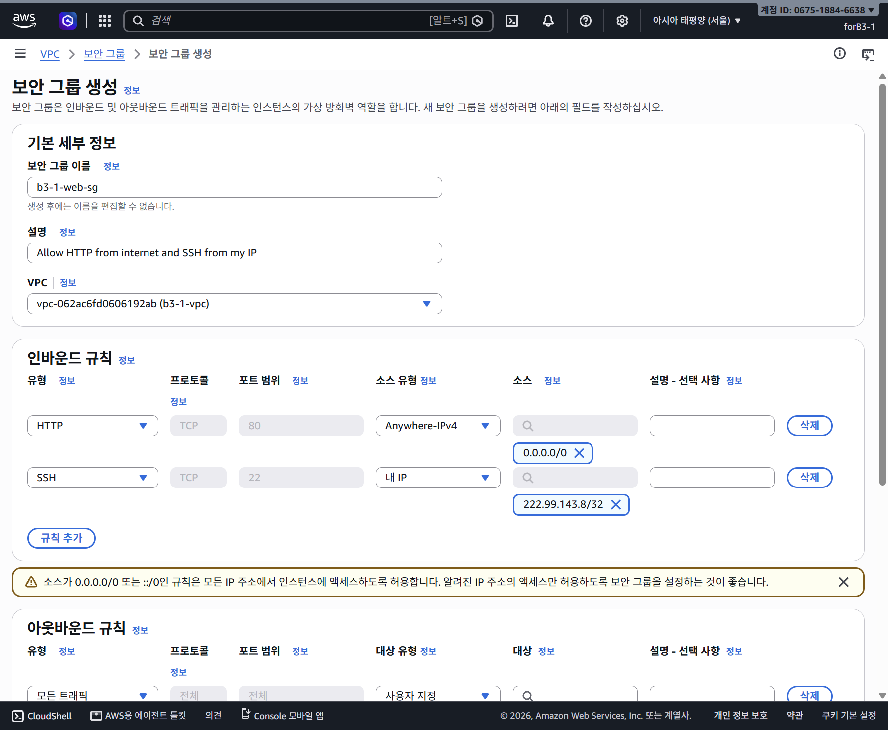

## 28. 웹 서버 보안 그룹 생성 성공 및 세션 변경 발견

성공 알림과 상세에서 b3-1-web-sg(sg-0c4336bb1e71eea36)가 실습 VPC vpc-062ac6fd0606192ab에 생성되었음을 확인했다. 인바운드 2개는 HTTP/TCP/80 소스 0.0.0.0/0 및 SSH/TCP/22 소스 단일 공인 IPv4 /32이다. 아웃바운드 수는 1개이며 상세 탭은 아직 확인 전이다.

중요: 직전 생성 전 화면의 사용자 표시는 forB3-1이었으나 현재 화면은 같은 계정의 AccountFullAccessRole 관리자 역할로 바뀌었다. 도메인의 세션 구분도 달라졌다. 이 관찰만으로 전환 원인이나 실제 CreateSecurityGroup 호출 주체는 확정할 수 없으며, 과제용 최소권한 사용자의 생성 권한 검증 성공으로 기록하지 않는다. 다음 EC2 작업 전에 사용자에게 역할 전환 여부를 확인하고 forB3-1 실습 세션으로 돌아가는 것을 우선한다. 기존 관리자 세션·권한은 변경하거나 종료하지 않는다.

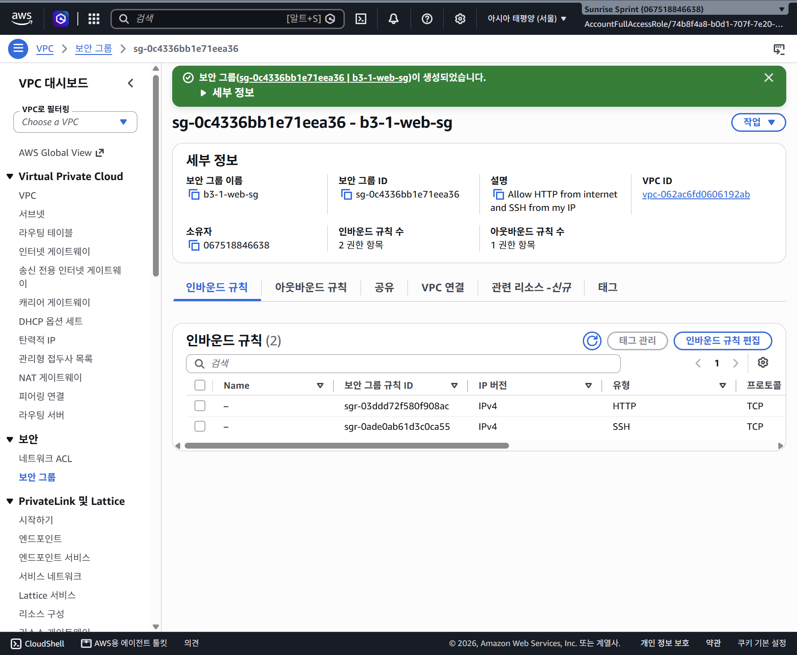
