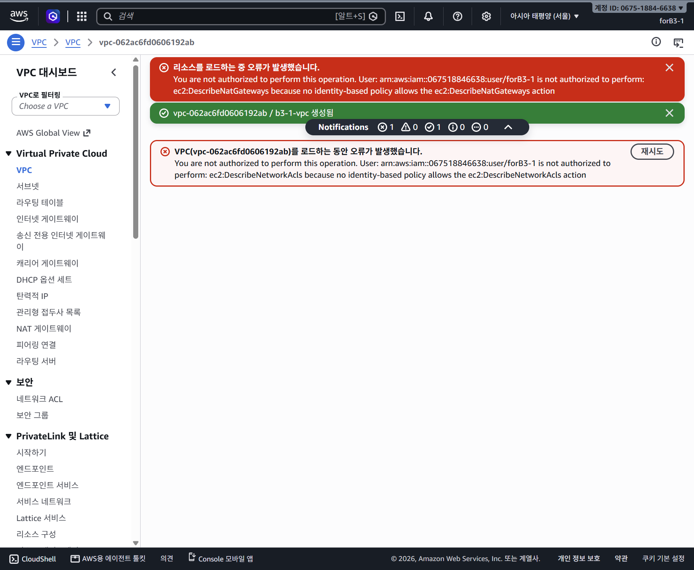
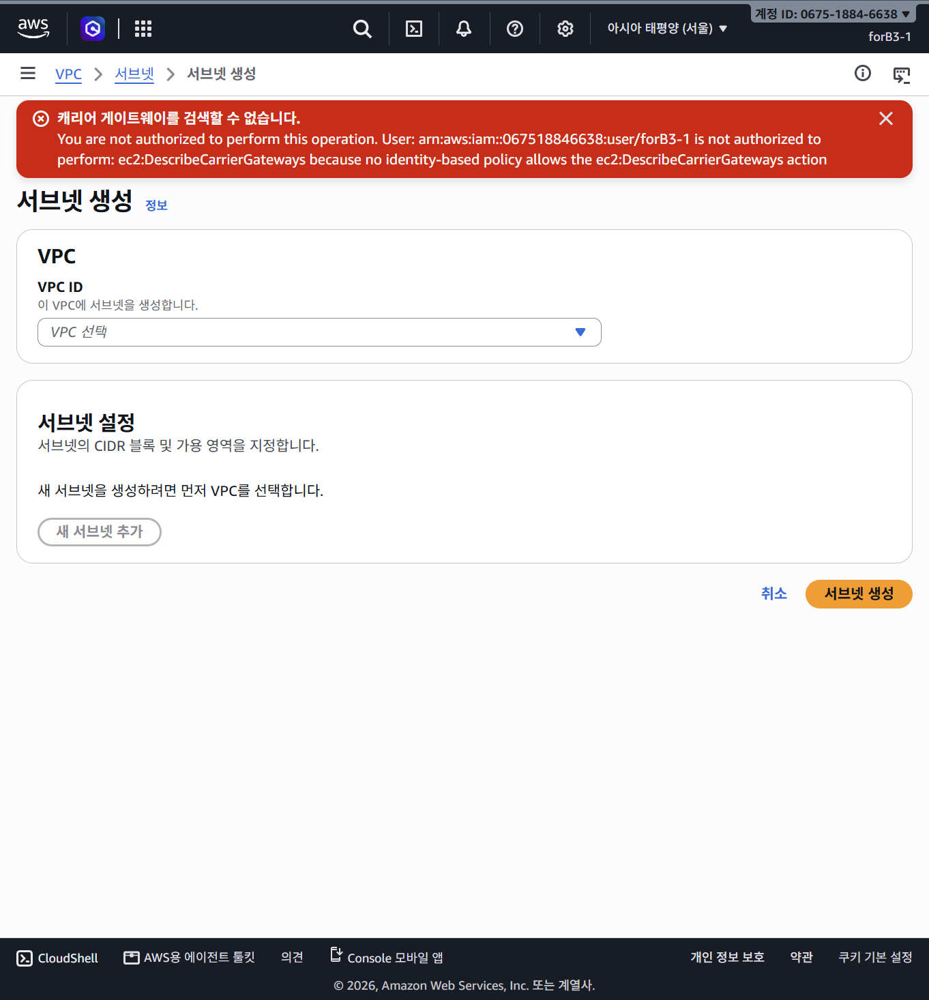

# VPC 생성 후 발생하는 2가지 조회 오류 쉬운 설명

[실습 진행 문서: 0019-vpc-network-walkthrough.md](0019-vpc-network-walkthrough.md)

---

## 1. 현재 상황 한눈에 보기

서울 리전(`ap-northeast-2`)에서 IAM 사용자 `forB3-1`로 실습용 VPC `b3-1-vpc`(`vpc-062ac6fd0606192ab`)를 생성했습니다.
AWS 콘솔 상단에 **생성 성공 알림**이 정상적으로 떴지만, 동시에 2개의 오류 메시지가 나타나며 VPC 상세 정보 일부가 로딩되지 않는 현상이 발생했습니다.

* **발생한 2개 오류**:
  1. `ec2:DescribeNatGateways` 요청 실패
  2. `ec2:DescribeNetworkAcls` 요청 실패
* **오류 메시지 원인 문구**: `... because no identity-based policy allows the action`
* **영향**: Network ACL 조회 실패로 인해 VPC 상세 정보 화면 일부 로딩 실패


*생성 성공 알림과 DescribeNatGateways 및 DescribeNetworkAcls 조회 거부가 동시에 표시됨, 아직 권한 변경 없음*

---

## 2. 일상 속 비유로 쉽게 이해하기

> **"새 건물(VPC) 준공은 완료되었으나, 관리사무소 점검표 중 일부 열람증이 빠진 상황"**

* **건물 신축 (VPC 생성)**: 구청(AWS)에 신축 요청을 보내 건물(`b3-1-vpc`) 생성이 공식 완료되었습니다. 백엔드 시스템에 리소스가 정상 등록되었습니다.
* **관리사무소 모니터 확인 (AWS 콘솔 화면)**: 관리사무소 화면에 건물의 부속 설비 현황을 띄우려고 합니다.
  * 이때 방범 게이트(Network ACL)와 내부 사설 공간에서 외부로 나갈 때 쓰는 출구(NAT Gateway) 현황을 함께 조회합니다.
* **열람증 확인 (IAM 정책)**: 관리사무소 시스템이 직원의 열람증을 확인해보니 "방범 게이트와 외부 출구 목록을 조회할 수 있다"는 허가 항목이 적혀 있지 않습니다.
* **결과**: 건물이 사라지거나 취소된 것이 아닙니다. 단지 **"안내 모니터에 정보를 불러와 보여줄 수 없다"**며 화면에 오류 경고를 띄운 것입니다.

---

## 3. 핵심 용어 정확히 풀이하기

### ① `ec2:Describe...` (조회 권한)
* AWS API에서 **`Describe`**가 붙은 액션은 리소스를 생성(`Create`), 수정(`Modify`), 삭제(`Delete`)하는 작업이 아닙니다.
* 이미 존재하는 리소스의 목록이나 상태 정보를 **"단순히 읽고 확인(Read/List)"**하는 읽기 전용 작업입니다.
* `DescribeNatGateways`: 사설 서버가 외부 인터넷으로 나갈 때 사용하는 출구(NAT Gateway) 목록과 상태를 읽어오는 권한
* `DescribeNetworkAcls`: 가상 네트워크의 서브넷 경계를 보호하는 방화벽(Network ACL) 목록과 규칙을 읽어오는 권한

### ② `identity-based policy` (자격 증명 기반 정책)
* 로그인한 IAM 사용자(`forB3-1`)에게 직접 또는 그룹을 통해 부여된 권한 문서(`b3-1-ec2-seoul-policy.json`)를 말합니다.

### ③ `because no identity-based policy allows the action` (암시적 거부)
* AWS IAM 보안의 기본 원칙은 **"명시적으로 허용(Allow)하지 않은 모든 요청은 거부(Deny)한다"**입니다.
* 이 오류는 관리자가 "이 사용자는 절대 보면 안 돼!"라고 명시적으로 차단한 것이 아니라, 정책 문서의 허용 목록(`Statement`의 `Action`)에 해당 항목을 **아직 적어주지 않아서 거부된 것(Implicit Deny)**입니다.

---

## 4. '생성 성공'과 '조회 실패'의 결정적 차이

많은 분들이 화면에 빨간색 오류가 뜨면 "VPC 생성이 망가졌거나 실패했나?" 하고 당황하여 다시 만들기 버튼을 누르곤 합니다. 하지만 두 작업은 완전히 분리되어 있습니다.

| 구분 | 생성 작업 (`CreateVpc`) | 조회 작업 (`DescribeNatGateways` / `DescribeNetworkAcls`) |
| :--- | :--- | :--- |
| **수행 주체** | 사용자가 요청한 VPC 생성 | AWS 콘솔 웹페이지가 상세 화면을 채우려고 보낸 자동 조회 |
| **결과** | **성공** (`vpc-062ac6fd0606192ab` 생성 완료) | **실패** (권한 목록 누락으로 데이터 응답 거부) |
| **인프라 상태** | AWS 클라우드에 VPC 리소스가 공식 등록됨 | 리소스 상태 변화 없음 (콘솔 화면 데이터 로딩만 실패) |
| **네트워크 영향** | VPC 기반 네트워크 공간 생성 완료 | 조회가 거부되었다고 해서 실제 트래픽 동작이 바뀌지 않음 |

* **NAT Gateway에 대해**: 이번 과제는 퍼블릭 서브넷 중심 실습이므로 사설 서버가 외부로 나갈 때 쓰는 출구인 NAT Gateway를 만들 계획이 없습니다. 하지만 AWS 콘솔은 VPC 상세 화면을 구성할 때 관련된 리소스 조회를 관례적으로 한꺼번에 호출하기 때문에 권한 오류가 표출된 것입니다.
* **Network ACL에 대해**: 일반적으로 VPC 생성 시 기본 Network ACL이 함께 자동 생성되지만, 현재 조회가 거부된 상태이므로 이번 VPC의 실제 ACL 규칙 내용이나 트래픽 허용 상태는 아직 직접 조회하여 검증하지 못했습니다. 또한 현재 실습 단계에서는 아직 서브넷을 새로 생성하지 않았으므로 서브넷 연결이 완료된 상태도 아닙니다. 중요한 점은 **조회 권한 부족이 실제 ACL의 트래픽 처리 동작 자체를 바꾸거나 정지시키는 것은 아니라는 사실**입니다.

---

## 5. 이전 SCP 실험과 이번 IAM 오류의 차이

이전 실험에서 겪었던 오류와 이번 화면 오류는 원인이 명확히 구분됩니다.

* **이전 실험의 SCP(Service Control Policy) 거부**:
  * 조직 상위 정책 차원에서 서울 리전의 `ec2:DescribeInstances` 요청을 **명시적 거부(explicit deny)**로 차단했던 사례였습니다.
* **이번 IAM 조회 오류**:
  * 현재 오류 메시지가 지목하는 직접적인 원인은 상위 SCP의 거부가 아니라, 사용자 정책(`b3-1-ec2-seoul-policy.json`)의 `B3ReadSeoul` 문에 해당 작업이 포함되어 있지 않은 **자격 증명 기반 정책 허용 누락**입니다.
  * 다만 이것이 다른 모든 작업이나 상위 SCP 검증까지 완전히 보장한다는 뜻은 아니며, 현재 콘솔 화면에서 확인된 직접적 장애 원인이 IAM 정책 내 허용 누락임을 의미합니다.

---

## 6. 조회(Describe) 권한에 대한 올바른 이해

* **생성/수정 권한과의 차이**:
  * 조회 권한은 리소스를 만들거나(`Create`), 수정하거나(`Modify`), 삭제(`Delete`)할 수 없으므로 실수로 유료 자원을 생성하거나 네트워크 설정을 변경할 수는 없습니다.
* **보안적 고려 사항 (노출 범위 확대)**:
  * 그렇다고 읽기 권한이 시스템에 아무런 위험을 주지 않는다고 단정할 수는 없습니다. 조회 권한이 늘어나면 가상 네트워크의 구성 현황, 자원 식별자, 보안 규칙 등 내부 인프라 정보가 노출되는 범위가 넓어지기 때문입니다.
* **최소 권한 부여 원칙**:
  * 따라서 무분별하게 넓은 조회를 허용하기보다는, 콘솔 실습에 꼭 필요한 조회 작업만 선별하여 **서울 리전 조건(`aws:RequestedRegion: ap-northeast-2`)**으로 한정해 허용하는 최소 권한 접근이 필요합니다.

---

## 7. 결론 및 현재 단계 권장사항

1. **VPC는 정상 생성되었습니다**: 절대 VPC를 삭제하거나 다시 생성하려고 시도하지 마세요.
2. **화면 렌더링 문제일 뿐입니다**: Network ACL 기능 정지나 인프라 결함이 아니므로 안심하셔도 됩니다.
3. **아직 권한 변경은 하지 않았습니다**: 현재 최소 권한 상태를 유지하고 있으며, 다음 실습 단계에 맞춰 필요한 최소 조회 권한을 안전하게 추가할지 순서대로 검토하면 됩니다.

---

## 8. 초보자를 위한 핵심 개념: NAT Gateway와 Network ACL

> **안내**: 아래 도식과 설명은 일반적인 네트워크 구조의 이해를 돕기 위한 **개념 예시**입니다. 현재 실습에서는 신규 서브넷, EC2, IGW 연결이 아직 완료되지 않았으며, 이번 과제는 **Public EC2 + IGW** 구성으로 NAT Gateway를 생성하지 않습니다.

---

### ① 궁금증 해소: "Network ACL은 유료인가요?"
* **VPC Network ACL (추가 비용 없음)**:
  * 본 실습에서 다루는 Network ACL은 VPC 서브넷의 기본 네트워크 방화벽 기능(L4 IP/포트 기반)입니다. VPC 내에서 기본 제공되며 별도의 사용 요금이 발생하지 않습니다.
* **AWS WAF의 Web ACL (유료 서비스와 혼동 주의)**:
  * 흔히 "ACL이 유료"라고 알려진 것은 웹 애플리케이션 방화벽 서비스인 **AWS WAF(Web Application Firewall)의 Web ACL**입니다. 이는 웹 요청(HTTP/HTTPS 등 L7 계층)의 악성 공격을 분석·차단하는 별도의 고급 보안 서비스입니다.
  * 이름에 둘 다 'ACL'이 들어가지만, VPC Network ACL과 AWS WAF Web ACL은 계층과 용도가 완전히 다른 별개 서비스입니다.

---

### ② 통합 ASCII 도식: VPC 전체 구조와 트래픽 흐름

```text
[ Internet ]
      ^
      | (Outbound / Response)
      v
+--[ IGW (Internet Gateway) ]----------------------------------------------+
|                                                                          |
| [ VPC Boundary ]                                                         |
|                                                                          |
|   +--[ Public Subnet ]-----------------------------------------------+   |
|   |  (Subnet Boundary: Public Network ACL - Stateless)               |   |
|   |                                                                  |   |
|   |   +----------------------------------------------------------+   |   |
|   |   |  Public NAT Gateway (Managed Address Translation)        |   |   |
|   |   |  - Has Elastic IP (Public IP)                            |   |   |
|   |   |  - Performs Address & Port Translation (NAPT)            |   |   |
|   |   +----------------------------------------------------------+   |   |
|   |                               ^                                  |   |
|   |   Route Table: 0.0.0.0/0 -> Target: IGW                          |   |
|   +-------------------------------|----------------------------------+   |
|                                   | (Traffic routed to NAT)              |
|   +--[ Private Subnet ]-----------|----------------------------------+   |
|   |  (Subnet Boundary: Private Network ACL - Stateless)              |   |
|   |                                                                  |   |
|   |   +--[ Network Interface (ENI) ]-----------------------------+   |   |
|   |   |  Security Group (Virtual Firewall - Stateful)            |   |   |
|   |   |                                                          |   |   |
|   |   |   +--------------------------------------------------+   |   |   |
|   |   |   |  Private EC2 (Private IP only)                   |   |   |   |
|   |   |   +--------------------------------------------------+   |   |   |
|   |   +----------------------------------------------------------+   |   |
|   |                                                                  |   |
|   |   Route Table: 0.0.0.0/0 -> Target: Public NAT Gateway           |   |
|   +------------------------------------------------------------------+   |
+--------------------------------------------------------------------------+
```

---

### ③ 그림을 따라가는 쉬운 해설

#### 1. NAT Gateway의 실제 위치와 역할: "방화벽 레이어가 아닌 주소 변환 서비스"
* **어느 레이어에 있는가?**:
  * NAT Gateway는 서브넷이나 인스턴스를 감싸고 있는 방화벽 계층(보안 레이어)이 아닙니다.
  * 퍼블릭 서브넷(Public Subnet) 안에서 하나의 IP 주소를 부여받아 동작하는 **네트워크 주소 및 포트 변환(NAPT) 매니지드 서비스**입니다.
  * 따라서 보안 그룹(SG)이나 Network ACL(NACL)과 상하로 겹겹이 배치된 방화벽 순서로 오해하면 안 됩니다.
* **라우팅 테이블(Route Table)을 통한 흐름**:
  * 사설 서버(`Private EC2`)가 인터넷으로 나갈 때, 직접 인터넷으로 쏘는 것이 아니라 **프라이빗 서브넷의 라우팅 테이블**이 외부행(`0.0.0.0/0`) 트래픽을 퍼블릭 서브넷의 **NAT Gateway**로 전달합니다.
  * NAT Gateway는 사설 IP를 자신의 공인 IP(Elastic IP)와 고유 포트 번호로 변환하여, **퍼블릭 서브넷의 라우팅 테이블(IGW행)**을 거쳐 **인터넷 게이트웨이(IGW)**로 내보냅니다.
* **단방향 통신 보장**:
  * 외부 인터넷에서 돌아오는 응답 패킷은 주소 변환 기록을 보고 원래 사설 서버로 돌려주지만, 외부 인터넷에서 먼저 시작하는 새로운 연결은 NAT Gateway를 뚫고 들어올 수 없습니다.

#### 2. Network ACL vs 보안 그룹(SG) 구조적 차이
* **Network ACL (서브넷 정문 검문소)**:
  * 서브넷의 경계를 감싸는 **Stateless(비상태 추적)** 방화벽입니다.
  * 들어오는 트래픽(Inbound)과 나가는 트래픽(Outbound)을 기억하지 않으므로 양쪽 규칙을 모두 관리하며, 번호 순서로 허용(Allow)과 거부(Deny)를 평가합니다.
* **보안 그룹 (개별 세대 도어록)**:
  * 가상 서버의 네트워크 카드(**ENI**)에 직접 붙는 **Stateful(상태 추적)** 가상 방화벽입니다.
  * 허용된 인바운드 요청의 응답은 아웃바운드 규칙과 상관없이 자동 허용되며, 오직 허용(Allow) 규칙만 작성합니다.

---

### ④ 이번 과제에서의 의미 재확인

1. **NAT Gateway 미생성**: 이번 과제는 인스턴스가 공인 IP를 직접 부여받아 IGW로 소통하는 **퍼블릭 서브넷(Public EC2 + IGW)** 구성이므로 유료인 NAT Gateway는 전혀 만들지 않습니다.
2. **Network ACL 직접 설정 불필요**: VPC를 만들면 기본 ACL이 백엔드에서 자동으로 구성되므로, 이번 과제 명세상 커스텀 ACL 설정은 필수가 아니며 보안 그룹(SG) 설정에 집중합니다.
3. **현재 상태**: 위 도식은 개념 이해를 돕기 위한 예시이며, 현재 실습 환경에서는 신규 서브넷, EC2 인스턴스, IGW 연결이 아직 완료되지 않은 초기 단계입니다. 추가 권한 정책이나 네트워크 설정 변경은 아직 수행하지 않았습니다.

---

## 9. 부록: 캐리어 게이트웨이(Carrier Gateway)란 무엇인가요?


*서브넷 생성 화면에서 ec2:DescribeCarrierGateways 조회 권한 누락으로 오류가 표시되나, 실제 실습에 필요한 자원이 아님*

### ① 콘솔에 나타난 오류의 배경
서브넷 생성 화면을 열 때 AWS 콘솔은 Wavelength Zone 등 특수 서브넷 옵션을 지원하기 위해 `ec2:DescribeCarrierGateways` API를 자동으로 호출합니다. 이 오류는 IAM 사용자 정책에 해당 조회 권한이 명시되지 않아 발생한 단순 읽기 거부일 뿐이며, 서브넷 생성 실패나 필수 자원이 빠졌다는 뜻이 아닙니다.

### ② ASCII 개념도
```text
[ Wavelength Subnet ] ---> [ Carrier Gateway ] ---> [ Carrier Network (5G/LTE Edge) ]
(Ultra-low latency app)     (Dedicated Edge Gateway)  (Mobile devices / Connected cars)
```

### ③ 한국어 비유로 이해하기
* **비유**: 일반 택배가 여러 거점 물류센터를 거쳐 배송된다면, 캐리어 게이트웨이는 **"통신사 네트워크 바로 근처에 마련된 직통 창구"**입니다.
* 스마트폰이나 커넥티드 디바이스 같은 모바일 기기가 통신사 망에서 AWS 서버와 통신할 때 네트워크 이동 거리를 단축하여 통신 지연을 줄이는 용도로 활용됩니다.

### ④ 인터넷 게이트웨이(IGW)와의 구분
* **인터넷 게이트웨이 (IGW)**: 일반 가용 영역(AZ)의 서브넷과 공용 인터넷(Public Internet)을 연결하여 전 세계 사용자와 양방향 통신을 제공하는 표준 관문입니다.
* **캐리어 게이트웨이 (Carrier Gateway)**: AWS Wavelength Zone 서브넷에 연결되어 특정 통신사업자(Carrier) 무선 네트워크로의 직접 트래픽 전송과 함께 Wavelength 서브넷의 인터넷 아웃바운드 트래픽을 처리하는 게이트웨이입니다.

### ⑤ 이번 과제에서의 의미
* 이번 실습은 서울 리전 일반 가용 영역(AZ)에 **Public EC2 + IGW** 환경을 구축하는 과제입니다.
* 따라서 Wavelength Zone이나 캐리어 게이트웨이는 전혀 생성하거나 사용할 필요가 없습니다.
* 또한 서브넷 생성 화면의 조회 거부 오류만으로 생성이 실패했다고 단정할 필요는 없으며, 실습에 필수적인 작업이 실제로 차단되는 경우가 아니라면 화면 표시 오류로 구분하고 필요 시 최소 권한 범위를 재검토하면 됩니다.
