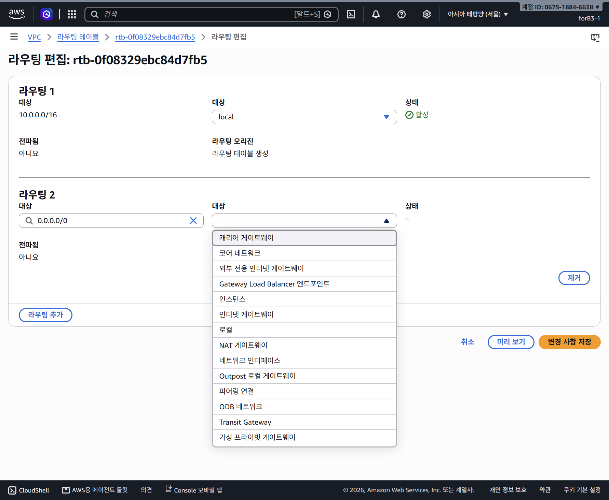
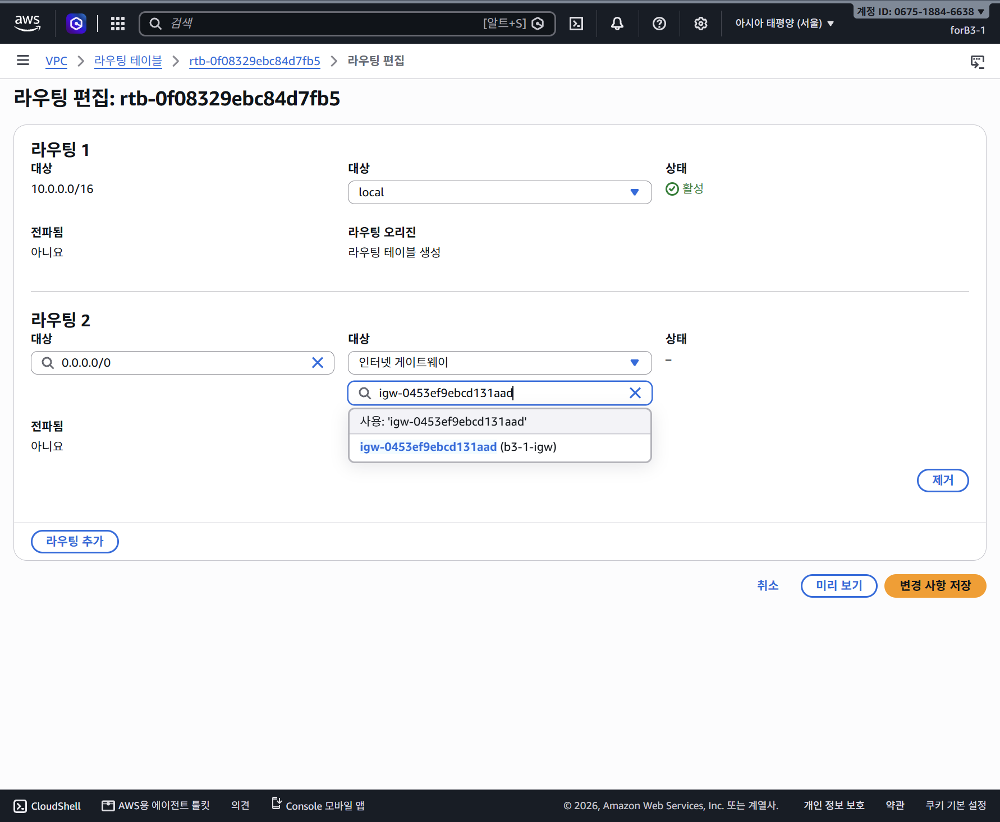
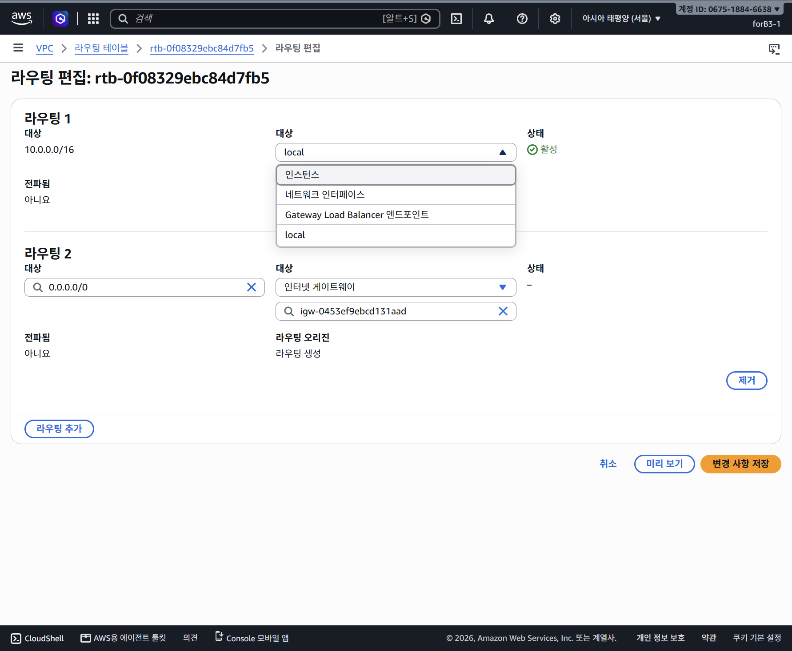

# 라우팅 테이블 대상(Target) 유형 14종 완전 분석 및 쉬운 설명

[이전: 서브넷 생성 설정값](0022-subnet-settings-쉬운설명.md) · [실습 진행 문서: 0019-vpc-network-walkthrough.md](0019-vpc-network-walkthrough.md)

---

## 1. 현재 확인 상태 요약

서울 리전(`ap-northeast-2`)의 IAM 사용자 `forB3-1` 환경에서, 실습용 VPC `b3-1-vpc`에 속한 라우팅 테이블 `rtb-0f08329ebc84d7fb5`에 인터넷 경로를 추가하는 작업 중입니다.


*라우팅 편집 화면에서 제공되는 14가지 대상(Target) 유형 드롭다운 목록*


*Destination에 0.0.0.0/0을 입력하고 Target으로 인터넷 게이트웨이 b3-1-igw를 선택 중인 화면*

> **확인 시점 안내**: 위 캡처는 기존 VPC 내부 경로(`10.0.0.0/16 -> local`) 외에 새 목적지(`0.0.0.0/0`)와 타깃(`igw-0453ef9ebcd131aad`)을 입력하고 **최종 변경 사항 저장 버튼을 누르기 전 상태**입니다. 저장 성공이 확정되기 전 단계이므로, 현재 완료 상태로 단정하지 않고 입력 중인 설정과 선택 메뉴의 의미를 학습 목적으로 정리합니다.

---

## 2. 핵심 개념: Destination vs Target과 '최장 일치 원칙'

콘솔 화면에서 가장 혼동하기 쉬운 용어 차이와 라우팅 규칙의 우선순위 원리입니다.

### ① 용어 구분: Destination(목적지) vs Target(전달 대상)
* **Destination (목적지 주소 범위)**: **"패킷의 최종 도착지 주소가 어디인가?"**
  * 예: `10.0.0.0/16` (VPC 내부 주소들), `0.0.0.0/0` (모든 IPv4 주소에 매칭하며 더 구체적인 경로가 없을 때 사용)
* **Target (다음 전달 위치 / 경유지)**: **"그 목적지로 가려면 지금 당장 누구에게 패킷을 넘겨야 하는가?"**
  * 예: `local` (VPC 내부 라우터), `igw-0453ef9ebcd131aad` (인터넷 게이트웨이)

### ② 최장 일치 원칙 (Longest Prefix Match)
라우팅 테이블에 여러 규칙이 있을 때, 라우터는 **목적지 IP와 가장 길고 구체적으로 일치하는(서브넷 마스크 숫자가 큰) 규칙**을 우선 선택합니다.

```text
[ 패킷 도착: 목적지 10.0.1.50 ]
       |
       +---> 규칙 1: 10.0.0.0/16  -> Target: local  (16비트 일치 -> 더 구체적임!) [채택!]
       |
       +---> 규칙 2: 0.0.0.0/0    -> Target: IGW    (0비트 일치 -> 기본 경로)
       |
       v
결과: 외부 인터넷(IGW)으로 나가지 않고 VPC 내부(local)로 안전하게 전달됨
```

* 이 두 경로만 있는 경우 `10.0.0.0/16`에 속하는 목적지는 더 구체적인 local 경로를 선택합니다. SG·NACL 등의 통신 허용은 별도 조건입니다.
* `0.0.0.0/0 -> igw-xxx`는 모든 IPv4 목적지에 매칭하되 더 구체적인 경로가 없을 때 IGW로 전달하는 **기본 경로(Default Route)**입니다. 사설 IP도 /0에 매칭하므로, 경로가 있다고 모든 목적지에 실제 도달할 수 있다는 뜻은 아닙니다.

---

## 3. 라우팅 판단 흐름 ASCII 도식

```text
[ EC2 인스턴스에서 발생한 트래픽 ]
                 |
                 v
   +-------------------------------+
   |      서브넷 라우팅 테이블       |
   |   (Destination 판별 시작)     |
   +-------------------------------+
                 |
        [ 목적지 IP 검사 ]
                 |
        +--------+--------+
        |                 |
  (10.0.0.0/16 매칭?)  (그 외 모든 외부 IP?)
        |                 |
     [ YES ]           [ YES (0.0.0.0/0) ]
        |                 |
        v                 v
   Target: local     Target: Internet Gateway
        |                 |
        v                 v
  [ VPC 내부 통신 ]    [ 인터넷 게이트웨이 (IGW) ]
  (다른 서브넷/서버)              |
                          v
                   [ 공용 인터넷 (Internet) ]
```

---

## 4. 라우팅 대상(Target) 드롭다운 14종 완전 분석

콘솔에 14개 목록이 표시된다고 해서 모든 자원을 만들어야 하거나, 현재 계정에 해당 자원이나 권한이 존재한다는 뜻이 아닙니다. 이는 이번 콘솔 화면에서 제공하는 대상 유형 목록입니다. 지원 조건과 실제 사용 가능한 자원은 서비스·리전·구성에 따라 달라집니다.

> **비용 안내**: 아래 대상 중 일부(NAT Gateway, Transit Gateway, Gateway Load Balancer 등)는 시간당 요금이나 데이터 처리 요금이 발생하는 유료 서비스입니다. 모든 대상이 무료인 것은 아니며, 본 문서에는 변동 가능한 요금 수치는 명시하지 않습니다.

---

### 1. 로컬 (Local)
* **초보자용 역할**: "VPC 내부 전용 통로"
* **언제 쓰는가**: VPC를 만들면 `VPC-CIDR -> local` 규칙이 자동으로 생성됩니다. VPC 내의 서브넷들끼리 프라이빗 IP로 통신할 때 사용됩니다.
* **주의**: 이는 트래픽을 허용/차단하는 방화벽 규칙이 아니라 **네트워크 경로(길)**입니다. 일반 실습에서는 그대로 유지합니다. 고급 중간 장비 라우팅에서는 local 경로의 전달 대상을 교체할 수 있으므로, 절대로 수정 불가능하다는 뜻은 아닙니다.
* **이번 과제 필요 여부**: **[기본 필수 유지]** (이미 등록되어 있으며 그대로 유지)

---

### 2. 인터넷 게이트웨이 (Internet Gateway, IGW)
* **초보자용 역할**: "VPC와 공용 인터넷을 잇는 정문"
* **언제 쓰는가**: 퍼블릭 서브넷의 서버가 전 세계 공용 인터넷과 양방향(Inbound/Outbound)으로 통신해야 할 때 사용합니다.
* **이번 과제 필요 여부**: **[이번 과제 필수 대상]** (`0.0.0.0/0`의 타깃으로 `b3-1-igw` 지정)

---

### 3. NAT 게이트웨이 (NAT Gateway)
* **초보자용 역할**: "사설 서버 전용 일방통행 인터넷 출구"
* **언제 쓰는가**: 공인 IP가 없는 프라이빗 서브넷의 서버가 패치 다운로드 등을 위해 인터넷으로 나갈 때 사용합니다.
  * **Public NAT Gateway**: 일반적으로 퍼블릭 서브넷에 배치되어 IGW를 통해 인터넷으로 아웃바운드 트래픽을 내보냅니다.
  * **Private NAT Gateway**: 인터넷이 아닌 다른 사설망(VPC, 온프레미스)과 중복 IP 없이 통신할 때 사용합니다.
* **이번 과제 필요 여부**: **[불필요 / 미사용]** (이번 과제는 공인 IP를 직접 갖는 Public EC2 + IGW 구성)

---

### 4. 인스턴스 (Instance)
* **초보자용 역할**: "가상 라우터/방화벽 역할을 하는 특수 EC2 서버"
* **언제 쓰는가**: 트래픽을 일반 웹 서버로 보낼 때 쓰는 것이 아닙니다. 오픈소스 방화벽(pfSense 등)이나 커스텀 NAT 소프트웨어가 설치된 **특수 네트워크 EC2 인스턴스**로 트래픽을 중계할 때 타깃으로 지정합니다.
  * 해당 EC2 인스턴스는 OS 레벨 패킷 포워딩 및 AWS의 **Source/Destination Check(소스/대상 확인) 비활성화** 설정이 반드시 필요합니다.
* **이번 과제 필요 여부**: **[불필요 / 미사용]**

---

### 5. 네트워크 인터페이스 (Elastic Network Interface, ENI)
* **초보자용 역할**: "특정 가상 네트워크 카드(ENI)로 트래픽 전달"
* **언제 쓰는가**: 인스턴스 타깃과 유사하지만, 여러 개의 네트워크 카드를 장착한 방화벽 장비의 특정 인터페이스(`eni-xxx`)를 콕 집어 라우팅할 때 사용합니다. 역시 Source/Dest Check 비활성화가 요구됩니다.
* **이번 과제 필요 여부**: **[불필요 / 미사용]**

---

### 6. 외부 전용 인터넷 게이트웨이 (Egress-Only Internet Gateway, EIGW)
* **초보자용 역할**: "IPv6 전용 일방통행 인터넷 출구"
* **언제 쓰는가**: 인터넷 라우팅 가능한 IPv6 주소를 가진 서버가 외부로 시작한 통신과 그 응답은 허용하되, 이 게이트웨이를 통한 외부 시작 신규 연결을 막고 싶을 때 사용합니다. IPv6에도 사설·링크 로컬 주소 등이 있으므로 모든 IPv6 주소가 공인 주소인 것은 아닙니다.
* **이번 과제 필요 여부**: **[불필요 / 미사용]** (이번 실습은 IPv4 전용 구성)

---

### 7. 피어링 연결 (Peering Connection, pcx)
* **초보자용 역할**: "두 VPC를 1:1로 직접 잇는 전용 지하 터널"
* **언제 쓰는가**: 회사 내 다른 VPC나 타사 VPC와 사설 IP로 직접 고속 통신할 때 사용합니다.
  * **비전이성 (Non-transitive)**: VPC-A와 VPC-B가 연결되고 VPC-B와 VPC-C가 연결되어 있어도, B를 거쳐 A와 C가 통신할 수는 없습니다. (A와 C가 통신하려면 별도 피어링 필요)
* **이번 과제 필요 여부**: **[불필요 / 미사용]**

---

### 8. Transit Gateway (TGW)
* **초보자용 역할**: "수십 개의 VPC와 온프레미스를 하나로 묶는 중앙 허브 라우터"
* **언제 쓰는가**: VPC가 수십~수백 개로 늘어나 1:1 피어링 연결이 거미줄처럼 복잡해질 때, 중앙 교차로 역할을 하는 가상 라우터(Hub-and-Spoke 아키텍처)로 트래픽을 모아 전달할 때 사용합니다.
* **이번 과제 필요 여부**: **[불필요 / 미사용]**

---

### 9. 가상 프라이빗 게이트웨이 (Virtual Private Gateway, VGW)
* **초보자용 역할**: "본사/지사 사옥과 VPC를 연결하는 VPN/전용선 관문"
* **언제 쓰는가**: 회사 온프레미스 전산실과 AWS VPC를 연결하는 **Site-to-Site VPN**이나 전용 회선인 **AWS Direct Connect(DX) Private VIF**를 연결할 때 VPC 측 종단점으로 사용합니다.
* **이번 과제 필요 여부**: **[불필요 / 미사용]**

---

### 10. Gateway Load Balancer 엔드포인트 (GWLBE)
* **초보자용 역할**: "모든 패킷을 전문 보안 검사 장비로 경유시키는 통로"
* **언제 쓰는가**: 트래픽이 웹 서버로 들어가기 전에 타사 보안 어플라이언스(Palo Alto, Fortinet 등 침입 방지 시스템) 클러스터를 통과하여 정밀 검사를 받도록 트래픽 경로를 우회시킬 때 사용합니다.
* **이번 과제 필요 여부**: **[불필요 / 미사용]**

---

### 11. 코어 네트워크 (Core Network)
* **초보자용 역할**: "글로벌 단위 클라우드 WAN 백본 통로"
* **언제 쓰는가**: **AWS Cloud WAN** 서비스를 이용해 전 세계 여러 리전의 VPC와 글로벌 지사 네트워크를 단일 중앙 정책 기반으로 통합 관리할 때 코어 네트워크로 트래픽을 보냅니다.
* **이번 과제 필요 여부**: **[불필요 / 미사용]**

---

### 12. 캐리어 게이트웨이 (Carrier Gateway)
* **초보자용 역할**: "5G 기지국 모바일 통신사망 전용 관문"
* **언제 쓰는가**: AWS Wavelength Zone 서브넷에서 5G 모바일 기기 네트워크와 직접 초저지연 통신을 주고받거나, Wavelength 서브넷의 인터넷 아웃바운드를 처리할 때 사용합니다.
* **이번 과제 필요 여부**: **[불필요 / 미사용]**

---

### 13. Outpost 로컬 게이트웨이 (Outpost Local Gateway, LGW)
* **초보자용 역할**: "고객 전산실에 설치된 AWS 랙(Outpost)과 회사 사내망 연결 통로"
* **언제 쓰는가**: 고객사의 실제 데이터센터에 설치된 AWS 하드웨어 랙인 **AWS Outposts** 환경에서 사내 로컬 네트워크(LAN)로 트래픽을 라우팅할 때 사용합니다.
* **이번 과제 필요 여부**: **[불필요 / 미사용]**

---

### 14. ODB 네트워크 (ODB Network)
* **초보자용 역할**: "Oracle Database@AWS 전용 고속 연결망"
* **언제 쓰는가**: AWS 데이터센터 내에 위치한 전용 Oracle Cloud Infrastructure(OCI) 하드웨어 기반의 **Oracle Database@AWS** 서비스와 고객 VPC를 직접 저지연으로 연결할 때 사용합니다.
* **이번 과제 필요 여부**: **[불필요 / 미사용]**

---

## 5. 이번 실습 요약 및 핵심 정리

1. **사용하는 대상은 단 2개뿐**:
   * `10.0.0.0/16` -> **`local`** (VPC 내부 기본 통신, 자동 유지)
   * `0.0.0.0/0` -> **`인터넷 게이트웨이 (igw-0453ef9ebcd131aad / b3-1-igw)`** (외부 인터넷 통신용 신규 추가)
2. **나머지 12개 대상은 미사용**:
   * NAT Gateway, Peering, Transit Gateway 등은 이번 퍼블릭 서브넷 단일 EC2 과제에서 전혀 필요하지 않습니다.
3. **현재 상태**:
   * 마지막 확인 화면은 라우팅 편집 창에서 목적지와 인터넷 게이트웨이를 입력하고 선택 목록을 확인 중인 단계입니다. 저장 완료 여부는 이후 화면에서 별도로 검증해야 합니다.


## 6. 실제 비교: 라우팅 1은 왜 대상이 4개인가요?

Aside가 사용자가 연 local 경로의 메뉴를 직접 확인했습니다. 라우팅 1(10.0.0.0/16)의 목록은 인스턴스, 네트워크 인터페이스, Gateway Load Balancer 엔드포인트, local의 4개입니다. 앞서 14개라고 설명한 것은 새로 추가한 라우팅 2의 대상 유형 메뉴이며 두 목록은 다릅니다.



- **local**: VPC 내부 전달을 기본 방식으로 처리합니다. 이번에는 그대로 유지합니다.
- **인스턴스**: 라우터·방화벽 등 중간 장비 역할의 EC2로 내부 트래픽을 전달합니다. 일반 웹 서버를 목적지로 등록하는 설정이 아닙니다.
- **네트워크 인터페이스**: 중간 장비의 특정 ENI로 전달합니다.
- **Gateway Load Balancer 엔드포인트**: GWLB를 통해 보안 검사 장비로 트래픽을 경유시킵니다.

이 제한된 목록은 기존 local 경로의 전달 대상 교체를 위한 것입니다. 목적지 CIDR을 지우거나 인터넷행 경로로 바꾸는 설정이 아닙니다. 중간 장비 경유 구성은 양방향 경로·장비 설정 등을 별도로 설계해야 합니다. 이번 과제에서는 local을 유지하고, 별도 /0 경로에 IGW를 지정합니다.

관찰 당시 라우팅 2에는 0.0.0.0/0과 igw-0453ef9ebcd131aad가 입력되어 있었으며 최종 저장 성공은 확인 전입니다.


## 7. ‘라우팅 테이블 생성’, ‘라우팅 생성’, ‘전파됨’을 아주 쉽게

### 라우팅 테이블은 ‘길 안내판’이라고 생각하세요

안내판에는 ‘어디로 가려면 어느 길로 가라’는 줄들이 적혀 있습니다. 이 안내판 하나가 **라우팅 테이블**, 안내 문구 한 줄이 **라우팅 경로**입니다.

### 왜 위에는 ‘라우팅 테이블 생성’, 아래에는 ‘라우팅 생성’인가요?

둘 다 **그 안내 문구가 어떻게 생겼는지**를 말합니다. 화면의 ‘라우팅 오리진’은 어려운 말로 들리지만, 여기서는 ‘이 줄의 출처’라는 뜻입니다.

- **위: 라우팅 테이블 생성**
  - 안내판을 처음 받았을 때부터 기본으로 적혀 있던 문구입니다.
  - AWS가 테이블을 만들면서 ‘우리 VPC 안의 주소로 가려면 내부 길(local)을 써라’를 자동으로 넣었습니다.
  - 화면의 줄: `10.0.0.0/16 → local`
- **아래: 라우팅 생성**
  - 안내판을 받은 뒤 우리가 새로 써 넣는 문구입니다.
  - 이번에는 ‘더 자세한 길 안내가 없는 IPv4 주소로 가려면 인터넷 출입구(IGW) 쪽으로 보내라’를 추가하고 있습니다.
  - 입력한 줄: `0.0.0.0/0 → b3-1-igw`

**한마디로: 위는 ‘처음부터 있던 기본 문구’, 아래는 ‘우리가 추가하는 문구’입니다.** 아래에 ‘라우팅 생성’이 보여도 저장 성공을 뜻하지는 않습니다. 마지막 확인은 아직 편집 화면이었습니다.

### ‘전파됨’은 무슨 뜻인가요?

여기서 전파는 와이파이 전파나 ‘인터넷에 공개했다’는 뜻이 아닙니다. **다른 네트워크 쪽에서 알려준 길 안내를 자동으로 받아 적었는지**를 뜻합니다.

회사망과 AWS를 연결한 상황을 예로 들면, 회사 쪽에서 ‘우리 회사 주소들은 이 연결로 보내세요’라고 알려줄 수 있습니다. 전파를 지원하는 연결에서 이를 설정하면 해당 길 안내가 테이블에 자동으로 반영될 수 있습니다. 모든 연결이 이렇게 동작하는 것은 아닙니다.

```text
안내판에 적힌 문구의 출처

AWS가 처음부터 넣어 줌   → 위 local 경로
우리가 직접 추가함       → 아래 IGW 경로
다른 연결에서 자동 전달받음 → ‘전파됨’에 해당하는 경우
```

지금 두 줄은 마지막 경우가 아니므로 **전파됨: 아니요**입니다.

- **아니요 = 고장**이 아닙니다.
- **아니요 = 인터넷 연결 안 됨**도 아닙니다.
- 지금 실습에서는 ‘예’로 바꿀 필요가 없습니다.

### 이번 화면에서 기억할 것

**위 local은 그대로 유지하고, 아래 IGW 경로만 추가합니다. ‘오리진’과 ‘전파됨’은 그 길 안내가 어디서 왔는지 설명하는 정보입니다.**


## 8. 추가 질문: `0.0.0.0/0`은 어떻게 읽나요?

**‘앞에서 고정할 비트가 0개이므로, 모든 IPv4 주소에 해당하는 범위’**라고 읽습니다.

CIDR에서 / 뒤의 숫자는 앞에서 몇 비트를 고정할지 뜻합니다. IPv4는 총 32비트입니다.

```text
10.0.1.0/24 → 앞의 24비트 고정 → 10.0.1.[아무 값]
10.0.0.0/16 → 앞의 16비트 고정 → 10.0.[아무 값].[아무 값]
0.0.0.0/0   → 고정하는 비트 없음 → [아무 값].[아무 값].[아무 값].[아무 값]
```

따라서 `0.0.0.0/0`의 범위는 `0.0.0.0`부터 `255.255.255.255`까지입니다. 이는 모든 IPv4 주소를 매칭하는 범위라는 뜻이지, 모든 주소가 실제 호스트 주소로 할당 가능하거나 인터넷으로 통신 가능하다는 뜻은 아닙니다. 대응하는 마스크는 `0.0.0.0`입니다. 앞에 적힌 `0.0.0.0`은 이 CIDR 블록의 시작 주소이며, ‘목적지가 정확히 0.0.0.0 하나’라는 뜻이 아닙니다.

### 모든 주소에 해당하면 내부 통신도 인터넷으로 나가나요?

아닙니다. **같이 맞는 경로가 여러 개면 더 자세한 경로가 우선**입니다.

이번에 준비한 두 줄을 길 안내판으로 읽으면 다음과 같습니다.

- `10.0.0.0/16 → local`: ‘10.0으로 시작하는 우리 VPC 주소는 내부 길로 보내세요.’
- `0.0.0.0/0 → IGW`: ‘더 자세한 안내가 없는 나머지 IPv4 목적지는 인터넷 출입구로 보내세요.’

예시:

- 목적지 `10.0.1.50`: /16과 /0에 모두 해당하지만 **/16이 더 구체적**이므로 local을 선택합니다.
- 목적지 `8.8.8.8`: 이 두 경로 중 /0에만 해당하므로 IGW를 선택합니다.

그래서 /0 경로를 **기본 경로(Default Route)**라고 부릅니다. 목적지 판단에서 마지막으로 사용하는 ‘나머지는 이쪽’ 안내입니다. 별도의 더 구체적인 경로를 추가하면 그 경로가 우선할 수 있습니다.

### 모든 사람에게 접속을 허용한다는 뜻인가요?

**라우팅 테이블에서는 아닙니다.** 여기서는 어디로 보낼지 정하는 길 안내입니다. 실제 통신에는 공인 IP, SG·NACL 허용, 서버 설정 등도 필요합니다.

같은 `0.0.0.0/0`이라도 **SG 인바운드 규칙의 소스**에 넣으면 ‘모든 IPv4 출발지’를 의미합니다. 예를 들어 HTTP 80 소스에 쓰면 누구나 접속할 수 있도록 허용하는 규칙이고, SSH 22는 이번 과제에서 본인 IP로 제한해야 합니다. 같은 주소 범위라도 어느 설정의 어느 칸에 쓰는지에 따라 역할이 다릅니다.

이 설명은 경로 의미에 관한 것이며 현재 편집 중인 경로의 저장 완료를 뜻하지 않습니다.
