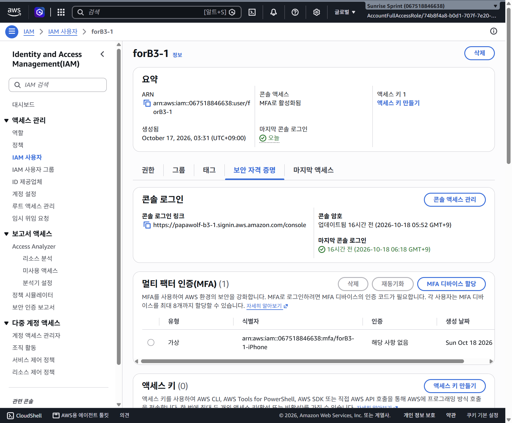
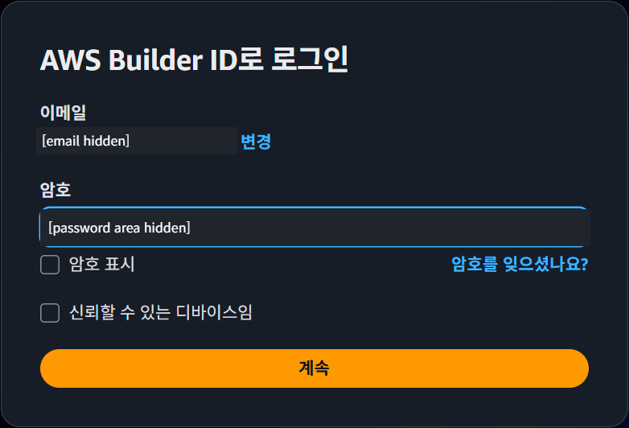
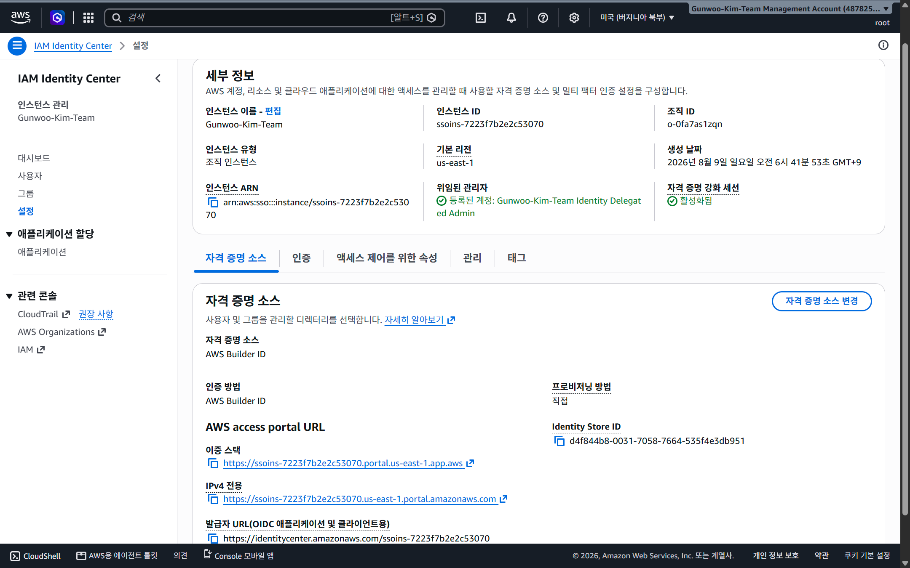
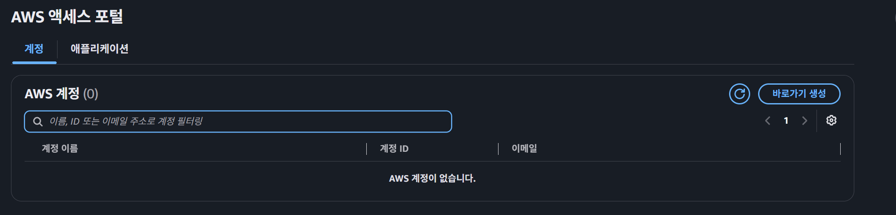
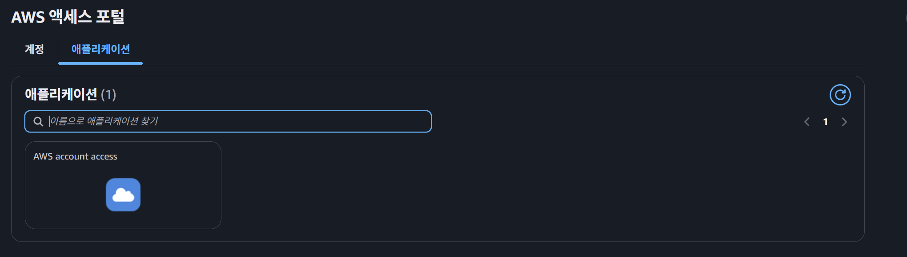
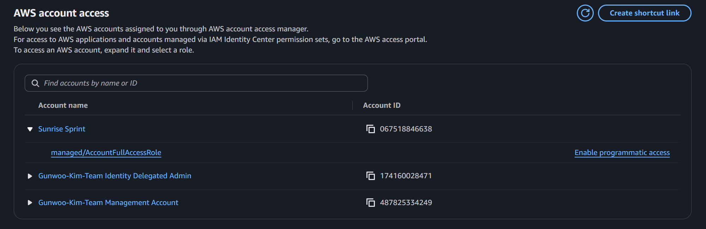
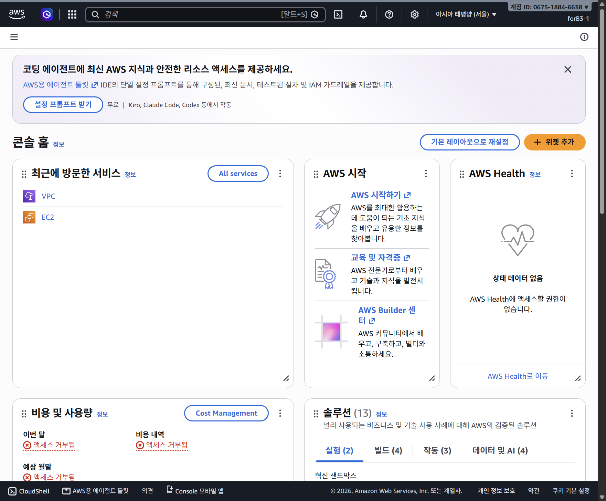

# AWS 로그인 미궁과 관리자 접근 복구 사건 쉬운 설명

> **최신 상태: 새 IAM 암호 재로그인 검증 완료.** 사용자 로그인 완료 보고 후 forB3-1, 실습 계정 067518846638, 서울 콘솔 홈을 확인했다. 아래의 재로그인 미검증 문구는 이전 시점의 기록이며 문서 끝 후속 검증을 참고한다.

[이전: 라우팅 대상 14종 분석](0023-route-targets-쉬운설명.md) · [트러블슈팅 종합 보고서: TS-004](troubleshooting.md#ts-004-iam-암호-분실과-계정로그인-경로-혼동으로-인한-실습-접근-복구) · [실습 상세 기록](0018-iam-console-login-and-mfa.md#19-재로그인-인증-실패-및-비밀번호-복구-검토)

**캡처 학습 추가: [11. Builder ID·SSO·IAM Identity Center의 차이](#11-캡처로-이해하는-builder-idssoiam-identity-center의-차이)**

---

## 1. 사용자의 시선: "도대체 무슨 일이 일어난 건가요?"

> **사용자가 인지했던 당시 상황**:\
> *"시간이 지나서 콘솔이 로그아웃되었는데, 실습용 IAM 비밀번호를 까먹었고 root 계정도 못 찾겠고... 그냥 IAM 사용자를 만든 root 계정만 찾으면 다 해결될 줄 알았는데, 화면을 보니 papawolf, mamawolf, IAM 이렇게 3개가 뒤엉켜서 너무 복잡했어요. 도대체 내부에서 무슨 일이 있었던 건가요?"*

실습 도중 세션이 끊기고 로그인이 막혔을 때 마주했던 거대한 혼란의 원인과, 복잡하게 얽혀 있던 AWS 다중 계정 구조의 실체, 그리고 마침내 본래 관리자 권한을 되찾아 IAM 암호를 재설정하기까지의 전 과정을 초보자의 눈높이에서 알기 쉽게 정리합니다.

---

## 2. 가장 큰 오해 풀기: papawolf와 mamawolf는 권한 종류가 아닙니다!

가장 먼저 바로잡아야 할 핵심은 **"papawolf, mamawolf, IAM"이 서로 대등한 3개의 권한 종류가 아니라는 점**입니다. 사용자가 보았던 단어들은 사실 서로 다른 차원의 이름들이 한 화면에 섞여 나타난 것이었습니다.

* **papawolf / mamawolf**: 권한 이름(root, IAM 등)이 아니라, 사용자가 가입할 때 쓴 **이메일 주소의 앞부분(ID)**이거나 계정에 붙여둔 **표시 이름(별칭/팀 이름)**일 뿐입니다.
* **IAM (`forB3-1`)**: AWS 계정 내부에서 과제 실습을 위해 최소 권한으로 일하도록 만든 **실제 작업자 신원(Identity)**입니다.

### 당시 화면 뒤에 실제로 존재했던 3개의 진짜 AWS 계정
실제로 당시 하나의 AWS Organization(조직) 안에는 다음과 같이 **3개의 완전히 분리된 독립 AWS 계정**이 존재하고 있었습니다.

| 계정 번호 (12자리 ID) | 계정 이름 / 역할 | 등록 이메일 주소 형태 | 설명 |
| :--- | :--- | :--- | :--- |
| **`487825334249`** | **Management Account** (관리 계정) | `mamawolf@...` | 조직을 관리하는 별도 AWS 계정. 계정 자체와 root 신원은 구분 |
| **`067518846638`** | **Sunrise Sprint** (실습 멤버 계정) | `papawolf@...` | **우리의 진짜 실습 공간!** (`forB3-1`, VPC, 보안 그룹이 있는 곳) |
| **`174160028471`** | **Identity Delegated Admin** (인증 위임) | `papawolf@...` | 조직에 함께 표시된 위임 관리자 계정. 상세 담당 기능은 이번 조사에서 검증하지 않음 |

여기에 더해, 사용자가 root 로그인을 시도하는 과정에서 실습 계정과 ID가 다른 계정들(`769533384379`, `603849567211`)로 접속되기도 했습니다. 이들은 이름이 비슷했을 뿐 실습 계정과는 아예 별개의 계정들이었습니다.

---

## 3. "IAM을 만든 root만 있으면 되는 줄 알았는데?" 왜 안 됐을까?

일반적인 AWS 입문 책에서는 *"root 계정으로 로그인해서 IAM 사용자를 만들고, 문제 생기면 root로 들어가서 비밀번호를 바꾸면 된다"*고 가르칩니다. 하지만 이번 실습 환경은 그렇게 단순한 1개짜리 계정이 아니었습니다.

### ① 핵심: 생성자가 누구인지보다 ‘어느 AWS 계정에 속하는지’가 중요합니다
* IAM 사용자는 생성한 사람의 개인 소유물이 아니라 특정 AWS 계정에 속한 신원입니다.
* **실습 계정 자체의 root라면 생성 주체와 관계없이 일반적으로 해당 IAM 사용자를 관리할 수 있습니다.** 다른 계정의 root를 찾는 것은 별개의 문제입니다.
* 이번에 실제 복구한 기존 접근은 중앙 인증으로 실습 계정의 **`managed/AccountFullAccessRole` 관리자 역할**을 사용하는 경로였습니다. root 암호를 찾을 필요 없이 그 역할로 IAM 암호를 재설정했습니다.
* 이번 복구 화면만으로 최초 사용자 생성 API의 실행 주체를 추가 확정하지는 않습니다.

### ② 두 번째 진실: 관리 계정 root라고 해서 멤버 계정의 IAM을 볼 수 없습니다!
* 최상위 관리 계정(`487825334249`)의 root로 로그인에 성공했지만, 그곳의 IAM 사용자 목록에는 `forB3-1`이 코빼기도 보이지 않았습니다.
* AWS는 계정 간의 보안 격리가 철저하여, **관리 계정의 IAM 화면이 자식 멤버 계정(`Sunrise Sprint`)의 IAM 사용자 목록을 합쳐서 보여주지 않습니다.**
* 다른 계정의 방 안을 들여다보려면 해당 계정으로 직접 들어가야만 합니다.

### ③ 세 번째 진실: root로는 중앙 루트 세션을 탈 수 없었습니다!
* 관리 계정 root 세션에서 멤버 계정의 root 권한을 원격 대행하려 했을 때, AWS는 다음과 같은 명확한 거부 메시지를 띄웠습니다.
  > `RootSession may not be assumed by root accounts` (루트 계정은 루트 세션을 수임할 수 없습니다)
* 즉, "root니까 모든 계정을 마음대로 다 헤집고 다닐 수 있다"는 일반적 상식은 AWS 멀티 계정 환경에서 통하지 않도록 보안상 막혀 있었던 것입니다.

---

## 4. 비밀번호 3총사의 정체 (회사 출입증 비유)

복구 과정에서 비밀번호를 어디에 넣어야 할지 헷갈렸던 이유는, **서로 다른 3개의 문(Gate)과 3개의 서로 다른 비밀번호**가 존재했기 때문입니다.

```text
[ 대기업 그룹 본사 & 연구소 비유 ]

1. AWS Builder ID 비밀번호
   = "그룹 통합 포털 출입증" (중앙 SSO 로그인용)
   - 이번 환경에서 기존 포털에 인증할 때 사용한 개인 신원. 모든 AWS 계정의 관리자 권한을 자동으로 주지는 않음

2. AWS Root 계정 비밀번호
   = "회사 법인 인감 및 등기소 열쇠" (각 AWS 계정의 소유자)
   - 관리 계정(mamawolf)이나 실습 계정(papawolf) 각각의 최상위 비상 열쇠

3. IAM 사용자(forB3-1) 비밀번호
   = "연구실 301호 전용 도어록 비밀번호" (실습 계정 내부 작업자)
   - 실습 계정 안에서 네트워크를 만들고 실습을 수행하는 현장 작업자 비밀번호
```

* 같은 `papawolf@...` 이메일을 쓰더라도 **Builder ID에 로그인하는 비밀번호**와 **AWS Root로 로그인하는 비밀번호**는 완전히 별개입니다.
* 한 사람의 사용자라도 상황에 따라 들고 들어가는 출입증이 완전히 달랐던 것입니다.

---

## 5. 개념 혼동을 바로잡는 4차원 분리 지도

내가 마주했던 용어들이 도대체 어느 위치에 있던 것인지 다음 도식으로 한눈에 정리할 수 있습니다.

```text
+-----------------------------------------------------------------------------------+
| 1. AWS 계정 공간 (어느 방인가?)                                                    |
|    - 관리 계정 (487825334249) : 조직의 본사 (mamawolf 등록)                        |
|    - 실습 계정 (067518846638) : Sunrise Sprint / 별칭 papawolf-b3-1 (우리의 진짜 방!)|
|    - 엉뚱한 계정들 (769533384379 등) : 실습 계정과 ID가 다른 계정                 |
+-----------------------------------------------------------------------------------+
                                         ^
                                         | (접속)
+-----------------------------------------------------------------------------------+
| 2. 로그인 인증 방식 (어느 출입문으로 들어왔는가?)                                   |
|    - AWS Builder ID (SSO 포털 로그인 -> 정답 경로!)                                |
|    - Root 이메일 로그인 (계정별 최상위 로그인 -> 길을 잃었던 경로)                  |
|    - IAM 사용자 콘솔 로그인 (과제 수행용 로그인 -> 암호 분실로 막혔던 곳)          |
+-----------------------------------------------------------------------------------+
                                         ^
                                         | (행사하는 권한)
+-----------------------------------------------------------------------------------+
| 3. 역할 및 사용자 (누구의 자격으로 일하는가?)                                     |
|    - managed/AccountFullAccessRole : 실습 계정을 총괄 관리하는 마스터 역할         |
|    - forB3-1 : 이번 실습 네트워크를 만드는 최소 권한 작업자                        |
+-----------------------------------------------------------------------------------+
                                         ^
                                         | (겉에 붙은 이름표)
+-----------------------------------------------------------------------------------+
| 4. 표시 이름 및 이메일 (라벨)                                                      |
|    - papawolf@... : 실습 계정 소유자 이메일 / 계정 별칭에 쓴 이름                  |
|    - mamawolf@... : 조직 관리 계정 소유자 이메일                                   |
+-----------------------------------------------------------------------------------+
```

---

## 6. 왜 그토록 헤맸을까? (Aside 어시스턴트의 안내 혼선과 교훈)

사용자가 복구 과정에서 극심한 혼란을 겪은 데에는 **Aside(AI 어시스턴트)의 성급하고 잘못된 안내 판단**이 크게 작용했습니다. 복구 기록에 명시된 어시스턴트의 판단 실수들을 투명하게 정리합니다.

1. **루트 이메일 찾기부터 무작정 유도한 실수**:
   - IAM 암호가 안 되면 "이 계정의 원래 관리자 접속 방식(Builder ID/SSO)"을 먼저 확인했어야 했는데, 덜컥 "루트 이메일 찾기"로 방향을 틀어 사용자를 미궁에 빠뜨렸습니다.
2. **등록 이메일만 보고 접속 계정을 추측한 실수**:
   - AWS Organizations 화면에 적힌 등록 이메일(`papawolf@...`)만 보고 "이 이메일로 루트 로그인하면 실습 계정으로 들어가겠지"라고 섣불리 단정했으나, 실제 로그인 결과는 엉뚱한 과거 계정(`769533384379`)이었습니다.
3. **인증 확인 메일을 '가입 완료'로 착각한 실수**:
   - 메일함에서 "Builder ID 이메일 확인" 메일을 찾았을 때, 이것을 "기존 계정이 맞다"고 너무 강하게 해석하여 신규 가입 '이름 입력' 화면으로 잘못 진입할 뻔했습니다(다행히 신규 가입을 멈추고 복귀함).
4. **작업 탭과 사용자가 보고 있는 탭의 혼동**:
   - 어시스턴트가 백그라운드에서 읽고 있는 브라우저 탭과 사용자가 모니터에서 보고 있는 실제 탭이 달라, 서로 다른 화면을 보며 대화하는 혼선이 발생했습니다.
5. **표준 포털의 '계정 0개'에 당황했던 이유**:
   - 마침내 올바른 SSO 포털에 들어갔지만, 첫 화면의 [AWS 계정] 탭에는 `계정 0개`라고 떠서 "계정이 삭제됐나?" 하는 공포를 주었습니다.
   - 하지만 이는 계정이 지워진 것이 아니라, AWS가 **표준 권한 세트 할당 방식**과 별도의 **'AWS account access' 애플리케이션 할당 방식**을 분리해 두었기 때문이었습니다. 애플리케이션 탭으로 들어가자 실습 계정이 온전히 기다리고 있었습니다.

---

## 7. 실제 성공한 진짜 복구 경로

우리가 마침내 실습 계정의 관리자 권한을 되찾고 IAM 암호를 재설정했던 **진짜 정답 경로**는 다음과 같았습니다.

```text
[ 진짜 복구 지도 ]

1. AWS Builder ID로 로그인
   ↓
2. 기존 조직 Identity Center 포털 접속 (us-east-1, ssoins-7223f7b2e2c53070)
   ↓
3. [애플리케이션] 탭 클릭 → [AWS account access] 앱 열기
   ↓
4. 목록에서 실습 계정 [Sunrise Sprint (067518846638)] 확인
   ↓
5. [managed/AccountFullAccessRole] 관리자 역할 클릭하여 실습 콘솔 진입!
   (중앙 사용자 ID 74b8f4a8-b0d1-707f-7e20-d333fe265f89 확인)
   ↓
6. 실습 계정 IAM 콘솔에서 사용자 [forB3-1] 선택
   ↓
7. [보안 자격 증명] → [콘솔 액세스 관리] → [암호 재설정]
   ↓
8. 새 암호 설정 완료! (2026-10-19 03:45 GMT+9)
```


*관리자 역할로 실습 계정에 정상 진입하여 forB3-1 사용자가 온전히 살아있음을 확인한 화면*


*비밀번호를 노출하지 않고 안전하게 콘솔 암호 재설정을 완료한 성공 알림 화면*

### 가장 훌륭했던 점: 원칙을 지킨 무손실 복구
* 당황하여 새로운 관리자 계정을 마구잡이로 만들지 않았습니다.
* 권한을 함부로 넓히거나 조직 SCP 보안 규칙을 깨뜨리지 않았습니다.
* 사용자의 기존 휴대폰 **가상 MFA 1개도 안전하게 그대로 유지**되었습니다.
* 오직 원래 존재하던 정석 관리자 접근 경로를 끈기 있게 찾아내어 재사용했습니다.

---

## 8. 다음에 또 길을 잃었을 때를 위한 1페이지 치트시트

만약 나중에 또 세션이 끊기거나 암호가 생각나지 않아 막막하다면, 아래 표만 보고 순서대로 따라오시면 됩니다.

| 상황 | 절대 하지 말아야 할 행동 (함정) | 올바른 정답 행동 (복구 경로) |
| :--- | :--- | :--- |
| **IAM 비밀번호를 잊었을 때** | 무작정 루트 이메일 로그인 창을 켜서 아무 이메일이나 넣어본다. | **AWS Builder ID**로 Identity Center 포털에 들어간다. |
| **포털에 들어왔는데 계정이 0개일 때** | "내 계정이 다 삭제됐구나!" 하고 계정을 새로 만든다. | [계정] 탭 옆의 **[애플리케이션] 탭**을 누르고 **AWS account access**를 연다. |
| **관리자 콘솔에 들어왔을 때** | 최상위 관리 계정(mamawolf)에서 IAM 사용자를 찾는다. | 실습 계정 **Sunrise Sprint (`067518846638`)**의 콘솔인지 계정 ID를 확인한다. |
| **암호를 재설정할 때** | [콘솔 액세스 비활성화]를 누르거나 MFA를 삭제해 버린다. | [암호 재설정] -> [사용자 지정 암호]를 누르고 새 암호를 안전하게 입력한다. |

---

## 9. 우리 실습의 현재 위치와 남은 과제

* **현재까지 확인된 사실**:
  * 2026-10-19 03:45 GMT+9 시점에 실습 계정(`067518846638`) 내 `forB3-1` 사용자의 콘솔 암호 재설정이 성공적으로 완료되었습니다.
  * 기존 가상 MFA 1개도 정상 유지되고 있습니다.
* **아직 남아 있는 확인 작업**:
  * **새로 설정한 IAM 암호와 스마트폰 MFA 코드를 사용하여 `forB3-1` 사용자로 콘솔에 직접 재로그인하는 검증은 아직 수행하지 않았습니다.**
  * 새 암호로 로그인이 정상 동작함을 확인한 뒤, 우리가 앞서 만들었던 VPC(`b3-1-vpc`)와 서브넷, 라우팅 테이블 작업으로 안전하게 복귀하면 됩니다.


## 10. 사용자 요청: ASCII 한눈 요약

```text
[사람: 나]
   |
   +-- root 로그인 ------------------> [해당 AWS 계정의 root]
   |                                     그 계정의 최상위 신원
   |
   +-- Builder ID -> 기존 조직 포털 ---> [실습 계정의 관리자 역할]
   |                                     이번에 복구한 입구
   |
   +-- IAM 로그인 -------------------> [실습 계정의 forB3-1]
                                         평소 과제용 입구
```

papawolf/mamawolf는 root/IAM과 대등한 권한 종류가 아니라 이름·이메일 단서다. 중요한 것은 12자리 AWS 계정 ID다. 본인 한 사람이 여러 계정·여러 신원을 쓸 수 있다.

```text
[같은 AWS 조직]
   |
   +-- 관리 계정 487825334249
   |      +-- 이 계정의 root
   |      `-- 이 계정의 IAM 목록 (실습 사용자를 합쳐 보여주지 않음)
   |
   +-- 실습 계정 067518846638 = Sunrise Sprint
   |      +-- 이 계정의 root
   |      +-- 기존 관리자 역할 <--- 이번 복구에 사용
   |      +-- IAM 사용자 forB3-1 <-- 새 암호 설정 완료
   |      `-- VPC / 서브넷 / 보안 그룹 등
   |
   `-- 위임 관리자 계정 174160028471
```

```text
[시간이 지난 뒤 접근 중단]
   |  정확한 세션 만료 원인·기간은 미확인
   v
[IAM 암호 기억 안 남]
   |
   +-- root 찾기 ------> 다른 계정에 진입
   |                      `-> IAM 사용자가 안 보임
   |
   +-- 관리계정 root --> 실습계정 IAM 목록을 직접 보여주지 않음
   |                      `-> 중앙 root 세션도 root로는 사용 불가
   |
   `-- 기존 포털 ------> '계정 0개' 표시
                           |
                           `-> '애플리케이션'은 따로 확인해야 했음
                                  |
                                  v
                         AWS account access
                                  |
                         Sunrise Sprint 선택
                                  |
                         AccountFullAccessRole
                                  |
                         forB3-1 암호 재설정 성공
```

왜 어려웠나: 비슷한 이름의 다른 계정, 별개인 root/Builder ID/IAM 인증, 조직 관리와 개별 계정 권한의 차이, 계정 탭과 별도 애플리케이션 할당의 분리, 서로 다르게 살아 있는 로그인 세션이 겹쳤다. 여기에 Aside가 이름·이메일만으로 계정을 추측하고 작업 탭을 혼동한 안내 실수가 더해졌다. 세션 선택 화면에서 root 세션 2개는 보였으나 실습 관리자 세션은 없었고, account access 앱은 다시 사용할 수 있었다. 따라서 ‘모든 로그인이 한꺼번에 종료됐다’고 단정하지 않는다.

결론: 정확한 실습 계정의 root가 있으면 관리할 수 있다는 이해는 맞다. 다만 root가 유일한 복구 수단은 아니며 이번에는 기존 관리자 역할로 해결했다. 암호 재설정 성공과 새 암호로 실제 재로그인 성공은 별도의 검증 단계다.


## 11. 캡처로 이해하는 Builder ID·SSO·IAM Identity Center의 차이

### 11-1. 같은 종류의 계정 두 개가 아니다

- **Builder ID**: 나라는 개인을 확인하는 로그인 신원. 이번 환경에서는 이 신원으로 기존 조직 포털에 인증했다. 이것만 만들었다고 EC2를 넣을 AWS 계정이나 관리자 권한이 자동으로 생기지는 않는다.
- **SSO(Single Sign-On, 통합 로그인)**: 한 번 인증한 상태를 활용해 허용된 여러 서비스로 들어가는 방식. 별도 계정 이름이 아니다. ‘모든 계정에 무조건 접근’ 또는 ‘영구 로그인’을 뜻하지 않는다.
- **IAM Identity Center**: 조직 사용자·애플리케이션·계정 접근을 중앙에서 관리하는 AWS 서비스. 예전 이름이 AWS Single Sign-On(AWS SSO)이어서 URL이나 설명에 sso가 남아 있고 SSO라고 짧게 부르기도 한다. 이 사건에서 ‘SSO 포털’은 기존 AWS 액세스 포털을 가리켰다.
- **AWS account access**: 이번 구성에서 실습 계정과 역할을 선택한 별도 애플리케이션. 포털의 표준 계정 권한 세트 목록과 이 앱의 할당 목록은 같은 목록이 아니다.

회사 비유: **Builder ID는 신분증 / SSO는 인증을 재사용하는 출입 방식 / Identity Center는 중앙 출입 관리소 / account access는 들어갈 계정과 역할을 고르는 안내 창구**다. 권한은 실제로 할당된 범위에서만 생긴다.

### 11-2. 캡처 A: Builder ID 로그인은 IAM 사용자 로그인이 아니다



**볼 곳**: ‘AWS Builder ID로 로그인’ 제목, 이메일, 암호, ‘암호를 잊으셨나요?’.

여기서 입력하는 암호는 **Builder ID 암호**다. forB3-1의 IAM 암호를 입력하거나 재설정하는 화면이 아니다. 같은 이메일을 쓰더라도 Builder ID/root/IAM은 별개의 인증 체계다. 이 화면만으로 실습 계정 관리자 권한이나 로그인 성공이 증명되지는 않는다.

**캡처 출처**: 복구 당시 임시 원본을 재사용했다. 이메일과 암호 입력 영역은 불투명하게 가리고 로그인 카드만 잘랐다. 새 로그인이나 암호 조회로 재현하지 않았다.

### 11-3. 캡처 B: Builder ID와 중앙 로그인 시스템이 연결된 근거



**볼 곳**:

1. 왼쪽 **IAM Identity Center** 서비스명.
2. 세부 정보의 기본 리전 **us-east-1**.
3. 아래쪽 **자격 증명 소스: AWS Builder ID**.
4. **인증 방법: AWS Builder ID**.
5. 그 아래 **AWS access portal URL**.

‘Builder ID와 SSO 중 무엇을 골라야 하나?’가 아니라 **‘이 조직의 중앙 접근 시스템이 Builder ID로 나를 인증하도록 설정되어 있었구나’**라고 읽으면 된다.

```text
[내 Builder ID]
      |
      | 이 사람이 맞는지 확인: 인증
      v
[기존 중앙 접근 시스템 / Identity Center]
      |
      | 허용된 애플리케이션·계정 접근 제공
      v
[액세스 포털 -> 계정 접근 앱 -> 할당된 역할]
```

**캡처 범위**: 문서 보강 시점에 기존 설정을 다시 조회했다. 설정을 바꾸지 않았다. 모든 AWS 조직이 Builder ID를 쓰는 것은 아니고, 이 설정만으로 모든 사용자에게 관리자 권한이 부여되는 것도 아니다.

### 11-4. 캡처 C와 D: 인증은 됐는데 ‘계정 0개’인 이유



**볼 곳**: ‘계정’ 탭이 선택되어 있고 본문에 **AWS 계정 (0)**이 표시된다.

이 화면에서 알 수 있는 것은 ‘이 탭에 표시할 계정 할당이 없다’는 것이다. ‘인증 실패’, ‘AWS 계정 전부 삭제’, ‘다른 앱을 통한 접근도 없음’까지 의미하지 않는다.



**볼 곳**: **애플리케이션 (1)**과 **AWS account access** 카드.

우리의 관리자 입구는 이 앱에 있었다. 계정 탭만 보면 없는 것처럼 보이지만, 애플리케이션 탭에는 별도 접근 경로가 있었던 것이다.

**캡처 범위**: C와 D는 문서 보강 시점에 같은 포털에서 탭을 바꿔 다시 캡처했다. 과거 장면의 원본이라고 주장하는 것이 아니라, 과거 관찰과 같은 목록 구분을 현재 화면에서도 재확인한 것이다.

### 11-5. 캡처 E: 실제 권한은 계정의 역할을 선택해 사용했다



**볼 곳**:

- **Sunrise Sprint / 067518846638**: 사용자와 실습 자원이 들어 있는 정확한 AWS 계정.
- **managed/AccountFullAccessRole**: 복구할 때 사용한 기존 관리자 역할.
- 위쪽 영문 안내: 이 앱은 **AWS account access manager를 통한 계정 할당**을 보여주고, **IAM Identity Center permission sets를 통한 접근**은 포털로 안내한다고 명시한다.

따라서 ‘계정 0개인데 여기에는 왜 계정이 있지?’는 모순이 아니다. **서로 다른 할당 경로를 보여주는 목록**이었다.

역할로 들어가면 해당 계정의 권한을 쓰는 세션을 얻는다. Builder ID가 root로 변하거나 forB3-1로 바뀌는 것이 아니다. 그 관리자 권한으로 별도 IAM 사용자 forB3-1의 암호를 바꿨다.

**캡처 범위**: 문서 보강 시점에 앱에서 계정만 펼쳐 다시 찍었다. 이 캡처를 위해 역할을 새로 실행하거나 권한을 변경하지 않았다. 실제 역할 접속·암호 변경 성공 증거는 본문 7절의 기존 캡처에 별도로 있다.

### 11-6. 비밀번호가 갈리는 지점

```text
[나]
 |
 +-- Builder ID 암호
 |      |
 |   기존 조직 포털 인증
 |      |
 |   애플리케이션 -> AWS account access
 |      |
 |   실습 계정의 관리자 역할
 |      |
 |   forB3-1의 IAM 암호 재설정
 |
 +-- forB3-1의 IAM 암호 + MFA
 |      |
 |   실습 계정의 최소권한 사용자 세션
 |   (평소 과제를 하는 입구)
 |
 `-- 특정 AWS 계정의 root 로그인
        |
     그 계정의 root 세션
     (다른 계정의 root라면 실습계정과 별개)
```

우리가 바꾼 것은 **forB3-1의 IAM 콘솔 암호 하나**다. Builder ID 암호·root 암호를 바꾼 것이 아니며 기존 IAM MFA도 유지했다. 새 IAM 암호+MFA 재로그인 성공은 별도 검증 과제로 남아 있다.

### 11-7. 왜 로그아웃도 복잡하게 느껴졌을까?

Builder ID 인증 상태, 포털·앱 상태, AWS 계정 역할 세션, IAM 사용자 세션을 하나의 ‘로그인’으로 생각하면 헷갈린다. 어느 세션이 재인증을 요구해도 다른 세션은 유효할 수 있다. 실제로 세션 선택 화면에는 root 세션 두 개만 보였지만, 기존 account access 앱에서 실습 관리자 역할을 다시 실행할 수 있었다.

사용자가 ‘시간이 지나 접근이 끊겼다’고 느낀 상황은 기록하되 **어느 인증 상태가 정확히 언제 왜 종료됐는지는 확인하지 않았다.** 모든 로그인이 동시에 종료됐다고 단정하거나 특정 만료 시간을 추측하지 않는다.

**결론: Builder ID로 ‘나’를 확인하고, 기존 중앙 접근 경로를 통해 실습 계정의 관리자 역할을 사용해, 별개인 IAM 사용자 암호를 재설정했다. SSO는 그 인증을 허용된 서비스 접근에 활용하는 방식이지, 또 하나의 root 계정이 아니다.**


## 후속 검증: 새 IAM 암호 재로그인 완료

사용자가 새 암호와 MFA 로그인 절차 완료를 보고한 뒤 콘솔 홈을 직접 확인했다. 로그인 신원은 forB3-1 @ papawolf-b3-1, 계정 ID 067518846638, 리전 서울(ap-northeast-2)이다. 새 암호로 재로그인하는 최종 검증이 완료되었으므로 앞선 절의 재로그인 미검증 상태는 당시 기록으로만 해석한다. 암호와 MFA 코드는 읽거나 기록하지 않았다. 홈의 Health·비용 위젯 조회 권한 부족은 로그인 실패와 별개이며 이를 이유로 권한을 확장하지 않는다. 다음은 이 최소권한 사용자로 서울 EC2 생성 단계에 진입하는 것이다.




## 후속 학습: 조직 포털 직접 주소만이 유일한 입구는 아니었다

이후 사용자가 AWS 공식 홈페이지부터 UI로 로그인 경로를 따라갔고, **콘솔 로그인 → 세션 선택 화면 상단 Sign in → 기존 이메일 → Builder ID 선택 → 인증 후 Sunrise Sprint**로 실습 계정 AccountFullAccessRole에 진입한 것을 확인했다. 따라서 본문의 이전 포털·account access 앱 경로는 실제 성공한 한 경로이지 유일한 로그인 방법이 아니다. 홈페이지 개인 프로필 탐색도 이 성공 경로의 필수 단계가 아니었다. 같은 이메일이라도 Builder ID/root를 선택하는 화면과 인증 뒤 계정 선택이 분리되어 있다는 실제 근거를 [홈페이지부터의 UI 학습 문서](0029-aws-login-ui-from-home-쉬운설명.md)에 캡처와 함께 남겼다. 이 추가 학습 시점에 브라우저 SSH 권한은 아직 바꾸지 않았다.
