# EC2 생성·SSH·웹 서버 배포 진행 기록

> **2026-10-19 후속 상태:** 아래는 생성·실행·검증 당시의 순차 기록이다. 이후 EC2는 Terminated, EBS·EIP·ENI는 없음, 실습 SG·Subnet·IGW·VPC는 정리 확인했다. 현재 서비스 운영 상태로 읽지 않는다. [정리 결과](cleanup-checklist.md).

[이전: 네트워크 구성](0019-vpc-network-walkthrough.md) · [로그인 복구](0024-aws-login-recovery-쉬운설명.md) · [과제 명세](0051-requirements-and-review-reference.md)

## 기록 원칙

AWS 설정과 생성·변경은 사용자가 직접 수행한다. Aside는 화면 확인·설명·첨부용 원본 캡처·문서화를 담당한다. 비밀번호, MFA 코드, SSH 개인키 원문과 다운로드 내용은 캡처·문서·Git에 남기지 않는다. 캡처는 관찰한 당시 상태이며 리소스 생성·검증 성공은 실제 결과 확인 뒤에 기록한다.

## 1. 최소권한 사용자로 서울 인스턴스 목록 재확인

새 IAM 암호로 로그인 복구 후 EC2 인스턴스 목록에 진입했다.

- 계정: Sunrise Sprint / 067518846638.
- 로그인 신원: forB3-1 @ papawolf-b3-1.
- 리전: 서울 / ap-northeast-2.
- 인스턴스 필터 입력란은 비어 있으며 목록에 ‘인스턴스 없음 / 이 리전에는 인스턴스가 없음’이 표시된다.
- 인스턴스 목록 조회 자체는 성공했다. 하단 경보·Health의 액세스 거부는 부가 조회 권한 문제와 구분한다.
- 이번 시점에 EC2는 생성하지 않았고 생성 권한·SSH 접속·인터넷 통신·웹 서비스 응답은 아직 검증 전이다.

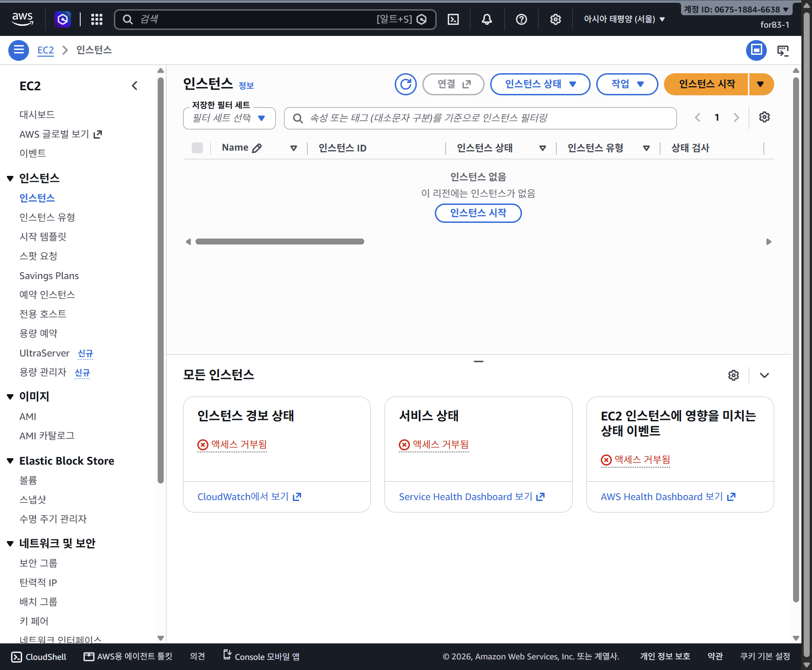

### 다음 사용자 행동

오른쪽 위 ‘인스턴스 시작’을 눌러 생성 설정 화면을 연다. 이 버튼은 생성 설정 단계에 들어가는 것이며, 설정 화면의 최종 실행 버튼을 누르기 전 이름·AMI·유형·키 페어·VPC·서브넷·퍼블릭 IP·기존 보안 그룹·스토리지·비용 조건을 단계별로 확인한다.

## 생성 전 확인할 기존 실습 자원

아래 ID는 앞선 네트워크 작업 기록을 연결하기 위한 것이며 이 단계에서 리소스 상세를 재조회한 것은 아니다.

- VPC: b3-1-vpc / vpc-062ac6fd0606192ab.
- 서브넷: b3-1-public-subnet / subnet-08efa9b32e083838b / ap-northeast-2a.
- 보안 그룹: b3-1-web-sg / sg-0c4336bb1e71eea36.
- 이전 보안 규칙: HTTP 80은 공개, SSH 22는 당시 본인 IPv4 /32. IP가 바뀌었을 수 있으므로 SSH 전 현재 허용 소스를 확인한다.

## 현재 상태

생성 설정 진입 전. 인스턴스·키 페어·웹 서버를 생성했다고 주장하지 않는다.

## 2. EC2 생성 설정 초기 상태 확인

사용자가 인스턴스 시작을 눌러 생성 설정 화면에 진입했다. 계정·사용자·서울 리전은 이전과 동일하다. 아직 최종 생성 버튼을 누르지 않았다.

- 이름: 빈칸. 다음 단계로 b3-1-web 입력을 안내한다. 이 이름은 Name 태그이며 웹사이트 도메인이나 SSH 사용자 이름이 아니다.
- 초기 AMI: Amazon Linux 2023 kernel-6.18, x86_64, ami-06a87fea194ac0452. 화면의 OS 기본 로그인 사용자 이름은 ec2-user.
- 초기 인스턴스 유형: t3.micro, 2 vCPU, 1 GiB. 화면에 프리 티어 사용 가능 표시와 Linux 기본 온디맨드 0.013 USD/시간이 함께 보인다. 프리 티어 표시만으로 이 계정에서 모든 비용이 무료라고 단정하지 않는다. EBS·퍼블릭 IPv4 등 다른 항목도 별도로 고려해야 한다.
- 초기 키 페어: 미선택.
- 초기 네트워크: 기존 기본 VPC vpc-0f2817bf8e55c5af4. 이 값은 실습 VPC가 아니므로 이후 수정해야 한다.
- 초기 방화벽: 새 보안 그룹 launch-wizard-1 생성, SSH 소스 위치 무관(0.0.0.0/0). 이대로 생성하지 않으며 기존 b3-1-web-sg를 선택할 계획이다.
- 초기 스토리지: 루트 gp3 8 GiB, 암호화되지 않음. 세부 옵션은 생성 전 검토한다.
- 인스턴스 개수: 1.

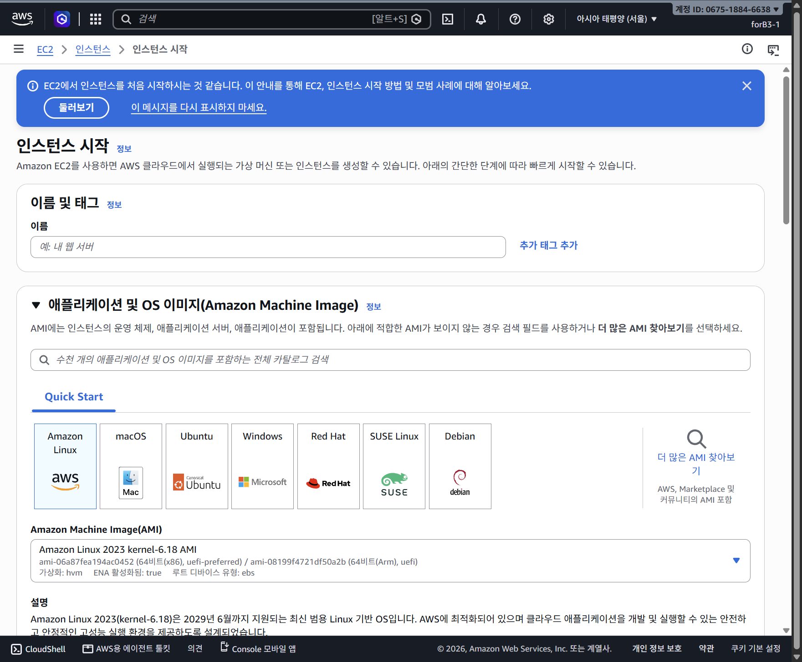

위 항목은 초기 설정을 관찰한 기록이다. AMI 선택 확정·네트워크 수정·키 페어 생성·실제 EC2 실행이 완료되었다는 뜻이 아니다. 다음 사용자 행동은 상단 이름 칸에 b3-1-web을 입력하는 것 하나이며 최종 인스턴스 시작은 보류한다.

## 3. 서버 이름 입력 확인과 다음 단계

상단 이름 필드에 b3-1-web이 입력된 것을 확인했다. AMI는 Amazon Linux 2023 x86_64, 인스턴스 유형은 t3.micro가 선택되어 있다. 이 조합으로 진행할 것을 안내하며 아직 실제 인스턴스는 생성되지 않았다.

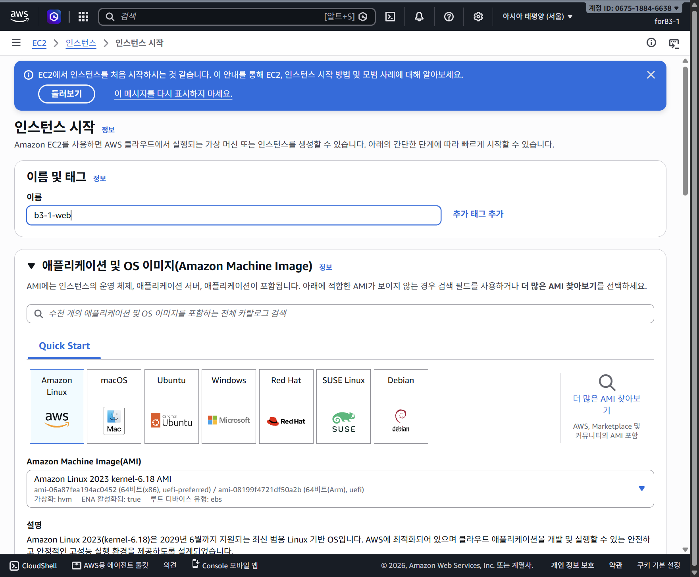

AMI는 운영체제 등이 들어 있는 서버 생성용 원본 이미지이고, 인스턴스 유형은 CPU·메모리 등 서버의 자원 규격이다. 둘은 별개의 선택이다. 다음 사용자 행동은 키 페어(로그인)의 새 키 페어 생성 버튼을 눌러 옵션 창을 여는 것 하나다. 키 페어는 이후 SSH 접속에 사용할 공개키·개인키 쌍이며 AWS 콘솔 로그인 암호나 MFA를 대신하는 것이 아니다. 개인키는 안전하게 보관하고 채팅·캡처·Git에는 남기지 않는다. 아직 키 페어 생성·다운로드는 수행하지 않았다.

## 학습 질문: Nginx를 이미지로 쓰면 더 간편하지 않을까?

명세의 필수 조건은 ‘웹 서버(Nginx 등)를 설치하고 실행’하며 내부 localhost HTTP 200 및 외부 응답을 검증하는 것이다. Nginx라는 특정 제품만 필수인 것은 아니고, 별도 애플리케이션 개발·기존 웹사이트 복사가 이 문구만으로 추가 요구되는 것도 아니다. 기본 페이지도 명세의 결과 예시에 포함된다.

EC2 생성 화면의 AMI는 운영체제와 초기 소프트웨어 등을 담는 가상 머신 이미지다. Docker의 nginx 이미지는 컨테이너 이미지이므로 AMI 선택란에 그대로 넣을 수 없다. Docker 방식을 쓰려면 먼저 Linux AMI로 EC2를 만들고, 그 안에 Docker를 설치한 뒤 Nginx 컨테이너를 실행하고 포트를 매핑한다. 이 방식은 명세의 선택 보너스 ‘Docker 컨테이너로 웹 서비스 배포하기’와 연결된다.

Nginx가 미리 설치된 AMI도 가능하지만 제3자 이미지의 공급자·소프트웨어 추가 요금·지원 여부를 따로 확인해야 한다. 이번 과제의 비용·출처 단순화와 설치 학습을 위해서는 공식 Amazon Linux 2023 AMI로 시작해 SSH 접속 후 Nginx를 직접 설치하는 경로를 권장한다. 선택 보너스를 원하면 공식 Linux AMI + Docker + Nginx 컨테이너 경로로 바꿀 수 있다. 아직 Marketplace AMI 선택·Docker 도입·Nginx 설치는 수행하지 않았다.

사용자는 인스턴스 유형을 t2.micro로 하겠다고 결정했다. 실제 선택값과 서울 요금·프리티어 적용 조건은 다음 화면 확인 시 별도로 검증한다. AMI는 명세가 허용하는 Ubuntu LTS 또는 Amazon Linux 계열이면 되며 특정 AMI ID·커널 버전까지 명세가 지정하지는 않는다.

## 4. AMI 선택과 t2.micro 변경 확인

사용자가 연 AMI 목록에서 현재 선택은 Amazon Linux 2023 kernel-6.18 AMI이며, 아키텍처는 64비트(x86), AMI ID는 ami-06a87fea194ac0452다. Quick Start의 기본 범용 Amazon Linux 이미지로 과제에서 허용한 Amazon Linux 계열에 해당하며 Nginx를 직접 설치하는 경로로 진행할 수 있다. 목록의 Deep Learning/CUDA/GPU 이미지는 이번 웹 서버 과제에 필요하지 않다. AWS 공식 AL2023 커널 문서에서도 kernel 6.18을 지원·권장한다고 안내한다: https://docs.aws.amazon.com/linux/al2023/ug/kernel-update.html . 이는 커널 지원의 근거이며 아직 실제 인스턴스 부팅·Nginx 실행 성공을 검증한 것은 아니다.

인스턴스 유형과 요약이 t2.micro로 바뀐 것을 확인했다. 현재 화면의 t2.micro Linux 기본 온디맨드 요금은 0.0144 USD/시간이다. 앞선 초기 화면의 t3.micro Linux 기본 요금은 0.013 USD/시간이었다. 따라서 지금까지 관찰한 서울 Linux 기본 단가만 비교하면 t2.micro가 더 싸다는 가정은 맞지 않는다. 이 비교는 EBS·퍼블릭 IPv4·CPU 크레딧 추가 과금·프리티어·계정 크레딧을 포함한 최종 청구액 비교는 아니다. 선택을 임의로 되돌리지 않고 사용자에게 차이를 설명한다.

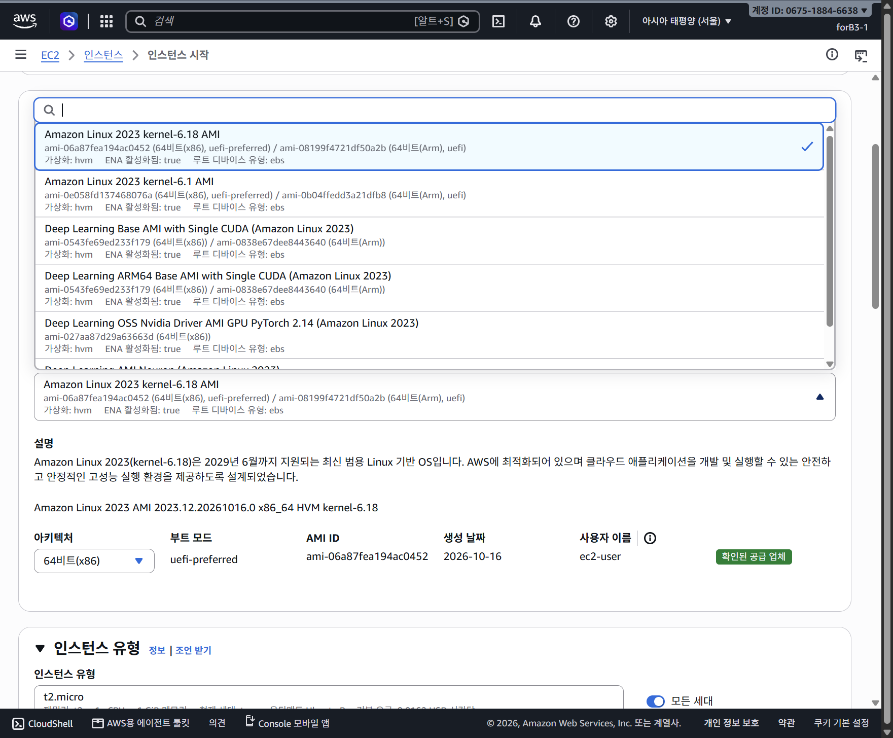

키 페어 미선택·기본 VPC·새 보안 그룹 SSH 공개 등 초기 설정은 여전히 남아 있으므로 최종 인스턴스 시작은 보류한다.

## 5. 키 페어 생성 옵션 창 확인

키 페어 생성 모달이 열렸고, 이름은 빈칸이며 RSA와 .pem이 기본 선택되어 있다. .pem에는 OpenSSH와 함께 사용, .ppk에는 PuTTY와 함께 사용이라고 안내되어 있다. Windows OpenSSH로 SSH 접속할 계획에 맞춰 이름 b3-1-key, RSA, .pem을 안내한다. ED25519가 잘못된 선택이라는 의미는 아니며 여기서는 기본값 RSA로 진행한다.

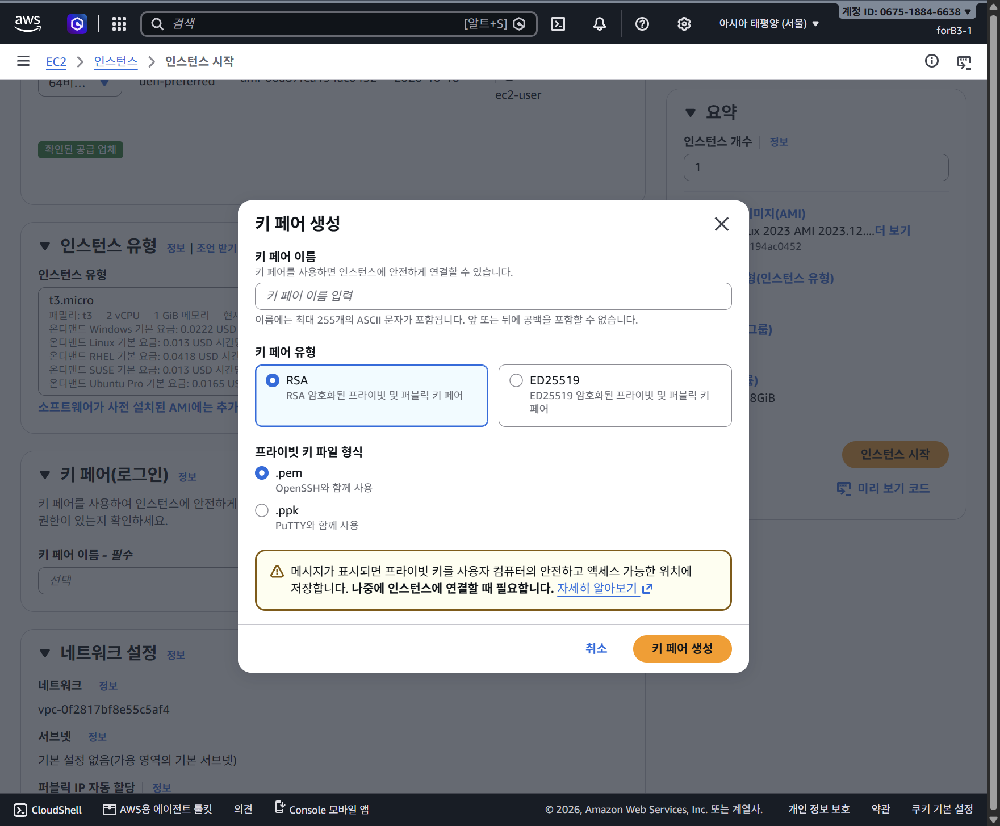

사용자가 키 페어 생성을 누르면 다운로드되는 개인키는 PC의 안전한 위치에 보관해야 하며 AWS에서 동일 개인키를 다시 다운로드할 수 없다. Git 저장소 밖에 보관하고 업로드·공유·캡처하지 않는다. 이번 관찰 시점에는 아직 키 페어 생성 성공이나 다운로드 완료를 확인하지 않았다.

배경의 인스턴스 유형 및 요약은 t3.micro로 돌아온 것을 확인했다. AMI는 기존 Amazon Linux 2023 x86_64로 유지되어 있다. 아직 네트워크 기본값과 보안 그룹을 수정하지 않아 최종 인스턴스 시작은 보류한다.

## 6. 키 페어 선택 결과와 SSH 쉬운 설명

생성 창이 닫혔고 생성 폼의 키 페어 선택값이 b3-1-key로 바뀐 것을 확인했다. 이것은 AWS 화면에서 키를 선택한 증거이며, 로컬 개인키 파일 다운로드·보관 완료를 별도로 검증한 것은 아니다. 개인키 파일 내용은 읽거나 저장소에 복사하지 않았다.

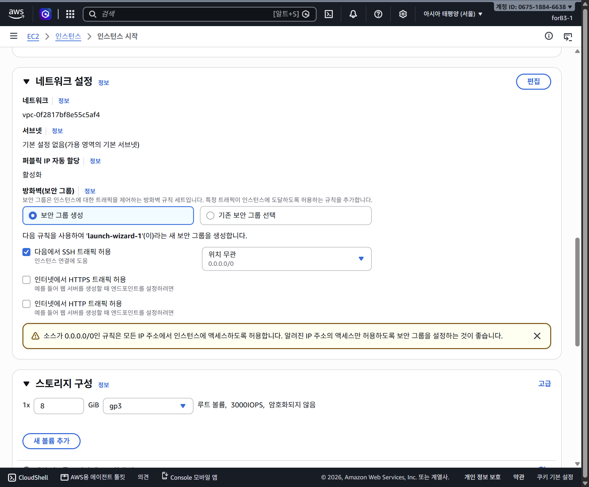

사용자 요청에 따라 [키 페어·지원 환경·OpenSSH·PuTTY 쉬운 설명](0026-ssh-keypair-openssh-putty-쉬운설명.md)을 작성했다. 키 알고리즘/파일 형식/접속 도구/프로토콜을 구분하고, EC2 Linux와 Windows의 지원 범위, 내 Windows PC와 원격 Windows 서버의 차이, AL2023의 RSA SHA-2·호스트 키 호환성, 개인키 보관 원칙과 공식 근거를 담았다.

다음은 사용자가 개인키의 안전한 저장 여부를 확인한 뒤 네트워크 설정의 편집을 여는 것이다. 현재 폼의 네트워크는 기본 VPC이며 SSH 전체 공개의 새 보안 그룹 설정도 남아 있다. 기존 실습 VPC·서브넷·보안 그룹으로 수정하기 전에는 최종 인스턴스 시작을 누르지 않는다.

## 7. 네트워크 편집 진입 후 원본 재캡처

사용자의 캡처 재요청으로 현재 화면을 다시 확인하고 원본을 저장했다. 네트워크 편집이 열려 VPC·서브넷·퍼블릭 IP·보안 그룹 설정이 노출되어 있다.

- 키 페어: b3-1-key 선택 유지.
- 인스턴스 유형: t3.micro.
- 현재 VPC: vpc-0f2817bf8e55c5af4 / 기본값 / 172.31.0.0/16. 실습 VPC로 아직 변경되지 않았다.
- 서브넷: 기본 설정 없음.
- 퍼블릭 IP 자동 할당: 활성화.
- 보안 그룹: 새 보안 그룹 launch-wizard-1 생성, SSH TCP 22에 0.0.0.0/0. 아직 실행 전 폼 값이며 이대로 생성하지 않는다.

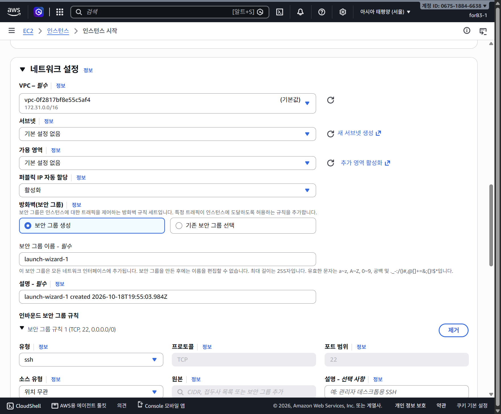

다음은 VPC 선택 목록을 열어 기존 b3-1-vpc(vpc-062ac6fd0606192ab)를 선택하는 것이다. 이후 실습 서브넷과 기존 보안 그룹을 확인한다. 최종 생성은 보류한다.

## 8. 실습 VPC·서브넷 선택 결과 확인

VPC가 b3-1-vpc(vpc-062ac6fd0606192ab, 10.0.0.0/16)로 바뀌었고 서브넷도 b3-1-public-subnet(subnet-08efa9b32e083838b, 10.0.1.0/24, ap-northeast-2a)로 선택된 것을 확인했다. 원래 기본 VPC 자체를 변경한 것은 아니고 생성 폼의 배치 위치를 바꾼 것이다.

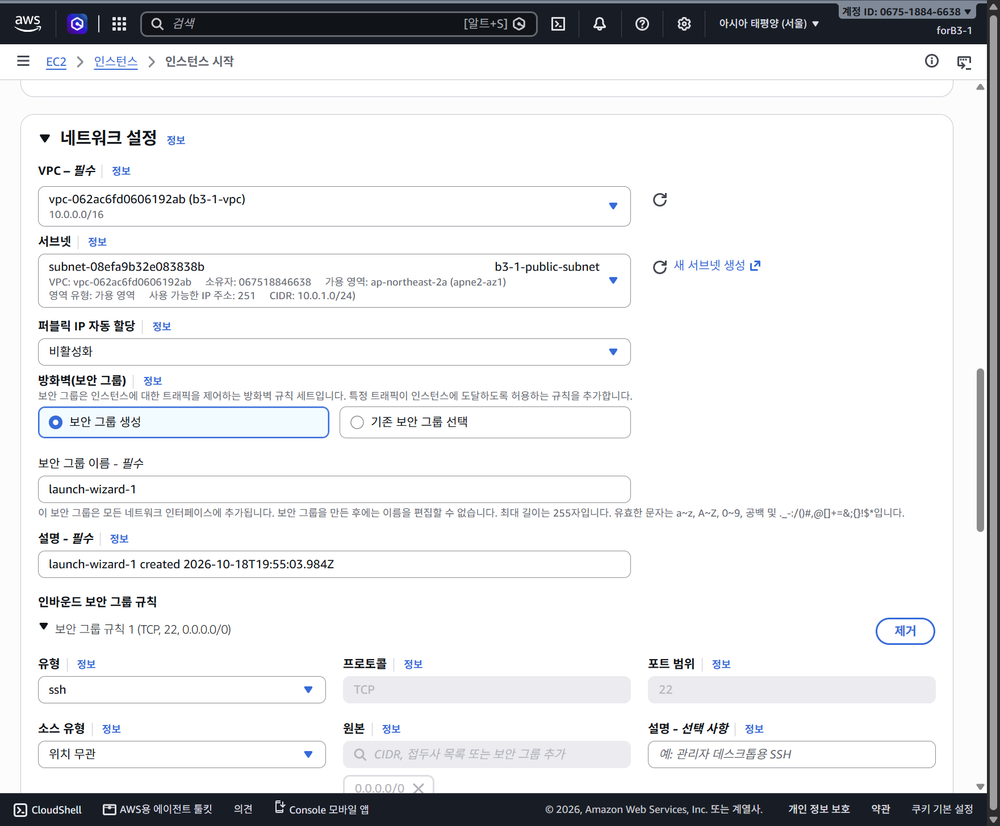

VPC 변경 후 퍼블릭 IP 자동 할당은 비활성화로 표시된다. 이전 기본 VPC 선택 때의 활성화 상태를 그대로 유지한다고 가정하지 않는다. 외부 HTTP·SSH 접속을 위한 이번 직접 접속 경로에서는 인스턴스에 퍼블릭 IPv4가 필요하므로 다음 단계로 활성화를 안내한다. IGW·라우팅만으로 인스턴스에 퍼블릭 IP가 자동 부여되는 것은 아니다. 퍼블릭 IPv4는 별도 과금 대상일 수 있고 계정 크레딧 적용 여부와 최종 청구액은 별도 확인 대상이다.

새 보안 그룹 생성 및 SSH 전체 공개 설정은 여전히 남아 있어 다음에 기존 b3-1-web-sg를 선택해야 한다. 아직 최종 생성은 하지 않는다.

## 9. 기존 보안 그룹 선택 목록과 조회 경고 캡처

사용자의 캡처 요청 시점에 퍼블릭 IP 자동 할당이 활성화되었고 방화벽이 기존 보안 그룹 선택으로 바뀌었다. 보안 그룹 목록이 열렸으며 b3-1-web-sg(sg-0c4336bb1e71eea36, VPC vpc-062ac6fd0606192ab)와 default 두 개가 보인다. 아직 선택된 그룹은 없고 요약의 방화벽 항목도 ‘-’이다.

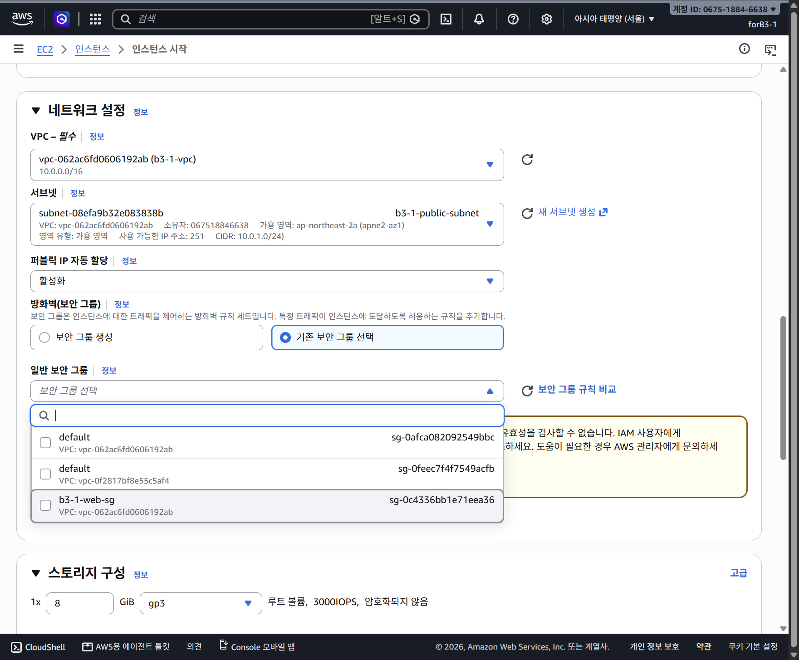

동시에 ec2:GetSecurityGroupsForVpc 권한이 없어 선택한 보안 그룹의 유효성을 검사할 수 없다는 경고가 표시된다. 이것은 콘솔의 검증용 조회 경고이며 이 시점에 RunInstances 생성 실패를 확인한 것은 아니다. 목록에는 실습 그룹과 VPC ID가 보이므로 우선 b3-1-web-sg를 선택하고 결과 상태를 확인한다. 이 경고만으로 관리자 권한이나 광범위 조회 권한을 추가하지 않는다. 최종 생성 전 규칙 확인과 실습 VPC 일치 검증은 별도로 수행한다.

## 10. 기존 보안 그룹 선택과 파일 시스템 네 옵션 학습

생성 폼에 b3-1-web-sg(sg-0c4336bb1e71eea36, 실습 VPC)가 선택된 것을 확인했다. 파일 시스템 선택지는 S3 파일 - 신규, EFS, FSx, 없음이며 현재 없음이 선택되어 있다. 별도의 공유 파일 시스템을 추가하지 않았고 루트 EBS는 gp3 8 GiB로 유지된다. 이 선택 결과만으로 보안 그룹의 현재 규칙과 본인 IP 일치까지 검증한 것은 아니다.

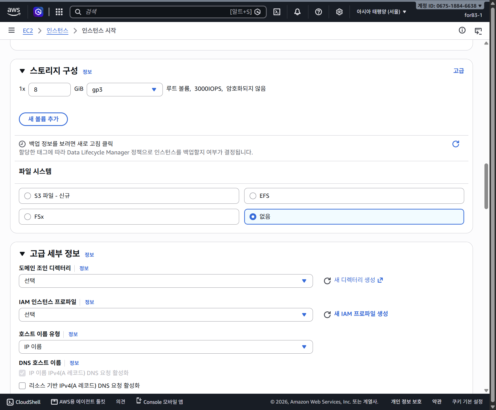

사용자 요청에 따라 [파일 시스템 4개 옵션 쉬운 설명](0027-ec2-file-system-options-쉬운설명.md)을 작성했다. EBS/파일/객체 스토리지 구분, 마운트, S3 Files의 동작과 동기화, EFS, FSx 제품군과 이 생성 마법사가 지원하는 범위, 비용·삭제·권한 주의점, 이번 과제에서 없음을 선택하는 근거를 포함했다. 설명을 위해 다른 서비스를 생성하거나 권한을 확장하지 않았다.

## 11. CPU 크레딧 사양 확인

현재 t3.micro의 크레딧 사양 목록에 선택/무제한/표준이 표시된다. 아직 선택 값은 미지정이며 이 값만으로 실제 시작 후 적용 모드를 확정하지 않는다. 세부 CloudWatch 모니터링은 비활성화로 확인했다. CPU 크레딧 추가 과금 위험을 피하기 위해 표준을 명시적으로 선택하도록 안내한다. 표준 모드는 CPU 크레딧 소진 시 지속 CPU 성능이 기본 수준으로 제한될 수 있는 대신 무제한 모드의 잉여 CPU 크레딧 요금은 발생하지 않는다. EC2·EBS·IPv4 등 다른 비용이 없어지는 것은 아니다. 앞선 고급 설정 전체 기본값 유지 안내에서 비용 검토를 보완한 항목이다. 아직 표준 선택 완료와 실제 인스턴스 실행은 확인하지 않았다.

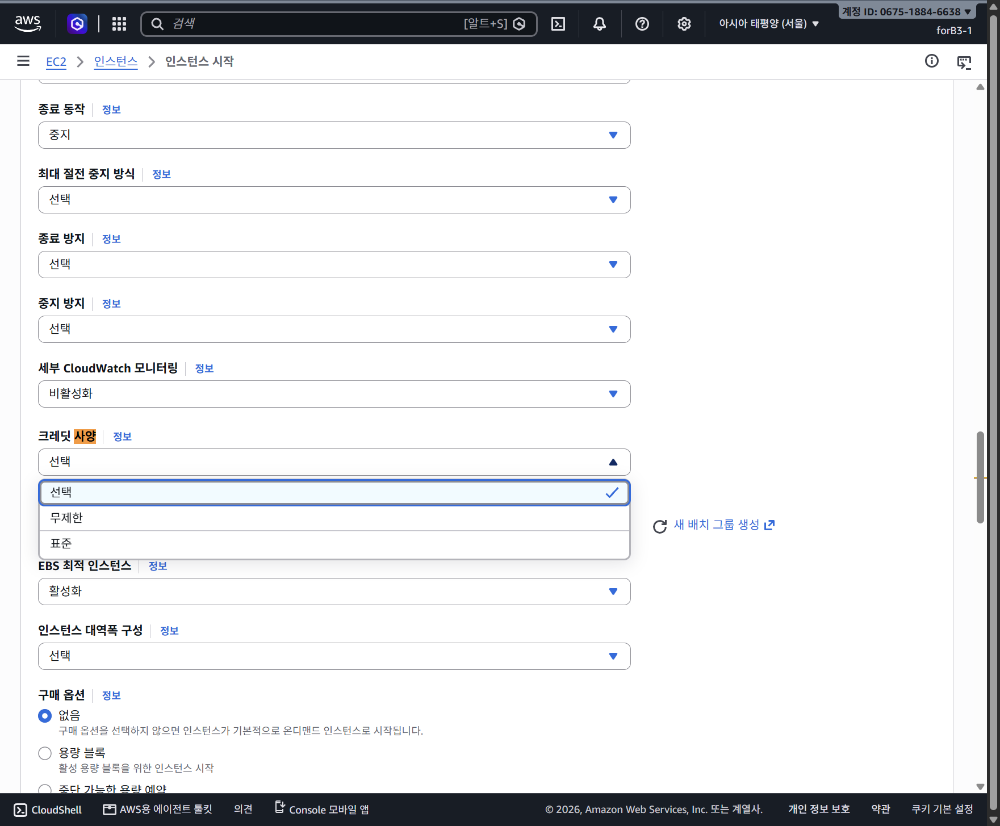

## 12. 생성 전 최종 검토: CPU 표준·실제 보안 규칙 확인

CPU 크레딧 사양이 표준으로 바뀐 것을 확인했다. 생성 폼을 보존하고 별도 조회 탭에서 실습 보안 그룹을 열었으나 인바운드 표는 ec2:DescribeSecurityGroupRules 권한 부족으로 조회되지 않았다. 이 오류 자체를 생성 실패로 해석하거나 권한을 확대하지 않았다. 별도 조회 탭은 닫았다.

대신 생성 폼의 보안 그룹 규칙 비교 화면에서 b3-1-web-sg의 실제 인바운드 규칙 2개를 확인했다.

- HTTP / TCP 80 / 0.0.0.0/0.
- SSH / TCP 22 / 현재 접속 공인 IPv4 한 개의 /32 제한.
- AWS checkip 응답으로 현재 공인 IPv4와 SSH 허용 소스가 일치함을 확인했다. IP 원문을 본문에 중복 기록하지 않으며 캡처에는 당시 실제 규칙이 포함된다.

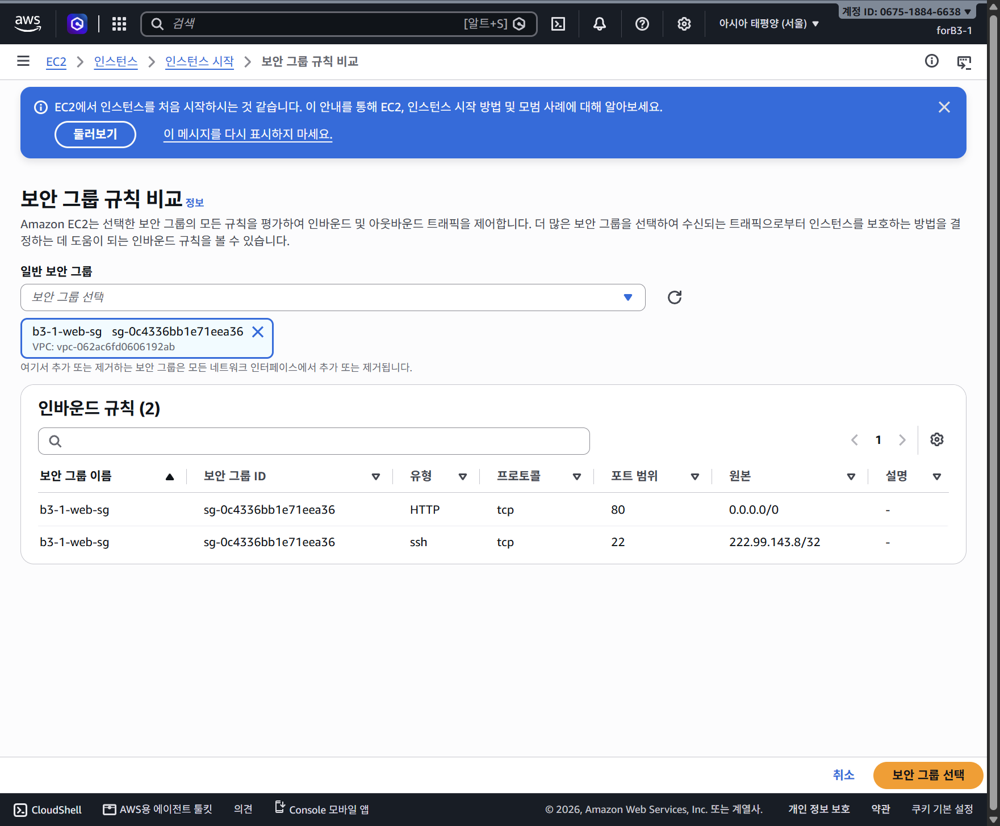
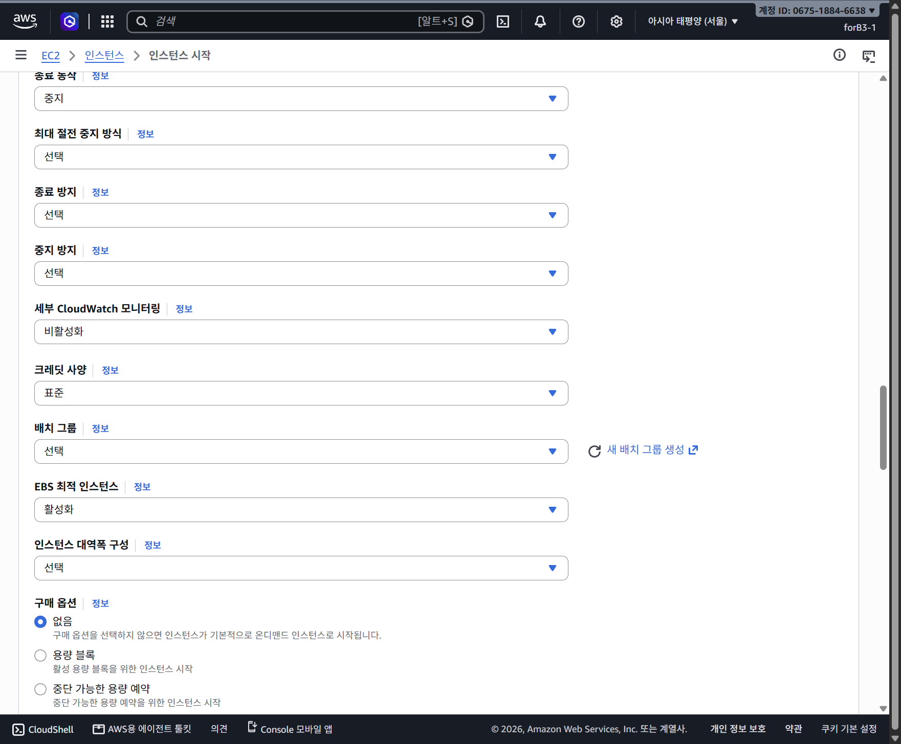

보안 그룹 비교를 취소로 닫은 뒤 원래 선택이 유지됨을 확인했다. 최종 관찰 설정:

- forB3-1 / 실습 계정 067518846638 / 서울.
- 이름 b3-1-web.
- Amazon Linux 2023 kernel-6.18, x86_64, ami-06a87fea194ac0452.
- t3.micro / 인스턴스 개수 1.
- 키 페어 b3-1-key. 로컬 개인키의 안전한 보관 여부는 사용자 확인 대상이며 내용을 읽지 않았다.
- b3-1-vpc / b3-1-public-subnet / 퍼블릭 IP 자동 할당 활성화.
- 기존 b3-1-web-sg 한 개 선택.
- gp3 8 GiB / 추가 파일 시스템 없음. 루트 볼륨 암호화되지 않음 표시는 유지되어 있으며 암호화했다고 주장하지 않는다.
- IAM 인스턴스 프로파일 미선택 / 세부 CloudWatch 모니터링 비활성화.
- CPU 크레딧 표준 / 구매 옵션 없음(온디맨드).
- 메타데이터 V2만 해당(토큰 필수) / 사용자 데이터 빈칸.

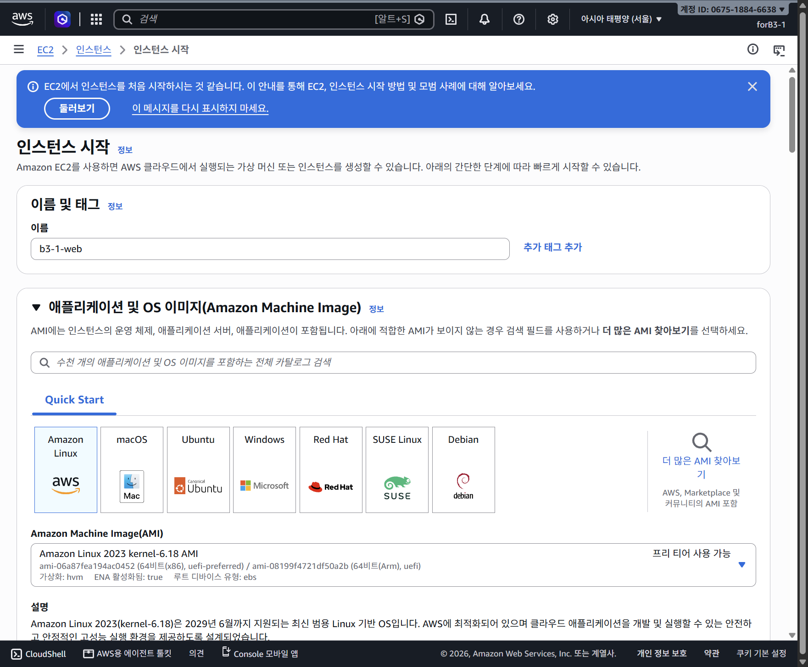

최종 인스턴스 시작 버튼은 아직 누르지 않았다. 사용자가 개인키를 안전하게 보관한 것을 확인한 뒤 인스턴스 1대 시작을 직접 수행하도록 안내한다. 실행 후 EC2·EBS·퍼블릭 IPv4 비용이 발생할 수 있으며 무료 표시만으로 전체 비용 무료를 보장하지 않는다. 시작 성공/실행 상태/SSH/웹 서버/외부 접속은 다음 검증 단계다.

## 13. 마일스톤: 최소권한 사용자로 EC2 시작 요청 성공

사용자가 최종 인스턴스 시작을 누른 뒤 AWS 성공 알림 ‘인스턴스를 시작했습니다’를 확인했다.

- 계정: 067518846638.
- 실행 주체: forB3-1 @ papawolf-b3-1.
- 리전: 서울(ap-northeast-2).
- 새 인스턴스 ID: i-05d34639a30bbfb6a.

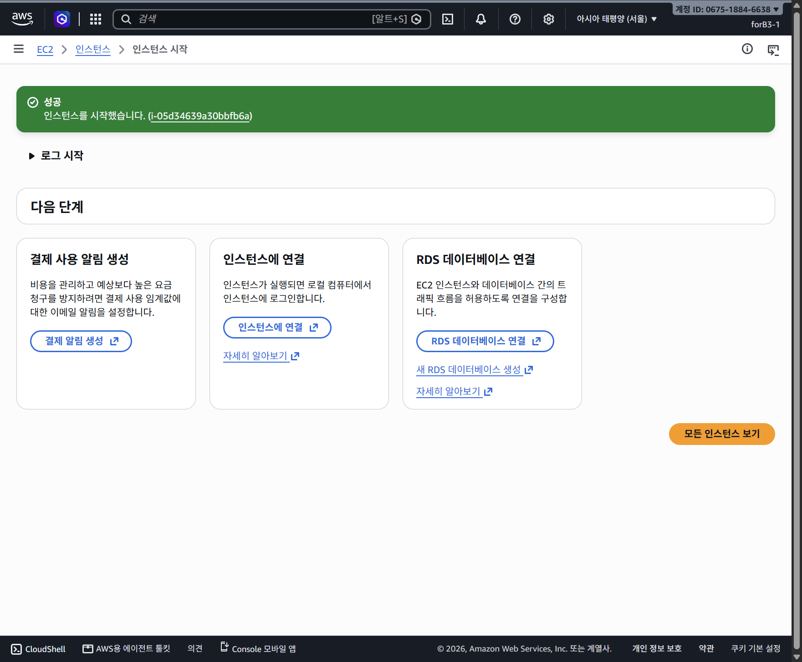

이는 이 설정의 시작 요청을 AWS가 수락한 증거이며, 앞선 GetSecurityGroupsForVpc·DescribeSecurityGroupRules 조회 문제와 실제 생성 실패를 구분한다. 이 작업을 위해 IAM 권한을 확장하지 않았다. 아직 인스턴스 실행 상태, 상태 검사 통과, 실제 퍼블릭 IP·볼륨·CPU 모드의 생성 후 값, SSH 접속 및 Nginx 응답은 미검증이다.

다음은 모든 인스턴스 보기를 열어 생성한 1대의 상태·주소를 확인하는 것이다. 성공 화면에 제안된 RDS 연결·DB 생성은 과제에 불필요하므로 진행하지 않는다. 시작한 자원은 추후 EC2·EBS·IPv4 등 과금 방지 정리 대상에 포함한다.

## 14. EC2 1대 실행 중·퍼블릭 IPv4 할당 확인

모든 인스턴스 목록에서 b3-1-web(i-05d34639a30bbfb6a) 한 대가 실행 중임을 확인했다.

- 유형: t3.micro.
- 가용 영역: ap-northeast-2a.
- 퍼블릭 IPv4: 13.125.99.141.
- 보안 그룹: b3-1-web-sg.
- 키 이름: b3-1-key.
- 시작 시간: 화면 표시 2026/10/19 05:20 GMT+9.
- 상태 검사: 초기화. 통과로 기록하지 않는다.

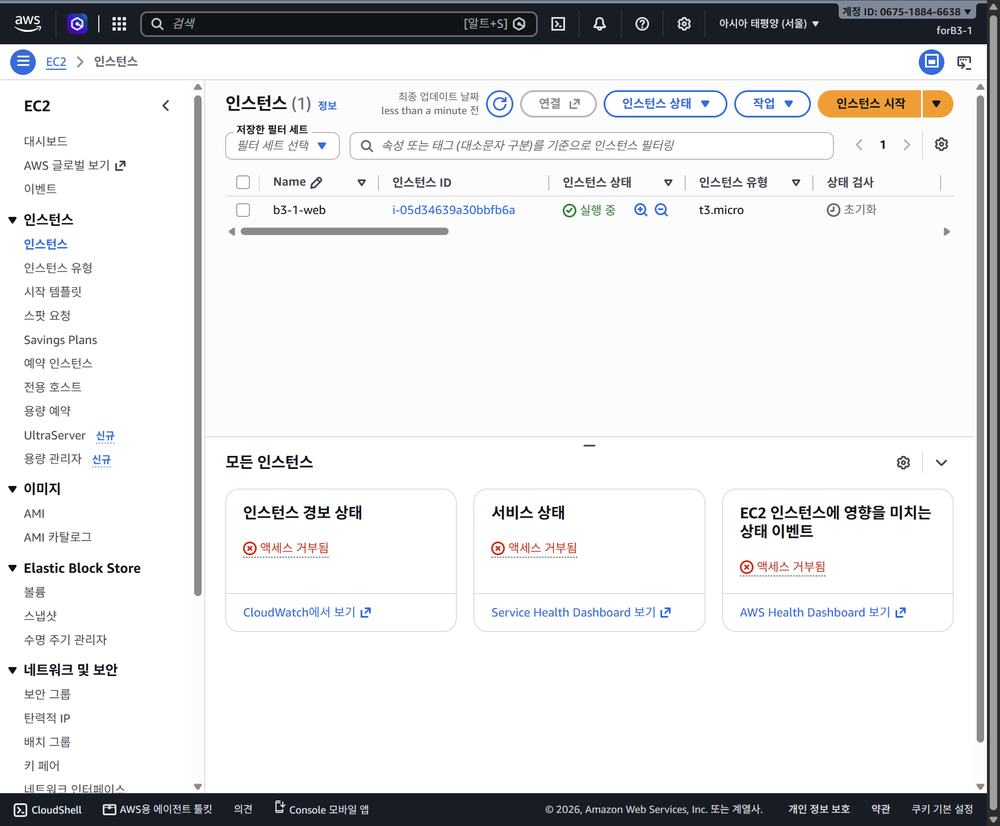

공인 IPv4는 이번 관찰 시점 주소이며 중지·재시작 등에 따라 달라질 수 있다. SSH 명령을 실행할 때 현재 주소를 확인한다. 퍼블릭 DNS·탄력적 IP 열은 대시(–)로 보이며 별도 탄력적 IP를 할당했다고 주장하지 않는다. SSH·Nginx·외부 HTTP·실제 인터넷 아웃바운드는 아직 미검증이다. 다음은 상태 검사와 접속 준비를 진행하고 사용자 PC의 OpenSSH 실행 여부를 ssh -V로 확인하는 것이다. 개인키는 내용이 아닌 파일 경로만 사용한다.

## 15. 사용자 PC의 OpenSSH 실행 확인

사용자가 확인을 요청한 클립보드 이미지를 읽었다. Windows PowerShell의 Downloads 폴더에서 ssh -V를 실행했고 OpenSSH_for_Windows_9.5p2, LibreSSL 3.8.2가 출력된다. OpenSSH 클라이언트 실행이 가능한 것을 확인했다. 이 화면은 아직 EC2 접속 성공 증거가 아니다. 개인키 파일 내용은 포함되어 있지 않다. 다음은 개인키 파일 존재를 Test-Path로 확인하고 SSH 접속을 진행하는 것이다.

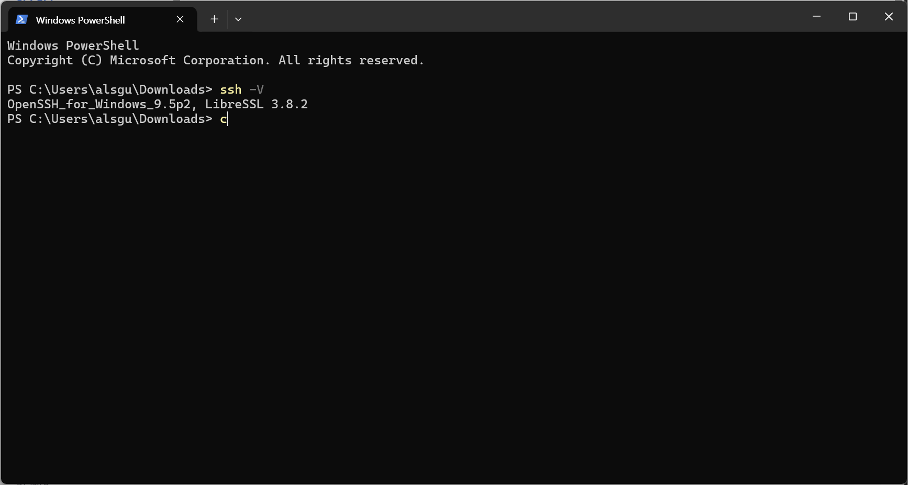

## 16. 마일스톤: 개인키 ACL 수정 후 SSH 접속 성공

사용자 클립보드 캡처에서 b3-1-key.pem ACL 조정 후 SSH 재시도가 실행됐고, Amazon Linux 2023 배너와 [ec2-user@ip-10-0-1-200 ~]$ 프롬프트를 확인했다. 실제 EC2 Linux에 ec2-user로 접속한 상태다. 로컬 Windows의 .ssh/known_hosts 갱신 권한 경고는 남았으며 TS-006으로 별도 기록한다. 모든 권한 문제가 해결되었다고 주장하지 않는다.

다음은 원격 셸에서 sudo dnf install -y nginx, sudo systemctl enable --now nginx, systemctl is-active nginx, curl -I http://localhost, curl -I https://example.com을 실행해 설치·자동 시작·실행 상태·내부 HTTP·인터넷 아웃바운드를 검증하는 것이다. 이 명령들은 다음 사용자 행동으로 안내할 계획이며 아직 실행 결과를 확인하지 않았다. 외부 HTTP 접속은 별도 단계다.

## 17. 사용자 선호에 따른 브라우저 SSH 경로 확인

사용자가 화면 확인과 캡처 편의를 위해 브라우저 SSH를 사용하자고 요청했다. 기존 PowerShell SSH는 예비 경로로 유지하고 사용자가 EC2 연결 화면을 열었다.

- 인스턴스 i-05d34639a30bbfb6a / b3-1-web / 실행 중.
- 최신 연결 화면에서 상태 검사 3/3개 통과를 확인했다. 앞선 목록의 초기화 표시와 구분하며 당시 목록은 최종 업데이트 9분 전으로 오래된 상태였다.
- 웹 브라우저에서 탭 / 퍼블릭 서브넷 액세스 / EC2 인스턴스 연결이 선택됐다.
- 퍼블릭 IPv4 13.125.99.141 / 사용자 이름 ec2-user.
- 화면 설명은 AWS가 관리하는 임시 SSH 키를 사용한다고 명시한다. 로컬 b3-1-key.pem을 브라우저에 업로드하는 경로가 아니다.
- ec2:DescribeAddresses 권한 부족 경고가 있지만 연결 링크는 표시된다. 이 경고만으로 실제 브라우저 SSH 성공·실패를 단정하지 않는다.

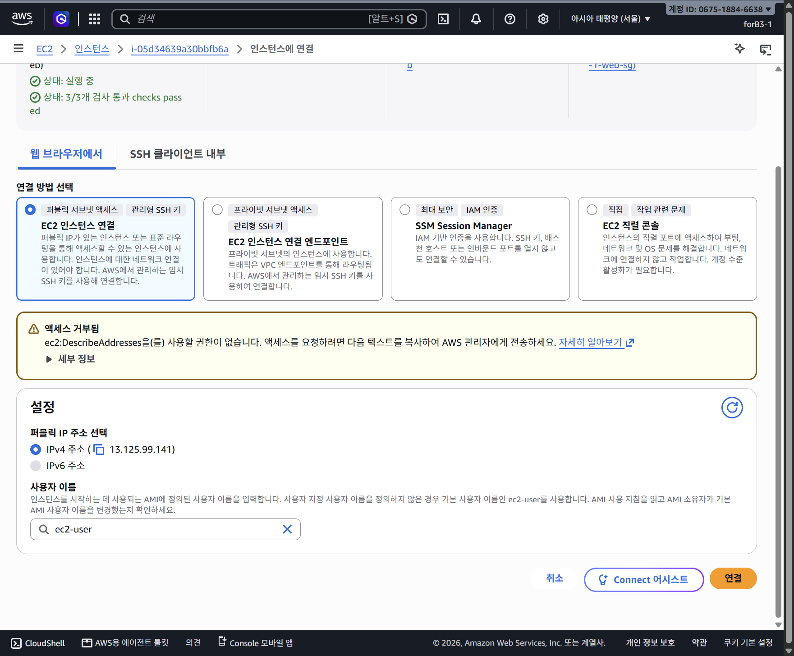

다음은 사용자가 연결을 눌러 실제 결과를 확인하는 것이다. 실패하면 오류를 근거로 EC2 Instance Connect의 IAM 권한 및 SSH 서비스 접속 대역을 검토한다. 현재 SSH 소스는 개인 IP만 허용하므로 로컬 SSH와 AWS 브라우저 SSH의 네트워크 출발점 차이가 영향을 줄 수 있다. 아직 어떤 권한·보안 그룹도 변경하지 않았고, SSH 전체 공개·인스턴스 연결 엔드포인트 생성·SSM 도입은 하지 않았다.

## 18. 브라우저 SSH 실패와 최소 변경 검토

브라우저에서 SendSSHPublicKey 실패를 직접 확인하고 캡처했다. [TS-007](troubleshooting.md#ts-007-ec2-브라우저-ssh의-sendsshpublickey-단계-실패)에 증상, 보관 정책의 권한 부재, 브라우저와 로컬 SSH 출발지 차이, 승인 후 검토할 인스턴스·OS 사용자 제한 IAM 허용 및 서울 Instance Connect 서비스 대역 허용안을 기록했다. 실제 현재 연결 정책 상세 확인 및 변경은 아직 하지 않았다.

브라우저 터미널 접속은 미해결이며 PowerShell SSH 성공과 구분한다. 웹 서버 설치 명령의 실행 결과는 아직 확인하지 않았으므로 Nginx 설치·내부/외부 HTTP 성공도 완료로 기록하지 않는다.

## 19. 브라우저 SSH 전환안의 과제 명세 적합성 검토

사용자 요청으로 instruction.md의 컴퓨트·보안 그룹·IAM·비용/계정·리전 조항을 다시 확인했다. 아래는 브라우저 SSH 전환안에 대한 해석이며 과제 전체 준수 또는 평가 합격을 보장하는 판정은 아니다.

- SSH 접속: 명세는 ‘SSH로 인스턴스에 접속할 수 있어야 한다’고 하며 PowerShell·PuTTY 등 특정 클라이언트를 지정하지 않는다. EC2 Instance Connect의 브라우저 SSH도 이 요구의 취지에 부합한다. 기존 PowerShell SSH 성공 증빙도 보존한다.
- SSH 소스 제한: 명세는 ‘학습자 개인 IP(또는 지정된 IP 대역)’만 허용하고, 운영 포트 소스 제한 유지를 강조한다. 개인 IPv4 /32를 유지하면서 서울 EC2 Instance Connect 서비스의 AWS 관리형 접두사 목록만 추가하는 것은 ‘지정된 IP 대역’으로 제한하는 해석에 부합한다. SSH 0.0.0.0/0 공개는 하지 않는다. 브라우저 캡처를 위한 임시 소스로 문서화하고 불필요해지면 제거해 최종적으로 개인 IP만 남기는 보수적 운영도 가능하다. 별도 평가표의 구체 해석은 미확인이다.
- IAM 최소권한: 브라우저 접속에 필요한 SendSSHPublicKey를 실습 인스턴스 1대·ec2-user·서울로 제한하는 방안은 명세의 ‘연결 등 실습에 필요한 작업 중심’과 양립한다. forB3-1에 AdministratorAccess·광범위 서비스 권한을 부여하지 않는다. 이 판단은 모든 인스턴스에 접속하는 관리형 광역 정책을 그대로 붙이는 것을 승인하는 뜻이 아니다.
- 관리자 접근: 정책 변경이 필요하면 기존 실습 계정 관리자 역할을 사용하고 root 콘솔을 실습 관리 수단으로 사용하지 않는다. 관리자 역할의 권한을 과제 사용자에게 복제하지 않는다. 실제 현재 연결 정책·조직 제한은 변경 전 확인한다.
- 리전·비용: 기존 서울 EC2를 그대로 쓰는 직접 Instance Connect 경로를 검토하며, 새 EC2·NAT·배스천·연결 엔드포인트·SSM 구성을 만들지 않는다. 기존 EC2·EBS·퍼블릭 IPv4 비용은 계속 별개로 추적한다.

결론: 제안한 최소 범위 IAM·SSH 소스 변경은 명세에 명시적으로 금지되어 있지 않으며, 위 조건을 지키면 요구사항에 부합하는 구성으로 해석된다. 브라우저 SSH 자체는 필수는 아니고 캡처·학습 편의를 위한 선택이다. 아직 사용자의 실제 변경 승인·정책 수정·보안 그룹 수정·브라우저 연결 성공은 확인하지 않았다.

## 로컬 ttyd에서 SSH 접속 확인, Nginx HTTP 검증 미완료

현재 Aside의 로컬 ttyd 화면에서 Windows OpenSSH로 ec2-user@13.125.99.141에 접속했고 Amazon Linux 2023 배너 및 [ec2-user@ip-10-0-1-200 ~]$ 프롬프트를 확인했다. known_hosts 갱신 Permission denied 경고는 남아 있지만 원격 로그인 자체는 성공했다. localhost:80에 대한 curl -I 요청은 세 차례 연결 실패를 반환했다. 현재 화면에는 Nginx 설치 완료·서비스 시작 결과가 보이지 않으므로 이를 검증 완료로 기록하지 않는다. 로컬 HTTP 연결 실패는 외부 보안 그룹 규칙을 더 여는 근거가 아니며 먼저 원격 서비스 실행 상태를 확인한다. 다음 사용자 명령은 sudo systemctl enable --now nginx이고 그 결과에 따라 설치·설정 오류를 분리한다.

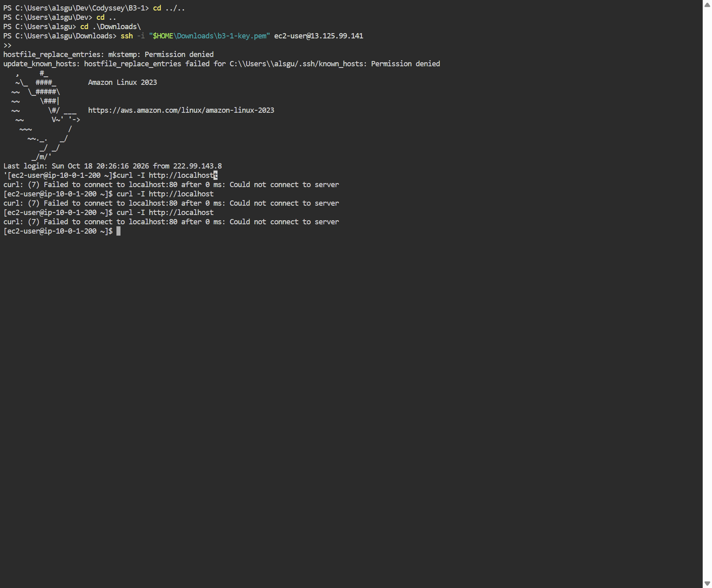

## Nginx 시작·자동 시작 등록 및 localhost HTTP 200 확인

로컬 ttyd의 실제 EC2 SSH 세션에서 사용자가 sudo systemctl enable --now nginx를 실행했고 nginx.service 자동 시작 심볼릭 링크 생성 안내를 확인했다. 이어 curl -I http://localhost에 HTTP/1.1 200 OK, Server: nginx/1.30.5, Content-Type: text/html이 반환됐다. 앞서 localhost:80 연결 실패였던 상태에서 Nginx 시작 후 정상 응답으로 바뀐 것을 확인했다. 패키지 설치 명령 자체의 출력은 이 캡처에 없지만 Nginx 서비스 시작과 실제 HTTP 응답은 검증됐다. 아직 외부 브라우저 HTTP 및 서버의 외부 인터넷 요청 성공을 새로 확인한 것은 아니다.

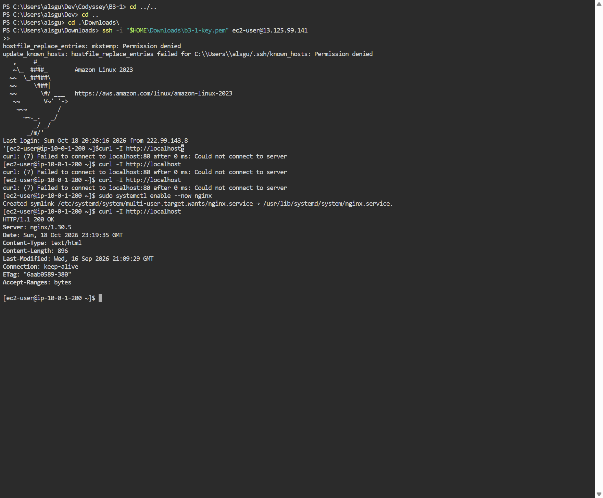

## 외부 브라우저 HTTP 접속 성공: 검증 방식 A

사용자가 새 Aside 탭에서 http://13.125.99.141/ 를 열었다. 실제 활성 탭 제목·본문에 Welcome to nginx! 및 설치·동작 안내 페이지가 표시되는 것을 확인하고 원본 캡처를 저장했다. 이 브라우저 요청은 EC2 내부 localhost가 아닌 외부 클라이언트에서 퍼블릭 IPv4의 HTTP에 접속한 시험이다. instruction.md의 외부 접속 방식 (A)를 선택한 것으로 README에 명시했다. 외부 응답의 HTTP 상태 코드를 별도 네트워크 도구로 읽은 것은 아니며 성공 페이지 표시를 증빙한다. 다음은 EC2 SSH 세션에서 외부 HTTPS 요청을 실행해 아웃바운드를 검증하는 것이다. 리소스 종료·삭제는 아직 하지 않았다.

## EC2 인터넷 아웃바운드 HTTPS 200 확인

사용자가 실제 ec2-user SSH 프롬프트에서 curl -I --max-time 15 https://example.com을 실행했다. 터미널에서 HTTP/2 200 및 content-type: text/html 응답 헤더를 확인했다. EC2에서 외부 도메인으로 요청해 HTTPS 응답을 받은 증빙이며, PC에서 실행한 curl 결과와 혼동하지 않는다. 이는 실제 시험한 목적지·시점의 DNS·외부 연결 성공을 보이며 모든 인터넷 목적지와 영구적 연결을 보장하는 것은 아니다.

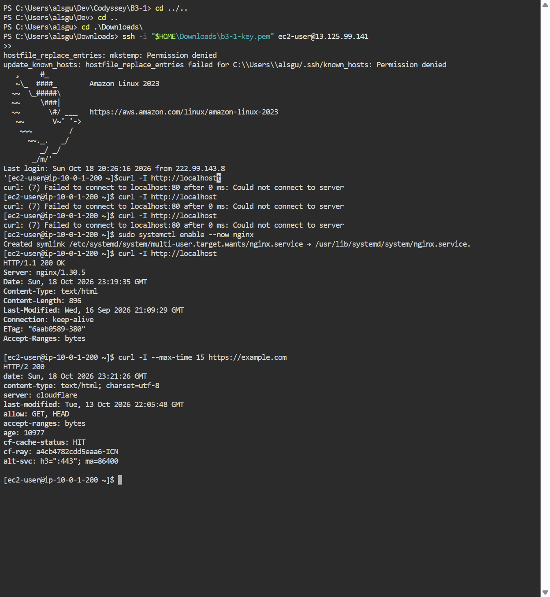

현재 핵심 기능 검증은 EC2 SSH 로그인, Nginx 시작·자동 시작 등록, 내부 HTTP 200, 외부 브라우저 접속 방식 A, EC2 외부 HTTPS 200까지 확인됐다. 아직 전체 과제 종료가 아니다. AWS 탭에 남은 보안 그룹 편집안을 취소하거나 실제 저장 여부를 확인해 개인 IP /32 SSH 최종 구성을 검증하고, 제출 문서·아키텍처·리소스 정리 및 Git 변경분도 별도로 점검해야 한다. 리소스 삭제는 사용자 확인 전 자동 실행하지 않는다.

## 후속: 삭제 전 localhost 일반 GET 검증

2026-10-19 사용자가 로컬 웹 터미널에서 EC2에 SSH로 재접속하고 `curl -i http://localhost`를 직접 실행했다. 화면에서 명령, `HTTP/1.1 200 OK`, Nginx HTML 본문을 확인했다. 응답 Date는 `Mon, 19 Oct 2026 02:49:14 GMT`다. 대문자 `-I`의 HEAD와 달리 이번에는 소문자 `-i`를 사용한 일반 GET 결과다. Aside는 명령을 대신 실행하지 않고 결과를 확인·캡처했다. 이 캡처는 삭제 전 동작 증빙이며 리소스 정리 완료 증빙은 아니다.

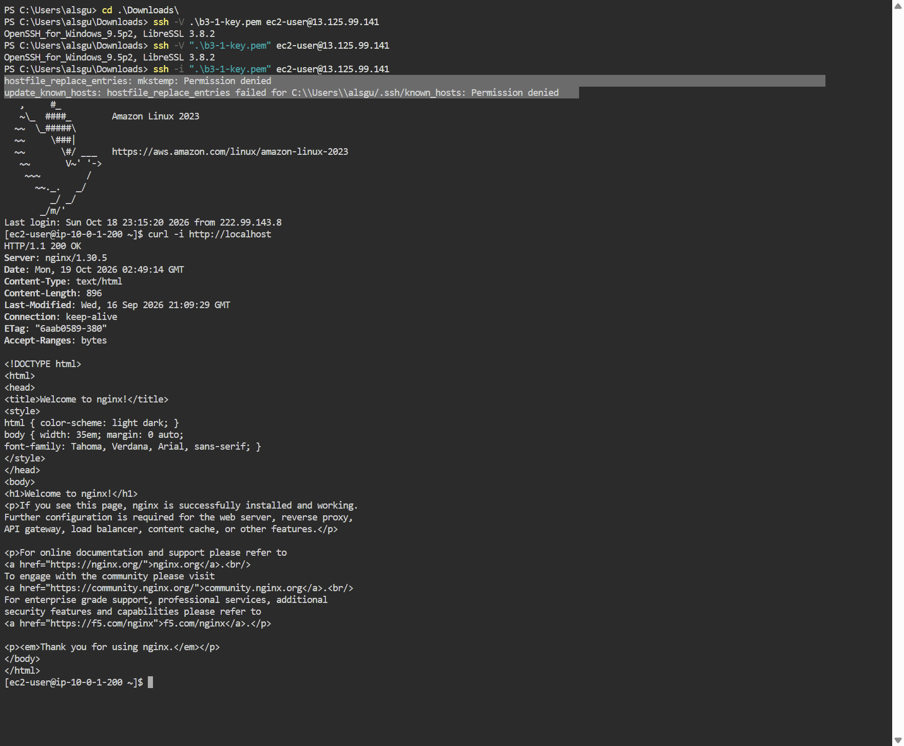
