# 브라우저 SSH 접속 실패·해결 과정 증빙 기록

[종합 트러블슈팅 TS-007](troubleshooting.md#ts-007-ec2-브라우저-ssh의-sendsshpublickey-단계-실패) · [EC2 배포 진행](0025-ec2-deployment-walkthrough.md) · [이전 로그인 복구 원리](0024-aws-login-recovery-쉬운설명.md)

> **최신 결과:** 브라우저 SSH용 IAM 변경 저장과 v2/v3 기본 버전 전환은 확인했으나 브라우저 연결은 성공 검증하지 못했다. 최종 접속·Nginx 검증은 로컬 OpenSSH로 수행했다. 이후 실습 EC2·네트워크는 [정리](cleanup-checklist.md)했다. 아래의 권한 변경 전·정리 전 표현은 해당 절의 관찰 시점 기록이다.

## 1. 왜 접속 방식을 바꾸려 했나?

사용자 PC의 PowerShell + 개인키 SSH는 이미 성공했다. 사용자가 화면 확인과 캡처를 편하게 하기 위해 브라우저 SSH 사용을 요청했다. 두 방식은 같은 Linux에 SSH로 접속하지만 인증 준비와 네트워크 출발점이 다르다. 기존 PowerShell SSH는 예비 경로로 유지한다.

이 캡처의 known_hosts 갱신 경고는 별도 TS-006으로 관리하며 이번 브라우저 실패와 혼동하지 않는다.

## 2. 실패 재현 전 연결 조건

실습 IAM 사용자 forB3-1, 계정 067518846638, 서울에서 실행 중인 b3-1-web(i-05d34639a30bbfb6a)에 연결한다. 브라우저 연결 화면에서 상태 검사 3/3 통과와 퍼블릭 IPv4 13.125.99.141, OS 사용자 ec2-user를 확인했다.

**확인할 문구**: 퍼블릭 서브넷 액세스 / EC2 인스턴스 연결 / AWS 관리 임시 SSH 키 / ec2-user.

이 화면에는 DescribeAddresses 조회 거부도 있지만, 이 조회 경고 자체가 뒤의 키 전송 실패와 같은 작업은 아니다. 개인키를 브라우저에 올리지 않았다.

## 3. 실제 오류

연결을 누른 뒤 다음 오류를 관찰했다.

> 인스턴스에 연결하지 못했습니다. SendSSHPublicKey가 실패했습니다. 나중에 다시 시도하세요.

이 문구로 확정할 수 있는 것은 임시 SSH 공개키 전송 단계에서 실패했다는 사실이다. 화면에 상세 권한 거부 API 결과가 표시되지 않아, IAM 부족·조직 정책 등을 유일 원인으로 단정하지 않는다.

## 4. 가설과 조사 근거

### 가설 A: 접속 사용자에게 임시 공개키 전송 권한이 없음

로컬에 보관한 b3-1-ec2-seoul-policy.json에는 ec2-instance-connect:SendSSHPublicKey가 없다. AWS 공식 문서가 요구하는 권한이다. 실제 현재 사용자 연결 정책 최신 버전은 관리자 역할에서 재확인해야 한다. 보관 파일과 실제 정책이 항상 같다고 가정하지 않는다.

### 가설 B: 브라우저 SSH 서비스 출발지가 방화벽에 허용되지 않음

앞서 규칙 비교 화면에서 확인한 SSH 소스는 개인 공인 IP /32 하나다. AWS 공식 문서는 브라우저 방식에서 Instance Connect 서비스의 관리형 접두사 목록을 SSH 소스로 허용하도록 안내한다. API 키 전송 권한과 실제 SSH 패킷 허용은 서로 다른 조건이다.

이 자료는 **변경 전** 규칙이다. 앞으로 이 규칙을 바꾸면 이후 화면을 추가해 전후를 비교한다. 보안 그룹 일반 상세 표는 DescribeSecurityGroupRules 부족으로 읽지 못했으나 생성 폼의 규칙 비교에서 확인한 자료다.

## 5. 관리 접근 경로: root를 고르는 것이 아님

### 5-1. 세션 메뉴의 함정

현재 forB3-1 세션의 메뉴에는 다른 활성 세션으로 papawolf 계정 root와 조직 관리계정 root가 표시됐다. 이들은 실습 계정의 기존 관리자 역할 항목이 아니다. 로그아웃·멀티 세션 끄기·다른 root 선택을 하지 않았다.

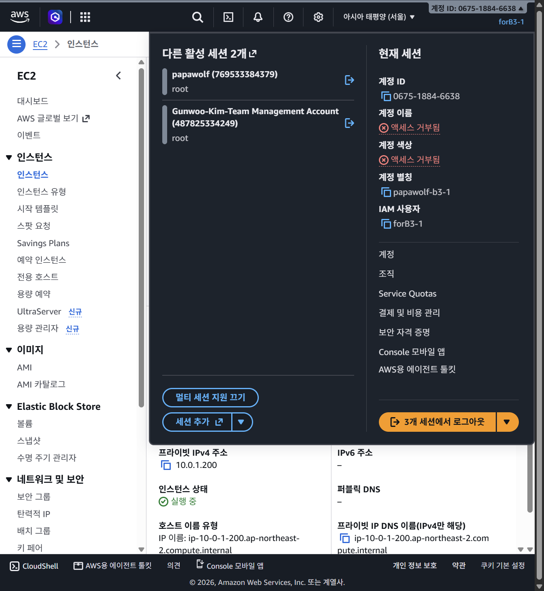

### 5-2. 기존 계정 접근 앱을 별도 탭에서 열기

실습 콘솔과 PowerShell SSH를 유지하고, 확인된 기존 AWS account access 앱을 새 탭에 열었다.

주소: https://aa-qgrz8p6ih.account-access.us-east-1.app.aws/

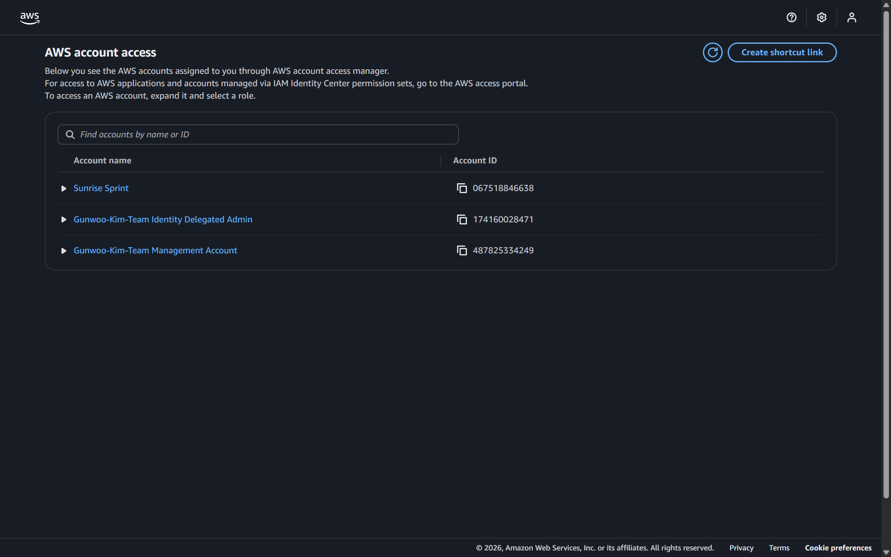

**볼 곳**: Sunrise Sprint / 계정 ID 067518846638. 이름만 같거나 조직 관리계정이라는 이유로 선택하지 않고 실습 계정 ID를 대조한다.

### 5-3. 실습 계정을 펼치면 기존 관리자 역할이 보임

위 계정을 펼쳐 managed/AccountFullAccessRole 링크를 확인했다. 이 단계에서는 역할 링크를 실행하지 않았다. 읽기용 펼치기만 수행했고 IAM·보안 그룹은 변경하지 않았다.

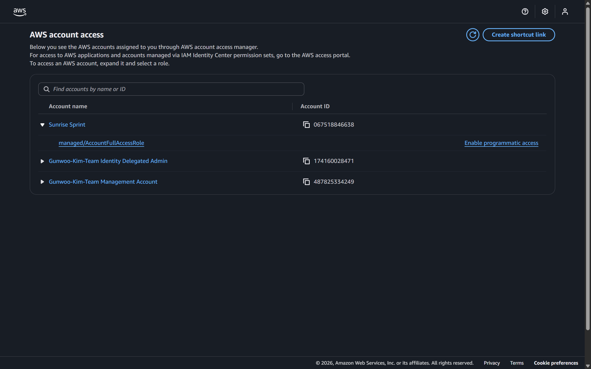

다음 사용자 행동은 **managed/AccountFullAccessRole 클릭**이다. 실제 관리자 콘솔이 열리면 실습 계정 ID와 역할 이름을 확인하고 그 화면도 캡처한다. 이 이미지 자체가 관리자 로그인 완료 증거는 아니다.

## 6. 승인 후 실행할 최소 변경 계획: 아직 미수행

1. 기존 실습 관리자 역할로 현재 forB3-1 연결 정책과 정책 버전을 읽고 변경 전 원본을 저장한다.
2. 필요하면 SendSSHPublicKey를 실습 인스턴스 1대의 ARN, ec2-user 조건, 서울 범위에 제한해 허용한다. 사용자 신원에 필요한 권한이지 EC2 인스턴스 프로파일에 주는 권한이 아니다.
3. 보안 그룹 SSH 22 소스에 서울 Instance Connect 서비스 관리형 접두사 목록만 추가한다. 목록 ID는 실제 조회 뒤 사용하며 추측하지 않는다. 기존 개인 IP /32는 유지하고 전체 공개하지 않는다.
4. 부가 조회 권한은 필요성이 확인된 작업만 별도로 검토하고 광범위 조회·관리자 권한을 주지 않는다.
5. 정책·규칙의 실제 저장 결과를 캡처하고 같은 forB3-1 신원으로 재접속한다.
6. 브라우저 터미널의 Linux 배너·ec2-user 프롬프트를 확인하고 캡처한다. 오류가 바뀌면 그 오류를 별도 단계로 기록한다.
7. 추가한 접근 권한·SSH 서비스 소스의 유지 또는 회수 계획을 기록한다.

## 7. 명세와의 관계

SSH 접속 요구는 특정 클라이언트를 지정하지 않는다. SSH 소스는 개인 IP 또는 지정된 대역으로 제한하도록 되어 있으므로 서비스 대역을 정확히 한정하는 접근으로 검토한다. 명세의 최소권한·서울·루트 미사용 원칙을 유지하며 AdministratorAccess나 SSH 전체 공개는 하지 않는다. 별도 평가표의 세부 해석은 미확인이다. 자세한 검토는 EC2 배포 문서 19절을 참고한다.

## 8. 증빙의 완성 기준

- 완료: 기존 로컬 SSH 성공 캡처.
- 완료: 브라우저 연결 설정·실제 실패 캡처.
- 완료: 변경 전 보안 그룹 규칙 자료.
- 완료: 세션 메뉴·account access 앱·역할 선택 직전 캡처.
- 미완료: 이번 변경 작업용 관리자 콘솔 진입 확인.
- 미완료: 실제 최신 IAM 정책 변경 전후 및 저장 결과.
- 미완료: SSH 서비스 소스 규칙 변경 전후 및 저장 결과.
- 미완료: forB3-1 브라우저 SSH 재시도와 결과.
- 미완료: 최종 원인 확정·해결 결과·불필요한 임시 접근 회수 확인.

‘미완료’를 실제 수행·검증 전에 완료로 바꾸지 않는다. 당시 찍지 않은 과거 장면을 뒤늦게 찍었다고 설명하지 않고, 추가 조회·재캡처 시점 자료임을 구분한다. 민감한 암호·MFA·개인키·토큰은 캡처하지 않는다.

## 9. 공식 근거

- [AWS: Instance Connect IAM 권한과 인스턴스·OS 사용자 제한](https://docs.aws.amazon.com/AWSEC2/latest/UserGuide/ec2-instance-connect-configure-IAM-role.html)
- [AWS: 브라우저 SSH의 서비스 출발지와 관리형 접두사 목록](https://docs.aws.amazon.com/AWSEC2/latest/UserGuide/ec2-instance-connect-prerequisites.html)

## 10. 실제 사용자 화면과 도구 탭 목록 불일치 교정

사용자가 ‘캡처한 화면이 내 화면에 보이지 않는다’고 지적했다. 도구 목록에 존재하는 AWS Account Access 탭을 사용자가 보고 있는 브라우저 창에서도 볼 수 있다고 잘못 안내했다. 이후 사용자의 요청으로 실제 포그라운드 창을 OS 수준에서 캡처해 확인하니 왼쪽 Tabs에는 EC2 Instance Connect와 인스턴스 두 탭만 보였고, 계정 접근 앱 탭은 없었다. 내부 탭 목록만으로 사용자 화면 가시성을 보장할 수 없다는 점을 확인했다. 불일치의 내부 원인은 미확인이다.

따라서 사용자에게 실제 보이는 왼쪽 ‘+ 새 탭’을 표시하고, 그 탭에서 검증된 account access URL을 직접 열도록 안내한다. 아래 이미지는 실제 원본에서 탭 영역만 잘라 빨간 표시를 추가한 설명용 이미지이며 화면 내용을 합성하거나 관리자 로그인 성공으로 표현하지 않는다. 원본 포그라운드 전체 캡처는 다른 채팅 제목이 포함되어 공개 문서에 복사하지 않았다.

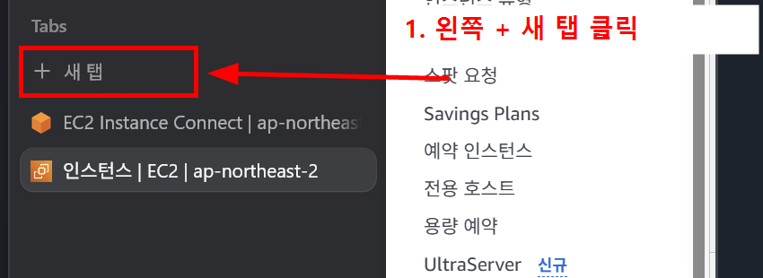

현재도 정책·보안 그룹 변경 전이며 브라우저 SSH 문제는 미해결이다. 앞으로 현재 사용자 화면을 안내할 때 도구의 논리 탭 상태와 실제 사용자 창의 가시성을 혼동하지 않는다.

## 11. 주소 직접 입력 대신 UI 경로 요청과 실제 한계

사용자는 새 탭에 주소를 입력하는 방식이 아니라 UI 버튼·링크를 따라 이동하길 원했다. 서비스 메뉴의 보안·자격 증명 및 규정 준수에서 IAM Identity Center를 실제로 클릭했으나 현재 실습 IAM 사용자에게 해당 자원 조회 권한이 없다는 오류가 표시됐다. 이 화면에서 기존 관리자 포털로 이어지는 링크를 확인하지 못했다. 기존 인스턴스를 새로 활성화하거나 Identity Center 권한을 추가하지 않았다.

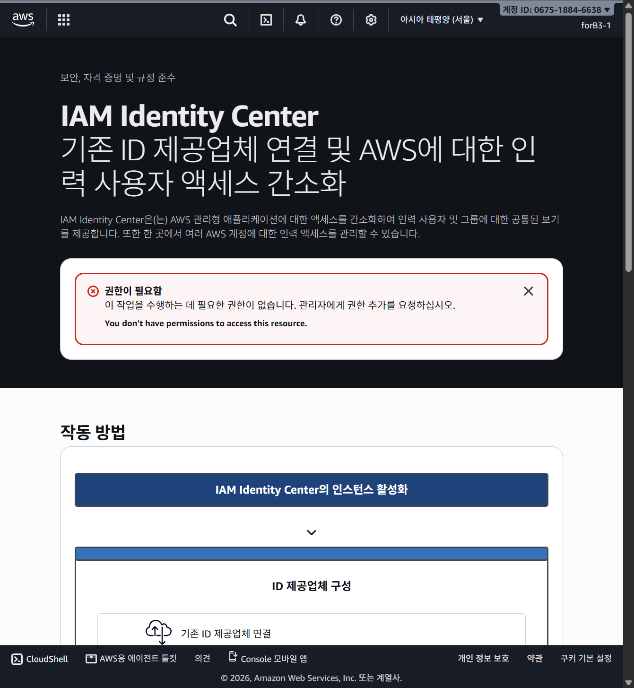

대신 AWS가 열린 Aside 창에서 Ctrl+H로 브라우저 방문 기록 UI를 열었고, 실제 보이는 항목 중 오전 5:34의 AWS Account Access | us-east-1을 확인했다. 해당 항목을 클릭하려 했으나 이후 전면 창이 바뀌어 이동 성공을 확인하지 못했다. 포털 도착 또는 관리자 로그인 성공으로 기록하지 않는다. 추가 자동 클릭을 중단하고 사용자가 클릭할 정확한 항목에 표시한 이미지를 제공한다.

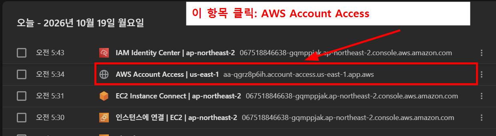

이 경로는 ‘AWS 콘솔 메뉴가 관리자 권한을 부여한다’는 의미가 아니라, 브라우저의 이전 방문 항목을 통해 별도 인증·접근 앱으로 돌아가는 UI 경로다. 사용자에게 도구 탭과 실제 보이는 창을 구분하고, 전면 창이 바뀌면 OS 수준 입력을 멈춰야 한다는 운영상 교훈도 기록한다. 현재 IAM·보안 그룹 변경은 여전히 미수행이다.

## 12. 후속 학습으로 홈페이지 UI 기반 관리자 역할 진입 성공

사용자가 원리 이해를 위해 Google→AWS 공식 홈페이지부터 UI를 따라 진행하길 요청했다. [전체 학습 기록](0029-aws-login-ui-from-home-쉬운설명.md)에 단계별 원본·개인정보 보호 캡처를 남겼다. 핵심 성공 경로는 홈페이지 콘솔 로그인 → 세션 화면 상단 Sign in → 기존 이메일 → Builder ID 선택 → 인증 후 아래쪽 Sunrise Sprint였다. 이 경로로 계정 067518846638의 AccountFullAccessRole 콘솔에 진입한 것을 확인했다.

개인 프로필 탐색과 직접 포털 URL 입력은 이 성공 경로의 필수 단계가 아니었다. 기존 Add session에서 IAM 로그인으로만 이어졌던 것과 상단 Sign in의 통합 로그인 입구를 구분하지 못한 것이 안내 혼선을 키웠다. 이 학습으로 root를 쓰지 않고 기존 역할 세션을 확보했지만, 브라우저 SSH 권한 수정·서비스 소스 규칙 추가·재접속 검증은 아직 수행하지 않았다. 현재 콘솔 표시 리전은 시드니이므로 서울로 바꾼 뒤 현재 정책 조회부터 진행한다.

## 13. 기존 관리자 역할로 IAM 대시보드 조회

사용자가 최근 방문 서비스의 IAM을 눌렀고 계정 067518846638, AccountFullAccessRole의 IAM 대시보드를 확인했다. IAM은 글로벌 서비스이므로 상단 리전이 글로벌로 바뀐 것은 정상이며 EC2가 다른 리전으로 이동한 것이 아니다. 대시보드는 IAM 사용자 1개·역할 12개·정책 1개를 표시한다. 이 숫자는 현재 대시보드의 요약이며 각각의 실제 정책 내용이나 권한을 검증한 것은 아니다. 다음은 IAM 사용자 -> forB3-1 -> 권한 탭에서 연결 정책을 조회하는 것이다. 정책·보안 그룹 변경은 아직 하지 않았다.

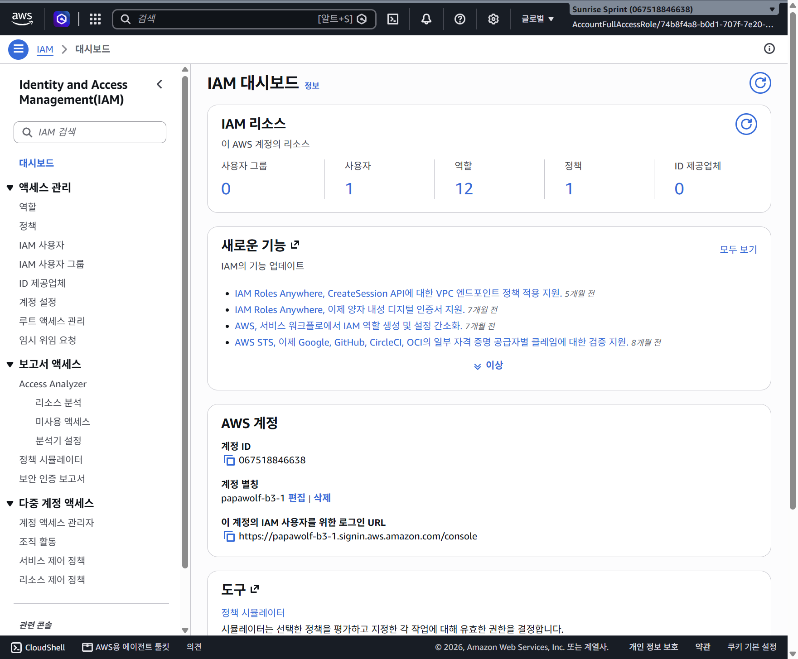

## 14. 실제 연결 정책 1개 확인: 내용 열람 전

관리자 역할에서 forB3-1의 권한 탭을 확인했다. 권한 정책 1개, 이름 B3Ec2SeoulLabPolicy, 유형 고객 관리형, 연결 방식 직접이다. 권한 경계는 설정되지 않음으로 표시된다. 정책 이름·연결 방식 확인과 정책 내용의 최소권한 검증은 다르며, 이 목록만으로 실제 Action/Resource/Condition 전체를 확인했다고 주장하지 않는다. 현재 로그인 신원은 AccountFullAccessRole이고 화면에서 관리 대상으로 연 사용자는 forB3-1이다. 사용자를 열었다고 그 사용자로 로그인된 것은 아니다.

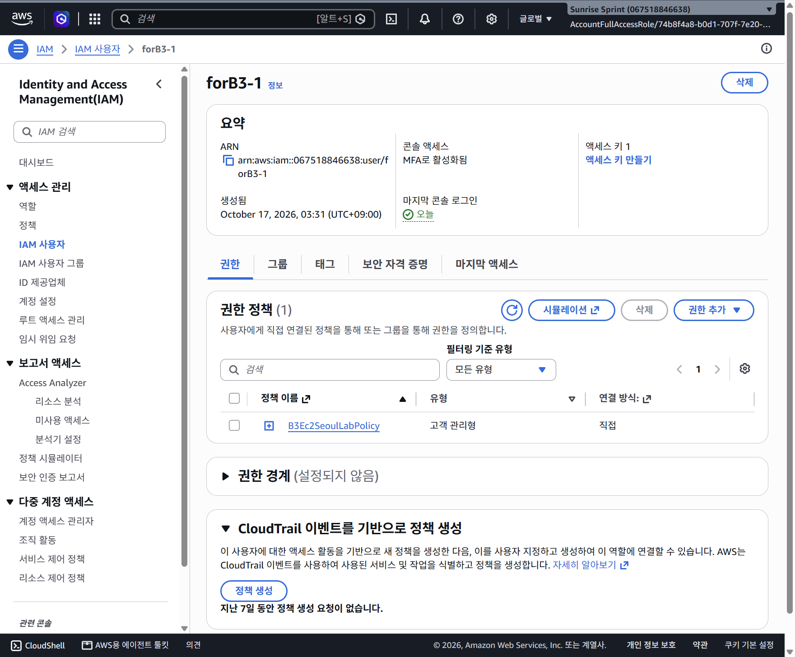

다음은 정책 이름 왼쪽 미리 보기 토글로 현재 정책 문서를 읽는 것이다. 권한 추가·삭제·편집은 하지 않았다.

## 15. 실제 연결 정책 전체 확인과 변경 전 원본 백업

미리 보기를 열어 B3Ec2SeoulLabPolicy 전체를 읽었다. 화면의 코드 줄 번호를 제외하고 JSON을 파싱했으며 7개 Statement가 기존 보관 정책과 구조적으로 같은 것을 확인했다. 허용 Action은 모두 ec2 서비스의 명시적 작업이고, ec2-instance-connect:SendSSHPublicKey 및 ec2:DescribeAddresses는 포함되지 않는다. 따라서 이전의 로컬 보관본에 근거한 누락 가설을 실제 연결 정책에서도 확인했다. 일반 API 실패 화면만으로 SCP 등 모든 다른 원인까지 배제한 것은 아니다.

- [실제 정책 변경 전 전체 JSON](policies/b3-1-ec2-seoul-policy.before-browser-ssh.json)
- [현재 정책과 IAM·SSH 원리 쉬운 설명](0030-iam-policy-reading-쉬운설명.md)

현재도 편집·정책 저장·보안 그룹 변경은 미수행이다. 다음은 인스턴스 1대·ec2-user·서울 범위의 키 전송 허용안을 사용자에게 설명하고 현재 정책과의 차이를 확인하는 것이다.

## 16. 사용자에게 안내한 최소 변경안: 작성·저장 전

사용자가 정책 편집 화면을 열고 추가 위치·내용을 질문했다. 실제 편집 화면은 기존 171줄 정책이며 오류·경고 없음으로 표시되는 상태다. 아직 사용자 입력을 확인하기 전 원본 캡처를 저장했다.

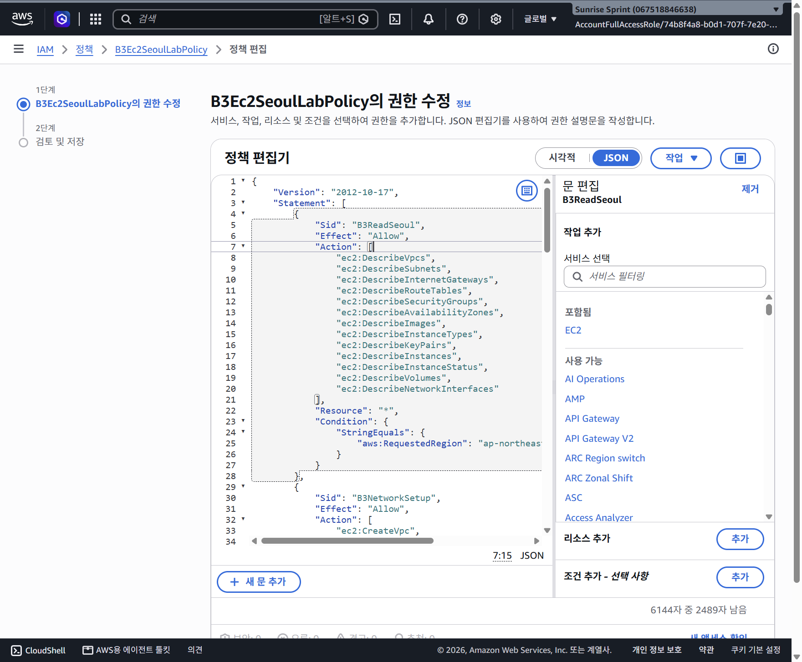

변경 안내는 두 군데다.

1. Statement 배열 맨 앞에 B3BrowserSshSingleInstance 규칙을 추가한다. Allow / ec2-instance-connect:SendSSHPublicKey / arn:aws:ec2:ap-northeast-2:067518846638:instance/i-05d34639a30bbfb6a / ec2:osuser=ec2-user 및 aws:RequestedRegion=ap-northeast-2 조건이다. 기존 모든 서버에 무제한 접속하도록 바꾸지 않는다.
2. 기존 B3ReadSeoul의 Action 배열에 ec2:DescribeAddresses 하나를 추가한다. 연결 준비 화면에서 실제 관찰한 주소 조회 경고를 해소하기 위한 별도 읽기 작업이다. 기존 Resource=*와 서울 조건을 유지한다. 이 읽기 작업 자체가 임시 키 전송 권한을 대신하지 않는다.

[전체 변경안 JSON](policies/b3-1-ec2-seoul-policy.browser-ssh-proposed.json)을 실제 변경 전 백업에서 생성하고 문법을 검증했다. 총 Statement 8개로, 기존 다른 6개 규칙을 유지하고 원래 읽기 규칙에 한 작업만 추가하는 구조다. 현재는 로컬 제안 파일이며 AWS 저장·정책 버전 전환·전파·재접속을 수행한 것은 아니다. 사용자가 입력 후 다음/검토 화면에서 변경 내용과 오류 유무를 확인하며, 실제 저장은 별도로 진행한다.

## 17. 추가 JSON 두 항목의 instruction.md 적합성 재검토

사용자가 제안 코드가 명세에 맞는지 재확인했다. 실제 파일명은 instruction.md이며 IAM 최소권한 조항은 생성·조회·태그·연결 등 실습 필요 작업 중심, 무관한 S3/RDS 권한 제외, AdministratorAccess 미부여를 요구한다.

- SendSSHPublicKey 추가안은 실습 서버 연결용이며 실제 인스턴스 ARN 하나·ec2-user·서울로 제한되어 요구의 취지에 부합하는 것으로 판단한다. 전체 EC2 관리 권한·IAM 자체 수정 권한·다른 서비스 접근 권한을 부여하지 않는다.
- DescribeAddresses는 연결 준비 UI에서 실제 경고가 난 조회 작업이며 주소 할당·해제·변경 권한이 아니다. 기존 서울 조건을 유지하는 조회 추가는 명세 범위와 양립한다. 다만 이것은 SendSSHPublicKey를 허용하기 위한 필수 종속 권한으로 확인된 것이 아니고, 현재 핵심 키 전송 오류를 고치는 데 반드시 필요하다고 단정해서는 안 된다. 엄격히 변경을 최소화하면 우선 키 전송 권한만 추가하고 주소 조회는 경고·실제 필요에 따라 선택적으로 추가할 수 있다. 로컬 전체 변경안 파일에는 두 항목이 들어 있음을 명시한다.
- 이 IAM 변경만으로 SSH 포트 소스 규칙을 열지는 않는다. 후속 네트워크 변경을 할 경우에도 개인 IP /32 유지와 서울 Instance Connect 지정 대역 제한을 별도로 검토하고 전체 공개하지 않는다.
- 실제 작업은 기존 관리자 역할에서 검토·정책 관리하고, 일반 과제 배포는 forB3-1로 계속한다. 관리자 역할 권한을 과제 사용자에 복제하지 않는다. 이번 판정은 제안 코드 범위에 대한 명세 해석이며 별도 평가표 합격이나 현재 전체 계정 설정의 완전한 준수 판정은 아니다.

현재 AWS 저장 전이다. 사용자에게 두 항목 모두 실습 관련 범위지만 주소 조회는 선택 보완임을 설명하고, 입력한 내용이 있으면 저장 전 실제 차이를 재확인한다.

## 18. 사용자의 JSON 추가 후 편집기 상태 확인

사용자가 추가했다고 알려 현재 편집기를 확인했다. 새 B3BrowserSshSingleInstance 블록과 기존 B3ReadSeoul이 이어지고 ec2:osuser=ec2-user가 보인다. 선택 보완이었던 ec2:DescribeAddresses도 기존 읽기 Action 끝에 추가되어 있다. 편집기는 오류·경고 없음으로 표시한다. 다만 가로로 긴 Action·ARN·리전 문자열이 화면 오른쪽에서 잘리므로 현재 캡처만으로 대상 ARN 전체가 제안과 일치한다고 최종 검증하지 않는다. 기존 나머지 모든 규칙의 보존도 검토 화면 전체 JSON에서 확인할 예정이다.

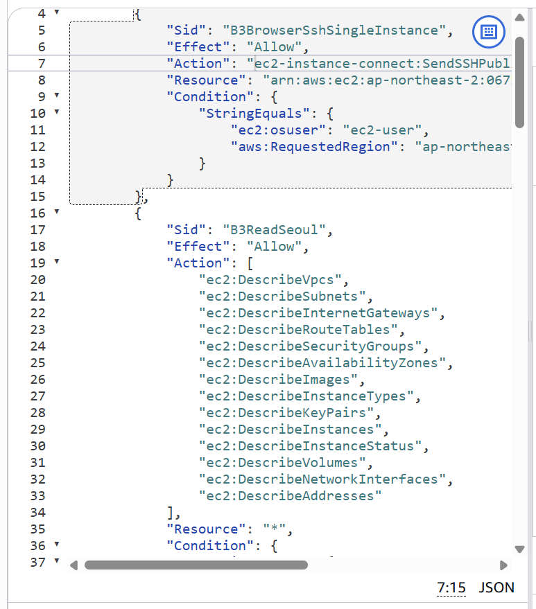

현재는 1단계 편집 화면이며 저장 완료가 아니다. 다음 버튼으로 검토 및 저장 화면에 이동한 뒤 전체 권한 차이를 확인하고, 실제 저장은 그 뒤 사용자 조작으로 진행한다.

## 19. 저장 직전 전체 JSON 대조 완료

검토 화면에서 EC2 Instance Connect -> SendSSHPublicKey 세부 요약을 열어 인스턴스 ID i-05d34639a30bbfb6a, 서울 리전, 실습 계정 067518846638 제한을 확인했다. 요청 조건은 Multiple로만 표시되어 요약만으로 끝내지 않았다. 정책 권한 편집으로 잠시 돌아가 코드 편집기 전체 내용을 선택·복사해 정책 JSON으로 파싱하고, 로컬 최소 변경 제안과 구조 전체를 비교했다. JSON 전체가 정확히 일치한다. Statement는 8개이고 기존 권한 보존, 키 전송 Action 1개·실제 인스턴스 ARN·ec2-user·서울 요청 리전 조건, 선택 보완인 DescribeAddresses 조회 추가를 확인했다. 정책 내용을 입력하거나 저장하지 않았으며 복사 과정에서 클립보드에는 정책 JSON이 들어간다. 검증 후 검토 및 저장 화면으로 복귀했다.

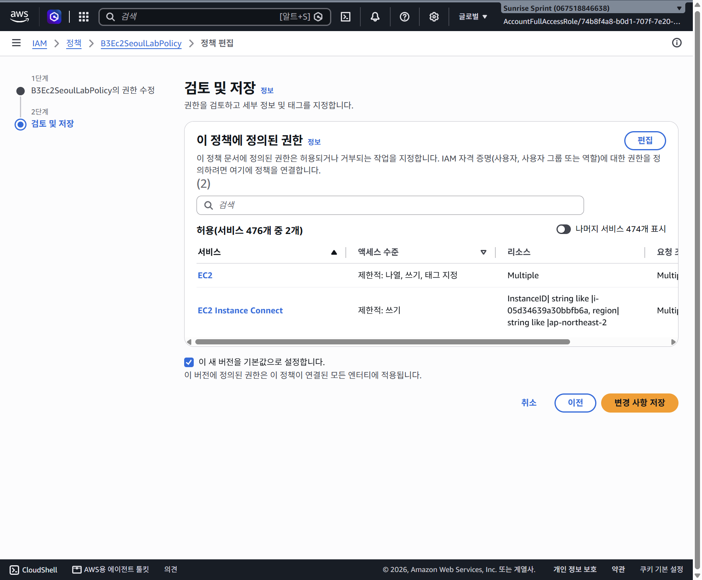

‘이 새 버전을 기본값으로 설정합니다’가 체크되어 있다. 이는 저장 시 기존 연결 사용자에 새 권한 버전을 적용한다는 의미다. 현재는 저장 버튼이 보이는 상태로 아직 실제 정책 버전 생성·기본 버전 전환이 확인되지 않았다. 다음 조작은 사용자가 변경 사항 저장을 누르는 것이며 그 후 성공 알림·적용 버전을 확인한다.

## 20. IAM 정책 저장 성공 및 버전 2 기본값 확인

사용자가 변경 사항 저장을 누른 뒤 AWS의 ‘정책 B3Ec2SeoulLabPolicy이(가) 업데이트되었습니다’ 성공 알림을 확인했다. 정책 버전 탭에서 버전 2가 기본값이고 버전 1이 남아 있음을 확인했다. 과제 사용자는 기존 연결 정책의 새 기본 버전을 사용하며 정책을 다시 연결할 필요는 없다. IAM 권한 반영이 모든 요청에 즉시 완료되었다거나 실제 접속이 성공했다고 해석하지 않는다.

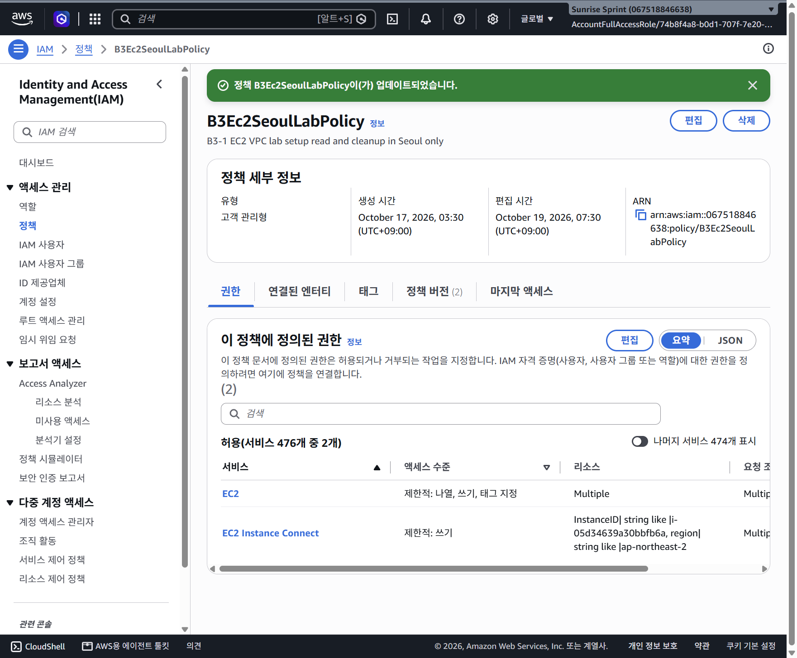

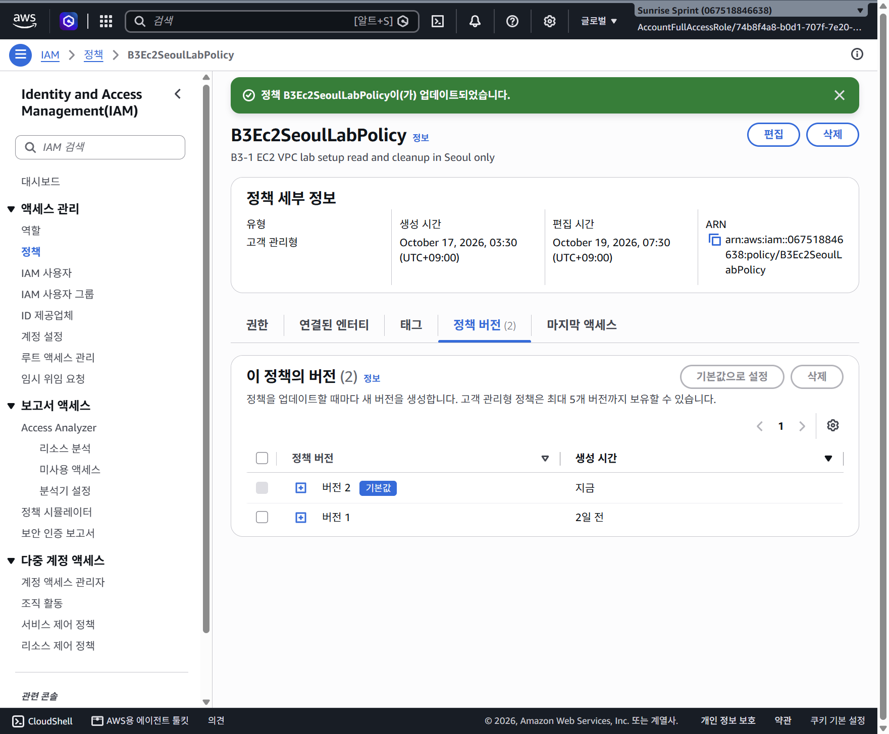

현재 보관 정책 b3-1-ec2-seoul-policy.json을 저장 직전 전체 대조한 변경안으로 갱신했다. 변경 전 정책은 before-browser-ssh.json과 IAM 버전 1에 보존된다. browser-ssh-proposed.json은 제안 당시 파일명으로 남기며 그 내용과 동일한 변경이 이번에 저장되었다.

현재 완료한 것은 IAM의 최소 키 전송 권한 및 주소 조회 추가, 정책 저장, 기본 버전 확인이다. 보안 그룹은 이번 단계에서 변경하지 않았고 브라우저 SSH는 아직 재시험 전이다. 다음은 EC2 탭의 실제 로그인 신원을 확인하고 forB3-1 신원에서 재시험하는 것이다. 관리자 역할에서 성공해도 과제 사용자의 추가 권한 검증을 대신하지 않는다. 네트워크 경로 문제는 별도이며 SSH 전체 공개는 하지 않는다.

## 21. forB3-1로 재시험: SSH 연결 수립 실패

정책 버전 2 저장 후 사용자가 브라우저 SSH를 재시도했다. 실제 활성 EC2 Instance Connect 화면의 로그인 신원은 forB3-1, 실습 계정 067518846638, 서울이다. 접속 URL의 대상은 i-05d34639a30bbfb6a, osUser=ec2-user, sshPort=22, standard 연결 및 IPv4다. 관리자 역할로 한 시험이 아님을 확인했다.

현재 오류는 ‘인스턴스에 연결하지 못했습니다. 인스턴스에 대한 SSH 연결을 설정하지 못했습니다. 나중에 다시 시도하세요.’다. 이전 SendSSHPublicKey 실패 문구와 다르지만 이 일반 오류만으로 실제 키 전송 API 성공을 확정하지 않는다. SSH 연결은 여전히 미해결이다.

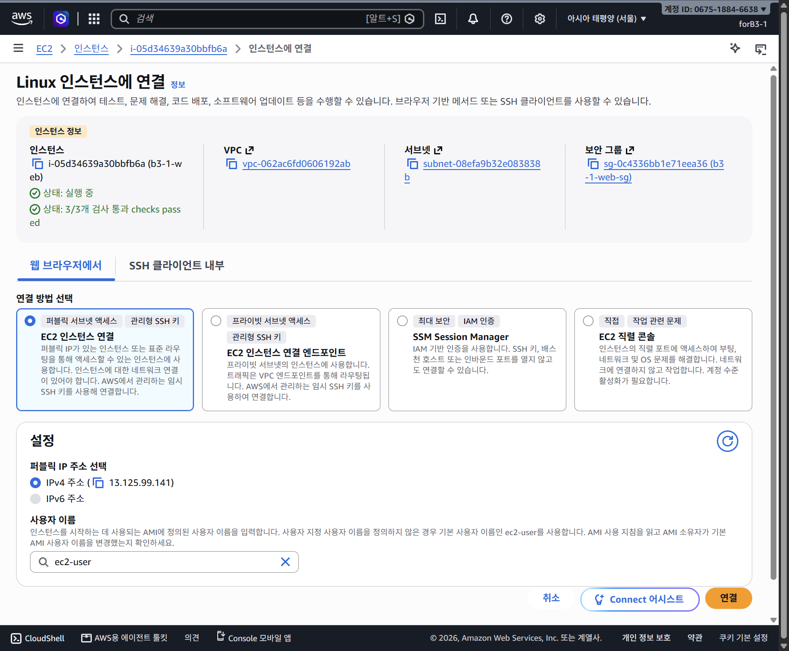

앞서 SSH 인바운드를 개인 IP /32로 제한했고 이번 단계에서 보안 그룹을 변경하지 않았다. 브라우저의 표준 퍼블릭 Instance Connect 접속은 PC의 직접 SSH와 네트워크 출발지가 다르므로 현행 보안 그룹을 다시 읽어 서비스 출발지 허용 여부부터 확인할 계획이다. 아직 네트워크 원인을 확정하거나 규칙을 추가하지 않는다. 다음 사용자 조작은 기존 EC2 탭에서 b3-1-web의 보안 탭을 여는 것이다. SSH 전체 공개·추가 관리자 권한 부여는 하지 않는다.

## 22. 現 보안 그룹 상세의 규칙 조회 권한 오류

forB3-1로 실습 보안 그룹 sg-0c4336bb1e71eea36 상세를 확인했다. 인바운드 2개·아웃바운드 1개는 요약에 표시되지만 인바운드 표에는 ec2:DescribeSecurityGroupRules 허용 정책이 없다는 오류가 나온다. 따라서 현재 표가 규칙 없음이나 실제 SSH 차단 자체를 증명하는 것은 아니다. 포트·소스는 이 화면에서 아직 다시 읽지 못했다.

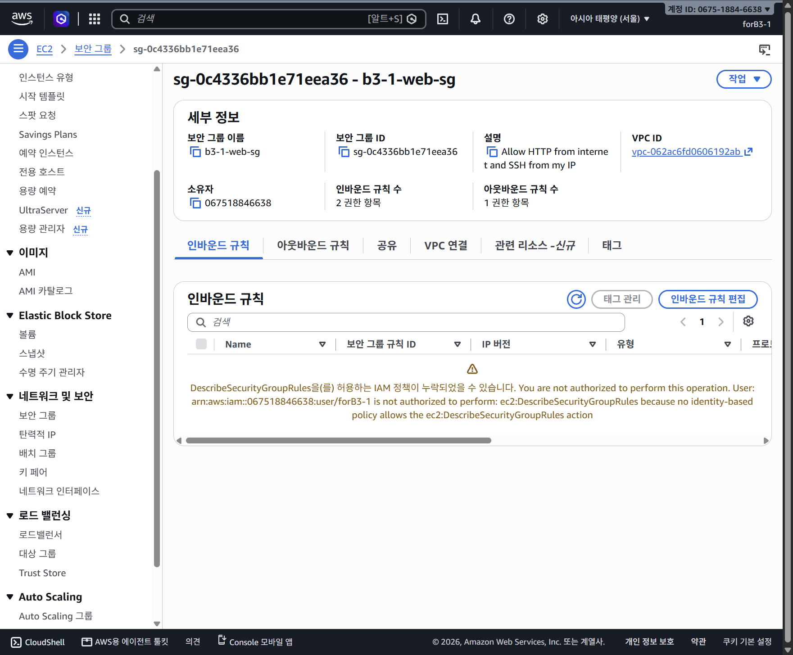

즉시 IAM 권한을 더 늘리지 않고, 인바운드 규칙 편집 화면에서 기존 DescribeSecurityGroups 권한으로 현행 값이 로드되는지 먼저 확인한다. 화면 열기는 저장이 아니며 실제 규칙 변경은 허용 범위를 확인한 뒤 사용자 조작으로 한다. 이 경로도 조회에 실패하면 기존 관리자 역할에서 읽기만 하는 대안이 있다. 현재 추가 IAM 수정·보안 그룹 저장은 하지 않았다.

## 23. 편집 화면 우회도 동일 조회 권한 누락으로 실패

인바운드 규칙 편집 화면도 forB3-1에 ec2:DescribeSecurityGroupRules 허용이 없다는 오류로 로드되지 않았다. 앞서 기존 DescribeSecurityGroups만으로 편집 화면 값을 읽을 수 있는지 시험한 우회는 현재 UI에서 실패했다. 포트·소스를 읽거나 변경한 것은 아니다.

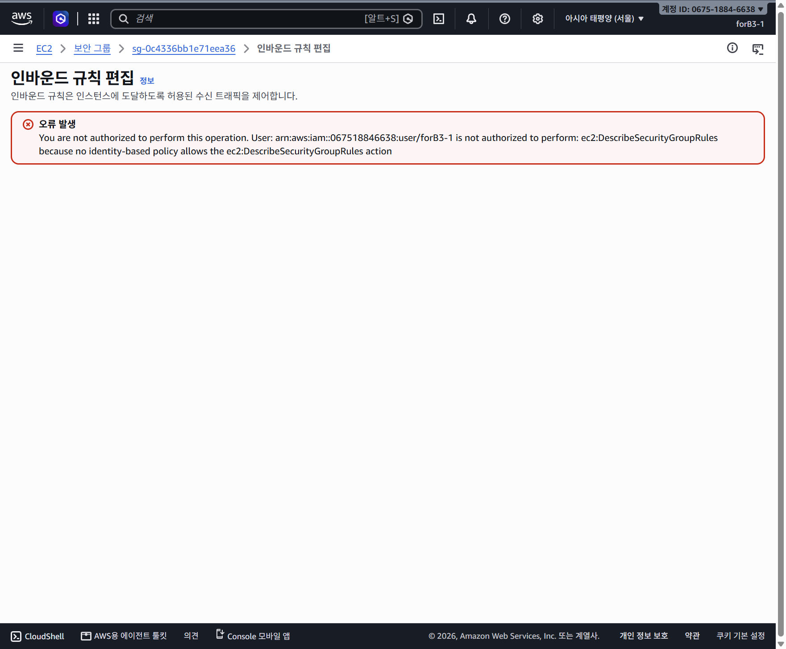

실제 콘솔에서 보안 그룹 규칙 조회·편집 준비에 필요한 API임이 확인됐으므로, forB3-1로 콘솔 작업을 이어가려면 기존 B3ReadSeoul Action에 ec2:DescribeSecurityGroupRules 읽기 작업 하나를 추가하는 방안을 안내한다. 기존 Resource=*와 서울 요청 리전 조건을 유지하며 전체 EC2 관리 권한이나 규칙 수정 작업을 일괄 확대하지 않는다. instruction.md의 실습 EC2/VPC/Security Group 조회 필요 범위에 해당한다. 기존 관리자 역할에서 조회만 하는 대안은 가능하나 forB3-1의 현재 콘솔 편집 화면 자체가 복구되는 것은 아니다. 아직 이 추가 권한은 저장하지 않았고 보안 그룹도 변경하지 않았다.

## 24. DescribeSecurityGroupRules 1개 추가 입력 검증 완료, 저장 전

사용자의 추가 입력 뒤 편집기는 오류·경고 없음으로 표시했다. 코드 편집기 전체 내용을 복사해 JSON을 파싱하고, 현재 보관된 버전 2에 B3ReadSeoul.Action의 ec2:DescribeSecurityGroupRules 하나만 추가한 기대값과 비교했다. 전체 구조가 정확히 일치하고 Statement는 기존 8개다. 즉 기존 인스턴스 한 대·ec2-user·서울 제한 및 나머지 권한은 그대로다. 클립보드에는 검증용 정책 JSON이 들어간다. 입력한 정책은 [별도 저장 전 제안 파일](policies/b3-1-ec2-seoul-policy.sg-read-proposed.json)에 보존했고 현재 기본 정책 보관본은 아직 버전 2로 유지했다.

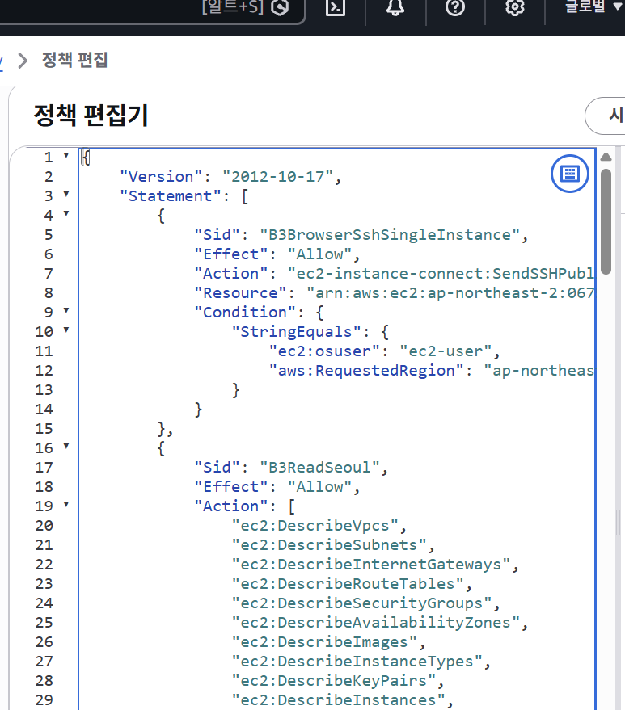

현재 편집 단계이며 AWS 정책 저장·버전 3 생성은 미확인이다. 다음 사용자 조작은 다음 버튼으로 검토 화면 이동이며 실제 저장은 그 뒤 진행한다.

## 25. 조회 권한 추가 저장: 버전 3 기본값 확인

사용자가 저장 후 EC2 탭으로 돌아왔다. 활성 EC2 편집 화면에는 여전히 DescribeSecurityGroupRules 권한 부족 오류가 보였다. 이 오류만으로 저장 실패를 판단하지 않고 별도 IAM 탭을 읽어 업데이트 성공 알림·편집 시간 변경·버전 3 기본값을 확인했다. 버전 2·1도 남아 있다. 현재 보관 정책 JSON을 전체 대조한 sg-read-proposed.json과 동일하게 갱신했다.

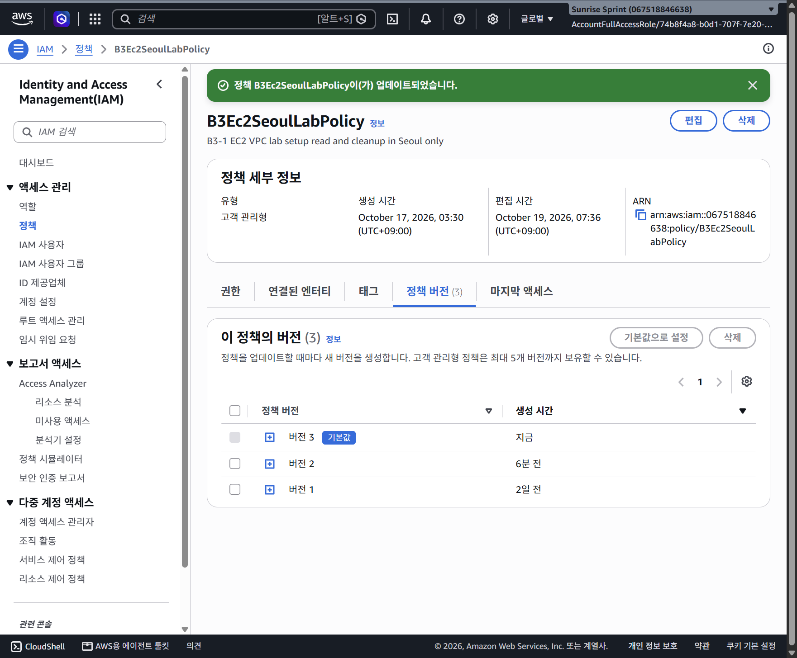

IAM 변경의 전파 지연 또는 기존 오류 화면이 남은 경우를 고려해 잠시 기다린 뒤 사용자가 EC2 화면을 새로고침하도록 안내한다. 현재 EC2 조회 복구·보안 그룹 규칙 내용·브라우저 SSH 성공은 아직 확인하지 않았다. 추가 권한 확장이나 보안 그룹 변경은 하지 않는다.

## 26. 조회 복구 확인 및 기존 인바운드 두 규칙 재검증

사용자가 된다고 알려 현재 활성 EC2 화면을 확인했다. 이는 브라우저 SSH 접속 성공이 아니라 보안 그룹 편집 화면의 조회 복구다. forB3-1 신원으로 실제 기존 규칙이 표시된다. HTTP TCP 80 소스 0.0.0.0/0, SSH TCP 22 소스 222.99.143.8/32이며 아직 Instance Connect 서비스용 인바운드는 없다. 아직 변경·저장 전이다.

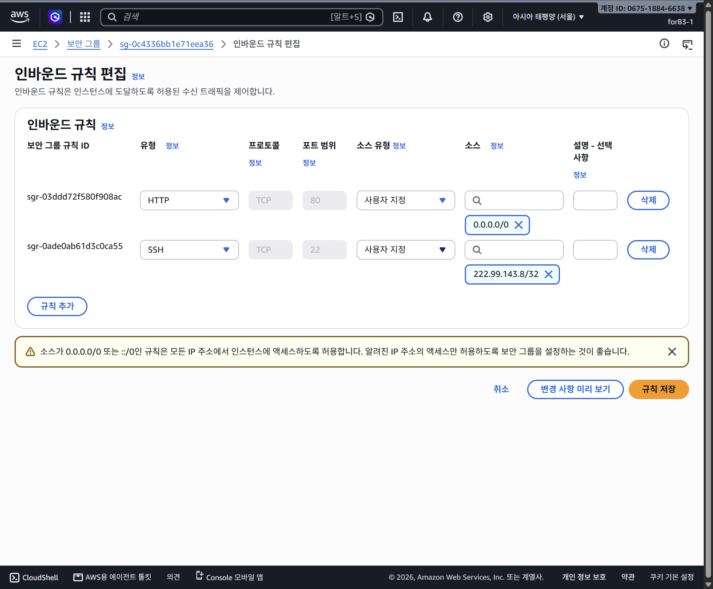

AWS 공식 선행 조건 문서(https://docs.aws.amazon.com/AWSEC2/latest/UserGuide/ec2-instance-connect-prerequisites.html)를 읽어 콘솔 접속 시 EC2 Instance Connect 서비스의 SSH 출발지를 허용해야 함을 확인했다. 공식 권장 IPv4 관리형 접두사 목록 이름은 com.amazonaws.ap-northeast-2.ec2-instance-connect이다. IP 목록 자동 갱신을 반영하는 관리형 접두사 목록을 우선 검토한다.

동시에 공식 https://ip-ranges.amazonaws.com/ip-ranges.json 을 실제 조회해 region=ap-northeast-2, service=EC2_INSTANCE_CONNECT의 IPv4 범위가 13.209.1.56/29 한 개임을 확인했다. 자료 createDate는 2026-10-18-19-07-05다. 이 값은 현재 공개 목록의 조회 결과이며 영구 고정이라고 보장하지 않는다. 접두사 목록 선택이 현재 권한으로 불가능한 경우 이 공식 확인 CIDR이 좁은 대안이 될 수 있으며, 사용 시 변화에 맞춘 유지 관리가 필요하다.

다음은 기존 HTTP·개인 IP SSH 두 규칙을 유지하고 서비스 출발지의 TCP 22 규칙 하나를 추가하는 방안을 사용자에게 안내하는 것이다. 포트·소스 검토와 저장 확인 전에는 네트워크 해결 완료로 기록하지 않는다. SSH 0.0.0.0/0 공개는 하지 않는다.

## 27. 접두사 목록 이름이 문자열로 추가되어 소스 검증 오류

사용자가 새 세 번째 규칙을 SSH/TCP/22로 선택하고 공식 접두사 목록 이름을 검색했다. 실제 화면에는 com.amazonaws.ap-northeast-2.ec2-instance-connect 문자열 토큰이 들어가 있지만 ‘CIDR 블록, 보안 그룹 ID 또는 접두사 목록을 지정해야 합니다’ 오류가 표시된다. 선택기에는 해당 문자열을 직접 사용하는 항목만 보이고, 유효한 pl- ID의 관리형 목록을 선택한 상태는 아니다. 조회 권한 때문인지 검색 매칭 때문인지는 이 화면만으로 확정하지 않는다. 이 상태로 저장하지 않는다.

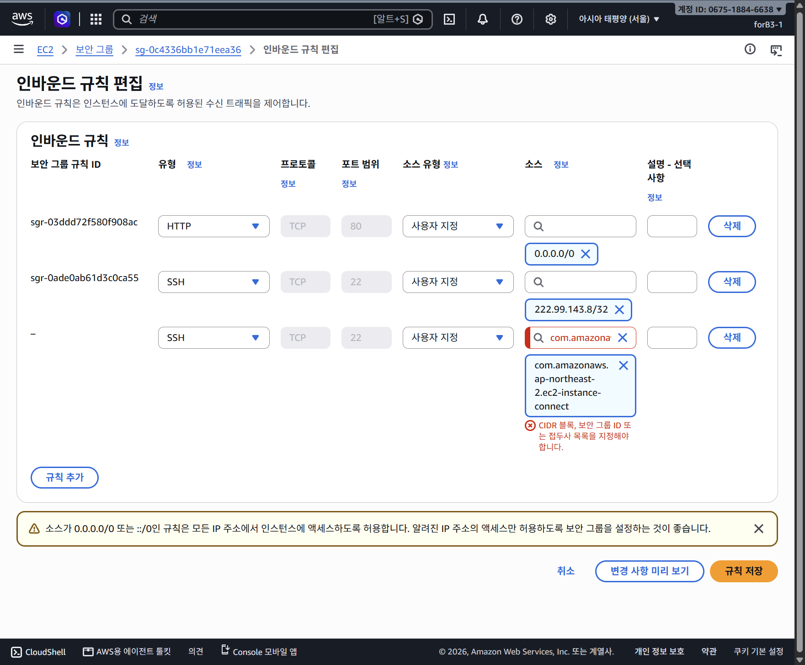

추가 IAM 권한 확장·관리자 전환 대신, 26절에서 공식 AWS IP 범위 JSON으로 독립 확인한 서울 EC2_INSTANCE_CONNECT IPv4 CIDR 13.209.1.56/29를 수동 소스로 쓰는 대안을 안내한다. 세 번째 줄의 잘못된 이름 토큰과 남은 검색 문자를 제거한 뒤 해당 CIDR을 입력·확정한다. 기존 개인 IP /32 SSH와 HTTP 규칙은 유지한다. 이 대안은 지정 IP 대역만 허용하므로 SSH 전체 공개가 아니지만 AWS 대역 변경 시 수동 갱신이 필요한 단점이 있다. 입력·미리 보기·실제 저장·재접속 확인은 아직 전이다.

## 28. 서비스 SSH CIDR 추가안의 instruction.md 재검토

사용자가 저장 전 명세 저촉 여부를 다시 요청했다. instruction.md 4절 접근 제어와 7절 보안 제약을 함께 읽었다. 양쪽 모두 SSH(22)는 학습자 개인 IP 또는 지정된 IP 대역에서만 접근 가능해야 한다고 규정한다. 7절에는 운영·관리 포트에 대해 ‘소스 제한(내 IP)을 유지한다’는 추가 주의가 있다.

13.209.1.56/29의 TCP 22만 추가하는 것은 SSH 전체 공개가 아니며 명시한 서비스 대역 제한이다. 따라서 ‘지정된 IP 대역’ 허용 취지와 양립한다고 볼 수 있다. 다만 명세가 이 AWS 서비스 대역을 지정 대역으로 명시 승인한 것은 아니므로 평가자가 내 IP만 허용을 엄격하게 적용할 가능성까지 배제하거나 무조건 합격을 보장하지 않는다.

보수적인 권고는 과제 최종 구성에서 개인 IP /32 SSH만 유지하는 것이다. 브라우저 SSH 원리를 계속 검증하고 싶다면 서비스 CIDR은 학습·접속 시험용으로만 허용하고, 시험 뒤 이 추가 규칙을 삭제해 최종 보안 구성을 개인 IP /32로 복구하고 전후 증빙을 남긴다. 이미 성공한 PowerShell SSH만으로도 명세의 SSH 접속 요구를 충족할 수 있어 브라우저 SSH는 필수 요구가 아니다. 현재 저장 여부를 새로 확인한 것은 아니며 실제 추가·삭제는 사용자 조작과 결과 확인 후 기록한다.

## 29. 최종 저장 규칙 확인: 서비스 대역 없이 개인 IP SSH 유지

로컬 ttyd/OpenSSH로 SSH·웹 배포 검증을 마친 뒤, 닫았던 보안 그룹 편집 탭을 사용자가 복원했다. 복원된 화면에는 기존 2개 규칙만 보였고, 사용자가 취소를 눌러 편집 화면에서 나갔다. 이어 실제 저장된 인바운드 목록에서 2개 규칙을 확인했다: HTTP TCP 80 / 0.0.0.0/0, SSH TCP 22 / 222.99.143.8/32. 검토했던 Instance Connect 서비스 CIDR 13.209.1.56/29 규칙은 최종 목록에 없고, 기존 규칙 ID도 동일하다. 따라서 임시 추가안을 삭제 저장했다고 표현하지 않고 최종 실제 규칙 목록으로 상태를 증빙한다.

브라우저 Instance Connect 경로는 재접속 성공을 검증하지 않았고 최종 과제 접속 경로로 사용하지 않는다. 과제 SSH 증빙은 로컬 ttyd에서 PC OpenSSH로 성공한 세션이다. IAM에는 버전 3의 제한적 SendSSHPublicKey와 조회 보완 권한이 남아 있으며 회수·정책 정리를 수행한 것으로 주장하지 않는다. EC2·EBS·퍼블릭 IPv4 리소스와 로컬 ttyd도 아직 종료·삭제 전이다.
