# AWS 공식 홈페이지에서 로그인 입구를 구분하는 UI 학습

[이전 로그인 복구 원리](0024-aws-login-recovery-쉬운설명.md) · [브라우저 SSH 문제 기록](0028-browser-ssh-troubleshooting.md)

## 목적과 학습 방식

사용자는 문제를 빨리 해결하는 것보다 ‘구글 검색으로 AWS에 들어온 지점부터 어떤 버튼이 어떤 인증·신원으로 이어지는지’를 이해하기 원한다. 주소를 외워 바로 이동하거나 과거 방문 기록으로 건너뛰지 않고 실제 공식 사이트의 UI를 관찰한다. 이번 학습 중 IAM 권한·보안 그룹 변경은 보류하고 기존 EC2·PowerShell SSH를 유지한다. 자격 증명은 사용자가 입력하며 캡처하지 않는다.

## 1. AWS 공식 홈페이지 도착

사용자가 Google 검색을 거쳐 AWS 공식 한국어 홈페이지 https://aws.amazon.com/ko/ 를 열었다고 보고한 뒤 실제 활성 탭의 주소와 화면을 확인했다. Google 검색 결과 화면 자체는 캡처하지 않았으므로 그 장면을 관찰했다고 주장하지 않는다.

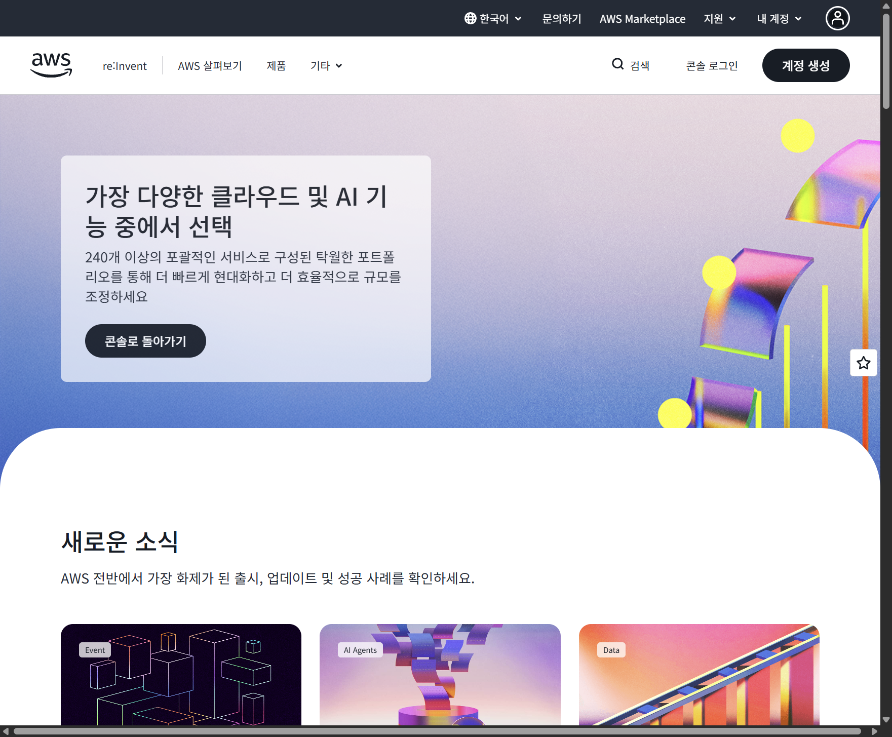

현재는 AWS 상품·서비스를 소개하는 공개 홈페이지다. 사이트를 보고 있다는 사실만으로 실습 계정의 관리자 세션이 되는 것은 아니다. 기존 로그인 쿠키 때문에 ‘콘솔로 돌아가기’ 문구가 보일 수 있으나 그 문구만으로 돌아갈 계정·신원을 단정하지 않는다.

상단에서 실제로 확인한 요소:

- 내 계정: 계정 관련 이동 메뉴를 여는 버튼. 하위 메뉴는 아직 열어 확인하지 않았다.
- AWS Profile: 사람 모양의 프로필 버튼. 하위 내용을 확인하기 전 로그인 신원·계정 연결을 단정하지 않는다.
- 콘솔 로그인: AWS 관리 콘솔 접근 경로로 이어지는 링크. 클릭 뒤의 화면에 따라 인증과 세션 선택을 다시 확인한다.
- 계정 생성: 신규 계정 생성용 버튼. 기존 프로젝트 접근을 배우는 단계이므로 누르지 않는다.

### 다음 행동과 학습 질문

먼저 상단 내 계정 메뉴를 연다. 실제 표시되는 메뉴를 보고 ‘서비스 소개 사이트의 메뉴’, ‘리소스를 관리하는 콘솔’, ‘개인 신원 인증’, ‘조직 계정의 역할 선택’ 중 어느 층으로 이동하는지 설명한다. 아직 메뉴 내용을 미리 가정하거나 IAM·root·Builder ID 중 하나로 로그인 완료했다고 기록하지 않는다.


## 2. ‘내 계정’ 메뉴는 로그인 신원 목록이 아니다

사용자가 내 계정을 누른 뒤 실제 메뉴와 각 링크 목적지를 확인했다.

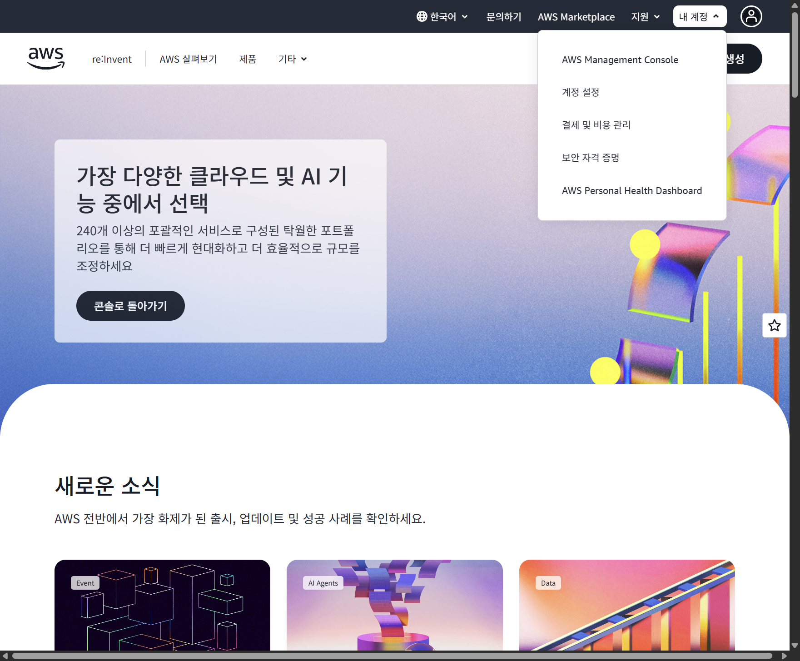

- **AWS Management Console**: EC2·VPC·IAM 등을 관리할 콘솔의 입구. 실제 링크는 console.aws.amazon.com이다.
- **계정 설정**: AWS 계정의 설정 화면. 링크는 console.aws.amazon.com/billing/home#/account이다. 이름만 보고 개인 Builder ID 프로필 설정이나 조직 전체 계정 선택기로 판단하면 안 된다.
- **결제 및 비용 관리**: 콘솔의 비용·결제 화면. 현재 로그인 신원에 해당 권한이 없으면 볼 수 없다.
- **보안 자격 증명**: 링크는 콘솔의 IAM 화면이다. 로그인된 신원과 권한에 따라 보이는 내용·가능한 작업이 달라진다. 누르면 root로 승격되거나 잊은 IAM 암호가 표시되는 기능이 아니다.
- **AWS Personal Health Dashboard**: AWS Health 상태 정보 경로. 접근 범위는 인증·권한에 따른다.

### 이 단계의 핵심 원리

이 메뉴는 ‘어느 관리 화면으로 이동할지’를 고르는 목록이지 ‘어떤 사람·권한으로 로그인할지’를 고르는 목록이 아니다. 같은 링크도 로그인 상태에 따라 인증 화면·기존 세션 선택·현재 콘솔 화면으로 이어질 수 있다. 서비스 소개 홈페이지의 내 계정 메뉴와 콘솔 내부의 활성 세션 메뉴를 구분한다.

### 다음 행동

맨 위 AWS Management Console을 누르고 다음 화면을 관찰한다. 이 단계에서는 root·IAM·Builder ID 중 하나의 암호를 넣거나 새 계정을 만들거나 기존 세션을 로그아웃하지 않는다. 실제 도착 화면을 보고 어떤 신원으로 이어지는지 확인한다. Builder ID 입구는 아직 이 메뉴에서 확인하지 않았으므로 있다고 추측하지 않는다.


## 3. 콘솔 입구 다음은 ‘현재 활성 세션 선택’ 화면이었다

사용자가 AWS Management Console을 눌러 새 탭에 Choose AWS sessions 화면이 열렸다. 이 화면은 새 계정을 만드는 페이지도, 암호를 바로 입력하는 페이지도 아니다. 현재 브라우저에 남아 있는 로그인 세션 중 어떤 신원으로 콘솔에 들어갈지 고른다.

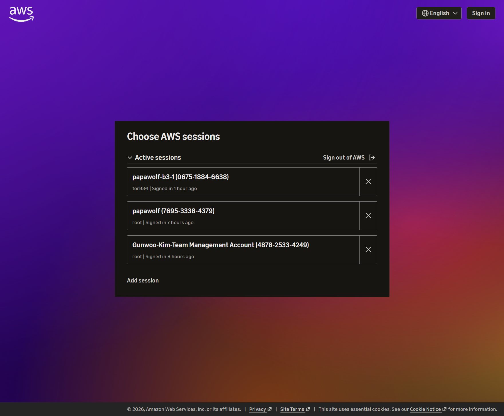

확인한 실제 항목:

1. papawolf-b3-1 / 067518846638 / forB3-1 / 1시간 전 로그인. 실습 계정 안의 최소권한 IAM 사용자 세션이다.
2. papawolf / 769533384379 / root / 7시간 전 로그인. 실습 계정과 별도인 AWS 계정의 root 세션이다.
3. Gunwoo-Kim-Team Management Account / 487825334249 / root / 8시간 전 로그인. 실습 멤버계정과 별도인 조직 관리계정의 root 세션이다.

### 여기서 구분할 개념

- 한 사람의 같은 브라우저가 여러 AWS 계정·신원의 세션을 동시에 보관할 수 있다.
- AWS 계정의 이름과 그 안의 사용자 종류(root/IAM)는 다른 항목이다.
- Signed in N hours ago는 로그인한 지 지난 시간이지 남은 유효기간이 아니다.
- 이 화면에는 이번에 필요한 실습 AccountFullAccessRole 세션이 표시되지 않는다. 다른 계정의 root를 누른다고 실습 계정 관리자 역할로 전환되는 것은 아니다.
- Add session은 추가 신원으로 로그인하는 진입점이며 신규 AWS 계정 생성과 다르다.

다음 사용자 행동은 Add session을 눌러 어떤 로그인 화면으로 이어지는지 관찰하는 것이다. 이후 화면의 실제 선택지를 확인하기 전 root/IAM/Builder ID 입구가 모두 존재한다고 가정하지 않는다. 기존 세션을 로그아웃하거나 정책·보안 그룹을 바꾸지 않는다.


## 4. Add session의 실제 결과: IAM 사용자 로그인 화면

사용자가 Add session을 누른 뒤 IAM user sign in 화면을 확인했다. 계정 별칭 papawolf-b3-1이 채워져 있고 IAM username·Password는 비어 있다. root 이메일 로그인으로 전환하는 버튼과 신규 계정 생성 버튼도 있으나 Builder ID 로그인 선택지는 이 화면에 표시되지 않는다.

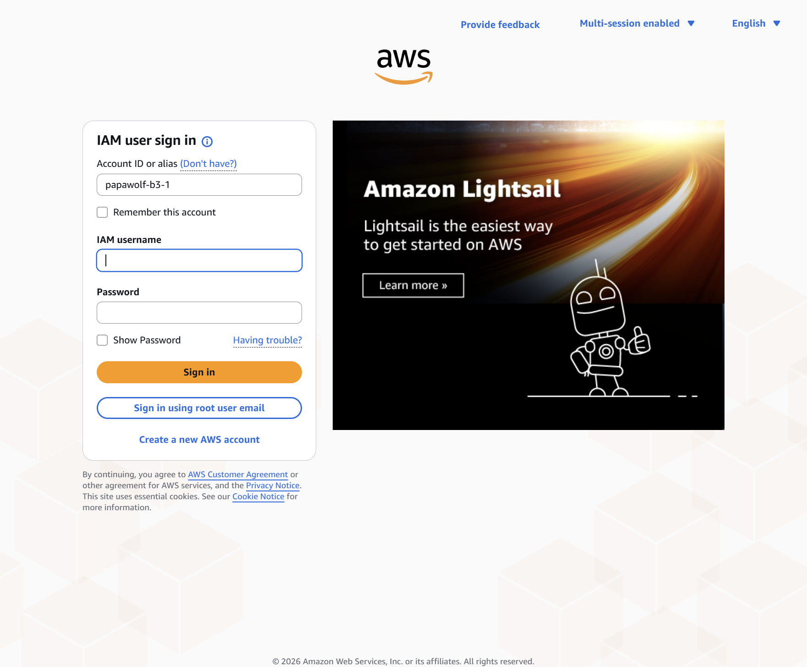

### 입력칸이 뜻하는 것

- Account ID or alias: 어느 AWS 계정 안에 있는 사용자인지 지정한다.
- IAM username: 그 계정 내부의 IAM 사용자 이름이다. 우리 과제용 사용자는 forB3-1이다.
- Password: 그 IAM 사용자의 콘솔 암호이며 Builder ID·root 암호와 다른 인증 체계다.
- Sign in using root user email: root 로그인 입구로 전환하는 기능이다. 사용자 권한을 root로 승격하는 기능이 아니며 이번 기존 관리자 역할 경로를 찾기 위해 누르지 않는다.

### 이 경로에서 무엇을 배웠나?

홈페이지 → 내 계정 → AWS Management Console → 세션 선택 → Add session으로 이동하니, 현재 환경에서는 IAM 로그인으로 이어졌다. ‘추가 세션’ 버튼이 곧바로 기존 조직 관리자 역할이나 Builder ID 포털을 찾아주는 것은 아니다. forB3-1을 다시 입력하면 같은 최소권한 신원으로 로그인하는 것이지 별도 관리자 역할이 생기지 않는다.

현재 목표는 잊은 IAM 암호 복구가 아니라 기존 중앙 인증·관리자 역할의 입구를 홈페이지 UI부터 이해하는 것이다. 따라서 여기서는 아무 암호도 입력하지 않는다. 다음 학습은 남아 있는 공식 홈페이지 탭으로 돌아가 상단 사람 모양 AWS Profile 메뉴를 열어, 별도 개인 프로필·인증 경로가 실제로 어떻게 표시되는지 확인하는 것이다. 그 메뉴가 Builder ID나 프로젝트에 직접 이어지는지는 아직 클릭 결과를 확인하지 않았으므로 단정하지 않는다.

학습 시작 이후 홈페이지 0158, 내 계정 메뉴 0159, 활성 세션 0160, IAM 로그인 0161을 각각 저장했다. 이후에도 사용자 조작 결과를 확인하며 단계별로 캡처하되 암호·코드·개인키 등 민감 정보는 제외한다.


## 5. 별도 입구: 홈페이지의 AWS Profile 메뉴

사용자가 홈페이지 탭으로 돌아가 사람 모양 AWS Profile을 눌렀다. 실제 메뉴에는 ‘AWS 프로필’, ‘프로필을 통해 일부 AWS 경험과의 상호 작용을 개선할 수 있습니다’, ‘프로필 생성 또는 로그인’ 버튼이 표시된다.

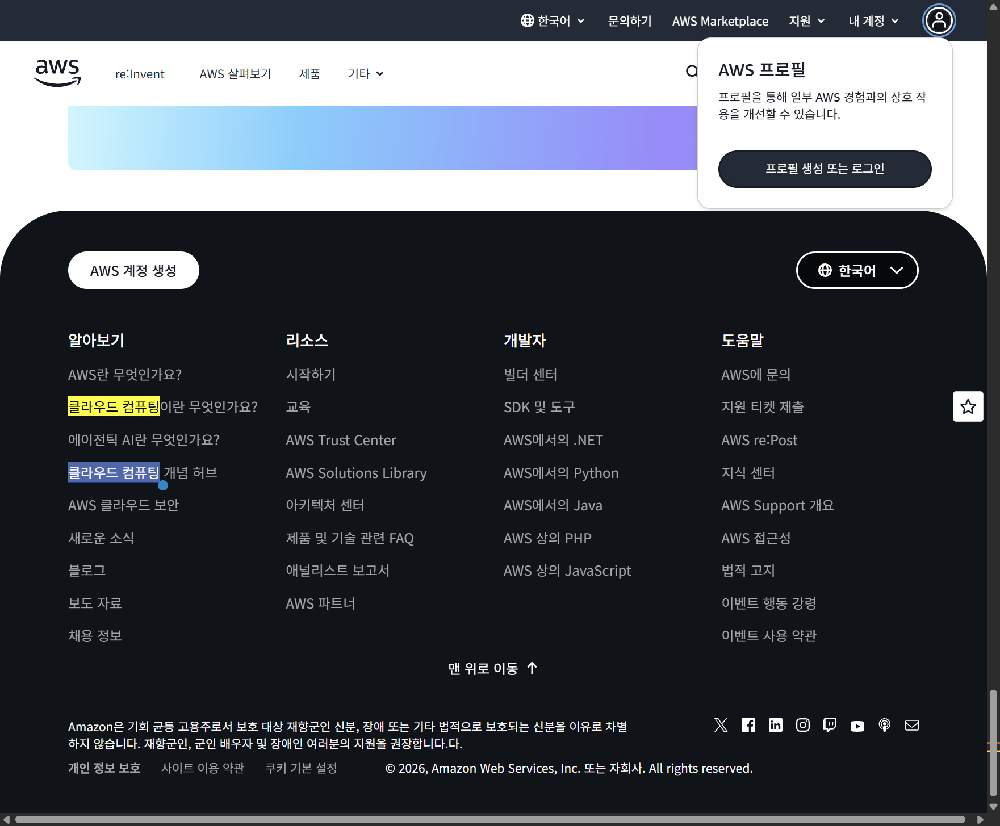

앞의 내 계정 메뉴가 콘솔·결제·IAM 화면의 바로가기였다면 이 메뉴는 AWS 프로필의 생성·인증 입구다. 이 화면만으로 Builder ID와 동일한 계정이라고 하거나 조직의 관리자 역할로 직행한다고 단정하지 않는다. ‘프로필 로그인’과 ‘AWS 계정 내 관리자 권한’을 별개로 살핀다.

다음은 프로필 생성 또는 로그인 버튼을 눌러 실제 인증 선택지를 관찰하는 것이다. 버튼에 생성과 로그인이 함께 적혀 있지만 기존 신원으로 로그인하는 흐름을 찾을 것이며, 새로운 계정·프로필 가입이 필요한 것으로 미리 판단하지 않는다. 암호·인증 코드는 아직 입력하지 않는다.


## 6. 개인 프로필 로그인 상태 확인: 아직 관리자 역할은 아님

사용자가 프로필 생성 또는 로그인 단계 진행 후 완료를 보고했다. 홈페이지의 프로필 아이콘이 사람 모양에서 이니셜 G로 바뀐 것을 확인했다. 메뉴는 일반 클릭 후 변화가 명확하지 않아 전체 snapshot과 화면을 확인했고, 같은 프로필 버튼의 Enter 조작 뒤 이름·AWS 프로필 보기·로그아웃이 표시되는 것을 확인했다.

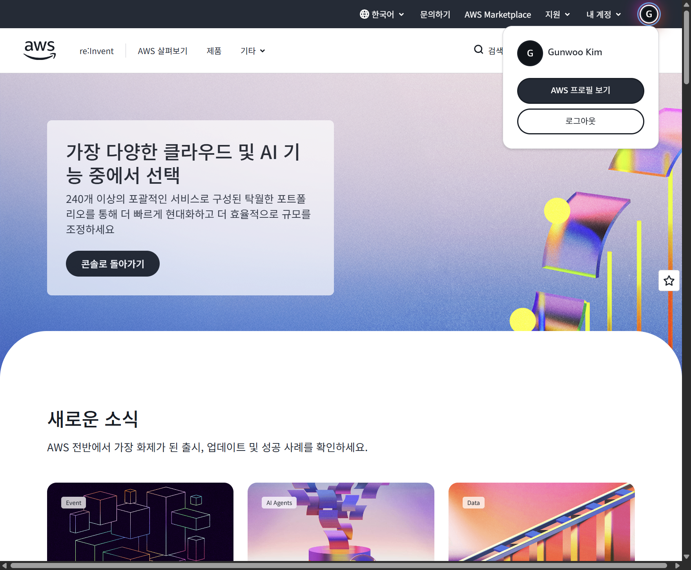

현재 확인된 것은 홈페이지 개인 프로필이 로그인된 상태라는 사실이다. 인증 과정 자체는 관찰하지 않아 새로 암호를 입력한 것인지 기존 세션이 재사용된 것인지는 단정하지 않는다. 아직 이 메뉴만으로 AWS Profile과 Builder ID의 연결 관계나 조직 관리자 권한 획득까지 확정하지 않는다.

AWS 프로필 보기의 실제 링크 목적지는 https://aws.amazon.com/profile 이다. 다음은 사용자가 이 링크를 눌러 개인 프로필 페이지에서 어떤 기능·연결 경로가 제공되는지 관찰하는 것이다. 로그아웃 버튼은 누르지 않고 root·IAM 정책·보안 그룹은 변경하지 않는다.

### 비교 포인트

- 콘솔 세션 목록: AWS 계정 ID와 root/IAM 같은 신원이 표시됐다.
- 현재 홈페이지 프로필 메뉴: 개인의 이름과 프로필 보기·로그아웃이 표시된다.

같은 사람 이름이 보이더라도 같은 권한 화면이 아니다. 개인 신원 인증과 특정 AWS 계정에서 역할 권한을 사용하는 단계를 계속 구분한다.


## 7. 프로필 본문에서 Builder ID 연결 근거를 확인

AWS 프로필 보기 클릭 후 My profile 페이지 https://aws.amazon.com/ko/profile 에 도착했다. 본문에는 공개 프로필·이름·이메일·관심사·직장 정보 등이 있고, 이메일 영역의 제목은 **AWS Builder ID 이메일**이다. 바로 아래에 ‘로그인하고 다양한 AWS 경험에 액세스하는 데 사용하는 이메일 주소입니다’라고 설명한다. 따라서 앞서 미확인이었던 개인 프로필과 Builder ID의 연결을 실제 화면 문구로 확인했다.

이메일이 화면 밖에 있어 설명과 함께 캡처하기 위해 왼쪽 이메일 항목 링크를 눌러 #emails 영역으로 이동했다. 개인 이메일 주소가 나오는 두 요소를 불투명하게 가린 이미지로 저장했다. 개인 이메일 전체 주소는 이 문서에 기록하지 않는다.

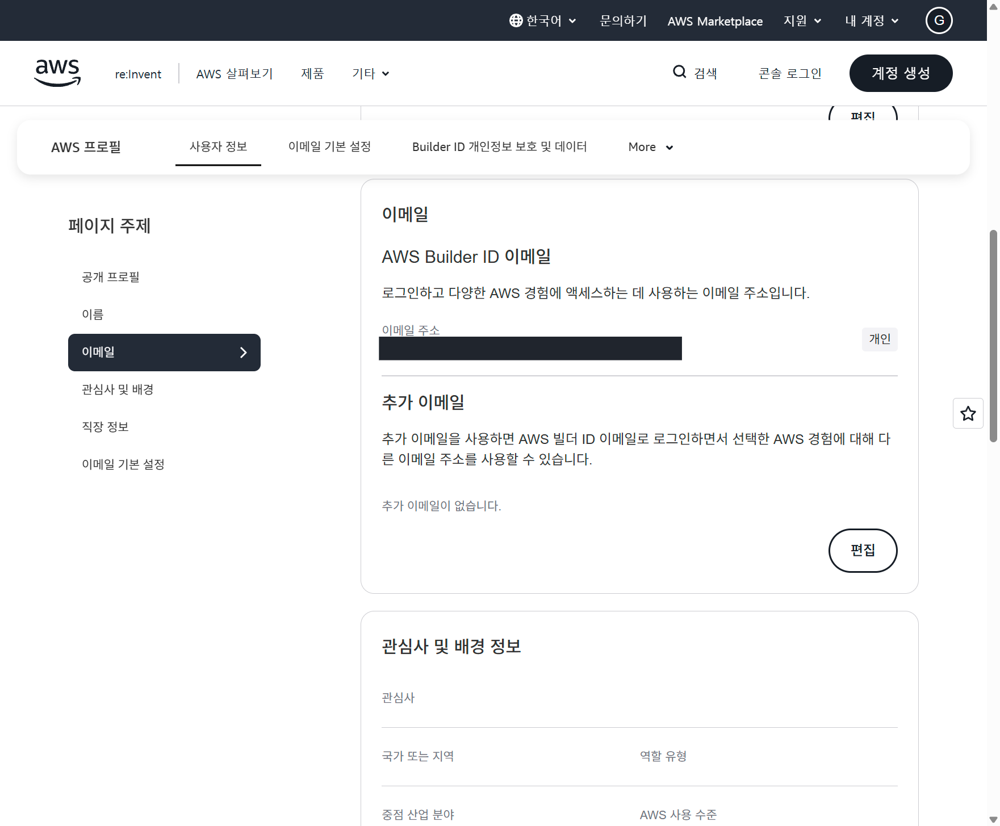

### 지금 확인한 관계와 아직 확인하지 않은 관계

- 확인: 홈페이지 사람 모양 → 프로필 생성 또는 로그인 → 개인 프로필 보기 → Builder ID 이메일 표시.
- 확인: 이 페이지의 주된 기능은 개인 프로필·연락처·관심사 등의 관리다.
- 미확인: 이 페이지에서 우리 조직의 기존 포털·Sunrise Sprint 관리자 역할로 직접 이어지는 UI 링크. 개인 프로필에 로그인한 사실만으로 그 역할을 얻었다고 말하지 않는다.

즉 Builder ID는 개인의 로그인 신원이고, AWS 계정은 실습 자원이 들어 있는 공간이며, 역할은 그 공간에서 사용할 권한이다. 화면에서 개인 프로필을 확인한 것과 실습 계정의 관리자 콘솔에 들어가는 단계를 구분한다.

다음은 상단 More 메뉴를 열어 추가 기능이 실제로 무엇인지 확인하는 것이다. 프로젝트·계정 접근 메뉴가 존재한다고 미리 가정하지 않고, 프로필 편집·가입·권한 변경도 하지 않는다.


## 8. More 메뉴의 실제 결과: AWS 프로필 소개 한 항목

사용자가 More를 누른 뒤 표시된 항목은 AWS 프로필 소개 하나였다. 실제 링크는 /ko/profile/about이다. 이 메뉴에서는 프로젝트·AWS 계정 목록·조직 포털·실습 관리자 역할 선택 항목을 확인하지 못했다.


이를 ‘Builder ID 인증이 실패했다’거나 ‘실습 계정이 없다’는 뜻으로 해석하면 안 된다. 개인 프로필 관리 페이지와 조직이 별도로 제공하는 접근 포털은 기능이 다르다. Builder ID로 본인 인증을 할 수 있다는 것과 그 홈페이지가 모든 조직의 포털 링크·관리자 역할을 자동으로 모아 보여준다는 것은 별개의 주장이다. 현재 관찰한 메뉴에는 후자를 뒷받침하는 항목이 없다.

사용자의 목적은 빠른 해결보다 원리 이해이므로 다음은 AWS 프로필 소개를 열어 서비스가 설명하는 프로필의 범위·용도를 읽는 것이다. 소개 문서에서 관리자 입구를 찾을 수 있다고 미리 가정하지 않는다. 정책 변경·프로필 편집·신규 AWS 계정 생성은 보류한다.


## 9. 중요한 분기 발견: 세션 화면 상단 Sign in은 통합 로그인으로 이어짐

사용자가 홈페이지 오른쪽 위 콘솔 로그인을 누른 뒤 앞서 본 세션 3개 목록으로 돌아왔다. 이 화면을 0166으로 캡처했다. 이번에는 Add session을 반복하지 않고, 상단 Sign in 링크의 실제 목적지를 확인한 뒤 클릭했다.

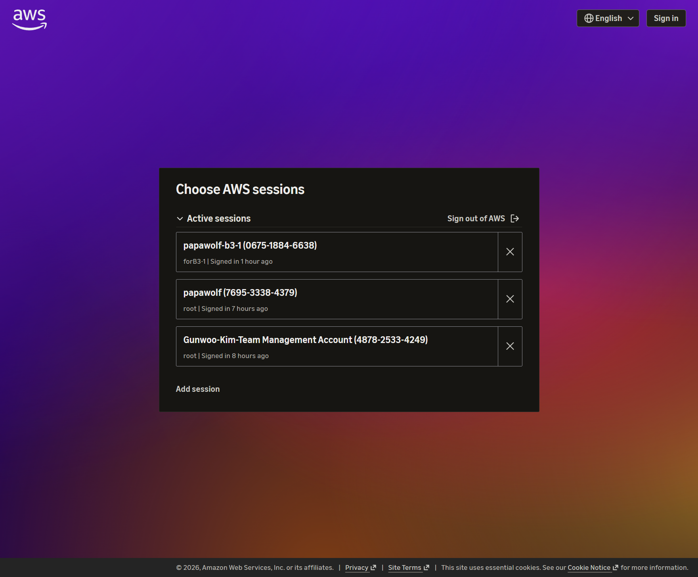

**실제 결과가 달랐다.** Add session에서 관찰한 화면은 IAM user sign in과 계정 별칭·사용자 이름·암호 칸이었다. 반면 상단 Sign in을 클릭한 뒤에는 Sign in to AWS라는 통합 로그인 화면이 나왔다.

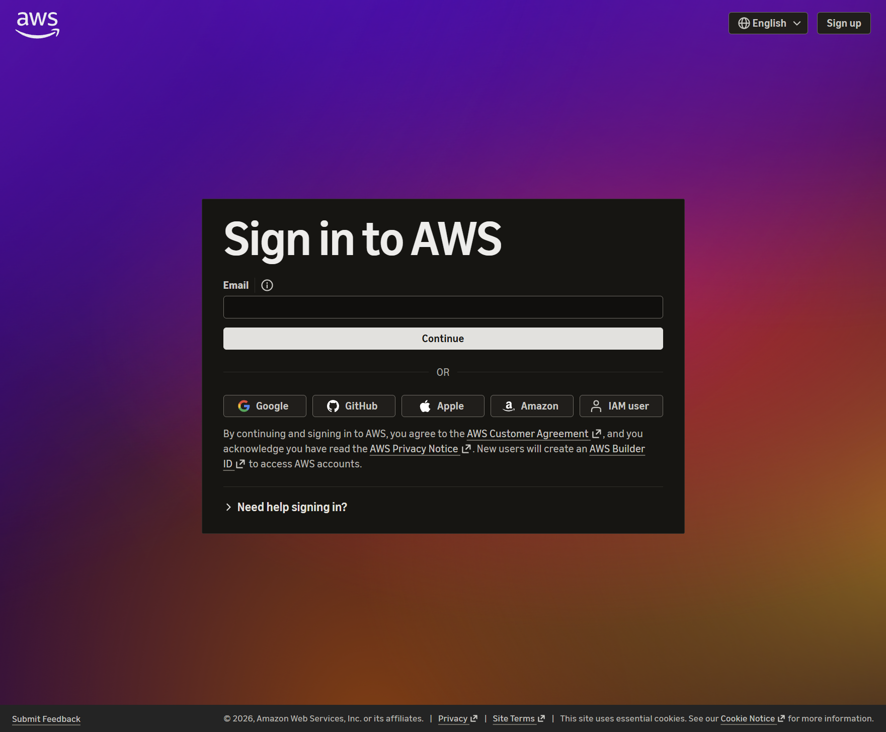

현재 화면에서 확인한 항목:

- Email / Continue.
- Google / GitHub / Apple / Amazon 버튼.
- 별도 IAM user 버튼.
- ‘New users will create an AWS Builder ID to access AWS accounts.’ 안내.
- 도움말에는 회사·조직의 IAM Identity Center 또는 IAM federation 이용자는 자신의 접근 포털·연동 URL에서 로그인해야 한다고 명시한다.

### 여기서 바로잡는 이해

1. **이메일을 입력하는 모든 AWS 로그인 화면이 root 로그인인 것은 아니다.** 현재 페이지는 Builder ID 안내를 포함하는 통합 로그인 입구다. 이후 어떤 계정·신원 선택으로 연결되는지 실제 결과를 확인해야 한다.
2. IAM user가 따로 있으므로 forB3-1은 그 경로이며 개인 Builder ID 이메일과 혼동하지 않는다.
3. 이 환경에서 Add session과 상단 Sign in이 서로 다른 화면으로 이어지는 것을 관찰했다. 모든 환경·미래 UI에서도 항상 다르다고 일반화하지 않는다.
4. 개인 프로필 탐색은 Builder ID 연결을 이해하는 데 도움이 됐지만 관리자 콘솔 로그인에 필수인 경로로 확인된 것은 아니다. 이를 관리자 입구로 이어질 것처럼 길게 안내한 것은 Aside의 과도한 추측이었다.
5. 통합 로그인에서도 모든 회사의 포털을 자동 발견한다고 보장하지 않는다. 조직용 접근 포털이 별도로 필요한 경우가 있다는 화면 안내를 보존한다.

### 다음 행동

이 화면의 Email에 앞서 AWS 프로필에서 확인한 **기존 Builder ID 이메일**을 사용자가 입력하고 Continue를 누른다. IAM user·Sign up은 누르지 않고, 실제로 기존 사용자 암호·신원 선택·포털 안내 중 무엇이 나오는지 확인한다. 신규 사용자 이름 입력이나 가입 동의가 나오면 자동 진행하지 않는다. 새 인증 시도나 계정 연결·관리자 역할 진입 성공은 아직 확인하지 않았다.


## 10. 결정적 화면: 같은 이메일에도 Builder ID와 root가 별개임

사용자가 기존 Builder ID 이메일을 입력하고 진행한 뒤 How would you like to sign in? 화면을 확인했다. 실제 안내는 ‘이 이메일은 여러 방법으로 로그인할 수 있고, 각 방법은 서로 다른 AWS 계정에 접근한다’는 뜻이다. 버튼은 다음 두 개다.

- Sign in with Builder ID.
- Sign in with root user.

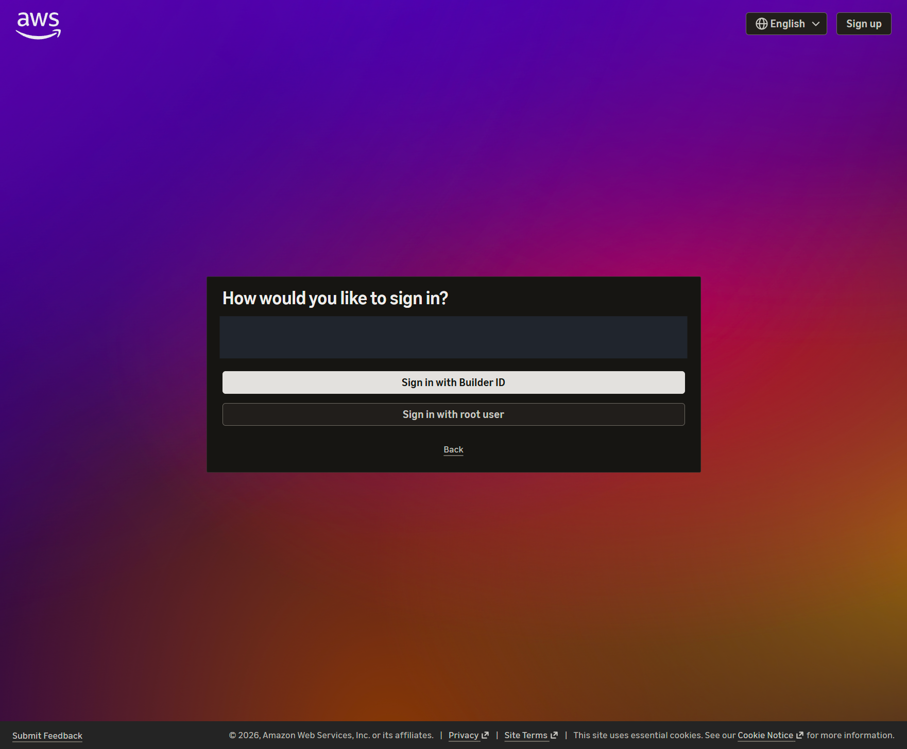

이 캡처는 개인 이메일이 포함된 문구 영역을 보호했다. 위 설명은 실제 snapshot에서 읽은 안내의 의미이며 보호 이미지가 동일 문장을 전부 보여준다고 주장하지 않는다.

### 이번 사건을 이해하는 핵심

‘이메일 주소가 맞다’는 것만으로 ‘올바른 AWS 계정·올바른 신원으로 들어간다’가 결정되지 않는다. **이메일 + 로그인 방식**이 다르면 접근 가능한 AWS 계정이 달라질 수 있다는 것을 이 화면이 직접 설명한다. 앞선 복구 과정에서 같은 이메일을 root 입구에 넣고 다른 계정으로 들어간 혼선과 연결된다.

개인 프로필에서 Builder ID 이메일을 확인했지만, 그 주소가 특정 실습 계정의 root 이메일이라는 뜻은 아니다. root는 특정 AWS 계정의 최상위 신원이고 Builder ID는 개인 신원이다. 중앙 인증을 통해 실습 관리자 역할에 접근했던 기존 경로를 살피려면 지금은 **Sign in with Builder ID**를 선택한다. root 버튼으로 ‘더 강한 같은 사용자’가 되는 구조라고 이해하지 않는다.

### 확인 범위와 다음 행동

두 로그인 방식 분기를 확인했을 뿐 아직 Builder ID 인증·계정 목록·실습 관리자 역할 진입을 완료하지 않았다. 다음은 사용자가 Builder ID 버튼을 누르고 실제 이어지는 화면을 확인하는 것이다. 가입·새 계정 생성·권한 변경은 하지 않으며 비밀번호·코드는 사용자만 입력한다.


## 11. Builder ID 인증 후: 기존 세션과 새 계정 접근 목록이 함께 표시됨

사용자가 Builder ID로 들어왔다고 알린 뒤 현재 활성 탭을 확인했다. Choose AWS sessions로 돌아왔지만 **이전 화면과 달리** 상단 사용자 이름, Add session for Gunwoo Kim 버튼과 그 그룹 안의 세 계정이 새로 표시된다.

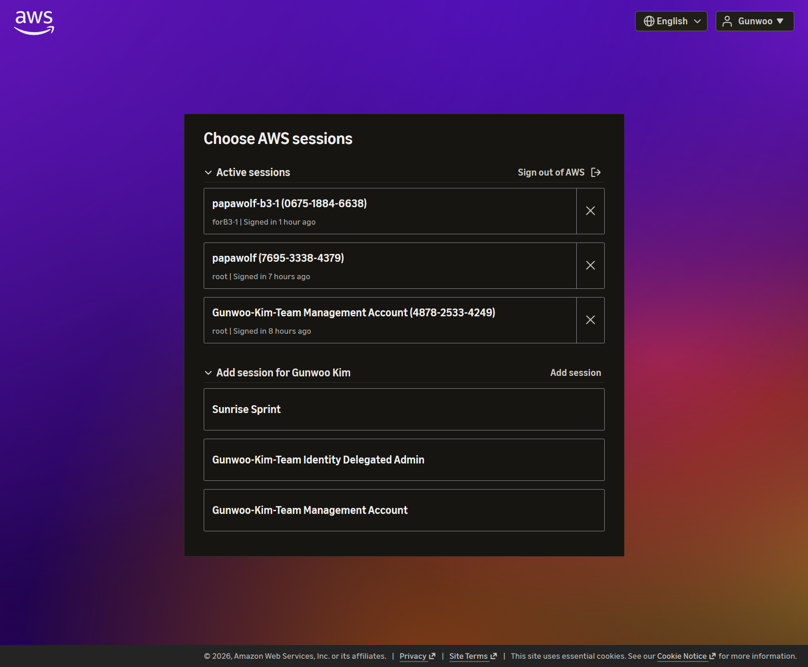

### 위쪽과 아래쪽은 다른 목록

위쪽 Active sessions는 기존 forB3-1·다른 계정 root·조직 관리계정 root 로그인 세션 세 개다. Builder ID 인증 전부터 보이던 목록이다.

아래쪽 Add session for 사용자 이름 그룹에는 다음 버튼이 보인다.

- Sunrise Sprint.
- Gunwoo-Kim-Team Identity Delegated Admin.
- Gunwoo-Kim-Team Management Account.

이는 기존 활성 세션 목록에 없는 계정 접근을 Builder ID 인증 뒤 선택할 수 있게 된 것을 보여준다. 과거에는 별도 account access 앱에서 확인했던 계정들이 이번에는 일반 콘솔 로그인 UI의 Builder ID 경로 뒤에서도 표시된다. 따라서 ‘콘솔 로그인으로는 기존 관리자 접근이 불가능하다’는 일반화는 잘못이다. **상단 Sign in → 이메일 → Builder ID 선택**이라는 실제 UI 분기가 중요했다.

### 원리와 다음 행동

Builder ID는 개인 인증이고, 그 인증 뒤 허용된 AWS 계정을 선택해 새로운 계정 세션으로 들어가는 것은 다음 단계다. 인증했다고 기존 forB3-1이 관리자 신원으로 바뀌거나 root가 되는 것은 아니다.

다음 사용자 행동은 위쪽 기존 forB3-1 세션이 아니라 **아래쪽 Sunrise Sprint 버튼**을 누르는 것이다. 실제 계정 ID와 역할은 다음 화면에서 확인한다. 아직 이 화면만으로 실습 관리자 역할 진입·정책 수정 완료를 주장하지 않는다.


## 12. 학습 마일스톤: 홈페이지 UI만 따라 실습 관리자 역할 진입

사용자가 Builder ID 인증 뒤 아래쪽 Sunrise Sprint를 누르자 같은 탭에서 실습 계정 콘솔 홈으로 진입했다. 별도 역할 선택 화면은 이번 경로에서는 나타나지 않았고, 도착한 콘솔 상단에서 실제 세션 신원을 확인했다.

- 계정 이름: Sunrise Sprint.
- 계정 ID: 067518846638.
- 신원: AccountFullAccessRole/74b8f4a8-b0d1-707f-7e20-d333fe265f89.
- 계정 별칭: papawolf-b3-1.
- 도착 시 리전: 시드니(ap-southeast-2).

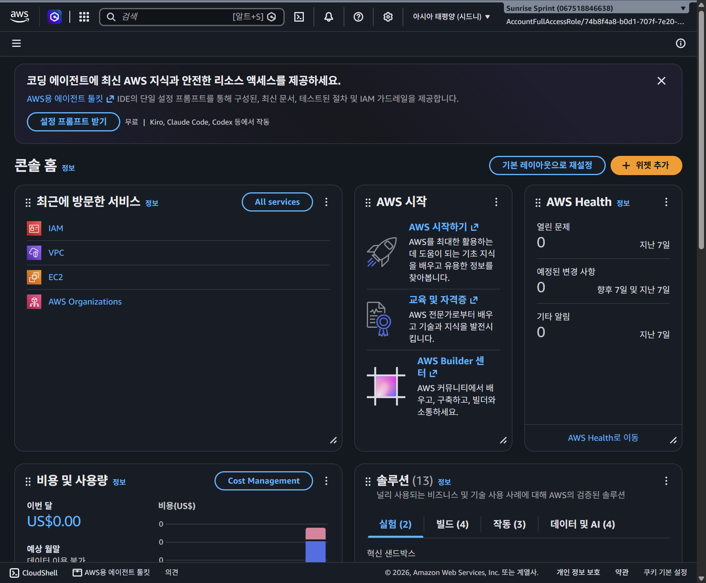

### 실제로 성공한 짧은 경로

```text
AWS 공식 홈페이지
  -> 오른쪽 위 콘솔 로그인
  -> 기존 세션 선택 화면의 상단 Sign in
  -> 기존 개인 이메일 입력 / Continue
  -> Sign in with Builder ID
  -> 인증 후 아래쪽 Sunrise Sprint
  -> 실습 계정의 AccountFullAccessRole 콘솔
```

내 계정 메뉴의 AWS Management Console도 콘솔 입구였지만, Add session으로 진행한 경로는 이번 환경에서 IAM 사용자 입력 화면으로 이어졌다. AWS Profile과 More 탐색은 개인 신원 정보를 확인하는 학습 분기였지 위 성공 경로의 필수 단계가 아니었다. 과거의 직접 조직 포털·account access 앱 경로만이 유일한 접근 방법이라고 설명해서는 안 된다.

### 가장 중요한 원리

- Builder ID는 개인 인증이다.
- 인증 뒤 접근할 AWS 계정은 별도로 선택한다.
- 선택한 계정에서 기존에 할당된 AccountFullAccessRole로 작업한다.
- root가 된 것도 아니고 forB3-1의 권한이 바뀐 것도 아니다.
- 사용자에게 이 역할 접근이 미리 할당되어 있었기 때문에 가능한 결과이며 모든 Builder ID 보유자가 관리자 권한을 얻는다는 뜻이 아니다.

### 다음 단계와 아직 하지 않은 일

현재 콘솔 표시 리전은 시드니다. 오른쪽 위 리전 메뉴에서 서울로 바꾸고 이후 IAM의 기존 forB3-1 연결 정책을 조회한다. 리전 전환은 콘솔의 조회·작업 위치를 고르는 것이지 이미 서울에 생성한 EC2를 시드니로 옮기는 것이 아니다. IAM 자체는 글로벌 서비스지만 EC2·보안 그룹 검토 실수 방지를 위해 서울 표시를 유지한다.

이 학습으로 관리자 역할 진입만 확인했고 IAM 정책·보안 그룹 규칙을 변경하지 않았다. 브라우저 SSH의 SendSSHPublicKey 실패는 아직 미해결이며, 최소 변경 전 현재 정책을 읽는 단계가 남았다. AWS 콘솔 비용 위젯의 현재 표시가 0이어도 과금 집계 지연이 있을 수 있어 전체 리소스 무료·비용 없음의 증거로 삼지 않는다.


## 13. 서울 관리자 세션 재확인, 다음은 IAM 조회

사용자가 리전을 변경한 뒤 활성 탭에서 아시아 태평양(서울), 계정 067518846638, AccountFullAccessRole 신원을 확인했다. 리전만 변경했으며 계정·역할은 유지된다.

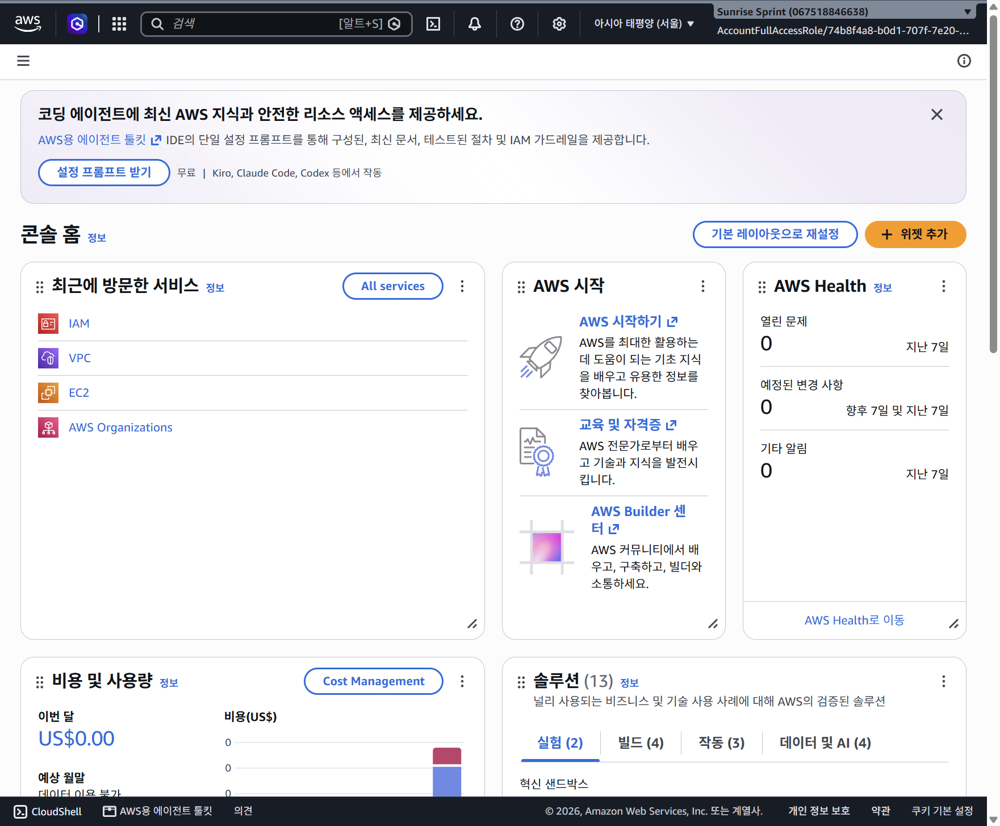

다음 사용자 행동은 최근에 방문한 서비스의 IAM을 누르는 것이다. IAM은 사용자·역할·정책 등 AWS 관리 작업 권한을 다루는 글로벌 서비스이고, EC2 OS 안의 사용자·SSH 키 설정을 다루는 화면은 아니다. 목표는 현재 forB3-1에 실제 연결된 정책을 먼저 읽고 브라우저 SSH 공개키 전송 권한 유무를 확인하는 것이다. 이 단계에서 관리자 역할을 forB3-1에 복사하거나 정책을 바로 편집하지 않는다. 기존 세션·EC2·보안 그룹은 유지한다.
