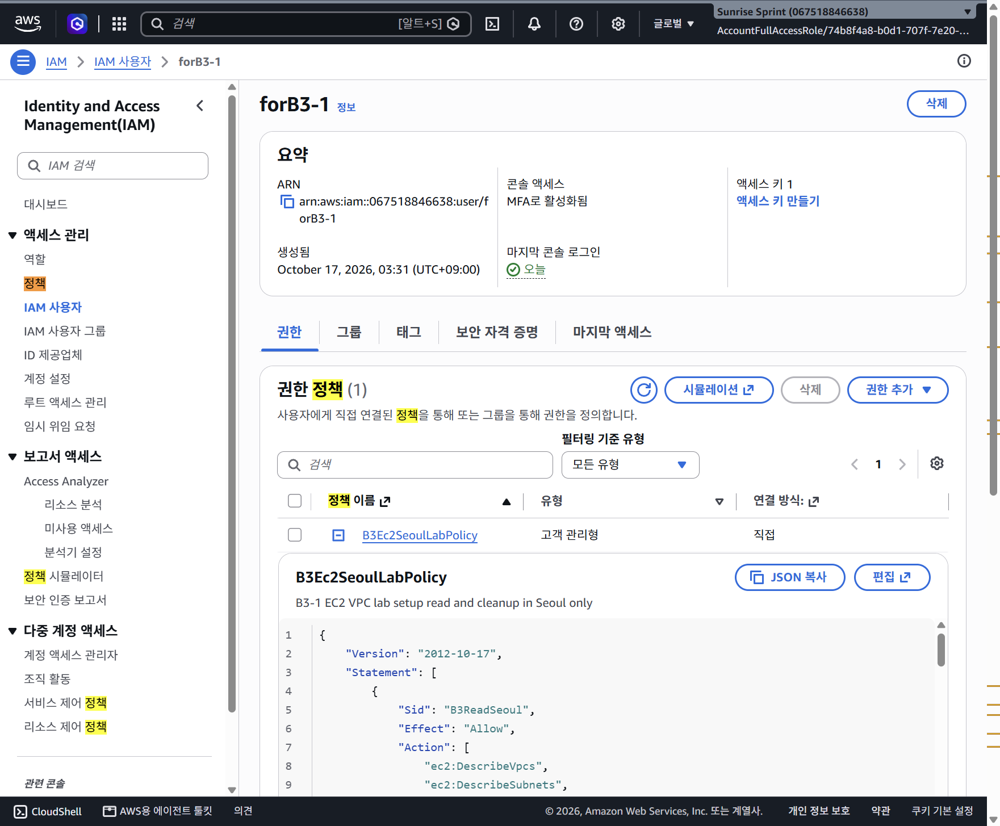

# 현재 IAM 정책을 읽고 브라우저 SSH 누락 권한 이해하기

[UI 로그인 학습](0029-aws-login-ui-from-home-쉬운설명.md) · [브라우저 SSH 증빙](0028-browser-ssh-troubleshooting.md)

## 1. 누구의 정책을 누가 보고 있나?

로그인 신원은 실습 계정의 AccountFullAccessRole이다. 화면에서 관리 대상으로 연 사용자는 forB3-1이다. 사용자 화면을 열었다고 forB3-1로 로그인한 것이 아니다. forB3-1에는 고객 관리형 B3Ec2SeoulLabPolicy 한 개가 직접 연결되어 있다.

미리 보기는 읽기 기능이다. 펼쳤다고 권한이 바뀌지 않는다. JSON은 권한 규칙을 구조적으로 적는 문서 형식이며, 이 문서에 없는 작업이 자동 허용되는 것은 아니다. 다른 정책·조직 제한도 실제 권한 평가에 영향을 줄 수 있다.

## 2. JSON의 핵심 네 항목

- **Effect**: Allow면 해당 조건의 작업을 허용한다. Deny는 명시적으로 거부한다. Allow가 있어도 상위 정책 등의 명시적 거부가 무효화되는 것은 아니다.
- **Action**: 무엇을 할 수 있는가. 예를 들어 ec2:RunInstances는 인스턴스 시작 작업이다.
- **Resource**: 어느 대상에 적용하는가. 계정·리전·리소스 종류·ID 등을 ARN으로 지정한다.
- **Condition**: 어떤 추가 조건에서 적용하는가. 현재 정책에는 요청 리전을 서울(ap-northeast-2)로 제한하는 조건이 있다.

Statement는 규칙 묶음이고 Sid는 그 묶음을 구분하는 이름표다. Sid 이름 자체가 권한을 부여하지 않는다. Version의 2012-10-17은 IAM 정책 언어 버전이며 마지막 수정일이 아니다.

## 3. 현재 실제 정책의 7개 묶음

- B3ReadSeoul: VPC·서브넷·보안 그룹·이미지·인스턴스·볼륨 등의 지정된 조회.
- B3NetworkSetup: VPC·서브넷·IGW·라우팅·보안 그룹 생성과 연결 등.
- B3NetworkCleanup: 실습 네트워크 자원 정리 작업.
- B3SshKeyLifecycle: EC2 키 페어 생성·삭제.
- B3LaunchInstance: EC2 인스턴스 시작.
- B3ComputeCleanup: 인스턴스 종료·볼륨 삭제.
- B3ResourceLabels: 허용된 자원에 Name·Project 태그를 붙이는 작업.

이것은 실제 연결 정책 미리 보기에서 읽은 내용이다. 7개 Statement 모두를 파싱해 보관본과 구조가 같은 것을 확인했다. 변경 전 전체 원본은 [JSON 백업](policies/b3-1-ec2-seoul-policy.before-browser-ssh.json)에 저장했다. 화면의 줄 번호를 제외하고 JSON으로 검증했으며 일부 보이는 줄만 보고 누락을 추측한 것이 아니다.

## 4. Resource가 *인데 관리자 권한인가?

그 자체로는 아니다. *는 대상 범위이며, Action의 허용 작업과 Condition을 함께 읽어야 한다. 일부 EC2 조회 작업은 개별 리소스 ARN 제한을 지원하지 않아 Resource에 *를 쓴다. 현재 읽기 규칙은 작업 이름을 나열하고 서울 조건을 둔다.

반대로 고객 관리형이라는 이름이나 정책 제목만 보고 안전하다고 할 수도 없다. 실제 Action·Resource·Condition이 중요하다. 현재 확인한 정책은 Action 전체 *나 ec2:*를 부여하지 않고 명시적인 EC2 작업만 나열한다. 다만 자원 ARN의 종류별 *도 범위가 있다는 뜻이므로 ‘모든 기존 규칙이 특정 실습 자원 1개로만 제한된다’고 과장하지 않는다.

## 5. 왜 EC2 생성은 됐는데 브라우저 SSH는 실패했나?

실제 정책에는 ec2:RunInstances가 있어서 앞서 EC2 생성 요청이 성공했다. 하지만 브라우저 SSH가 임시 공개키를 보내는 작업은 **ec2-instance-connect:SendSSHPublicKey**다. 작업의 서비스 접두사부터 ec2와 ec2-instance-connect로 다르다.

현재 연결 정책에는 이 작업이 없다. ec2:CreateKeyPair·ec2:DescribeKeyPairs가 있다고 이 작업까지 자동 허용되는 것도 아니다. 이 누락은 정책 전체를 읽고 확인했다. 연결 화면의 별도 경고에 해당하는 ec2:DescribeAddresses도 없다. 후자는 조회 작업으로, 공개키 전송 작업과 구분한다.

따라서 ‘EC2를 관리할 수 있다면 모든 접속 방법도 된다’는 가정은 틀리다. 필요한 동작을 별도 권한으로 나눈 것이 최소권한의 의미다. 화면의 일반 SendSSHPublicKey 실패 문구에 대한 모든 가능한 원인을 다 배제한 것은 아니며, 정책 누락부터 해결·검증해야 한다.

## 6. PowerShell SSH는 왜 성공했나?

로컬 SSH는 이미 생성 때 등록된 공개키와 PC의 개인키를 사용해 Linux에 인증했다. 브라우저 SSH는 임시 키 전송이라는 AWS API 호출이 추가로 필요하다. 같은 서버·같은 ec2-user라도 접속 방식에 따라 필요한 IAM 작업과 네트워크 출발지가 달라진다.

세 가지 문을 구분한다.

1. **IAM**: AWS API로 임시 키를 보낼 수 있는가?
2. **보안 그룹·라우팅**: 실제 SSH 패킷이 서버에 도달하는가?
3. **Linux SSH 인증**: 사용자·키·서버 설정이 맞는가?

한 문을 통과했다고 다른 문도 자동으로 통과하지 않는다. 그래서 IAM만 추가하면 무조건 해결된다고 약속하지 않는다.

## 7. 변경할 때의 최소 범위 계획

검토할 키 전송 권한은 전체 계정의 모든 서버가 아니라 **현재 실습 인스턴스 1대**, OS 사용자 **ec2-user**, 리전 **서울**로 제한한다. forB3-1의 IAM 정책에 필요한 권한이지 EC2의 인스턴스 프로파일에 관리자 권한을 붙이는 작업이 아니다.

네트워크에서는 기존 개인 IP /32를 유지하고 서울 Instance Connect 서비스 대역의 SSH만 추가하는 방안을 별도로 확인한다. AdministratorAccess·EC2 전체 권한·SSH 전체 공개는 필요하지 않다. 사용자 확인과 실제 저장 결과 검증 전에는 변경 완료로 기록하지 않는다.

## 8. 현재 상태

초기 정책 전체 확인·원본 백업 후, 사용자 입력 JSON 전체가 최소 변경안과 일치함을 대조했다. 사용자가 저장했고 AWS 업데이트 성공 알림 및 버전 2 기본값을 확인했다. 현재 정책은 기존 7개 규칙에 인스턴스 1대·ec2-user·서울 범위의 키 전송 규칙을 추가한 8개 Statement다. 기존 서울 읽기 규칙에는 선택 보완인 ec2:DescribeAddresses를 추가했다. 변경 전 원본은 백업 JSON과 IAM 버전 1에 남아 있다. 현재 보관 정책 b3-1-ec2-seoul-policy.json도 이 변경 내용으로 갱신했다. 보안 그룹은 변경하지 않았으며 forB3-1 신원에서 브라우저 SSH 재접속·성공 검증은 아직 하지 않았다. 상세한 저장·버전 증빙은 브라우저 SSH 문서의 20절을 참고한다.

공식 근거: [EC2 Instance Connect IAM 권한](https://docs.aws.amazon.com/AWSEC2/latest/UserGuide/ec2-instance-connect-configure-IAM-role.html), [브라우저 SSH 네트워크 조건](https://docs.aws.amazon.com/AWSEC2/latest/UserGuide/ec2-instance-connect-prerequisites.html).
