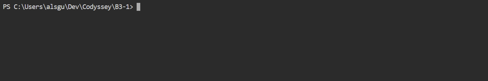

# Aside에서 내 PC의 웹 터미널 열기

## 실행 결과

사용자 요청으로 공식 ttyd 1.7.7 Windows 배포 파일을 받아 실행했다. 공식 SHA256SUMS와 실제 파일 SHA-256이 일치하는 것을 확인한 뒤 실행했다. 설치 프로그램·PATH 변경·Docker 시작·AWS 설정 변경은 하지 않았다. Windows PowerShell 7을 자식 프로세스로 사용하며 현재 작업 폴더는 B3-1 프로젝트다.

- 접속 주소: http://127.0.0.1:7681/
- 실제 바인딩: 127.0.0.1:7681만 LISTEN, HTTP 200 확인
- 웹소켓 다른 Origin 연결 거부(-O), 동시 연결 최대 1개(-m 1), 입력 허용(-W)
- 현재 서버 프로세스 PID: 68240. 재실행하면 달라질 수 있다.
- 런타임 작업 세션: 1000. PC 재부팅 후 자동 실행되도록 등록하지 않았다.

## 지금 화면은 어디인가?

Aside는 터미널 화면을 보여주고 ttyd와 PowerShell은 내 Windows PC에서 실행된다. 화면의 PS 프롬프트는 아직 EC2가 아니라 내 PC다. 앞으로 여기서 로컬 ssh 명령을 실행하면 같은 인터넷 경로에서는 직접 PowerShell SSH와 같은 PC 출발지 경로를 쓸 수 있다. 현재 EC2 SSH 접속·공인 IP 일치·서버 명령 실행을 새로 검증한 것은 아니다. 개인키를 웹 서비스에 업로드하지 않았다.

## 보안과 종료

루프백 주소만 사용하므로 공유기 포트 개방·방화벽 인바운드 추가는 하지 않았다. 인증 없는 개인 PC 전용 개발 터미널이므로 공용 PC·외부 공개·역방향 프록시·0.0.0.0 바인딩으로 확장하지 않는다. 사용 후 ttyd 서버를 종료해야 하며 브라우저 탭을 닫는 것만으로 서버가 종료되지는 않는다. 서버 종료를 요청하면 현재 포트와 실행 파일·PID를 다시 확인한 뒤 해당 프로세스만 중지한다. 터미널에서 exit를 입력하면 현재 PowerShell 세션이 종료되지만 ttyd 서버 자체가 종료된다고 단정하지 않는다.

AWS의 기존 EC2 Instance Connect IAM 권한은 별개이며 이번 작업에서 변경하지 않았다. 이전 보안 그룹 편집안의 저장·취소 여부 역시 이번 작업에서 조작하지 않았다. 로컬 SSH 사용에는 AWS Instance Connect 서비스 CIDR 허용이 필요하지 않다. 실제 EC2 SSH 접속은 다음 사용자 단계에서 진행한다.

## 배포 출처 및 무결성

- 공식 릴리스: https://github.com/tsl0922/ttyd/releases/tag/1.7.7
- 파일: ttyd.win32.exe, 1,409,024 bytes
- SHA-256: e33a27501b10b96981335bcba938b1145c7f52551a343e72160f00ab71832b37
- 이번 세션 artifacts의 ttyd-1.7.7.exe 및 ttyd-1.7.7-SHA256SUMS.txt에 배포본과 목록을 보관했다.

처음 다운로드에서는 GitHub API의 자산 메타데이터 URL을 실행 파일 URL로 잘못 선택해 파일 크기·해시 검증이 실패했다. 해당 파일은 실행하지 않고 실제 browser_download_url로 다시 받아 실행 파일 헤더·크기·공식 체크섬을 검증한 뒤에만 실행했다. Docker는 설치되어 있지만 엔진이 실행 중이 아니어서 사용하지 않았고 Windows 네이티브 배포본을 사용했다.

## 중복 탭 접속 문제와 해결

사용자가 별도 탭으로 같은 주소를 열자 ‘Press Enter to Reconnect’만 표시됐다. 동시 접속 제한 -m 1에서 assistant가 먼저 연 탭이 이미 연결을 사용 중인 상황이었다. assistant가 먼저 연 비활성 중복 탭만 닫고 사용자의 활성 탭에서 Enter로 재연결했다. ‘Reconnecting...’을 거쳐 실제 로컬 PowerShell 프롬프트가 다시 표시되는 것을 캡처로 확인했다. 제한을 풀거나 외부 접속을 허용하지 않았다. 향후에는 이 웹 터미널을 탭 한 개에서 사용한다.
