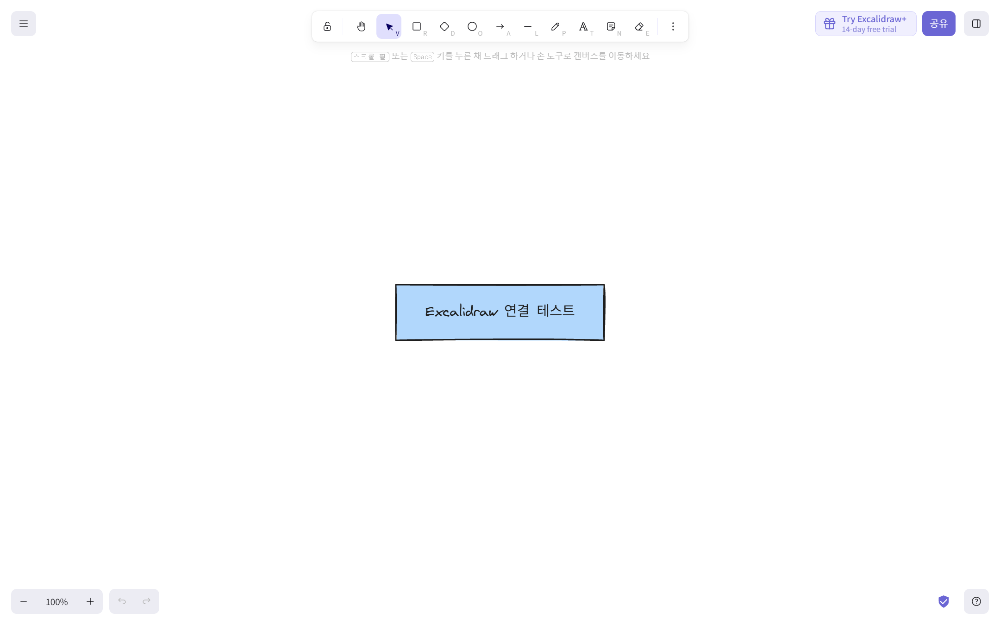

# Excalidraw MCP 설치와 연결 시험

## 결과

공식 Excalidraw MCP 0.3.2 사전 빌드 배포본을 계정 전용 tools 폴더에 설치하고 Aside의 excalidraw MCP 항목으로 연결했다. 실제 도구 5개(read_me, create_view, export_to_excalidraw, save_checkpoint, read_checkpoint)가 자동 검색되어 inventory에 등록된 것을 확인했다. 도구 목록을 수동으로 위조해 넣지 않았다. 계정의 기존 MCP 서버·inventory는 초기 확인 당시 비어 있었으며 다른 설정·AWS·권한은 변경하지 않았다.

별도 일반 Aside 시험 세션 xx8qxJxH0dHUWN6v에서 실제 mcp__excalidraw__read_me, mcp__excalidraw__create_view, mcp__excalidraw__export_to_excalidraw 호출이 성공했다. Excalidraw 연결 테스트라는 상자 하나를 만들고 공식 웹 편집기에 내보낸 그림이 표시되는 것을 시각적으로 확인했다. 이는 과제 최종 아키텍처 파일이 아니라 최소 연결 시험이다.

## 설치와 보관

- 공식 안내: https://github.com/excalidraw/excalidraw-mcp
- 공식 안내가 연결한 배포본: https://github.com/excalidraw/excalidraw-mcp/releases/download/v0.3.2/excalidraw-mcp-app.mcpb
- 공식 배포 SHA-256과 실제 다운로드 파일 해시 일치 확인: 2b494012b5fee5937f9f7b86f04a76cc4a91ec843ee3339b93e4e15e415274ff
- 압축 안의 모든 경로가 대상 폴더 안에 있는지 검사한 뒤 해제했다.
- 실행 파일: 계정 tools/excalidraw-mcp-dist-0.3.2/dist/index.js
- 런타임: Aside가 제공하는 Windows Node 실행 파일. 별도 전역 npm 설치·자동 postinstall·Bun 설치는 하지 않았다.
- 연결 방식: stdio, 인수 --stdio. HTTP 수신 서버를 새로 열지 않는다.
- 체크포인트용 TEMP/TMP는 계정 cache/excalidraw-mcp로 지정해 세션 임시 디렉터리 정리와 분리했다. 시험 당시 임시 체크포인트는 이전 세션 tmp에 있어 향후 이 ID를 영구 원본처럼 쓰지 않는다.
- 초기 설정 백업은 이번 세션 tmp/mcp-before-excalidraw.json에 있다. 초기에는 MCP 서버가 없었다.

## 원격 경로에서 관찰한 실패

공식 원격 주소 https://mcp.excalidraw.com 에 initialize 및 tools/list 요청은 HTTP 200과 5개 도구를 반환했다. 그러나 이 Aside 환경의 원격 연결 자동 검색은 서버를 비활성화하며 inventory를 만들지 못했다. 자동 인증과 인증 없음 설정 및 새 일반 세션에서도 같은 결과여서 로컬 stdio 배포본으로 전환했다. 원격 서버 자체 장애나 정확한 Aside 내부 실패 원인은 확정하지 않는다. 로컬 방식에서는 실제 도구 검색·호출·그림 생성까지 검증됐다.

## 사용 범위와 남은 확인

현재 대화처럼 이미 열린 세션은 새 MCP 도구가 즉시 부착되지 않을 수 있다. 설치 뒤의 새 일반 시험 세션에서는 도구가 실제로 노출되고 호출됐다. 직접 사용이 안 보이면 새 대화에서 확인한다.

create_view 응답과 웹 편집기 그림 표시를 확인한 것이며, Aside 채팅 안의 MCP Apps 전체 화면 편집 기능을 독립적으로 끝까지 검증한 것은 아니다. export_to_excalidraw로 연 일반 웹 편집기의 수동 수정 내용이 MCP 체크포인트에 자동 회신된다고 가정하지 않는다. 협업 시 수정 가능한 .excalidraw 원본 저장과 최종 PNG/PDF 내보내기 절차를 별도 확인한다. 실제 과제 그림은 사용자와 구성·표현을 결정한 뒤 만든다. 개인키·암호·MFA·인증 토큰은 그림이나 시험 데이터에 넣지 않았다.
