# HTTPS 보너스: 전체 계획과 단계별 진행표

> **최종 관찰 상태:** HTTPS GET 200 및 모의 갱신 성공을 후속 확인했다. 자동 갱신 timer는 disabled/inactive여서 자동 갱신을 보장하지 않는다. 이후 EC2·실습 네트워크는 [정리](cleanup-checklist.md)했으며 아래 DNS 입력·정리 보류·확인 전 문구는 당시 계획과 경위다. DNS A 레코드는 사용자 선택으로 유지 중이며 예전 IP를 정상 서비스로 신뢰하지 않는다.

[과제 명세](0051-requirements-and-review-reference.md) · [현재 배포 기록](0025-ec2-deployment-walkthrough.md) · [정리 체크리스트](cleanup-checklist.md)

## 0. 이번에 할 일과 현재 상태

**목표:** 보유 루트 도메인 `kodyssey.kr`을 기존 EC2에 연결하고, Nginx에 무료 Let's Encrypt 인증서를 적용해 외부 브라우저에서 HTTPS 접속을 검증한다.

- 사용자 설명: `kodyssey.kr` 보유, 가비아에서 구매, Cloudflare에 DNS 연결.
- 선택 주소: **`kodyssey.kr` 자체**. 사용자가 루트 도메인 사용을 선택했다. DNS 레코드 변경은 아직 하지 않았으며 기존 용도·값을 먼저 확인한다.
- 대상 서버: `b3-1-web` / `i-05d34639a30bbfb6a`, Amazon Linux 2023, Nginx.
- 마지막 확인 공인 IPv4: `13.125.99.141`. DNS를 입력하기 직전에 현재 주소를 다시 확인한다.
- 사용자는 EC2 종료 확인창을 취소했다고 알렸다. 이 문서 작성 중 별도 콘솔 조회나 설정 변경은 하지 않았다.
- **현재 진행: 인증서 발급, Nginx HTTPS 설정 검사와 reload, `https://kodyssey.kr/`의 Nginx 페이지 표시를 확인했다. HTTPS GET의 응답 코드·자동 갱신 실제 상태와 시험·마무리 증빙 정리는 후속 확인 대상이다. 인증서 만료일은 2027-01-17이다.**

진행 원칙: **한 단계 설명 → 사용자가 직접 조작 → 결과 확인·필요한 캡처 → 다음 단계**. Aside는 대신 AWS·Cloudflare 설정을 누르거나 SSH 명령을 실행하지 않는다. 실패하면 그 단계에서 멈추며, 뒤의 명령을 한꺼번에 실행하지 않는다.

## 1. 구성 방향

가비아는 도메인 등록·갱신을 담당하고, Cloudflare는 DNS에서 실습용 이름을 EC2 공인 IP로 알려준다. 실제 HTTPS 연결은 방문자 브라우저와 EC2 Nginx 사이에서 이루어지게 한다.

이번 실습은 **Cloudflare DNS only + EC2 Nginx + Let's Encrypt HTTP-01**을 기본 계획으로 한다.

- 루트 이름의 기존 A·AAAA·CNAME과 현재 사이트 용도를 먼저 확인·기록한다. 기존 사이트가 있다면 연결 변경의 영향을 설명하고 사용자 확인 후 진행한다.
- `www`, 이메일(MX/TXT), 다른 서비스의 DNS는 이번 작업에서 임의로 바꾸지 않는다.
- 루트 A 레코드가 없다면 추가하고, 있다면 변경 전 값을 보관한 뒤 승인된 항목만 수정한다.
- 처음에는 해당 레코드를 **DNS only(회색 구름)**로 사용해 EC2의 인증서를 직접 검증한다.
- DNS only에서는 실제 서버 IP가 공개되고 Cloudflare의 웹 프록시·캐시·WAF 보호를 받지 않는다. 이는 직접 TLS 구성을 배우기 위한 실습 선택이며, 모든 운영 사이트에 DNS only를 권장한다는 뜻이 아니다.
- Cloudflare Universal SSL만 켜진 결과를 EC2에 인증서를 설치한 증거로 혼동하지 않는다.
- Cloudflare의 도메인 전체 SSL 모드·HSTS·리다이렉트 규칙은 임의로 변경하지 않는다. 프록시 사용은 직접 HTTPS 성공 후 별도 선택 사항으로 둔다.
- Route 53, ALB, Elastic IP, 새 EC2, Cloudflare API 토큰은 이 계획에 필요하지 않다.

### 비용

Let's Encrypt 인증서는 무료다. 보유 도메인의 하위 이름을 연결하기 위해 새 도메인을 살 필요는 없다. 가비아의 기존 도메인 갱신비와 EC2·EBS·공인 IPv4 등 AWS 사용료는 별도다. 현재 Cloudflare 계약 플랜과 AWS 무료 적용 범위는 확인 전이며, 유료 기능이나 플랜 업그레이드는 선택하지 않는다.

## 2. 큰 진행 순서

1. 실습 주소와 현재 서버·기존 DNS 확인.
2. 실습 주소를 EC2 IP에 연결하고 DNS 응답 확인.
3. Nginx에 해당 도메인의 HTTP 설정을 준비하고 소유권 검증 경로 확인.
4. Security Group에 HTTPS 443만 추가.
5. AL2023에 맞는 Certbot 설치 방법을 확인하고 준비.
6. Let's Encrypt 인증서 발급.
7. Nginx에 인증서를 연결하고 HTTPS 검증.
8. 갱신 방식·실패 시 복구 방법 확인.
9. 보너스 증빙과 README·다이어그램 정리.
10. 선택 실습을 모두 마친 뒤 DNS 및 AWS 자원 정리.

아래 명령은 해당 단계에서 환경·경로를 확인한 뒤 사용자가 실행할 예시다. 지금 일괄 실행하는 스크립트가 아니다.

## Step 1. 사용할 이름과 기존 환경 확인

**목적:** 기존 사이트를 덮어쓰지 않고 올바른 서버에 연결한다.

사용자가 할 일:

- [ ] `kodyssey.kr`을 실습 주소로 사용할지 결정한다.
- [ ] Cloudflare에서 `kodyssey.kr` 영역이 활성 상태인지, DNS 수정 권한이 있는지 확인한다.
- [ ] 같은 이름의 A·AAAA·CNAME 레코드가 이미 있는지 확인한다. 있으면 덮어쓰지 않고 사용 목적부터 확인한다.
- [ ] EC2가 실행 중이고 현재 공인 IP가 무엇인지 확인한다.
- [ ] 기존 SSH·localhost HTTP·외부 HTTP가 유지되는지 확인한다.

완료 기준: 실습 주소 사용 가능 여부, 현재 IP, 기존 서비스와의 영향 범위가 명확하다.

캡처: 변경 전 해당 이름의 DNS 상태와 EC2 대상. 불필요한 다른 도메인 정보·토큰은 캡처하지 않는다.

## Step 2. Cloudflare A 레코드 추가

**목적:** 실습용 도메인이 해당 EC2를 가리키게 한다.

Step 1 확인 후 입력할 값:

- 유형: `A`.
- 이름: `@` (Cloudflare에서 루트 이름 `kodyssey.kr`로 표시될 수 있음).
- IPv4: 그때 콘솔에서 확인한 EC2 공인 IPv4.
- 프록시 상태: `DNS only`.
- TTL: 화면의 기본값을 우선 사용하고 실제 값을 기록한다.

- [ ] 기존 레코드 유무·용도·원래 값을 확인한 뒤 사용자가 추가 또는 승인된 수정 내용을 저장한다.
- [ ] PC PowerShell에서 DNS 결과를 확인한다.

```powershell
Resolve-DnsName kodyssey.kr -Type A
```

완료 기준: A 응답이 확인한 EC2 IP와 일치한다. 캐시·TTL에 따라 반영 시간이 다르므로 저장 직후 즉시 일치한다고 가정하지 않는다.

주의: 서버 IPv6를 구성하지 않았다면 이 이름에 잘못된 AAAA 응답이 남지 않았는지 확인한다. CAA 제한이 인증서 발급을 막는다면 먼저 원인을 확인하며, 상위 도메인의 기존 정책을 무작정 지우지 않는다. 가비아 네임서버를 다시 변경하는 단계는 기본 계획에 없다.

캡처: A 레코드의 이름·IP·DNS only 상태와 DNS 조회 결과.

## Step 3. Nginx의 도메인별 HTTP 설정 준비

**목적:** 이 도메인의 HTTP 요청과 인증서 소유권 검증 요청을 EC2가 받게 한다.

사용자가 EC2 SSH에서 할 일:

- [ ] 현재 Nginx 설정 파일 위치와 웹 루트 경로를 확인한다.
- [ ] 수정할 설정을 백업한다. 기존 설정을 통째로 덮어쓰지 않는다.
- [ ] 실습 도메인용 HTTP server block을 별도 설정 파일로 준비한다.
- [ ] 기존 퍼블릭 IP의 기본 HTTP 페이지는 유지한다.
- [ ] 설정 검사 성공 후에만 reload한다.

```bash
sudo nginx -t
sudo systemctl reload nginx
```

위 두 명령은 순서가 중요하다. `nginx -t`가 실패하면 reload하지 않는다.

- [ ] 외부 PC에서 `http://kodyssey.kr/` 접속을 확인한다.
- [ ] HTTP-01 검증용 `/.well-known/acme-challenge/` 경로에 공개 테스트 파일을 준비하고 외부에서 읽히는지 확인한다. 정확한 파일 생성 명령은 실제 웹 루트를 확인한 후 안내한다.

완료 기준: 도메인 HTTP와 검증 경로가 외부에서 정상 응답한다. 실패하면 인증서 발급으로 넘어가지 않는다.

캡처: 도메인 HTTP 화면·설정 검사 결과·검증 경로 응답. 개인키나 비밀 설정 내용은 포함하지 않는다.

## Step 4. Security Group에 HTTPS 추가

**목적:** 외부에서 EC2 TCP 443으로 접속하도록 허용한다.

사용자가 할 일:

- [ ] 실습 SG `sg-0c4336bb1e71eea36`인지 확인한다.
- [ ] 인바운드 HTTPS TCP 443, IPv4 소스 `0.0.0.0/0` 규칙 한 개를 추가한다.
- [ ] HTTP TCP 80은 유지한다. HTTP-01 소유권 확인·갱신에 필요하다.
- [ ] SSH TCP 22는 현재 본인 공인 IP `/32` 제한을 유지한다. 전체 포트나 SSH 전체 공개는 하지 않는다.

완료 기준: HTTP 80 공개 / HTTPS 443 공개 / SSH 22 제한만 의도대로 적용된다. 포트를 여는 것만으로 Nginx가 HTTPS를 제공하는 것은 아니다.

캡처: 유형·포트·출발지가 함께 보이는 인바운드 규칙 화면.

## Step 5. AL2023에 맞게 Certbot 준비

**목적:** 인증서 발급 도구를 안전하게 설치한다.

사용자가 EC2 SSH에서 우선 확인할 정보:

```bash
cat /etc/os-release
python3 --version
command -v certbot
```

- [ ] 현재 OS·Python·기존 Certbot 설치 여부와 지원되는 설치 경로를 확인한다.
- [ ] 공식 지침에 맞는 방법을 결정한 뒤 사용자가 설치한다.
- [ ] `certbot --version` 등으로 실행 가능 여부와 실제 실행 파일 경로를 기록한다.

환경 확인 전 설치 명령을 고정하지 않는 이유: Amazon Linux 2·Ubuntu용 명령을 AL2023에 그대로 쓰거나, 기본 Python과 최신 Certbot의 요구 버전이 맞지 않는 경우를 피하기 위해서다. Python 가상환경 방식을 선택한다면 공식 안내의 지원 조건을 확인하고 시스템 Python 환경에 무작정 pip 설치하지 않는다. 폐기된 `certbot-auto`는 사용하지 않는다.

이 계획에서는 다음 단계의 **webroot 방식**을 우선한다. Certbot이 Nginx 설정을 자동으로 바꾸는 방식 대신, 인증서 발급과 Nginx 연결을 구분해서 배운다.

참고: EC2 Linux에서 `sudo`를 사용하는 것과 AWS 콘솔의 root 계정으로 로그인하는 것은 다른 개념이다. 이 작업 때문에 AWS 관리자 정책이나 Cloudflare API 토큰을 추가할 필요는 없다.

## Step 6. Let's Encrypt 인증서 발급

**목적:** 실습 도메인용 공개 신뢰 인증서를 발급받는다.

진입 조건:

- DNS가 올바른 IP를 가리킨다.
- 외부 HTTP 80의 검증 경로가 열린다.
- 설치한 Certbot이 정상 실행된다.

웹 루트가 `/usr/share/nginx/html`로 확인된 경우의 예시:

```bash
sudo certbot certonly --webroot -w /usr/share/nginx/html -d kodyssey.kr
```

설치 방식에 따라 `certbot` 대신 확인한 전체 실행 경로를 사용한다. 웹 루트가 다르면 예시 경로를 그대로 쓰지 않는다.

- [ ] 사용자가 연락 이메일·이용약관 등 발급 화면을 직접 확인하고 동의 여부를 결정한다.
- [ ] 발급 결과·인증서 경로·실제 만료일을 확인한다. 기존 같은 이름의 인증서가 있다면 덮어쓰기 전에 확인한다.
- [ ] 인증서 개인키 내용은 출력·캡처·채팅·Git에 남기지 않는다.

공개 인증서를 발급하면 도메인 이름이 Certificate Transparency 공개 기록에 남을 수 있다. 실습 DNS를 나중에 지워도 발급 이력이 사라지는 것은 아니다.

완료 기준: 해당 도메인의 인증서 발급 성공. **아직 Nginx에 연결하기 전이면 HTTPS 완료가 아니다.**

캡처: 성공 메시지·도메인·만료 정보. 경로는 기록할 수 있지만 `privkey.pem` 내용은 열지 않는다.

실패 시: DNS·80번·검증 경로·CAA 등을 확인한다. 같은 잘못된 상태에서 반복 발급해 제한에 걸리게 하지 않는다.

## Step 7. Nginx에 인증서 연결 후 HTTPS 확인

**목적:** 발급받은 인증서로 EC2가 실제 TLS 통신을 제공하게 한다.

사용자가 할 일:

- [ ] 실습 도메인용 Nginx 설정을 백업한다.
- [ ] 443 TLS server block에 도메인, 발급된 실제 fullchain 경로와 private key 경로를 지정한다.
- [ ] TLS 1.2/1.3 등 현재 환경에 맞는 안전한 설정을 사용한다.
- [ ] `sudo nginx -t` 성공 후 reload한다.
- [ ] 외부 브라우저에서 `https://kodyssey.kr/`을 연다.
- [ ] 인증서 이름/SAN이 실습 도메인과 맞고, 유효 기간과 인증서 오류 유무를 확인한다.
- [ ] 외부에서 HTTPS GET 응답도 확인한다.

PC PowerShell에서는 curl 별칭 혼동을 피하려고 실행 파일 이름을 사용한다.

```powershell
curl.exe -i https://kodyssey.kr/
```

완료 기준: 인증서 검증을 끄지 않고 정상 HTTPS 페이지와 응답을 받는다. `-k`로 인증서 검증을 우회한 결과는 정상 인증서 증빙으로 사용하지 않는다.

기존 과제와의 관계:

- `http://<EC2 IP>/`와 localhost GET 200 검증을 유지한다.
- HTTPS가 성공한 뒤 도메인 전용 HTTP→HTTPS 리다이렉트를 추가할지는 별도로 결정한다. 기존 IP의 HTTP 동작까지 무심코 바꾸지 않는다.
- 최초 계획에는 도메인 전체 HSTS나 includeSubDomains를 켜는 작업을 넣지 않는다.

캡처: HTTPS 주소가 보이는 브라우저 화면, 도메인·발급자·유효 기간이 보이는 인증서 정보, HTTPS 응답 결과.

## Step 8. 갱신과 복구 확인 — 운영 권장, 자동 설정은 선택 생략

**사용자 결정:** instruction.md의 HTTPS 보너스는 도메인 연결과 인증서 적용을 요구하며 자동 갱신 설정을 필수로 명시하지 않는다. 갱신 모의 시험은 성공했으나, 사용자는 timer 활성화와 Nginx deploy hook 추가는 진행하지 않기로 했다. 아래는 원래의 확장 계획이며 미실행 항목을 필수 미달로 세지 않는다.

**목적:** 발급 한 번으로 끝나는 설정이 아님을 이해하고 만료 위험을 줄인다.

- [ ] 기존 Certbot 자동 갱신 timer/cron이 있는지 먼저 확인한다. 중복 등록하지 않는다.
- [ ] 없다면 설치 방식에 맞는 갱신 방법을 계획하고 사용자가 설정한다.
- [ ] webroot 방식에서 갱신 후 Nginx가 새 인증서를 읽도록, 설정 검사 성공 시 reload하는 deploy hook 등 실제 경로를 검토한다.
- [ ] 사용자가 갱신 모의 시험을 실행하고 결과를 확인한다.

```bash
sudo certbot renew --dry-run
```

실제 실행 파일 경로는 설치 방식에 맞춘다. 갱신 시험도 CA와 통신하며 HTTP 검증 경로가 필요하다. 시험 성공을 미래의 모든 갱신 성공 보증으로 적지 않는다.

복구 원칙: Nginx 설정 검사 실패 시 reload하지 않고 백업과 변경 차이를 확인한다. DNS 오류가 나도 기존 apex·메일 레코드를 지우지 않는다. 인증서 개인키를 외부 사이트에 올려 확인하지 않는다.

## Step 9. 보너스 결과를 제출 자료에 반영

- [ ] README에 선택한 보너스, HTTPS 주소, 인증서 적용·검증 결과를 기록한다.
- [ ] HTTPS 화면·인증서 정보·443 SG 규칙 증빙을 연결한다.
- [ ] 아키텍처 원본과 PNG에 도메인·HTTPS 443 경로를 반영한다.
- [ ] DNS only 방식이므로 Cloudflare를 HTTP/HTTPS 프록시가 지나가는 중간 서버처럼 그리지 않는다. DNS 조회 역할과 서비스 트래픽을 구분한다.
- [ ] 실패가 실제로 발생했다면 그 증상·검증·조치·결과를 추가한다. 발생하지 않은 오류를 꾸며 쓰지 않는다.
- [ ] Terraform 작성본에는 이번 수동 HTTPS 변경이 자동 반영되지 않는다는 점을 구분한다.

공식 HTTPS 보너스는 도메인 연결과 인증서 적용이다. 이 문서의 추가 캡처·갱신 시험은 학습·검증을 위한 권장 마무리이며, 명세에 별도의 필수 캡처 장수가 있다고 주장하지 않는다.

Docker 보너스는 별개이며 이번 HTTPS 작업으로 완료 처리하지 않는다. HTTPS 완료 후 추가 진행 여부를 결정한다.

## Step 10. 보너스 후 정리

- [ ] 동작 증빙과 실제 적용 설정의 설명을 보관한다. 개인키는 제출하지 않는다.
- [ ] 루트 A 레코드의 변경 전 상태를 복원하거나 승인된 새 목적지로 바꿔, 삭제 후 재할당될 수 있는 EC2 IP를 계속 가리키지 않게 한다. 원래 없던 레코드를 새로 만들었다면 해당 레코드만 제거할지 확인한다. 기존 메일·다른 이름의 DNS는 유지한다.
- [ ] TTL·캐시 때문에 DNS 반영에 지연이 있을 수 있음을 고려한다.
- [ ] [정리 체크리스트](cleanup-checklist.md)에 따라 EC2·EBS·IGW·VPC 등 실습 자원을 실제 정리하고 확인한다.
- [ ] 남은 스냅샷·AMI·EIP 등 과금 가능 자원과 비용을 확인한다.
- [ ] 실습용 DNS·서버·포트의 최종 상태를 README와 체크리스트에 기록한다.

도메인 등록 자체나 다른 서비스의 Cloudflare 설정을 삭제하는 계획이 아니다. EC2 삭제 후 HTTPS가 계속 제공된다고 쓰지 않는다.

## 지금 바로 할 첫 단계

**Cloudflare에서 `kodyssey.kr`의 DNS 레코드 목록을 열고, 루트 이름(`@` 또는 `kodyssey.kr`)의 A·AAAA·CNAME과 기존 용도를 확인한다. 아직 저장·삭제·변경하지 않는다.**

목록을 확인한 뒤 실습 주소와 변경 전 상태를 확정하고 Step 2로 넘어간다.

## 공식 참고 자료

- Let's Encrypt 무료 인증서: https://letsencrypt.org/
- HTTP-01과 80번 포트: https://letsencrypt.org/docs/challenge-types/
- Certbot 설치·지원 범위: https://eff-certbot.readthedocs.io/en/stable/install.html
- Cloudflare DNS only와 프록시 차이: https://developers.cloudflare.com/dns/proxy-status/
- Cloudflare Universal SSL: https://developers.cloudflare.com/ssl/edge-certificates/universal-ssl/

작성일: 2026-10-19. 이 문서 작성 중 AWS·DNS·서버 설정을 변경하지 않았다.

후속 결정: 사용자가 하위 주소 대신 루트 `kodyssey.kr` 사용을 선택했다. 위 주소·예시 명령을 갱신했으며 실제 DNS 변경은 아직 하지 않았다.

## 진행 기록: 변경 전 DNS 확인

2026-10-19 사용자가 Cloudflare의 DNS Records 화면을 직접 열었다. 검색 필터가 비어 있고 사용 레코드가 `0 of 200`, 목록이 `No DNS records`인 것을 확인·캡처했다. 따라서 이 Cloudflare 영역에는 루트 A·AAAA·CNAME을 포함한 DNS 레코드가 아직 없다. 공개 DNS 응답과 실제 네임서버 위임은 다음 검증에서 확인하며, 이 화면만으로 인터넷 전체의 캐시 상태까지 판단하지 않는다. 설정은 변경하지 않았다.

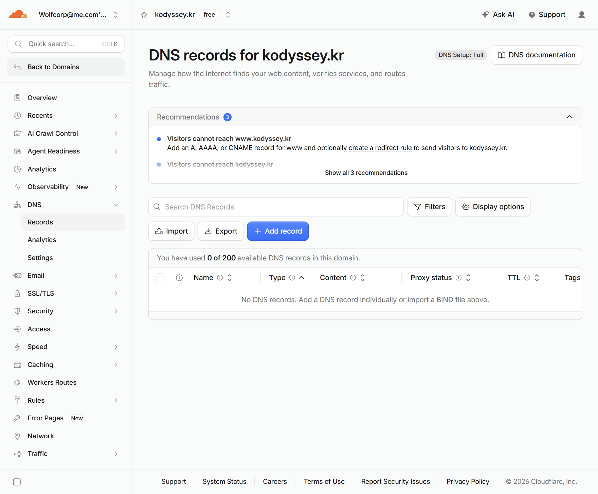

## 진행 기록: 루트 A 레코드 저장

2026-10-19 사용자가 직접 저장한 뒤 목록에서 `A / kodyssey.kr / 13.125.99.141 / DNS only / Auto`와 총 레코드 1개를 확인했다. Aside는 조회·캡처·기록만 했다. 저장은 확인했으나 외부 DNS 응답과 도메인 HTTP·HTTPS는 아직 확인 전이다.

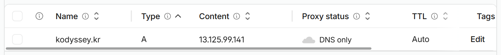

## 진행 기록: 사용자 PC에서 DNS A 응답 확인

사용자가 PC PowerShell에서 실행한 결과를 텍스트로 제공했다.

```text
PS C:\Users\alsgu> Resolve-DnsName kodyssey.kr -Type A
Name         Type TTL Section IPAddress
kodyssey.kr  A    300 Answer  13.125.99.141
```

사용자 PC의 DNS 조회 결과가 대상 EC2 IP와 일치한다. TTL 300은 DNS 응답의 캐시 수명(초)이며, 300초를 더 기다려야 한다는 뜻은 아니다. 이 결과로 전 세계 리졸버의 전파 완료를 보증하지 않는다. 해당 PowerShell 결과는 사용자 제공 텍스트이며 별도 스크린샷을 캡처했다고 기록하지 않는다. 다음은 외부 브라우저의 `http://kodyssey.kr/` 접속 확인이다.

## 진행 기록: 루트 도메인 HTTP 접속 성공

사용자가 연 `http://kodyssey.kr/` 탭에서 Nginx 환영 페이지를 snapshot으로 확인하고 캡처했다. 도메인 DNS 조회와 외부 HTTP 표시까지 확인됐지만 HTTPS 접속·인증서 발급 완료는 아니다. 도메인별 Nginx 설정과 ACME 검증 경로는 별도 확인 대상이다. 다음은 사용자가 실습 SG의 인바운드 편집 화면을 열고 HTTPS 443 추가를 준비하는 단계다. Aside는 설정을 변경하지 않았다.


## 진행 기록: HTTPS TCP 443 규칙 저장 확인

사용자가 실습 SG `sg-0c4336bb1e71eea36`에 HTTPS TCP 443, `0.0.0.0/0`을 직접 추가·저장했다. AWS 성공 알림과 저장된 규칙 3개를 확인했다. 새 규칙 ID는 `sgr-0f90bf3e8fc769e56`이다. HTTP 80 공개와 SSH 22 개인 IP /32는 유지됐고, Aside는 저장 버튼을 누르지 않았다. 캡처를 위해 표를 가로 이동해 포트·출발지가 함께 보이게 했다.

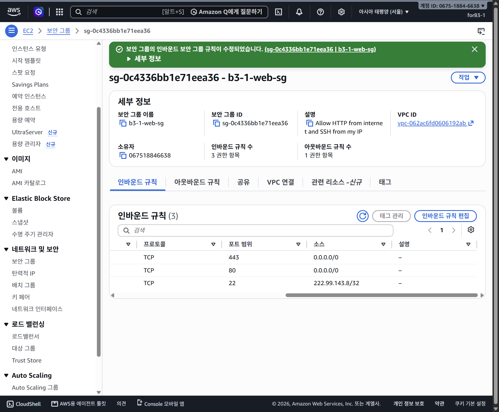

443을 허용한 것은 네트워크 준비이며 인증서 설치·HTTPS 성공 증거가 아니다. 다음은 사용자가 EC2 SSH에서 Python/Certbot 환경을 확인하는 단계다. 도메인 전용 Nginx 설정·webroot 검증 경로도 인증서 발급 전 확인해야 한다.

## 진행 기록: Python 기본 버전 확인

사용자가 EC2 SSH에서 `python3 --version`을 실행한 화면을 확인했다. 결과는 `Python 3.9.25`다. 캡처만 했으며 설치·Python 교체·서버 설정 변경은 하지 않았다. 다음은 기존 Certbot 실행 파일이 PATH에 있는지 확인하는 단계다.

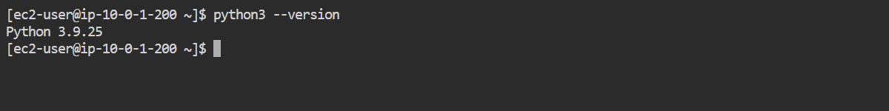

## 진행 기록: Certbot 경로 조회 및 설치 경로 결정

사용자가 실행한 `command -v certbot` 뒤에 경로 출력 없이 프롬프트가 돌아온 화면을 확인했다. 현재 PATH에서 Certbot을 찾지 못한 상태다. 이 확인만으로 모든 디렉터리의 설치 여부를 조사했다고 주장하지 않는다.

AL2023 공식 릴리스의 Certbot 패키지 제공을 확인해 우선 OS 저장소의 `certbot` 패키지를 사용하기로 했다. 기본 Python 3.9의 링크를 바꾸거나 별도 pip 설치를 섞지 않는다. webroot 방식이므로 지금 Route 53·Apache·Nginx 플러그인까지 한꺼번에 설치할 필요는 없다.

사용자에게 안내할 다음 명령은 `sudo dnf install certbot`이다. `-y`를 붙이지 않고, 설치 대상·의존성·용량 확인 화면에서 멈춰 확인한 뒤 사용자가 진행한다. 아직 설치를 실행하거나 완료를 확인하지 않았다.

근거: https://docs.aws.amazon.com/linux/al2023/release-notes/relnotes-2023.3.20231211.html 및 https://docs.aws.amazon.com/linux/al2023/ug/python.html . 설치되는 실제 버전은 DNF 화면에서 확인할 예정이다.

## 진행 기록: OS 저장소의 Certbot 설치 완료

사용자가 `sudo dnf install certbot`을 직접 실행하고 설치 확인에 동의했다. 화면에서 11개 패키지, 다운로드 약 1.4 MB, 설치 크기 약 6.2 MB 및 `Complete!`를 확인했다. 설치 패키지는 `certbot-2.6.0-4.amzn2023.0.1.noarch`와 관련 Python 의존성이다. 이는 패키지 설치 완료이며 인증서 발급 완료가 아니다. 다음은 실행 파일의 `certbot --version` 확인이다.

설치 로그에 `Certbot auto renewal timer is not started by default`가 표시됐다. 따라서 자동 갱신이 이미 작동한다고 기록하지 않는다. 인증서 발급·HTTPS 검증 뒤 timer의 실제 상태와 갱신 시험을 별도로 확인한다. Aside는 설치 명령·승인 입력·서비스 시작을 대신 실행하지 않았다.

DNF는 AL2023의 패키지 관리 도구로, 저장소에서 패키지를 받아 관련 의존성을 함께 해결한다. RPM은 패키지 형식·저수준 관리 체계이며 DNF는 그 위에서 저장소·의존성·설치 작업을 관리한다. 기본 Python 3.9 링크를 바꾸지 않고 OS가 제공하는 Certbot 패키지를 사용했다.

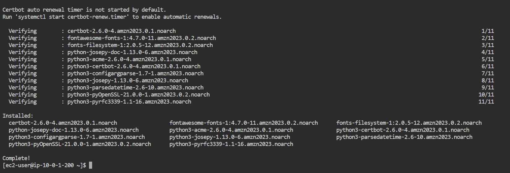

## 진행 기록: Certbot 실행과 웹 루트 확인

사용자가 `certbot --version` 결과를 2.6.0으로 알렸다. 이어 제공한 `grep root /etc/nginx/nginx.conf` 출력에서 활성 `root /usr/share/nginx/html;`과 같은 경로의 주석 처리된 예시를 확인했다. `#`로 시작하는 줄은 적용되는 두 번째 설정이 아니다. 도메인 HTTP는 이미 기존 기본 server block으로 표시되므로, 별도 80번 server block을 성급히 추가하기보다 이 웹 루트의 ACME 검증 경로를 외부에서 확인한 뒤 인증서 발급으로 진행한다. 실제 443 TLS 설정은 발급 후 별도로 준비한다.

다음 계획은 `.well-known/acme-challenge/b3-1-check.txt`라는 공개 테스트 파일을 사용자가 만들고 도메인 HTTP로 읽히는지 확인하는 것이다. 아직 파일 생성·외부 경로 검증·인증서 발급을 완료한 것으로 기록하지 않는다.

## 진행 기록: 검증 폴더 생성 시 Permission denied

- 증상: 사용자가 `html` 위치의 프롬프트에서 `mkdir -p .well-known/acme-challenge`를 실행했고 `.well-known` 생성에 `Permission denied`가 났다.
- 확인: 제공한 명령에는 `sudo`가 없다. 웹 루트는 앞서 `/usr/share/nginx/html`로 확인했으며, 현재 계정의 쓰기 권한 제약을 우선 확인할 상황이다. 실제 소유자·모드·ACL은 아직 조회하지 않았다.
- 조치 안내: 웹 폴더 전체 권한을 바꾸지 않고, 명시한 경로에 대한 폴더 생성 명령 한 개만 `sudo mkdir -p /usr/share/nginx/html/.well-known/acme-challenge`로 실행하도록 안내한다. 사용자 직접 실행 원칙은 유지한다.
- 결과: 수정 명령 실행 결과는 아직 미확인이다. 폴더·테스트 파일 생성 및 외부 검증이 완료됐다고 기록하지 않는다.
- 재발 방지: 시스템 웹 폴더의 작업에는 필요한 명령에만 권한을 사용한다. `chmod 777`이나 웹 루트 전체 소유권 변경으로 우회하지 않는다.

## 진행 기록: ACME webroot 사전 검증 성공

사용자가 테스트 파일이 보인다고 알렸고, 열린 브라우저의 `http://kodyssey.kr/.well-known/acme-challenge/b3-1-check.txt`에서 `kodyssey-acme-test` 본문을 직접 확인·캡처했다. 앞서 일반 계정의 폴더 생성이 거부됐던 상태 이후, 필요한 경로의 파일이 외부 HTTP로 제공되는 것까지 확인됐다. 개별 권한 수정이나 sudo 명령을 Aside가 대신 실행한 것은 아니다.

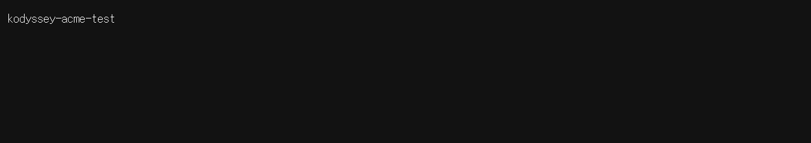

이는 Let's Encrypt 실제 검증 전의 사전 시험이다. 다음은 사용자가 `sudo certbot certonly --webroot -w /usr/share/nginx/html -d kodyssey.kr`를 실행하는 단계이며, 아직 인증서 발급 완료나 HTTPS 성공으로 표시하지 않는다. 연락 이메일·약관 동의·선택 동의는 사용자가 직접 확인한다. `certonly` 방식이므로 발급 후 Nginx TLS 설정은 별도로 진행한다.

## 진행 기록: Let's Encrypt 인증서 발급 성공

사용자가 이메일·약관 등의 입력을 직접 진행한 뒤, 화면에서 `Successfully received certificate.`와 도메인 `kodyssey.kr`의 인증서 경로를 확인했다. 만료일은 `2027-01-17`이다. 인증서는 `/etc/letsencrypt/live/kodyssey.kr/fullchain.pem`, 개인키는 같은 디렉터리의 `privkey.pem`에 저장됐다는 경로 안내가 표시됐다. 개인키 내용은 열지 않았다.

사용자 연락 이메일·약관 입력 부분은 프로젝트 캡처에 저장하지 않고 발급 성공 부분만 잘라 보관했다.

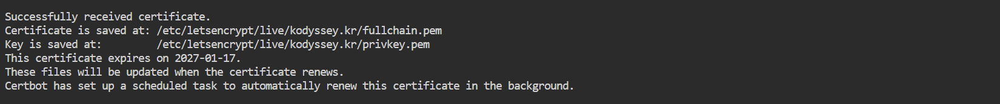

Certbot은 자동 갱신 예약 작업을 설정했다는 메시지를 출력했다. 앞선 패키지 설치 당시의 timer 미시작 안내와 시점을 구분한다. 실제 timer 활성 상태와 `renew --dry-run` 성공은 아직 확인하지 않았다. 이번 명령은 `certonly`였으므로 인증서 발급만 완료된 것이며, Nginx TLS 설정과 외부 HTTPS 검증을 완료했다고 표시하지 않는다. Aside는 발급 명령이나 약관 동의를 대신 실행하지 않았다.

## 진행 기록: HTTPS 설정 파일 추가 준비

사용자가 `ls -l /etc/nginx/conf.d/`의 `total 0` 결과를 제공했다. 이 디렉터리의 기존 파일은 없는 것으로 확인됐다. 기존 HTTP 설정은 수정하지 않고 새 `kodyssey-https.conf`에 443 server block을 추가할 계획이다. 아래는 사용자에게 안내한 작성 명령이며, 아직 실행 결과·문법 검사 성공·실제 적용을 확인하지 않았다.

```bash
sudo tee /etc/nginx/conf.d/kodyssey-https.conf > /dev/null <<'EOF'
server {
    listen 443 ssl;
    server_name kodyssey.kr;

    root /usr/share/nginx/html;
    index index.html;

    ssl_certificate /etc/letsencrypt/live/kodyssey.kr/fullchain.pem;
    ssl_certificate_key /etc/letsencrypt/live/kodyssey.kr/privkey.pem;
    ssl_protocols TLSv1.2 TLSv1.3;
}
EOF
```

개인키 내용이 아니라 이미 발급된 인증서·키의 파일 경로만 설정한다. 원래 파일이 없는 상태에서 별도 설정을 추가하므로 기존 HTTP 파일을 덮어쓰지 않는다. 이어 `grep 'conf.d' /etc/nginx/nginx.conf`로 include 지시문을 확인하고 `sudo nginx -t`로 문법·파일 접근을 검사한다. 검사 실패 시 멈추며, 결과 확인 전 reload하지 않는다. 파일 작성과 서비스 적용은 구분한다.

## 진행 기록: 사용자가 Vim으로 HTTPS 설정 작성

사용자가 `/etc/nginx/conf.d`에서 `sudo vim kodyssey-https.conf`로 파일을 작성한 뒤 `cat kodyssey-https.conf` 결과를 제공했다. server block의 HTTPS 443, `server_name kodyssey.kr`, 웹 루트, fullchain·privkey 경로, TLS 1.2/1.3 설정이 계획한 내용과 일치했다. 출력한 것은 설정 파일이며 인증서 개인키 내용이 아니다.

현재는 설정 파일 내용만 확인됐다. 주 설정의 `conf.d/*.conf` include 확인과 `sudo nginx -t` 성공 결과는 아직 제공되지 않았으며, reload와 실제 HTTPS 접속은 미완료다. 다음은 사용자가 이 두 조회·검사 명령을 실행하는 단계다. Aside가 파일을 작성하거나 서비스를 적용한 것은 아니다.

## 진행 기록: include 및 Nginx 설정 검사 성공

사용자가 제공한 출력과 터미널 화면에서 `include /etc/nginx/conf.d/*.conf;` 및 `syntax is ok`, `test is successful`을 확인했다. 작성한 HTTPS 설정과 인증서 경로를 포함해 검사에 통과했다. 중간에 붙여넣기 제어문자가 포함된 grep 명령 오류가 보였지만, 정상 재입력한 최종 명령에서는 include 확인과 설정 검사가 성공했다. 이를 Nginx 설정 실패로 기록하지 않는다.

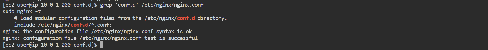

아직 reload 실행을 확인한 것은 아니다. 다음은 사용자가 `sudo systemctl reload nginx`로 설정을 반영하고, 외부 브라우저에서 `https://kodyssey.kr/` 접속과 인증서 오류 유무를 확인하는 단계다. Aside는 서버 명령을 대신 실행하지 않았다.

## 학습 메모: Let's Encrypt는 왜 무료인가?

- 비영리 ISRG의 프로젝트이며 기업·단체 후원과 개인 기부로 운영한다. 인증서마다 이용자에게 비용을 받는 사업 모델이 아니다. 기부는 선택이다.
- ACME 프로토콜로 도메인 제어 확인과 발급·갱신을 자동화해 사람이 건별로 심사하는 작업을 줄인다. 이번 HTTP-01에서는 Certbot이 실제 검증용 파일을 준비하고 CA가 이를 확인한다. 앞서 직접 만든 `b3-1-check.txt`는 접근 경로 확인용 사전 시험이지 실제 발급용 검증 토큰 파일 자체는 아니다.
- 무료인 것은 인증서 발급이다. HTTPS 웹 트래픽을 Let's Encrypt가 계속 중계해 주는 것은 아니다. 이번 DNS only 구성에서는 브라우저와 EC2 Nginx가 TLS 통신을 처리하며, EC2·EBS·IP·트래픽 등 서버 운영비는 별도다.
- Let's Encrypt는 도메인 검증(DV) 인증서를 제공한다. 도메인을 제어한다는 사실을 확인하는 것이며, 사업자 신원 검증(OV/EV)이나 사이트 콘텐츠의 안전성·신뢰성을 보증하는 것은 아니다.
- 무료라는 이유만으로 암호화가 약한 것은 아니다. 실제 보안은 올바른 서버 설정·개인키 보호·인증서 검증과 갱신에도 달려 있다.

공식 자료: https://letsencrypt.org/docs/faq/ · https://letsencrypt.org/sponsors/ · https://letsencrypt.org/how-it-works/ .

## 진행 기록: reload 및 실제 HTTPS 페이지 확인

터미널 화면에서 사용자가 실행한 `sudo systemctl reload nginx` 뒤 오류 없이 프롬프트가 돌아온 것을 확인했다. 이미 실행된 작업이므로 중복 실행을 요청하지 않았다. 사용자가 연 실제 `https://kodyssey.kr/` 탭의 URL과 Nginx 환영 페이지를 snapshot으로 확인하고 본문을 캡처했다. 브라우저 주소창이 포함된 스크린샷이나 인증서 상세 창을 확인한 것으로 주장하지 않는다.

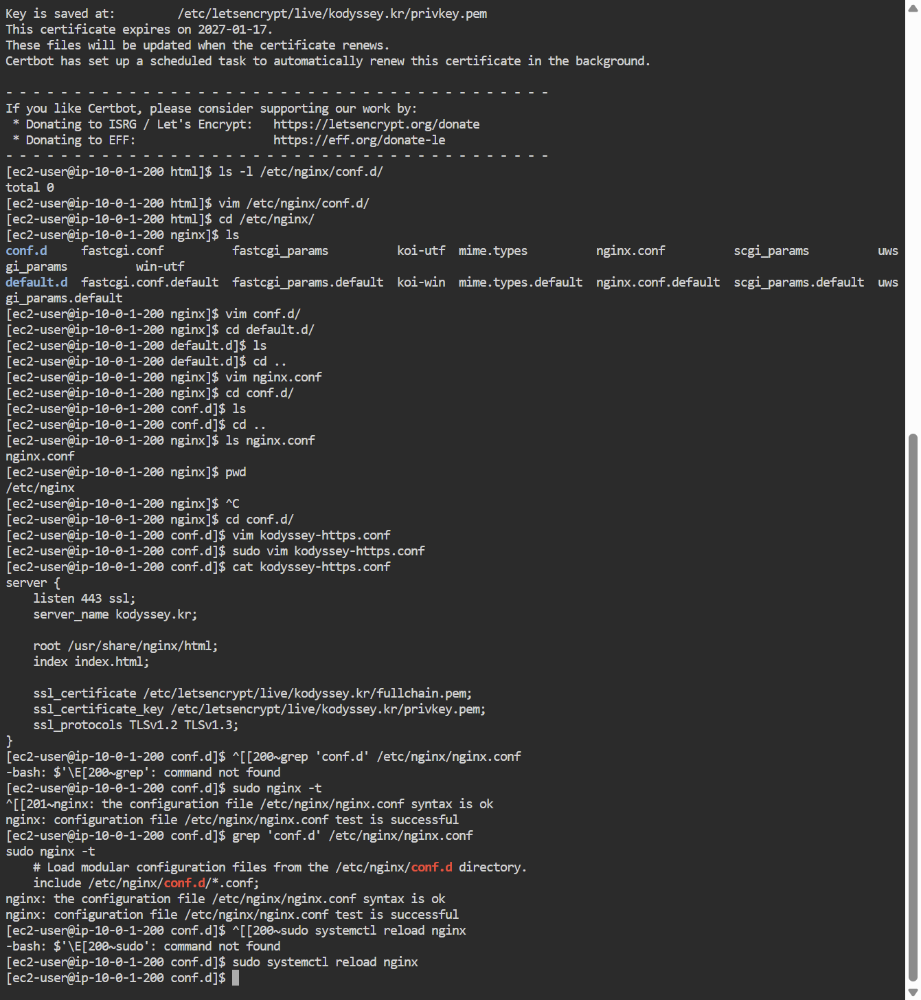


무료 운영 이유·DNS·DNF·Certbot·webroot·Nginx 설정 분리와 적용 차이는 [HTTPS 개념 및 현재 진행](0044-https-concepts-and-progress.md)에 모았다. 다음은 사용자가 EC2 SSH가 아닌 PC PowerShell에서 `curl.exe -i https://kodyssey.kr/`를 실행해, 외부 클라이언트에서 인증서 검증을 우회하지 않은 GET의 응답 코드를 확인하는 단계다. 실제 timer 상태·갱신 시험·다이어그램 갱신·최종 정리는 아직 남아 있다. Aside는 reload나 서버 명령을 대신 실행하지 않았다.

## 진행 기록: EC2에서 HTTPS GET 200 확인

사용자가 EC2 SSH에서 `curl.exe -i https://kodyssey.kr/`를 먼저 실행했을 때 `-bash: curl.exe: command not found`가 표시됐다. 이는 Windows 실행 파일명을 Linux 셸에 입력한 실행 환경 차이이며 TLS 오류가 아니다. 이어 사용자가 `curl -i https://kodyssey.kr/`로 직접 실행했고 `HTTP/1.1 200 OK`, `Server: nginx/1.30.5`, Nginx HTML 본문을 확인·캡처했다. 응답 Date는 `Mon, 19 Oct 2026 04:23:10 GMT`다. 명령에는 인증서 검증 우회용 `-k`가 없다.

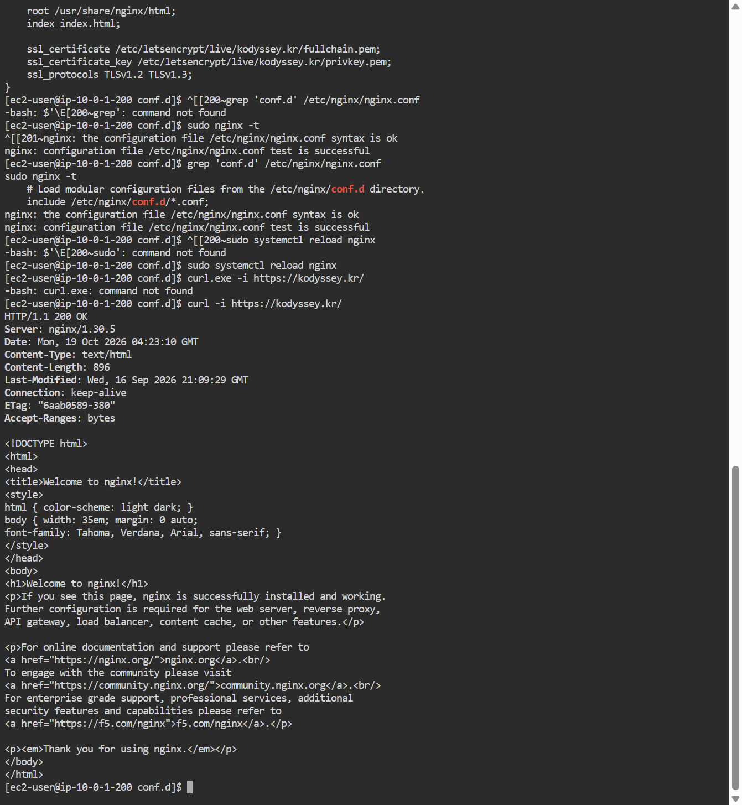

위 GET은 EC2 안에서 실행한 것이다. 앞서 확인한 외부 브라우저의 HTTPS 페이지 표시와 함께 기록하되, PC PowerShell에서 실행한 curl 결과라고 바꾸어 쓰지 않는다. Linux에서는 `curl`, Windows PowerShell에서는 실행 파일을 명시할 때 `curl.exe`를 사용한다. 자동 갱신 실제 상태와 모의 갱신·다이어그램 갱신·정리 작업은 아직 완료하지 않았다.

## 진행 기록: 실제 자동 갱신 timer 비활성 확인

사용자가 정확한 이름으로 `systemctl status certbot-renew.timer --no-pager`를 실행했다. 화면에서 unit이 `/usr/lib/systemd/system/certbot-renew.timer`에 설치돼 있지만 `disabled`, `inactive (dead)`, `Trigger: n/a`인 것을 확인·캡처했다. 따라서 발급 당시의 일반적인 예약 설정 메시지와 별개로 현재 자동 갱신은 활성화되지 않았다. 처음 `cerbot`으로 입력해 unit을 찾지 못한 것은 철자 오류이며 실제 설치 누락의 증거가 아니었다.

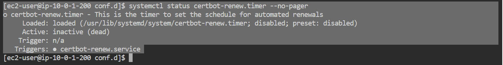

다음은 사용자가 `sudo certbot renew --dry-run`으로 운영 인증서를 교체하지 않는 갱신 모의 시험을 실행하는 단계다. 아직 시험이나 timer 활성화는 수행하지 않았다. 성공 후 갱신된 인증서를 Nginx가 다시 읽는 deploy hook과 timer를 순서대로 확인·설정한다.

## 진행 기록: 갱신 모의 시험 성공

사용자가 `sudo certbot renew --dry-run`을 직접 실행했고 `Congratulations, all simulated renewals succeeded` 및 `kodyssey.kr/fullchain.pem (success)`를 확인·캡처했다. 운영 인증서 교체가 아니라 시험용 갱신 절차 성공이다. `Account registered`는 이 모의 시험의 인증기관 계정 안내이며 AWS 계정을 새로 만들었다는 뜻이 아니다.

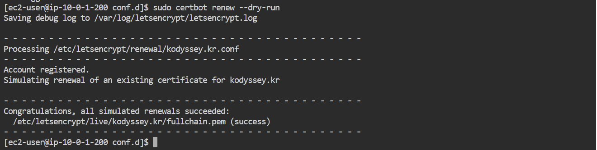

자동 timer는 마지막 확인에서 disabled/inactive였다. 이번 시험 성공이 timer 활성화나 Nginx deploy hook 설정까지 대신하지 않는다. 다음은 사용자가 `/etc/letsencrypt/renewal-hooks/deploy/`의 기존 파일을 조회해 중복된 Nginx reload hook이 있는지 확인하는 단계다. 아직 hook 작성·timer 활성화는 하지 않았다.

## 최종 범위 결정: 자동 갱신 설정 생략

사용자는 자동 갱신이 보너스 필수가 아니라면 여기서는 진행하지 않기로 했다. instruction.md §5의 HTTPS 보너스는 도메인 연결과 Let's Encrypt 등 인증서 적용만 명시한다. 도메인 연결·인증서 발급·Nginx 적용·브라우저 HTTPS와 GET 200까지 확인했고, 갱신 dry-run은 추가 시험으로 성공했다.

타이머 활성화와 deploy hook 추가는 선택 범위에서 제외한다. 마지막 확인된 timer 상태는 disabled/inactive이며, 이후 이를 켜거나 hook을 작성하지 않았다. 끄는 명령도 새로 실행하지 않았다. 인증서 만료일 2027-01-17 이후까지 서비스가 자동으로 유지된다고 주장하지 않는다. 계속 운영하려면 만료 전 별도 갱신 대책이 필요하고, 실습 후 삭제할 경우 DNS와 EC2 정리를 우선한다.
