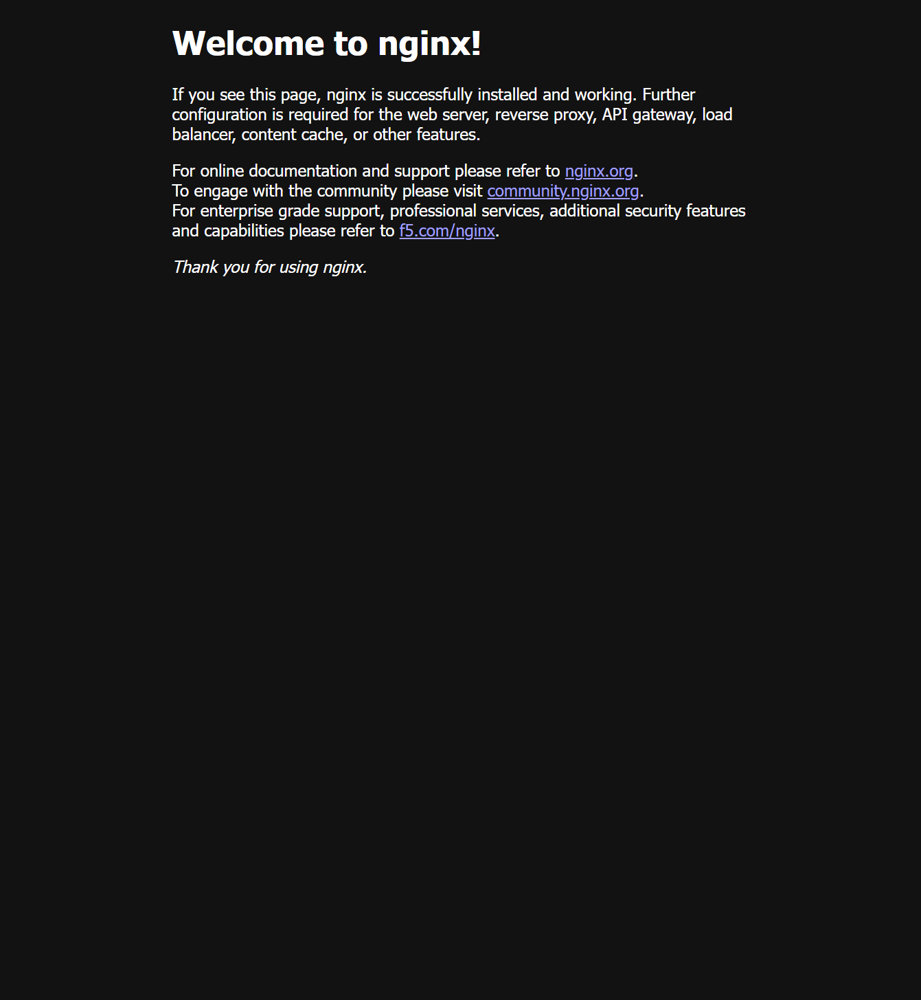

# HTTPS 보너스 검증

보유 도메인 `kodyssey.kr`과 Let's Encrypt 인증서를 사용해 Nginx HTTPS를 검증했습니다. 아래는 원본 실습 서버에서 확인한 당시 기록입니다.

## 적용

1. Cloudflare의 루트 A 레코드를 검증 당시 EC2 IP `13.125.99.141`로 설정했습니다. **DNS only**라 웹 트래픽을 Cloudflare 프록시로 중계하는 구성이 아닙니다.
2. 기존 HTTP 80·개인 IP SSH 22를 유지하고 TCP 443을 공개했습니다.
3. Nginx webroot 방식으로 Let's Encrypt 인증서를 발급했습니다. 발급 당시 만료일은 2027-01-17입니다.
4. Nginx TLS 설정을 검사하고 reload한 뒤 브라우저·GET 응답을 확인했습니다.

## 실제 검증 결과

- [443 추가 저장과 최종 SG 규칙](captures/0209-https-rule-saved.png)
- [Let's Encrypt 발급 성공](captures/0214-letsencrypt-certificate-issued.png)
- [브라우저 HTTPS 정상 표시](captures/0216-kodyssey-https-browser.png)
- [EC2에서 HTTPS GET HTTP/1.1 200 OK와 HTML](captures/0218-https-get-200.png): `curl -i https://kodyssey.kr/`, 인증서 검증을 끄는 `-k` 옵션 없음
- [모의 갱신 성공](captures/0220-certbot-renew-dry-run-success.png): `sudo certbot renew --dry-run`

자동 갱신 timer는 마지막 확인에서 disabled/inactive였고 자동 갱신 구성은 생략했습니다. 모의 갱신 성공을 무인 자동 갱신 보장으로 바꾸어 설명하지 않습니다.

원본 인스턴스와 네트워크는 검증 뒤 [정리](cleanup-checklist.md)했습니다. DNS 보존과 이후 평가용 복원은 그 정리 기록과 구분합니다.
