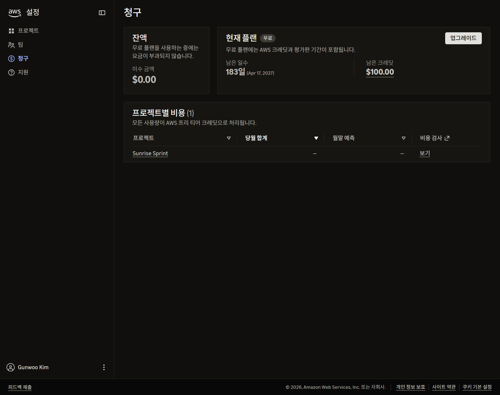

# B3-1 트러블슈팅 보고서

## TS-001. IAM 사용자는 생성됐지만 콘솔 로그인 설정이 없음

- 관찰일: 2026-10-17 (한국 시간)
- 상태: **원인 조사 완료, 해결 조치 및 결과 검증 미완료**
- 관련 요구사항: [instruction.md](../instruction.md) §4 IAM 최소권한, §7 별도 IAM 사용자/Role 콘솔 접근 및 서울 리전
- 관련 환경: Sunrise Sprint 프로젝트, AWS Settings 기반 관리 화면, 무료 플랜

## 1. 증상

실습용 IAM 사용자 `forB3-1`을 생성하고 EC2/VPC 중심 고객 관리형 정책 `B3Ec2SeoulLabPolicy`를 연결했다. 그러나 사용자 생성 과정에 콘솔 접근 활성화 체크박스가 없었고, 사용자 상세의 `보안 자격 증명` 탭에도 콘솔 암호 설정 항목이 없었다.

사용자 생성과 권한 연결은 성공했지만, 과제에서 요구하는 별도 최소권한 주체의 콘솔 로그인을 진행할 수 없었다. 서비스 URL에 시드니(`ap-southeast-2`)가 보여 서울 리전 요구사항과의 관계도 함께 조사했다.

**현재까지 실제 로그인 실패 요청이나 서울 EC2 생성 거부 오류를 재현한 것은 아니다.** 재현된 문제는 UI에서 콘솔 로그인 자격 증명을 설정할 수 없는 상태다.

## 2. 가설

### 가설 A. 사용자 생성이나 정책 연결을 빠뜨렸다

사용자 이름과 연결 정책을 확인해 검증한다. 권한 정책 연결과 콘솔 로그인 자격 증명 발급은 별개이므로, 정책이 있다는 사실만으로 로그인 가능 여부를 판단하지 않는다.

### 가설 B. 다른 메뉴에 콘솔 암호 설정이 있다

사용자 상세 자격 증명, 역할, 계정 메뉴, 팀 설정 등 실제 제공되는 UI와 공식 문서를 비교한다.

### 가설 C. 신규 프로젝트형 AWS 가입 경험의 기능 제한이다

프로젝트·팀·AWS Settings 메뉴, 프로그래밍 접근용 IAM 사용자 안내, 계정 접근 서비스용 역할을 근거로 AWS의 신규 경험 문서와 대조한다.

### 가설 D. 리전은 콘솔 URL만 바꾸면 해결된다

기본 표시 리전과 프로젝트 배정 리전, Organizations SCP의 실제 허용 범위가 다를 수 있으므로 분리해서 검증한다.

## 3. 검증

### 3.1 사용자와 정책은 실제로 존재함

사용자 상세에서 `forB3-1`과 권한 정책 1개인 `B3Ec2SeoulLabPolicy` 직접 연결을 확인했다. 가설 A의 단순 누락 문제는 아니었다. 액세스 키를 생성하지 않았으며 당시 자격 증명 탭의 액세스 키 수는 0개였다.

### 3.2 일반 가이드와 현재 UI가 다름

- 일반 IAM 가이드 및 초기 Amazon Q 답변은 콘솔 접근 체크박스와 암호 설정을 안내했다.
- 현재 생성·자격 증명 화면에는 그 항목이 없었다.
- 사용자 목록은 IAM 사용자를 프로그래밍 방식 접근용으로 안내했다.
- 계정 메뉴에는 프로젝트·팀·청구 등이 있고, Switch Role은 보이지 않았다.

따라서 단순히 일반 가이드를 반복하거나 액세스 키를 만들어서는 해결됐다고 볼 수 없다.

### 3.3 기존 역할과 팀 초대는 실습 최소권한의 대체 경로가 아니었음

- `AccountFullAccessRole`에는 AdministratorAccess가 연결되어 있었다.
- 신뢰 주체는 `account-access.amazonaws.com`이며 `sts:AssumeRole`, `sts:SetContext`를 허용했다.
- 역할의 존재·최근 활동만으로 현재 로그인 주체가 이 역할이라고 확정하지 않았다.
- 팀 초대는 광범위한 개발자 접근을 제공하며, EC2/VPC 한정 정책을 선택하는 항목은 보이지 않았다.
- 기존 역할의 관리자 정책이나 신뢰 정책을 삭제·교체하지 않았다.

### 3.4 공식 IAM 문서에서 신규 경험의 제한 확인

[Create an IAM user](https://docs.aws.amazon.com/IAM/latest/UserGuide/id_users_create.html)에는 다음이 명시되어 있다.

> In our new experience, you cannot create IAM users with console access.

[Compare sign-up options](https://docs.aws.amazon.com/accounts/latest/reference/sign-up-for-aws.html)는 신규 환경에서 사람 접근을 AWS가 관리하며 직접 만든 IAM 사용자·Role은 프로그래밍 접근용이라고 설명한다.

이 설명은 관찰한 UI와 강하게 일치한다. 신규 프로젝트에도 실제 AWS 계정이 존재하며, 잘못 가입했거나 AWS 계정 자체가 없는 상황은 아니다.

### 3.5 리전 제한은 별도 문제로 분리

[프로젝트 리전 문서](https://docs.aws.amazon.com/accounts/latest/reference/project-regions.html)는 한국 연락처에 시드니를 배정하고, [공개 프로젝트 SCP](https://docs.aws.amazon.com/accounts/latest/reference/scps-and-rcps-for-projects.html)의 RegionFloor는 지정 리전 밖 요청을 제한한다.

그러나 **본인 프로젝트의 추가 정보에 표시되는 Region, 현재 STS 주체, 서울 EC2 읽기 요청 결과는 아직 직접 확인하지 않았다.** URL만으로 실제 거부를 증명한 것으로 기록하지 않는다. 모든 한국 AWS 계정에 이 제한이 적용되는 것도 아니다.

### 3.6 Q와 외부 리서치는 공식 근거와 구분

Amazon Q는 초기 Role/Federation 권고 후, 신규 환경에서 그 경로가 공식 지원되는지 확인하지 못했다고 정정했다. 사용자가 제공한 ChatGPT 리서치도 계정에 직접 접속하지 않은 분석이다. 두 AI의 일치만으로 실제 계정 동작 검증을 대체하지 않았다.

세부 비교는 [통합 조사 문서](0016-aws-access-research-consolidated.md), 제공 자료는 [리서치 원문](references/2026-10-17-chatgpt-research-original.txt)에 보존했다.

### 3.7 전환 전 무료 플랜 상태 확인 및 캡처

사용자가 계정 메뉴에서 청구 페이지로 이동했다. 현재 `https://settings.aws.com/billing`에서 확인한 값:

- 현재 플랜: **무료**
- 미수 금액: **$0.00**
- 남은 크레딧: **$100.00**
- 무료 플랜 남은 기간: **183일**, 화면상 **Apr 17, 2027**
- 프로젝트: Sunrise Sprint 1개
- 화면 안내: 무료 플랜 사용 중 요금이 부과되지 않음

이 날짜는 무료 플랜의 표시 기간이며 개별 크레딧 만료일을 확인한 것은 아니다. 이번 캡처 시점에는 업그레이드 안내 화면도 열지 않은 상태였다.

## 4. 조치

### 수행한 조치

1. 사용자·정책 생성 여부와 자격 증명 UI를 확인하고 캡처했다.
2. 기존 관리자 Role과 팀 초대 경로를 읽기 위주로 확인했으며 변경하지 않았다.
3. 공식 문서, Q의 답변 변경, 독립 리서치를 비교해 계정 환경 제한과 명세 충돌을 기록했다.
4. 일반 IAM 생성 절차를 반복하거나 장기 액세스 키부터 발급하는 진행은 중단했다.
5. 사용자 요청에 따라 현재 계정을 유지하는 전환 경로 검토를 진행하고, 전환 전 무료 플랜 화면을 증빙으로 남겼다.

### 아직 수행하지 않은 조치

- Paid Plan 업그레이드
- 고급 기능 활성화
- Organizations 정책 수정
- 별도 실습 Role 생성·사람 접근 배정
- 별도 최소권한 콘솔 로그인 및 서울 리소스 작업

전환을 선택한다면 공식 문서상 큰 순서는 Paid 업그레이드 → 고급 기능 활성화 → 실제 SCP의 서울 허용 여부 검토/필요 최소 수정 → 별도 실습 Role과 접근 배정 → 독립 로그인 검증이다. 단계별 실행 여부는 [플랜 전환 기록](0017-aws-plan-upgrade-walkthrough.md)에 이어 쓴다.

**두 전환은 비가역적이며, 고급 기능 활성화 시 spend limit이 제거된다.** 사용자가 직접 화면을 확인하고 버튼을 누르며, 나는 안내·확인·캡처·기록을 담당한다. 가입·결제 정보와 비밀 자격 증명은 캡처하지 않는다.

공식 FAQ에는 고급 기능 활성화 후에도 이미 적립한 크레딧이 만료 전까지 청구서에 자동 적용된다고 명시되어 있다. 만료기간은 문서상 6개월/12개월이 혼재하므로 특정 기간을 보장하지 않는다. 사용자는 해당 논의를 더 진행하지 않고 다음 단계로 진행하기를 원했다.

## 5. 결과

**현재는 해결 완료가 아니다.**

- 사용자와 정책 누락이 아니라 신규 프로젝트 환경의 IAM 콘솔 접근 제한이 원인이라는 문서 근거를 확보했다.
- 일반 콘솔 가이드와 실제 UI의 차이를 설명할 수 있게 됐다.
- 현재 계정을 버리거나 관리자 정책을 삭제하지 않고 진행할 공식 전환 경로를 정리했다.
- 무료 플랜·잔여 크레딧 등 변경 전 상태를 보존했다.
- 실제 최소권한 콘솔 로그인과 서울 작업 성공 결과는 아직 없다.

이 사례는 계정 접근·권한 문제에 대한 조사 기록으로 사용할 수 있지만, 과제에서 요구하는 해결 결과가 갖춰진 최종 보고서라고 아직 주장하지 않는다. 담당자가 별도의 통신/권한 오류 실습 사례를 요구하는지 여부도 확인 대상이다.

### 해결 완료 시 추가할 증빙

- 사용자가 수행한 전환 단계와 성공 알림
- 서울 리전 허용 설정의 변경 전후 및 읽기 요청 결과
- 실습 Role에 연결된 정책과 사용자 접근 배정
- 실제 로그인 주체의 ARN 및 서울 콘솔 화면
- 필요한 작업 성공과 불필요한 관리 작업 제한 확인
- 리소스 정리 결과

## 6. 재발방지

1. 실습 시작 전에 과제의 리전·신원·권한 조건과 계정 가입 경험의 지원 범위를 비교한다.
2. Free/Paid 요금제와 New/Advanced 관리 기능을 구분한다.
3. 콘솔 표시 리전, 프로젝트 배정 리전, 기본 활성화 리전, SCP 허용 범위를 혼동하지 않는다.
4. 사용자 생성, 권한 부여, 로그인 자격 증명, Role 신뢰 관계, 사람 접근 배정, 실제 세션을 각각 검증한다.
5. 일반 AI 답변이 실제 UI와 다르면 무리하게 따라가지 않고 공식 문서의 적용 범위를 확인한다.
6. 최소권한은 작업 개수만으로 평가하지 않고 리소스·조건·다른 정책·실제 세션까지 확인한다.
7. 기존 관리자 접근은 보존하고, 실습 주체는 별도로 분리한다.
8. 비가역적인 플랜/관리 기능 전환 전에 비용 책임과 보호 장치 변화를 설명하고 변경 전후 증빙을 남긴다.
9. 진행 중 기록과 해결 완료 기록을 구분하고 실제 확인하지 않은 성공·오류를 만들어 쓰지 않는다.

## TS-001 진행 추가: 업그레이드 소개 화면 진입

사용자가 `업그레이드`를 눌러 소개 화면을 열었다. 업그레이드 비용·약정 없음과 크레딧 유지 안내를 확인해 캡처했다. 현재 `시작하기` 단계이며 최종 Paid 전환·결제 방법 등록·고급 기능 활성화는 아직 하지 않았다. 해결 완료 상태는 아니다.

이 화면에서 안내하는 월별 지출 한도는 이후 고급 기능 활성화 시 제거될 수 있는 별도 기능임을 구분한다.

## TS-001 진행 추가: 지출 한도 설정 화면

사용자가 시작하기를 눌러 업그레이드 1/3단계에 진입했다. 월간 $20.00 USD 한도가 기본 선택되어 있으며, 한도 도달 시 프로젝트 일시 중지를 안내한다. 아직 저장·Paid 전환 완료는 아니다. 이후 고급 기능 활성화 시 이 한도는 제거된다는 점을 별도로 기록한다.

## TS-001 진행 추가: 초기 비용 제어 2/3단계

사용자가 업그레이드 2/3단계로 이동했다. 처음에는 새 리소스 시작 중단·유휴 리소스 일시 중지·상위 비용 항목 일시 중단이 모두 미선택이었다. 이후 사용자가 세 항목 모두 체크한 것을 확인하고, 요청에 따라 캡처를 최신 체크 상태로 교체했다. 아직 저장 전이며, Paid 전환이나 고급 기능 활성화 완료를 확인한 상태는 아니다. 이 제어들의 고급 기능 활성화 후 유지 여부도 검증되지 않았다.

## TS-001 진행 추가: 결제 방법 추가 3/3단계（개인정보 가림）

결제 방법 추가 화면 진입을 확인했다. 사용자 요청에 따라 Billing address와 카드번호·유효기간·보안코드·카드 명의·청구 이메일 입력란을 모두 가렸다. 최신 입력 상태를 다시 캡처하여 검은 박스 대신 부드러운 가장자리의 연한 회색 불투명 마스킹 버전으로 첨부 이미지를 교체했다. 원래 입력값이나 설정은 변경하지 않았다. 최종 계정 업그레이드 완료는 아직 확인하지 않았으며 해결 진행 중이다.

## TS-001 진행 추가: 카드 등록 성공 확인

카드 등록 성공 알림 `Your credit or debit card has been added successfully.`과 업그레이드 처리 화면을 확인하고 캡처했다. 개인정보는 표시되지 않았다. 아직 이 증빙만으로 Paid 플랜 전환·고급 기능 활성화·실습 접근 문제 해결을 완료로 판단하지 않는다.

## TS-001 진행 추가: Paid 업그레이드 단계 완료

사용자가 완료를 보고했고 업그레이드 마법사 종료 후 청구 페이지에서 결제수단 관리·현재 요금·프로젝트 지출 한도가 표시됨을 확인했다. 사용 가능한 크레딧 $100.00, 당월 합계 $0.00, 프로젝트 한도 $20.00가 표시됐다. 카드 식별 정보는 부드러운 회색 가림 처리로 보호한 후 캡처했다.

Paid 업그레이드 단계 완료로 기록하되 고급 기능 활성화, 서울 리전 허용 검증, 별도 최소권한 콘솔 접근은 아직 남아 있어 TS-001 전체는 해결 진행 중이다.

## TS-001 진행 추가: 고급 기능 설정과 관리 계정 이메일 필요

고급 기능 설정 화면에서 기존 이메일이 이미 AWS 계정과 연결되어 있어 다른 관리 계정 이메일이 필요하다는 안내를 확인했다. 아직 이메일 입력·검증·활성화 완료는 아니다. 현재 증빙은 입력 위치를 청록색으로 강조하고 기존 이메일 영역은 가림 처리했다. 앞으로도 이 안내·가림 스타일을 적용한다.

## TS-001 진행 추가: 이메일 확인 코드 전송 상태

다른 관리 계정 이메일 입력 후 코드 전송 안내와 ID 확인 영역을 확인했다. 사용자의 명시적 허용에 따라 이메일은 표시하고 인증 코드는 가린 채, 다음 검토 버튼을 강조해 캡처했다. 코드 검증·고급 기능 활성화 성공은 아직 확인하지 않았다.

## TS-001 진행 추가: 최종 활성화 확인 모달

최종 확인 모달과 비가역성 경고를 확인했다. `활성화 확인` 입력란은 비어 있고 실행 버튼은 비활성 상태였다. 해당 입력 위치를 강조한 캡처를 첨부했다. 고급 기능 활성화 성공과 과제 접근 문제 해결은 아직 미완료다.

## TS-001 진행 추가: 고급 기능 활성화 처리 중

사용자가 최종 확인을 진행했고 `활성화 진행 중` 모달을 확인했다. 최대 5분 소요·페이지 유지·완료 후 설정 페이지 복귀를 안내한다. 진행 상태를 강조해 캡처했으며 인증 코드는 노출하지 않았다. 활성화 완료 성공 및 과제 접근 문제 해결은 아직 검증 전이다.

# TS-002. 고급 기능 활성화 처리 지연 오류

관찰일: 2026-10-17. 최신 상태: **활성화 성공 확인으로 기능상 해소. 지연/거부 메시지의 직접 원인은 미확인.** 아래 미해결 표현은 당시 관찰 기록이며 마지막 성공 확인 절을 우선 참고한다.

## 증상

사용자가 최종 활성화를 진행한 뒤 최대 5분 소요 안내의 처리 화면이 표시됐다. 이후 진행 모달이 사라지고 다음 오류가 나타났다.

> 활성화 작업이 예상보다 오래 걸리고 있습니다. 페이지를 새로 고침하여 진행 상황을 확인하거나 다시 시도해 주세요.

## 가설

조직·접근 관리 설정의 백엔드 처리가 지연되거나, 프런트엔드의 상태 확인 대기 한도를 넘었을 가능성이 있다. 오류 문구만으로 구체적인 원인이나 전체 실패를 단정하지 않는다.

## 검증

최신 화면에서 오류를 직접 읽고 캡처했다. 성공 화면·조직의 실제 변경 결과·관련 API/로그는 아직 확인하지 않았다. TS-001의 IAM 접근 제한과 이번 처리 지연은 구분한다.

## 조치

오류 영역을 강조하고 인증 코드는 숨긴 증빙을 저장했다. 다음 사용자 동작은 사이트 안내대로 페이지를 한 번 새로 고침하여 현재 상태를 읽는 것이다. 완료 상태 확인 전에 중복 활성화를 제출하거나 관리 역할·조직 정책을 변경하지 않는다. 아직 새로 고침·재시도는 실행하지 않았다.

## 결과

**고급 기능 활성화 성공 여부 미확인.** 완전 실패나 롤백 여부도 확인하지 않았다. 기존 Paid 업그레이드 완료와 고급 기능 활성화 상태를 혼동하지 않는다.

## 재발방지

비동기 계정 설정은 요청 접수·처리 중·완료·지연 오류를 구분한다. 처리 지연 시 새로 고침 등 읽기 확인을 우선하고, 실제 상태를 확인한 뒤 재시도 여부를 결정한다. 해결 후 성공 증빙과 원인 분석을 보완한다.

## TS-002 추가 관찰: 오류가 Access denied로 변경

후속 현재 화면에서 지연 메시지 대신 `Access denied`가 표시됐다. 오류 영역을 강조해 캡처하고 인증 코드는 노출하지 않았다. 페이지 조작 이력이나 거부된 API·정책은 확인되지 않았으므로 세션 만료·SCP·권한 부족 중 어느 원인이라고 단정하지 않는다. 중복 활성화 요청 또는 관리자 권한 변경은 하지 않았다. 상태는 미해결이며 활성화의 실제 완료 여부 확인이 필요하다.

## TS-002 해결 결과: 최종 활성화 성공 확인

사용자가 완료를 발견했고 프로젝트 목록의 `고급 기능 활성화 완료` 성공 알림을 직접 확인했다. Identity Delegated Admin 계정과 Management Account가 표시되고 조직 관리 진입 버튼이 생겼다. 완료 알림과 버튼을 강조한 캡처를 첨부한다.

따라서 활성화 지연 문제는 **실제 기능상 해소**로 갱신한다. 다만 어느 시점에 백엔드 처리가 완료됐는지와 Access denied의 직접 원인은 로그로 검증하지 못했다. 지연·거부 화면만으로 전체 활성화 실패라고 단정할 수 없다는 사례다. 사용자가 완료 상태를 확인했으며, 내가 중복 활성화를 대신 제출하거나 권한을 수정한 것은 아니다.

재발방지 보완: 비동기 설정 오류가 나타나면 현재 프로젝트/조직의 실제 완료 상태와 성공 알림을 확인한 뒤 재시도한다. 오래 열린 활성화 폼의 오류만으로 롤백이나 실패를 가정하지 않는다. **TS-001의 서울 작업·별도 최소권한 콘솔 접근은 여전히 별도 검증이 남아 있다.**

