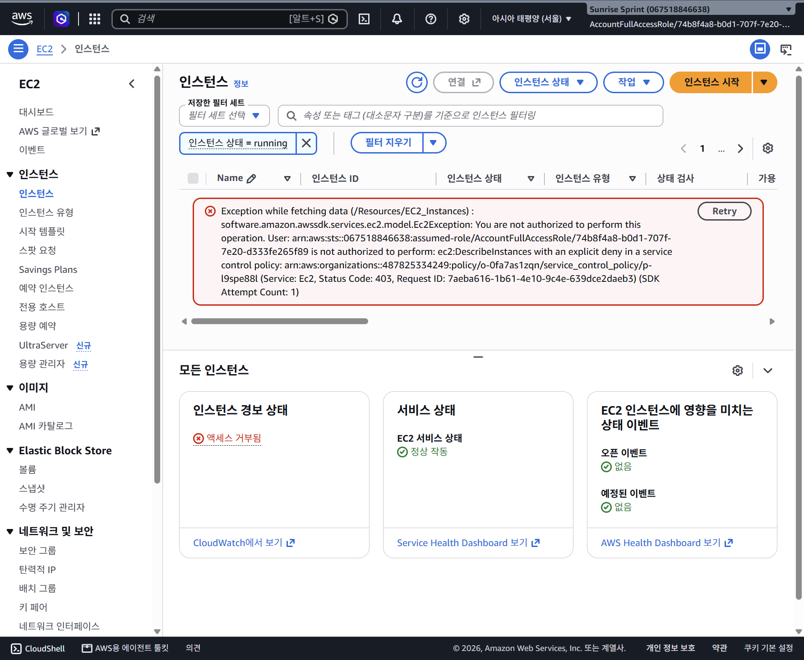
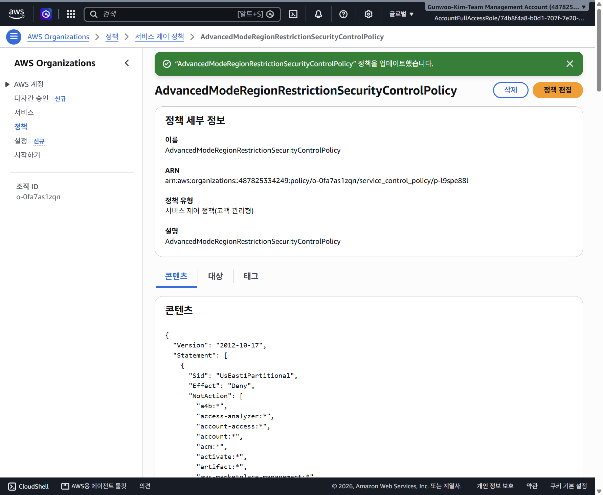
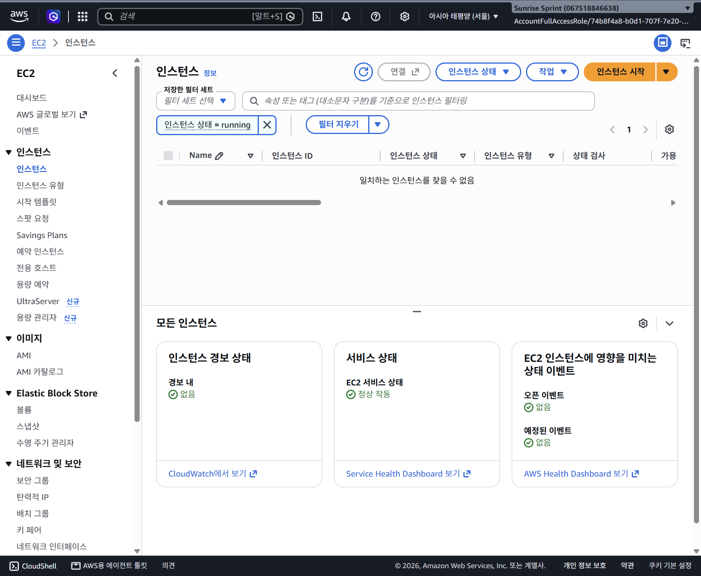
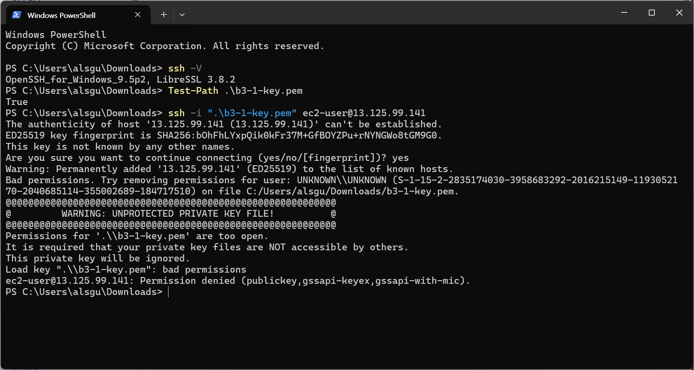
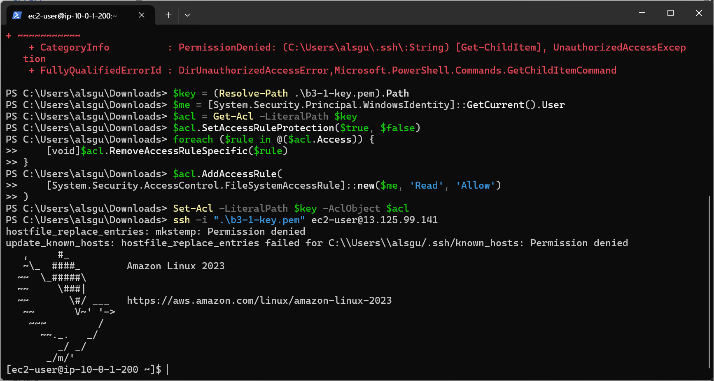
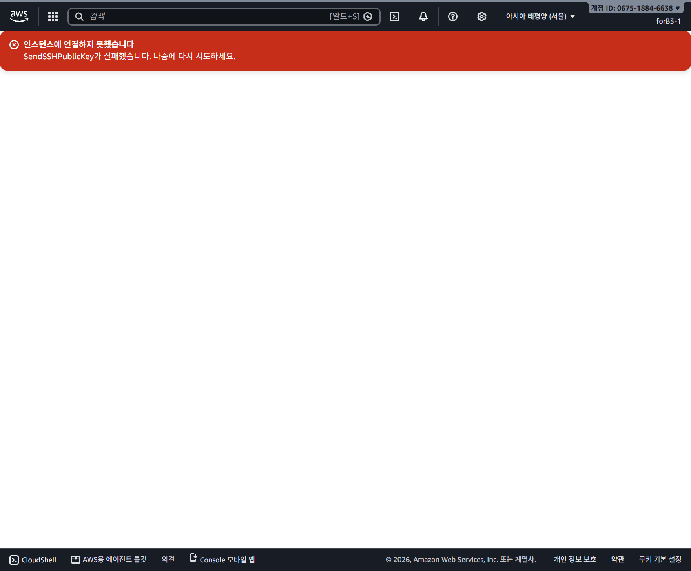

# B3-1 트러블슈팅 보고서

> **기록 시점 안내:** 각 사례는 증상부터 후속 결과까지 시간순으로 보존한다. 접근 복구와 로컬 SSH·Nginx 검증은 후속 성공했고 브라우저 SSH·known_hosts 경고는 해결을 보장하지 않는다. 정리 단계의 추가 조회 권한은 [0049](0049-cleanup-iam-read-permissions.md), 현재 자원 상태는 [정리 체크리스트](cleanup-checklist.md)를 따른다.

## TS-001. IAM 사용자는 생성됐지만 콘솔 로그인 설정이 없음

- 관찰일: 2026-10-17 (한국 시간)
- 상태: **원인 조사 완료, 해결 조치 및 결과 검증 미완료**
- 관련 요구사항: [instruction.md](0051-requirements-and-review-reference.md) §4 IAM 최소권한, §7 별도 IAM 사용자/Role 콘솔 접근 및 서울 리전
- 관련 환경: Sunrise Sprint 프로젝트, AWS Settings 기반 관리 화면, 무료 플랜

## 1. 증상

실습용 IAM 사용자 `forB3-1`을 생성하고 EC2/VPC 중심 고객 관리형 정책 `B3Ec2SeoulLabPolicy`를 연결했다. 그러나 사용자 생성 과정에 콘솔 접근 활성화 체크박스가 없었고, 사용자 상세의 `보안 자격 증명` 탭에도 콘솔 암호 설정 항목이 없었다.

사용자 생성과 권한 연결은 성공했지만, 과제에서 요구하는 별도 최소권한 주체의 콘솔 로그인을 진행할 수 없었다. 서비스 URL에 시드니(`ap-southeast-2`)가 보여 서울 리전 요구사항과의 관계도 함께 조사했다.

**현재까지 실제 로그인 실패 요청이나 서울 EC2 생성 거부 오류를 재현한 것은 아니다.** 재현된 문제는 UI에서 콘솔 로그인 자격 증명을 설정할 수 없는 상태다.


## 2. 가설

### 가설 A. 사용자 생성이나 정책 연결을 빠뜨렸다

사용자 이름과 연결 정책을 확인해 검증한다. 권한 정책 연결과 콘솔 로그인 자격 증명 발급은 별개이므로, 정책이 있다는 사실만으로 로그인 가능 여부를 판단하지 않는다.

### 가설 B. 다른 메뉴에 콘솔 암호 설정이 있다

사용자 상세 자격 증명, 역할, 계정 메뉴, 팀 설정 등 실제 제공되는 UI와 공식 문서를 비교한다.

### 가설 C. 신규 프로젝트형 AWS 가입 경험의 기능 제한이다

프로젝트·팀·AWS Settings 메뉴, 프로그래밍 접근용 IAM 사용자 안내, 계정 접근 서비스용 역할을 근거로 AWS의 신규 경험 문서와 대조한다.

### 가설 D. 리전은 콘솔 URL만 바꾸면 해결된다

기본 표시 리전과 프로젝트 배정 리전, Organizations SCP의 실제 허용 범위가 다를 수 있으므로 분리해서 검증한다.

## 3. 검증

### 3.1 사용자와 정책은 실제로 존재함

사용자 상세에서 `forB3-1`과 권한 정책 1개인 `B3Ec2SeoulLabPolicy` 직접 연결을 확인했다. 가설 A의 단순 누락 문제는 아니었다. 액세스 키를 생성하지 않았으며 당시 자격 증명 탭의 액세스 키 수는 0개였다.

### 3.2 일반 가이드와 현재 UI가 다름

- 일반 IAM 가이드 및 초기 Amazon Q 답변은 콘솔 접근 체크박스와 암호 설정을 안내했다.
- 현재 생성·자격 증명 화면에는 그 항목이 없었다.
- 사용자 목록은 IAM 사용자를 프로그래밍 방식 접근용으로 안내했다.
- 계정 메뉴에는 프로젝트·팀·청구 등이 있고, Switch Role은 보이지 않았다.

따라서 단순히 일반 가이드를 반복하거나 액세스 키를 만들어서는 해결됐다고 볼 수 없다.

### 3.3 기존 역할과 팀 초대는 실습 최소권한의 대체 경로가 아니었음

- `AccountFullAccessRole`에는 AdministratorAccess가 연결되어 있었다.
- 신뢰 주체는 `account-access.amazonaws.com`이며 `sts:AssumeRole`, `sts:SetContext`를 허용했다.
- 역할의 존재·최근 활동만으로 현재 로그인 주체가 이 역할이라고 확정하지 않았다.
- 팀 초대는 광범위한 개발자 접근을 제공하며, EC2/VPC 한정 정책을 선택하는 항목은 보이지 않았다.
- 기존 역할의 관리자 정책이나 신뢰 정책을 삭제·교체하지 않았다.


### 3.4 공식 IAM 문서에서 신규 경험의 제한 확인

[Create an IAM user](https://docs.aws.amazon.com/IAM/latest/UserGuide/id_users_create.html)에는 다음이 명시되어 있다.

> In our new experience, you cannot create IAM users with console access.

[Compare sign-up options](https://docs.aws.amazon.com/accounts/latest/reference/sign-up-for-aws.html)는 신규 환경에서 사람 접근을 AWS가 관리하며 직접 만든 IAM 사용자·Role은 프로그래밍 접근용이라고 설명한다.

이 설명은 관찰한 UI와 강하게 일치한다. 신규 프로젝트에도 실제 AWS 계정이 존재하며, 잘못 가입했거나 AWS 계정 자체가 없는 상황은 아니다.

### 3.5 리전 제한은 별도 문제로 분리

[프로젝트 리전 문서](https://docs.aws.amazon.com/accounts/latest/reference/project-regions.html)는 한국 연락처에 시드니를 배정하고, [공개 프로젝트 SCP](https://docs.aws.amazon.com/accounts/latest/reference/scps-and-rcps-for-projects.html)의 RegionFloor는 지정 리전 밖 요청을 제한한다.

그러나 **본인 프로젝트의 추가 정보에 표시되는 Region, 현재 STS 주체, 서울 EC2 읽기 요청 결과는 아직 직접 확인하지 않았다.** URL만으로 실제 거부를 증명한 것으로 기록하지 않는다. 모든 한국 AWS 계정에 이 제한이 적용되는 것도 아니다.

### 3.6 Q와 외부 리서치는 공식 근거와 구분

Amazon Q는 초기 Role/Federation 권고 후, 신규 환경에서 그 경로가 공식 지원되는지 확인하지 못했다고 정정했다. 사용자가 제공한 ChatGPT 리서치도 계정에 직접 접속하지 않은 분석이다. 두 AI의 일치만으로 실제 계정 동작 검증을 대체하지 않았다.

세부 비교는 [통합 조사 문서](0016-aws-access-research-consolidated.md), 제공 자료는 [리서치 원문](references/2026-10-17-chatgpt-research-original.txt)에 보존했다.

### 3.7 전환 전 무료 플랜 상태 확인 및 캡처

사용자가 계정 메뉴에서 청구 페이지로 이동했다. 현재 `https://settings.aws.com/billing`에서 확인한 값:

- 현재 플랜: **무료**
- 미수 금액: **$0.00**
- 남은 크레딧: **$100.00**
- 무료 플랜 남은 기간: **183일**, 화면상 **Apr 17, 2027**
- 프로젝트: Sunrise Sprint 1개
- 화면 안내: 무료 플랜 사용 중 요금이 부과되지 않음

이 날짜는 무료 플랜의 표시 기간이며 개별 크레딧 만료일을 확인한 것은 아니다. 이번 캡처 시점에는 업그레이드 안내 화면도 열지 않은 상태였다.


## 4. 조치

### 수행한 조치

1. 사용자·정책 생성 여부와 자격 증명 UI를 확인하고 캡처했다.
2. 기존 관리자 Role과 팀 초대 경로를 읽기 위주로 확인했으며 변경하지 않았다.
3. 공식 문서, Q의 답변 변경, 독립 리서치를 비교해 계정 환경 제한과 명세 충돌을 기록했다.
4. 일반 IAM 생성 절차를 반복하거나 장기 액세스 키부터 발급하는 진행은 중단했다.
5. 사용자 요청에 따라 현재 계정을 유지하는 전환 경로 검토를 진행하고, 전환 전 무료 플랜 화면을 증빙으로 남겼다.

### 아직 수행하지 않은 조치

- Paid Plan 업그레이드
- 고급 기능 활성화
- Organizations 정책 수정
- 별도 실습 Role 생성·사람 접근 배정
- 별도 최소권한 콘솔 로그인 및 서울 리소스 작업

전환을 선택한다면 공식 문서상 큰 순서는 Paid 업그레이드 → 고급 기능 활성화 → 실제 SCP의 서울 허용 여부 검토/필요 최소 수정 → 별도 실습 Role과 접근 배정 → 독립 로그인 검증이다. 단계별 실행 여부는 [플랜 전환 기록](0017-aws-plan-upgrade-walkthrough.md)에 이어 쓴다.

**두 전환은 비가역적이며, 고급 기능 활성화 시 spend limit이 제거된다.** 사용자가 직접 화면을 확인하고 버튼을 누르며, 나는 안내·확인·캡처·기록을 담당한다. 가입·결제 정보와 비밀 자격 증명은 캡처하지 않는다.

공식 FAQ에는 고급 기능 활성화 후에도 이미 적립한 크레딧이 만료 전까지 청구서에 자동 적용된다고 명시되어 있다. 만료기간은 문서상 6개월/12개월이 혼재하므로 특정 기간을 보장하지 않는다. 사용자는 해당 논의를 더 진행하지 않고 다음 단계로 진행하기를 원했다.

## 5. 결과

**현재는 해결 완료가 아니다.**

- 사용자와 정책 누락이 아니라 신규 프로젝트 환경의 IAM 콘솔 접근 제한이 원인이라는 문서 근거를 확보했다.
- 일반 콘솔 가이드와 실제 UI의 차이를 설명할 수 있게 됐다.
- 현재 계정을 버리거나 관리자 정책을 삭제하지 않고 진행할 공식 전환 경로를 정리했다.
- 무료 플랜·잔여 크레딧 등 변경 전 상태를 보존했다.
- 실제 최소권한 콘솔 로그인과 서울 작업 성공 결과는 아직 없다.

이 사례는 계정 접근·권한 문제에 대한 조사 기록으로 사용할 수 있지만, 과제에서 요구하는 해결 결과가 갖춰진 최종 보고서라고 아직 주장하지 않는다. 담당자가 별도의 통신/권한 오류 실습 사례를 요구하는지 여부도 확인 대상이다.

### 해결 완료 시 추가할 증빙

- 사용자가 수행한 전환 단계와 성공 알림
- 서울 리전 허용 설정의 변경 전후 및 읽기 요청 결과
- 실습 Role에 연결된 정책과 사용자 접근 배정
- 실제 로그인 주체의 ARN 및 서울 콘솔 화면
- 필요한 작업 성공과 불필요한 관리 작업 제한 확인
- 리소스 정리 결과

## 6. 재발방지

1. 실습 시작 전에 과제의 리전·신원·권한 조건과 계정 가입 경험의 지원 범위를 비교한다.
2. Free/Paid 요금제와 New/Advanced 관리 기능을 구분한다.
3. 콘솔 표시 리전, 프로젝트 배정 리전, 기본 활성화 리전, SCP 허용 범위를 혼동하지 않는다.
4. 사용자 생성, 권한 부여, 로그인 자격 증명, Role 신뢰 관계, 사람 접근 배정, 실제 세션을 각각 검증한다.
5. 일반 AI 답변이 실제 UI와 다르면 무리하게 따라가지 않고 공식 문서의 적용 범위를 확인한다.
6. 최소권한은 작업 개수만으로 평가하지 않고 리소스·조건·다른 정책·실제 세션까지 확인한다.
7. 기존 관리자 접근은 보존하고, 실습 주체는 별도로 분리한다.
8. 비가역적인 플랜/관리 기능 전환 전에 비용 책임과 보호 장치 변화를 설명하고 변경 전후 증빙을 남긴다.
9. 진행 중 기록과 해결 완료 기록을 구분하고 실제 확인하지 않은 성공·오류를 만들어 쓰지 않는다.


## TS-001 진행 추가: 업그레이드 소개 화면 진입

사용자가 `업그레이드`를 눌러 소개 화면을 열었다. 업그레이드 비용·약정 없음과 크레딧 유지 안내를 확인해 캡처했다. 현재 `시작하기` 단계이며 최종 Paid 전환·결제 방법 등록·고급 기능 활성화는 아직 하지 않았다. 해결 완료 상태는 아니다.

이 화면에서 안내하는 월별 지출 한도는 이후 고급 기능 활성화 시 제거될 수 있는 별도 기능임을 구분한다.


## TS-001 진행 추가: 지출 한도 설정 화면

사용자가 시작하기를 눌러 업그레이드 1/3단계에 진입했다. 월간 $20.00 USD 한도가 기본 선택되어 있으며, 한도 도달 시 프로젝트 일시 중지를 안내한다. 아직 저장·Paid 전환 완료는 아니다. 이후 고급 기능 활성화 시 이 한도는 제거된다는 점을 별도로 기록한다.


## TS-001 진행 추가: 초기 비용 제어 2/3단계

사용자가 업그레이드 2/3단계로 이동했다. 처음에는 새 리소스 시작 중단·유휴 리소스 일시 중지·상위 비용 항목 일시 중단이 모두 미선택이었다. 이후 사용자가 세 항목 모두 체크한 것을 확인하고, 요청에 따라 캡처를 최신 체크 상태로 교체했다. 아직 저장 전이며, Paid 전환이나 고급 기능 활성화 완료를 확인한 상태는 아니다. 이 제어들의 고급 기능 활성화 후 유지 여부도 검증되지 않았다.


## TS-001 진행 추가: 결제 방법 추가 3/3단계（개인정보 가림）

결제 방법 추가 화면 진입을 확인했다. 사용자 요청에 따라 Billing address와 카드번호·유효기간·보안코드·카드 명의·청구 이메일 입력란을 모두 가렸다. 최신 입력 상태를 다시 캡처하여 검은 박스 대신 부드러운 가장자리의 연한 회색 불투명 마스킹 버전으로 첨부 이미지를 교체했다. 원래 입력값이나 설정은 변경하지 않았다. 최종 계정 업그레이드 완료는 아직 확인하지 않았으며 해결 진행 중이다.


## TS-001 진행 추가: 카드 등록 성공 확인

카드 등록 성공 알림 `Your credit or debit card has been added successfully.`과 업그레이드 처리 화면을 확인하고 캡처했다. 개인정보는 표시되지 않았다. 아직 이 증빙만으로 Paid 플랜 전환·고급 기능 활성화·실습 접근 문제 해결을 완료로 판단하지 않는다.


## TS-001 진행 추가: Paid 업그레이드 단계 완료

사용자가 완료를 보고했고 업그레이드 마법사 종료 후 청구 페이지에서 결제수단 관리·현재 요금·프로젝트 지출 한도가 표시됨을 확인했다. 사용 가능한 크레딧 $100.00, 당월 합계 $0.00, 프로젝트 한도 $20.00가 표시됐다. 카드 식별 정보는 부드러운 회색 가림 처리로 보호한 후 캡처했다.

Paid 업그레이드 단계 완료로 기록하되 고급 기능 활성화, 서울 리전 허용 검증, 별도 최소권한 콘솔 접근은 아직 남아 있어 TS-001 전체는 해결 진행 중이다.


## TS-001 진행 추가: 고급 기능 설정과 관리 계정 이메일 필요

고급 기능 설정 화면에서 기존 이메일이 이미 AWS 계정과 연결되어 있어 다른 관리 계정 이메일이 필요하다는 안내를 확인했다. 아직 이메일 입력·검증·활성화 완료는 아니다. 현재 증빙은 입력 위치를 청록색으로 강조하고 기존 이메일 영역은 가림 처리했다. 앞으로도 이 안내·가림 스타일을 적용한다.


## TS-001 진행 추가: 이메일 확인 코드 전송 상태

다른 관리 계정 이메일 입력 후 코드 전송 안내와 ID 확인 영역을 확인했다. 사용자의 명시적 허용에 따라 이메일은 표시하고 인증 코드는 가린 채, 다음 검토 버튼을 강조해 캡처했다. 코드 검증·고급 기능 활성화 성공은 아직 확인하지 않았다.


## TS-001 진행 추가: 최종 활성화 확인 모달

최종 확인 모달과 비가역성 경고를 확인했다. `활성화 확인` 입력란은 비어 있고 실행 버튼은 비활성 상태였다. 해당 입력 위치를 강조한 캡처를 첨부했다. 고급 기능 활성화 성공과 과제 접근 문제 해결은 아직 미완료다.


## TS-001 진행 추가: 고급 기능 활성화 처리 중

사용자가 최종 확인을 진행했고 `활성화 진행 중` 모달을 확인했다. 최대 5분 소요·페이지 유지·완료 후 설정 페이지 복귀를 안내한다. 진행 상태를 강조해 캡처했으며 인증 코드는 노출하지 않았다. 활성화 완료 성공 및 과제 접근 문제 해결은 아직 검증 전이다.


# TS-002. 고급 기능 활성화 처리 지연 오류

관찰일: 2026-10-17. 최신 상태: **활성화 성공 확인으로 기능상 해소. 지연/거부 메시지의 직접 원인은 미확인.** 아래 미해결 표현은 당시 관찰 기록이며 마지막 성공 확인 절을 우선 참고한다.

## 증상

사용자가 최종 활성화를 진행한 뒤 최대 5분 소요 안내의 처리 화면이 표시됐다. 이후 진행 모달이 사라지고 다음 오류가 나타났다.

> 활성화 작업이 예상보다 오래 걸리고 있습니다. 페이지를 새로 고침하여 진행 상황을 확인하거나 다시 시도해 주세요.

## 가설

조직·접근 관리 설정의 백엔드 처리가 지연되거나, 프런트엔드의 상태 확인 대기 한도를 넘었을 가능성이 있다. 오류 문구만으로 구체적인 원인이나 전체 실패를 단정하지 않는다.

## 검증

최신 화면에서 오류를 직접 읽고 캡처했다. 성공 화면·조직의 실제 변경 결과·관련 API/로그는 아직 확인하지 않았다. TS-001의 IAM 접근 제한과 이번 처리 지연은 구분한다.

## 조치

오류 영역을 강조하고 인증 코드는 숨긴 증빙을 저장했다. 다음 사용자 동작은 사이트 안내대로 페이지를 한 번 새로 고침하여 현재 상태를 읽는 것이다. 완료 상태 확인 전에 중복 활성화를 제출하거나 관리 역할·조직 정책을 변경하지 않는다. 아직 새로 고침·재시도는 실행하지 않았다.

## 결과

**고급 기능 활성화 성공 여부 미확인.** 완전 실패나 롤백 여부도 확인하지 않았다. 기존 Paid 업그레이드 완료와 고급 기능 활성화 상태를 혼동하지 않는다.

## 재발방지

비동기 계정 설정은 요청 접수·처리 중·완료·지연 오류를 구분한다. 처리 지연 시 새로 고침 등 읽기 확인을 우선하고, 실제 상태를 확인한 뒤 재시도 여부를 결정한다. 해결 후 성공 증빙과 원인 분석을 보완한다.


## TS-002 추가 관찰: 오류가 Access denied로 변경

후속 현재 화면에서 지연 메시지 대신 `Access denied`가 표시됐다. 오류 영역을 강조해 캡처하고 인증 코드는 노출하지 않았다. 페이지 조작 이력이나 거부된 API·정책은 확인되지 않았으므로 세션 만료·SCP·권한 부족 중 어느 원인이라고 단정하지 않는다. 중복 활성화 요청 또는 관리자 권한 변경은 하지 않았다. 상태는 미해결이며 활성화의 실제 완료 여부 확인이 필요하다.


## TS-002 해결 결과: 최종 활성화 성공 확인

사용자가 완료를 발견했고 프로젝트 목록의 `고급 기능 활성화 완료` 성공 알림을 직접 확인했다. Identity Delegated Admin 계정과 Management Account가 표시되고 조직 관리 진입 버튼이 생겼다. 완료 알림과 버튼을 강조한 캡처를 첨부한다.

따라서 활성화 지연 문제는 **실제 기능상 해소**로 갱신한다. 다만 어느 시점에 백엔드 처리가 완료됐는지와 Access denied의 직접 원인은 로그로 검증하지 못했다. 지연·거부 화면만으로 전체 활성화 실패라고 단정할 수 없다는 사례다. 사용자가 완료 상태를 확인했으며, 내가 중복 활성화를 대신 제출하거나 권한을 수정한 것은 아니다.

재발방지 보완: 비동기 설정 오류가 나타나면 현재 프로젝트/조직의 실제 완료 상태와 성공 알림을 확인한 뒤 재시도한다. 오래 열린 활성화 폼의 오류만으로 롤백이나 실패를 가정하지 않는다. **TS-001의 서울 작업·별도 최소권한 콘솔 접근은 여전히 별도 검증이 남아 있다.**


## TS-001 검증 추가: 서울 EC2 조회를 실제로 SCP가 거부

실습 계정 Sunrise Sprint(067518846638)의 AccountFullAccessRole로 서울(ap-northeast-2) EC2 인스턴스 목록을 사용자가 열었다. 화면에서 `ec2:DescribeInstances`에 대한 HTTP 403과 `explicit deny in a service control policy`를 확인했다. 오류가 지목한 정책은 `p-l9spe88l`로, 앞서 읽은 AdvancedModeRegionRestrictionSecurityControlPolicy와 일치한다. 따라서 이번 서울 조회 실패의 직접 차단 정책이 확인됐다.

인스턴스가 없어서 거부된 것이 아니다. 목록 조회 자체가 실패했으므로 이 화면으로 인스턴스가 0개임을 검증할 수 없다. 실행 중 필터가 적용된 목록이며 새 리소스 생성은 하지 않았다. 콘솔 표시 설정에는 서울을 추가한 것을 확인했지만 SCP 수정 저장이나 해제는 수행하지 않았다. 다음 검증은 승인된 정책 변경 후 동일 계정·역할·리전에서 같은 조회를 재시도하는 것이다.




## TS-001 조치: 서울 리전 예외 추가 저장 확인

사용자가 관리 계정에서 SCP p-l9spe88l을 수정·저장했다. AWS의 정책 업데이트 성공 알림과 RegionFloor의 ap-northeast-2 추가를 확인했다. 변경 전후 JSON 구조 비교에서 서울 항목 추가 외 변경이 없음을 확인했다. 원본과 저장본은 policies/advanced-region-restriction-before-seoul.json 및 policies/advanced-region-restriction-after-seoul.json에 보관했다. Root에 연결된 정책이므로 다른 멤버 계정에도 서울 제한 완화가 적용된다. 실제 조회 성공은 아직 미검증이며, 다음 단계는 Sunrise Sprint의 같은 역할·서울 리전에서 DescribeInstances 재조회다.




## TS-001 검증 결과: 동일 실습 계정·역할·서울 리전에서 목록 조회 성공

SCP 서울 예외 추가 저장 후 사용자가 Sunrise Sprint(067518846638)의 AccountFullAccessRole 세션으로 돌아왔다. 현재 리전은 ap-northeast-2이며 실행 중 인스턴스 필터가 적용된 동일 목록 화면이다. 이전의 명시적 SCP 거부 오류가 사라지고 `일치하는 인스턴스를 찾을 수 없음`이 정상 결과로 표시됐다. 변경 전 403과 변경 후 정상 빈 목록을 비교해 **해당 역할의 서울 EC2 목록 조회 차단이 해소됨**을 확인했다.

이는 실행 중 필터에 맞는 인스턴스가 없다는 뜻이며, 모든 상태의 인스턴스가 0개라고 단정하지 않는다. 인스턴스 생성·기타 API 및 forB3-1 최소권한 사용자/별도 Role 접근은 아직 검증하지 않았다. 관리자 역할의 조회 성공을 최소권한 설계 검증 완료로 해석하지 않는다.




# TS-003. VPC 생성 성공 후 상세 화면의 조회 권한 부족

## 증상

과제용 forB3-1이 서울에서 b3-1-vpc(vpc-062ac6fd0606192ab)를 생성했다는 성공 알림과 함께 DescribeNatGateways, DescribeNetworkAcls 오류가 표시된다. 후자는 VPC 상세 화면 로딩 실패로도 표시된다.

## 가설과 검증

두 오류 모두 `no identity-based policy allows`라고 명시한다. 현재 화면에서 직접 확인했다. 보관된 B3Ec2SeoulLabPolicy의 B3ReadSeoul에는 해당 두 조회 작업이 없다. 이전 TS-001의 SCP explicit deny와 다른 원인이다. 실제 연결 정책 최신 버전과 보관본 일치 여부는 수정 전 별도로 확인한다.

## 조치 계획

기존 관리자 역할은 그대로 두고, 과제용 정책에 필요한 두 Describe 작업만 서울 리전 조건 아래 보완하는 방안을 사용자와 검토한다. NAT Gateway나 ACL을 새로 생성·수정할 필요는 이 오류로 입증되지 않았다. VPC 중복 생성은 하지 않는다.

## 결과와 재발방지

현재는 **원인 확인·권한 보완 전, 미해결**이다. 생성 성공 알림만으로 콘솔의 모든 조회 권한이 검증됐다고 판단하지 않는다. 최소권한에는 과제 API뿐 아니라 필요한 콘솔 조회 API도 고려하되, 광범위한 Describe* 또는 관리자 권한을 일괄 부여하지 않는다. 조치 후 동일 사용자·리전·VPC에서 상세 조회가 성공하는지 확인한다.


## TS-003 후속 결정: 권한 보완을 필수 단계로 취급하지 않음

과제 명세에는 NAT Gateway 생성 및 Network ACL 직접 수정 요구가 없다. 사용자는 추가 조회 권한을 부여하지 않고 필수 서브넷·IGW·라우팅 구성을 계속하기로 했다. 따라서 위 조회 권한 보완은 검토한 선택지이지 실행된 조치가 아니다. 오류는 미해결·보완 보류이며, 필수 과제 작업이 실제로 막히거나 추가 검증이 필요할 때 해당 API의 최소 범위를 재검토한다. VPC 생성 성공은 별도로 확인했고 중복 생성하지 않았다.


# TS-004. IAM 암호 분실과 계정·로그인 경로 혼동으로 인한 실습 접근 복구

관찰 기간: 2026-10-18~19(한국 시간). 상세 원본: [IAM 로그인·복구 기록](0018-iam-console-login-and-mfa.md#19-재로그인-인증-실패-및-비밀번호-복구-검토).

## 1. 증상과 영향

- forB3-1 재로그인에서 Authentication failed가 표시되었고 사용자가 암호를 잊었을 가능성을 알렸다.
- 관리자 재접속 과정에서 다른 루트 계정의 콘솔로 들어가 IAM 사용자가 보이지 않았다.
- 관리계정에 들어온 뒤에도 그 계정의 IAM 목록에는 실습 계정 사용자가 없었다.
- 중앙 루트 액세스 관리에는 액세스 거부됨이 표시되었다.
- 정확한 조직 포털 로그인 이후에도 표준 계정 탭에는 AWS 계정 0개가 표시되었다.
- 이 과정에서 실습 계정·IAM 사용자·자원이 삭제되었다는 증거는 확인되지 않았다. 다른 계정의 빈 목록은 삭제 증거가 아니다.

## 2. 원리: 네 가지를 분리해야 한다

### AWS 계정: 리소스와 IAM 사용자가 들어 있는 별도 공간

관리계정 487825334249와 실습 멤버계정 Sunrise Sprint(067518846638)는 같은 조직이지만 서로 다른 AWS 계정이다. forB3-1과 실습 VPC·보안 그룹은 실습 계정 안에 있다. 조직 관리계정의 IAM 목록이 멤버계정의 사용자까지 합쳐 보여주지는 않는다. 이름·이메일만이 아니라 12자리 계정 ID로 위치를 확인한다.

### 루트 로그인: 특정 AWS 계정의 최상위 신원

관리계정 root로 로그인했다고 실습 계정의 IAM 관리 화면으로 자동 전환되는 것은 아니다. 조직의 관리 권한과 다른 계정의 콘솔 세션은 구분해야 한다. 멤버계정에 등록된 이메일을 루트 로그인에 입력했다는 사실만으로 실습 계정에 접근했다고 판단하지 않는다. 실제 관찰된 한 로그인 결과는 별도 계정 769533384379였다. 인증 입력부터 세션 선택까지 모든 사용자 조작을 관찰하지 않아 그 결과의 내부 원인은 단정하지 않는다.

### Builder ID와 중앙 사용자: 기존 프로젝트에 들어가기 위한 인증

us-east-1의 기존 IAM Identity Center 설정에서 소스·인증 방법 AWS Builder ID와 인스턴스 ssoins-7223f7b2e2c53070를 확인했다. 이 ID는 원래 프로젝트 경로와 일치했다. 기존 중앙 사용자 ID 74b8f4a8-b0d1-707f-7e20-d333fe265f89는 과거 실습 관리자 역할의 세션명과도 일치했다. 같은 이메일을 사용하더라도 Builder ID 로그인과 AWS 계정 root 로그인은 같은 로그인 방식이 아니다.

### IAM 사용자와 역할: 실제 실습 권한을 사용하는 신원

중앙 사용자로 인증한 뒤 기존 할당에 따라 실습 계정의 managed/AccountFullAccessRole을 사용하면 해당 계정의 관리자 세션으로 들어간다. 그 세션에서 실습 계정 안의 IAM 사용자 forB3-1을 관리할 수 있다. forB3-1은 별도의 콘솔 암호와 MFA로 로그인하는 과제용 최소권한 사용자다. Builder ID 암호·루트 암호·IAM 사용자 암호를 같은 것으로 취급하지 않는다.

## 3. 핵심 진단 근거

1. **계정 ID 불일치**: 별도 root 로그인 계정들과 관리계정은 실습 계정 067518846638와 ID가 달랐다.
2. **중앙 루트 세션 제한**: 거부 버튼의 상세 문구가 `RootSession may not be assumed by root accounts`였다. ‘root면 모든 복구 기능을 실행할 수 있다’는 가정은 틀렸으며, 이 제한을 풀기 위한 새 권한 부여는 하지 않았다.
3. **기존 Identity Center의 리전**: 서울에서 초기 안내가 보였어도 기존 구성은 us-east-1에 있었다. 기존 인스턴스가 없다고 판단해 새로 활성화하지 않았다.
4. **실제 인증 설정**: 기존 인스턴스·중앙 사용자·역할 세션명의 일치를 확인해 올바른 경로를 식별했다.
5. **표준 계정 탭과 account access 앱의 차이**: 표준 포털 계정 목록은 새로 고침해도 0개였으나, 애플리케이션 탭의 AWS account access에 들어가니 실습 계정과 기존 역할이 있었다. 앱 자체가 계정 액세스 관리자를 통한 할당과 Identity Center 권한 세트를 통한 할당을 구분한다고 안내했다. 따라서 표준 계정 탭 0개는 모든 계정 접근 권한이 없다는 뜻이 아니었다.

## 4. 실제 해결 경로

```text
기존 조직 포털
  → AWS Builder ID로 인증
  → 애플리케이션 탭
  → AWS account access
  → Sunrise Sprint [067518846638]
  → managed/AccountFullAccessRole
  → 실습 계정 IAM의 forB3-1
  → 보안 자격 증명 → 콘솔 액세스 관리
  → 암호 재설정 → 사용자 지정 암호
```

검증된 기존 포털: https://ssoins-7223f7b2e2c53070.us-east-1.portal.amazonaws.com

검증된 account access 앱: https://aa-qgrz8p6ih.account-access.us-east-1.app.aws/

사용자가 새 IAM 콘솔 암호를 직접 입력하고 재설정했다. 권한 확장, 새 관리자 생성, 조직·SCP 변경, MFA 삭제 없이 기존 관리자 접근을 재사용했다. 재설정 창의 기본 선택인 콘솔 액세스 비활성화는 실행하지 않았다.

## 5. 결과와 검증 범위

- **확인 완료**: 실습 계정 관리자 세션 복구, forB3-1 존재, 기존 MFA 1개 유지.
- **확인 완료**: ‘콘솔 액세스가 업데이트되었습니다’, ‘사용자의 새 암호를 활성화했습니다’ 및 암호 업데이트 시각 2026-10-19 03:45 GMT+9.
- **아직 미검증**: 새 암호+MFA로 forB3-1 재로그인 성공, 복구 이후 실습 리소스의 현재 상태 재조회.
- 최초 Authentication failed만으로 암호 오류를 유일 원인으로 확정하지 않는다. 사용자의 암호 분실 가능성에 따라 재설정했으며 초기 인증 실패의 세부 원인은 확인되지 않았다.


## 6. 조사 중 잘못된 판단과 교정

- **가입 인증 메일 = 올바른 기존 계정**으로 단정할 수 없다. 이메일 확인 요청은 가입 완료·프로젝트 연결을 보장하지 않는다. 이후 신규 가입 이름 입력 화면이 나타나 그 흐름은 중단했다.
- **계정 등록 이메일 = 그 이메일의 루트 로그인으로 해당 프로젝트에 진입**이라는 보장은 확인되지 않았다. 최종 계정 ID와 세션 유형을 확인해야 한다.
- **IAM Identity Center 미활성 안내 = 기존 조직 인스턴스 없음**으로 해석하면 안 된다. 기존 구성 리전을 확인해야 한다.
- **계정 0개 = 계정 삭제**가 아니다. 이 구성은 별도의 account access 애플리케이션을 사용했다.
- 보이지 않는 작업 탭을 사용자 화면에 표시했다고 보고한 혼선이 있었다. 이후 사용자 원래 탭의 URL을 실제로 전환하고 새 snapshot으로 확인했다.

## 7. 재발 방지

- 기존 포털과 account access 앱의 복구 경로를 문서·북마크에 보관한다.
- 매 작업 전 계정 ID 067518846638와 신원 forB3-1 또는 의도한 관리자 역할을 확인한다.
- Builder ID/계정 root/IAM 사용자 로그인 정보를 비밀번호 관리자에서 명확히 구분한다. 비밀 값은 학습 문서·캡처·Git에 넣지 않는다.
- 복구 후에는 관리자 세션을 보존한 채 새 IAM 암호와 MFA 로그인을 검증하고, 실습은 최소권한 사용자로 재개한다.


## 후속 검증: 새 IAM 암호 재로그인 완료

사용자가 새 암호와 MFA 로그인 절차 완료를 보고한 뒤 콘솔 홈을 직접 확인했다. 로그인 신원은 forB3-1 @ papawolf-b3-1, 계정 ID 067518846638, 리전 서울(ap-northeast-2)이다. 새 암호로 재로그인하는 최종 검증이 완료되었으므로 앞선 절의 재로그인 미검증 상태는 당시 기록으로만 해석한다. 암호와 MFA 코드는 읽거나 기록하지 않았다. 홈의 Health·비용 위젯 조회 권한 부족은 로그인 실패와 별개이며 이를 이유로 권한을 확장하지 않는다. 다음은 이 최소권한 사용자로 서울 EC2 생성 단계에 진입하는 것이다.


# TS-005. Windows SSH가 개인키 파일 권한 때문에 인증을 거부함

## 증상

사용자 클립보드 캡처에서 Downloads의 b3-1-key.pem에 Test-Path가 True를 반환한 뒤 ec2-user로 SSH를 시도했다. 서버 호스트 지문 확인에 사용자가 yes를 입력했고 known_hosts 등록 안내가 표시되었다. 이후 Bad permissions, WARNING: UNPROTECTED PRIVATE KEY FILE!, Permissions are too open, This private key will be ignored, Load key bad permissions 및 Permission denied(publickey,...)가 출력됐다.



## 가설·검증

현재 확인된 직접 원인은 로컬 개인키 파일 ACL에 다른 보안 주체의 접근 권한이 남아 OpenSSH가 키를 사용하지 않은 것이다. 사용자 이름이나 키가 서버와 불일치한다고 단정하지 않는다. 서버 호스트 응답을 받았으므로 이번 시도는 단순한 TCP 연결 시간 초과가 아니다. 키 파일 존재와 SSH 클라이언트 실행도 확인됐다. 다만 화면의 호스트 지문은 AWS 시스템 로그 등 별도 신뢰 경로와 대조하지 않아 서버 신원 대조 완료로 기록하지 않는다.

## 조치 안내·검증 계획

개인키 내용은 열지 않고 정확히 해당 파일 하나의 ACL만 조정한다. 상속을 끄고 기존 접근 규칙을 제거한 뒤 현재 Windows 사용자에게 읽기 권한을 부여하는 PowerShell 절차를 안내한다. Downloads 전체·상위 디렉터리·서버 보안 그룹·IAM 권한은 변경하지 않는다. 사용자 실행 후 Set-Acl 오류 유무와 동일 SSH 명령 결과를 확인한다. 현재는 해결 전이며 SSH 접속 성공을 주장하지 않는다.

## 재발 방지

개인키는 Git 밖의 본인 전용 위치에 보관하고 다운로드·이동·동기화 후 파일 ACL이 넓어지지 않았는지 확인한다. chmod를 Windows PowerShell에 무조건 적용하거나 Everyone 읽기 권한을 주어 우회하지 않는다. 개인키를 재생성하거나 인스턴스를 중복 생성하기 전에 오류 문구에서 로컬 키 읽기 문제와 원격 인증 문제를 구분한다.


## TS-005 후속: 개인키 ACL 수정 후 SSH 로그인 성공

사용자 최신 캡처에서 제안한 단일 개인키 ACL 변경과 SSH 재시도 뒤 Amazon Linux 2023 배너 및 ec2-user@ip-10-0-1-200 프롬프트를 확인했다. 로컬 개인키 권한 때문에 키를 사용하지 않던 문제는 해결되었고 이번 SSH 인증·로그인 성공을 확인했다. 서버의 Nginx 설치·HTTP 응답은 아직 검증 전이다.



# TS-006. SSH는 성공했으나 Windows known_hosts 갱신 권한 경고

## 증상과 현재 판단

같은 캡처에 로컬 .ssh 디렉터리 열람의 UnauthorizedAccessException과 SSH의 hostfile_replace_entries: mkstemp: Permission denied, update_known_hosts 실패가 보인다. 뒤이어 원격 셸이 열렸으므로 개인키 인증 실패와 구분한다. 해당 로컬 경로의 쓰기·접근 권한이 부족해 호스트 키 저장 파일 갱신을 못 하는 상황으로 판단하되 ACL 실제 항목은 아직 조회하지 않았다.

## 조치와 결과

현재는 미해결이다. 진행 중인 SSH 연결을 끊거나 로컬 .ssh 전체 권한을 무작정 바꾸지 않는다. Nginx 기본 배포 후 로컬 PowerShell에서 .ssh 및 known_hosts의 소유자·ACL을 별도로 확인하고 최소 범위로 수정한다. StrictHostKeyChecking 비활성화, known_hosts 전체 삭제, Everyone 권한 부여로 우회하지 않는다. 서버 호스트 지문의 별도 신뢰 경로 대조도 아직 완료하지 않았다.

2026-10-19에 SSH 재접속과 localhost 일반 GET 200은 확인했으나, known_hosts 권한 경고는 해결하지 않았다. 원리·다른 오류와의 구분·읽기 전용 확인 방법은 [known_hosts Permission denied 쉬운 설명](0042-ssh-known-hosts-permission-denied-쉬운설명.md)에 정리했다. 권한 변경은 수행하지 않았다.


# TS-007. EC2 브라우저 SSH의 SendSSHPublicKey 단계 실패

> **후속 결과:** IAM 변경 저장과 v2/v3 기본 버전은 확인했으나 브라우저 SSH 성공은 미검증이다. 최종 웹 검증은 로컬 OpenSSH로 수행했고 이후 EC2는 종료했다. 아래 ‘승인 전·미수행’ 및 정책에 권한이 없다는 설명은 초기 관찰 시점이다. 당시 정책 사본은 [변경 전 JSON](policies/b3-1-ec2-seoul-policy.before-browser-ssh.json), 상세 후속은 [브라우저 SSH 기록](0028-browser-ssh-troubleshooting.md)에 있다.

## 증상

실습 사용자 forB3-1로 퍼블릭 IPv4·ec2-user를 사용해 EC2 Instance Connect 브라우저 연결을 시도했다. 화면에 ‘인스턴스에 연결하지 못했습니다 / SendSSHPublicKey가 실패했습니다. 나중에 다시 시도하세요’가 표시된다. 대상은 i-05d34639a30bbfb6a이며 기존 PowerShell의 개인키 SSH는 성공한 상태다.



## 가설·근거와 미확인 범위

- 로컬 보관 정책 b3-1-ec2-seoul-policy.json에는 ec2-instance-connect:SendSSHPublicKey가 없다. 공식 문서는 브라우저 연결에 이 작업의 허용을 요구한다. 따라서 IAM 권한 부족이 우선 가설이다. 다만 현재 연결 정책 최신 버전·SCP·실제 API 상세 오류는 재확인 전이므로 일반 실패 문구만으로 유일 원인을 확정하지 않는다.
- 기존 SSH 인바운드는 개인 공인 IPv4 /32만 허용한다. 공식 문서에 따르면 브라우저 SSH 트래픽은 EC2 Instance Connect 서비스에서 출발하므로 서울 서비스 접두사 목록을 허용해야 한다. 이 네트워크 조건도 현재 브라우저 경로에 충족되지 않은 것으로 판단한다. 단, 그것이 현재 SendSSHPublicKey API 실패 문구를 직접 일으켰다고 단정하지 않는다. API 권한과 SSH 네트워크 경로는 별도 단계다.
- 연결 준비 화면의 ec2:DescribeAddresses 조회 권한 경고도 관찰됐지만, 이것을 SendSSHPublicKey 실패와 같은 API 오류로 혼동하지 않는다.

## 사용자 승인 후 검토할 최소 변경안

1. 관리자 역할로 현재 연결 정책을 확인한 뒤 필요 시 forB3-1에 SendSSHPublicKey를 실습 인스턴스 ARN 하나, ec2-user 조건, 서울 범위로 제한해 허용한다. 인스턴스 IAM 프로파일에 줄 권한이 아니라 브라우저로 접속하는 사용자 신원에 줄 권한이다. AdministratorAccess·전체 인스턴스 접근을 주지 않는다.
2. 실습 보안 그룹에 SSH TCP 22의 추가 소스를 AWS 관리형 접두사 목록 com.amazonaws.ap-northeast-2.ec2-instance-connect로 한정한다. 실제 목록 ID는 콘솔에서 조회한 뒤 사용하며 추측하지 않는다. 기존 개인 IP /32 규칙은 유지하고 0.0.0.0/0 SSH를 열지 않는다.
3. DescribeAddresses 등 콘솔 조회 경고는 실제 필요 API를 확인해 서울 범위의 최소 읽기 권한으로 별도 검토한다. 다른 불필요한 조회 작업을 일괄 추가하지 않는다.
4. 같은 사용자·인스턴스·OS 사용자로 재접속해 터미널 프롬프트를 확인하고 추가한 임시 접근 규칙의 유지·회수 계획을 문서화한다.

## 현재 결과와 재발 방지

미해결·승인 전이다. IAM·보안 그룹·SSM·인스턴스 연결 엔드포인트는 변경하지 않았다. 기존 PowerShell SSH를 예비 경로로 유지한다. 브라우저 접속은 로컬 키 SSH와 동일한 인증·출발 IP를 쓰는 것이 아니므로 화면 캡처 편의만으로 설정 없이 전환할 수 있다고 가정하지 않는다.

공식 근거:
- https://docs.aws.amazon.com/AWSEC2/latest/UserGuide/ec2-instance-connect-configure-IAM-role.html
- https://docs.aws.amazon.com/AWSEC2/latest/UserGuide/ec2-instance-connect-prerequisites.html


## TS-007 증빙 기록 연결

사용자 요청으로 관리자 경로의 누락 캡처를 보완하고 [브라우저 SSH 실패·해결 과정 증빙 기록](0028-browser-ssh-troubleshooting.md)을 분리 작성했다. 기존 실패 0151에 이어 현재 세션 메뉴 0152, 계정 접근 앱 0153, 실습 관리자 역할 선택 직전 0154를 실제 화면에서 캡처했다. 최종 해결 완료 전까지 관리자 진입·현재 정책 확인·최소 변경 저장·브라우저 재접속·결과 검증을 해당 문서에 순차 추가한다. 현재는 역할 선택 직전이며 실제 변경은 미수행이다.
