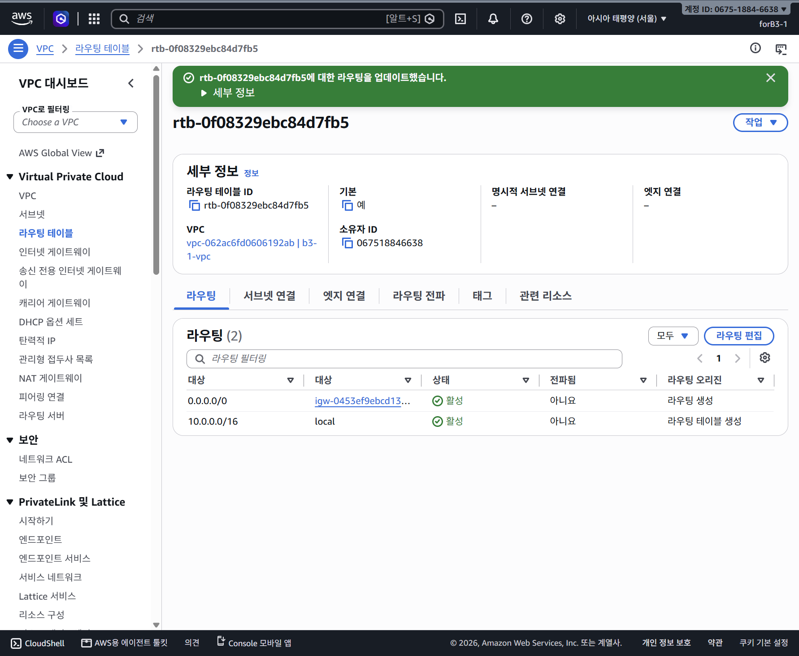

# 구성과 요구사항별 검증

[제출 README](../README.md) · [아키텍처](architecture.png)

## 네트워크 구성

| 구성 | 실습 값 | 역할 |
| --- | --- | --- |
| VPC | `vpc-062ac6fd0606192ab`, `10.0.0.0/16` | 실습 전용 네트워크 |
| Public Subnet | `subnet-08efa9b32e083838b`, `10.0.1.0/24` | 서울 `ap-northeast-2a`의 EC2 배치 영역 |
| IGW | `igw-0453ef9ebcd131aad` | VPC의 인터넷 연결 |
| Route Table | `rtb-0f08329ebc84d7fb5` | local 경로와 `0.0.0.0/0 → IGW` |
| EC2 | `i-05d34639a30bbfb6a` | Amazon Linux 2023·t3.micro·Nginx |
| 웹 SG | `sg-0c4336bb1e71eea36` | 필요한 인바운드 포트만 허용 |

Public Subnet이라는 이름만 붙인 것이 아니라 실제 적용 라우팅 테이블에 IGW 기본 경로가 있음을 확인했습니다. 기본 테이블의 암시적 서브넷 연결을 사용했으며, 존재하지 않는 명시적 연결을 새로 만들었다고 기록하지 않습니다.

## 인스턴스·SSH·웹 서버

1. Public Subnet에 EC2 한 대를 생성하고 자동 할당 공인 IPv4 `13.125.99.141`을 확인했습니다.
2. Windows OpenSSH와 개인키로 `ec2-user` 로그인에 성공했습니다.
3. Nginx를 설치하고 `sudo systemctl enable --now nginx`로 실행·자동 시작을 등록했습니다.
4. EC2에서 `curl -i http://localhost`로 일반 GET의 HTTP 200과 HTML 본문을 확인했습니다.
5. EC2에서 `curl -I --max-time 15 https://example.com`으로 인터넷 아웃바운드 HTTP/2 200을 확인했습니다.
6. 외부 PC 브라우저의 퍼블릭 IP HTTP 접속으로 Nginx 페이지를 확인했습니다.

- [EC2 생성 성공](captures/0145-ec2-launch-success.png)
- [OpenSSH 로그인 성공](captures/0149-ssh-login-success-known-hosts-warning.png)
- [localhost GET 200](captures/0202-nginx-localhost-get-200.png)
- [아웃바운드 응답 200](captures/0194-ec2-outbound-https-200.png)
- [외부 브라우저 응답](captures/0193-nginx-external-http-success.png)

SSH 성공 화면의 별도 known_hosts 쓰기 권한 경고를 로그인 실패와 혼동하지 않습니다. 최종 접속은 로컬 OpenSSH이며 브라우저 Instance Connect 성공을 제출 근거로 삼지 않습니다.

## 접근 제어

| 인바운드 | 출발지 | 적용 목적 |
| --- | --- | --- |
| TCP 80 | `0.0.0.0/0` | 공개 HTTP 서비스 |
| TCP 22 | 학습자 공인 IPv4 `/32` | 개인 관리 접속 |
| TCP 443 | `0.0.0.0/0` | 후속 HTTPS 보너스 |

전체 포트 0~65535를 인터넷에 공개하는 규칙은 사용하지 않았습니다. HTTP/HTTPS 공개와 SSH 전체 공개는 다릅니다. 최종 검증 시 Instance Connect 서비스 CIDR 규칙은 없었습니다.

## IAM과 Security Group의 구분

실습 IAM 사용자 `forB3-1`에는 `B3Ec2SeoulLabPolicy`를 연결했습니다. 생성·조회·태그·연결·정리 등 EC2/VPC 실습 작업을 중심으로 제한했으며 과제 사용자에게 AdministratorAccess를 새로 부여하지 않았습니다.

[사용자에 연결된 실습 정책 증빙](captures/0173-forB3-attached-policy-before-review.png)

IAM은 누가 AWS API 작업을 할 수 있는지, Security Group은 서버에 어떤 네트워크 연결을 허용할지 제어합니다. 두 경계를 별도로 확인했습니다. 권한 오류는 실제 거부된 API와 필요한 범위를 확인해 보완했습니다.

[배포 검증 당시 정책 사본(v3)](policies/deployment-policy-v3.json) · [당시 v3 기본 버전 증빙](captures/0185-iam-policy-v3-default.png). 이 사본은 배포 단계의 범위를 보여주는 자료이며 이후 정리용 조회 보완까지 포함한 최신 export라는 뜻은 아닙니다.
